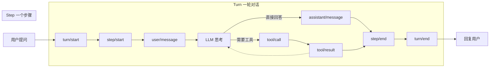

# DeepSeek Harness 从 0 开始：Session 模块（事件日志）

> 本系列从 0 开始，基于 Cordis 框架一步步实现一个简略版本的 DeepSeek Harness（loop、session、tool、system prompt 等）。上一篇我们学会了事件系统（五种派发模式 + 洋葱模型），这一篇开始实现第一个真正的核心模块：**Session**——Agent 的「记忆」。
>
> 配套代码：[blog-04-session](./)，运行 `pnpm install && pnpm dev` 即可复现本文全部输出。

## 上一篇留下的问题

事件系统让模块之间能松耦合地通信，但还缺一块：**Agent 说了什么、做了什么、调了什么工具，这些历史记录存在哪？**

想想 Agent 的基本需求：

- **上下文**：LLM 是无状态的，每次调用都要把整个对话历史发给它；
- **审计**：出了 bug，要能回看「这一步模型为什么这么回答」；
- **调试**：想看看「如果当时不走这条路会怎样」；
- **一致性**：用户的消息、助手的回复、工具的结果，必须按顺序完整记录。

如果每个模块各自存各自的状态，历史会散落一地、无法对齐。我们需要一个**统一的、按时间顺序的、只追加不修改**的记录——这就是 **Session（事件日志）**。

## 项目目录结构

```
blog-04-session/
├── package.json          # 项目配置：依赖、启动脚本
├── pnpm-lock.yaml        # 依赖锁定文件
├── src/
    └── main.ts           # 代码入口，pnpm dev 运行它
```

## 核心概念

| 概念 | 一句话理解 |
| --- | --- |
| **Session** | 一个会话，持有 append-only 的事件数组（只追加、不修改、不删除） |
| **SessionEvent** | 事件类型联合：turn/step/用户消息/助手消息/工具调用等 |
| **Surface（消息表面）** | 从事件流「投影」出的有序消息视图（OpenAI 格式），给 LLM 看的那层 |
| **Fork** | 从历史某个索引处分叉出一个新会话（时间旅行 / A/B 测试） |

## Part 1：Session 基础——事件日志系统

### 第一步：事件类型定义

先看整个 Agent Loop 的流程——9 种事件串起来就是一次完整交互，事件日志记录循环的每一次心跳：



Agent 的每一步都是一种事件。用 TypeScript 联合类型把它们全部定义出来（**每个事件带 `seq` 单调序列号**，这是可精确重放的基础，dsh 的做法）：

```ts
type SessionEvent =
  | { type: 'turn/start'; seq: number; turnId: string; timestamp: number }                    // 一轮对话开始
  | { type: 'turn/end'; seq: number; turnId: string; timestamp: number }                      // 一轮对话结束
  | { type: 'step/start'; seq: number; stepId: string; turnId: string; timestamp: number }    // 一个步骤开始
  | { type: 'step/end'; seq: number; stepId: string; turnId: string; timestamp: number }      // 一个步骤结束
  | { type: 'user/message'; seq: number; content: string; timestamp: number }                 // 用户消息
  | { type: 'assistant/message'; seq: number; content: string; timestamp: number }            // 助手消息
  | { type: 'assistant/chunk'; seq: number; delta: string; timestamp: number }                // 流式输出增量
  | { type: 'tool/call'; seq: number; id: string; name: string; args: Record<string, unknown>; timestamp: number }  // 工具调用
  | { type: 'tool/result'; seq: number; id: string; result: unknown; error?: string; timestamp: number }           // 工具结果

// 调用方追加事件时不需要自己填 seq，由 SessionService.append 自动分配
type SessionEventInput = SessionEvent extends infer E ? Omit<E, 'seq'> : never

// 会话结构：id + 事件数组 + 时间戳
interface Session {
  id: string
  events: SessionEvent[]
  createdAt: number
  updatedAt: number
}
```

**注意事件里都带 `seq` 和 `timestamp`**——`seq` 是会话内单调递增的序列号（0, 1, 2, …），用来精确重放和校验连续性；`timestamp` 是审计的时间基准。事件类型覆盖了 Agent 交互的完整生命周期：turn（一轮对话）→ step（一个步骤）→ message / tool（具体动作）。

从上图可以看到事件与 Loop 的对应关系：

- **`turn/start` / `turn/end`**：一轮对话的边界——用户提问到助手最终回复；
- **`step/start` / `step/end`**：一个步骤的边界——LLM 从思考到产出；
- **`user/message`**：用户本轮输入；
- **`assistant/message`**：助手产出（直接回答，或最后总结）；
- **`tool/call` → `tool/result`**：工具调用往返——虚线箭头表示**结果回到 LLM 再思考**，可能触发下一个 step（一轮 turn 内多次工具调用）；
- **`assistant/chunk`**：流式输出时的增量片段（图中未画出，穿插在 assistant 产出过程中）。

所以一轮对话可能包含多个 step（多次工具调用循环），而事件日志把整条链完整记下来——**这就是后面 Agent Loop 模块要驱动的流程，Session 负责把它变成可审计的历史。**

### 第二步：类型扩展

给 Cordis 的 Context 加上 `sessions` 服务，并声明一个广播事件：

```ts
// 扩展 Cordis 类型
declare module '@cordisjs/core' {
  // 声明事件：每次追加事件都广播给监听者
  interface Events {
    'session/event': (sessionId: string, event: SessionEvent) => void
  }

  // 声明服务：ctx.sessions 可用
  interface Context {
    sessions: SessionService
  }
}
```

这里用了上一篇学到的两样东西：**declare module 类型扩展**（依赖注入篇）+ **事件声明**（事件系统篇）。后续博客里我们会看到 harness 的 `ctx.tools`、`ctx.llm` 都是这么挂上去的。

### 第三步：SessionService 实现

```ts
class SessionService extends Service {
  private sessions = new Map<string, Session>()
  private counter = 0  // 自增计数器，用于生成唯一 ID（与 dsh 内存版一致）

  constructor(ctx: Context) {
    super(ctx, 'sessions')
  }

  // 生成唯一会话 ID：自增 session-<n>
  // （dsh 内存版 SessionStore 的做法；真实持久化版用 randomUUID）
  private mintId(): string {
    return `session-${++this.counter}`
  }

  // 创建新会话（id 缺省时自动生成）
  create(id?: string): Session {
    const sessionId = id ?? this.mintId()
    const session: Session = {
      id: sessionId,
      events: [],
      createdAt: Date.now(),
      updatedAt: Date.now(),
    }
    this.sessions.set(sessionId, session)
    console.log(`  📁 创建会话: ${sessionId}`)
    return session
  }

  // 获取会话
  get(id: string): Session | undefined {
    return this.sessions.get(id)
  }

  // 追加事件：自动分配 seq + push + 更新 updatedAt + 广播
  append(sessionId: string, input: SessionEventInput): void {
    const session = this.sessions.get(sessionId)
    if (!session) {
      throw new Error(`Session ${sessionId} not found`)
    }

    // 自动分配 seq：等于当前事件数（从 0 开始，连续递增）
    const event: SessionEvent = { seq: session.events.length, ...input }
    session.events.push(event)   // 只追加，不修改已有事件
    session.updatedAt = Date.now()

    // 广播事件：所有关心的人都能听到
    this.ctx.emit('session/event', sessionId, event)
  }

  // 从指定索引开始获取事件（默认从头）
  getEvents(sessionId: string, fromIndex = 0): SessionEvent[] {
    const session = this.sessions.get(sessionId)
    return session ? session.events.slice(fromIndex) : []
  }

  // Fork：从历史某个索引处分叉出新会话
  fork(sourceId: string, fromIndex: number, newId?: string): Session {
    const source = this.sessions.get(sourceId)
    if (!source) {
      throw new Error(`Session ${sourceId} not found`)
    }

    const sessionId = newId ?? this.mintId()
    const newSession: Session = {
      id: sessionId,
      events: source.events.slice(0, fromIndex),  // 复制前 fromIndex 个事件
      createdAt: Date.now(),
      updatedAt: Date.now(),
    }

    this.sessions.set(sessionId, newSession)
    console.log(`  🍴 Fork 会话: ${sourceId} → ${sessionId} (从索引 ${fromIndex})`)
    return newSession
  }

  // 列出所有会话
  list(): Session[] {
    return Array.from(this.sessions.values())
  }
}
```

#### Session 存在哪里？

看这一行：

```ts
class SessionService extends Service {
  private sessions = new Map<string, Session>()  // ← Session 就存在这个 Map 里
```

**当前实现：存在进程内存里**。`sessions` 是一个 `Map<会话ID, Session>`，所有 create / append / fork 都读写这个 Map。它的特点：

| 特性 | 说明 |
| --- | --- |
| 速度 | 最快——纯内存读写，无 IO |
| 生命周期 | **进程结束即丢失**（程序退出，Map 清空，所有会话消失） |
| 适用场景 | 演示、单进程、不需要重启后保留历史的场景 |

**真实 Harness 会怎么做？** 把存储层抽出来，接数据库（SQLite / Redis / Postgres）：

```ts
// 真实项目的思路：存储层可替换
interface SessionStore {
  create(session: Session): Promise<void>
  get(id: string): Promise<Session | undefined>
  append(id: string, event: SessionEvent): Promise<void>
  // ...
}

// 内存实现（当前演示用）
class MemorySessionStore implements SessionStore {
  private sessions = new Map<string, Session>()
  // ...
}

// 数据库实现（真实用）
class SqliteSessionStore implements SessionStore {
  // 每次操作都写入磁盘，进程重启后数据还在
  // ...
}
```

这样 `SessionService` 只依赖 `SessionStore` 接口，换成内存版还是数据库版，业务代码不用改——这就是依赖注入篇讲的「接口与实现分离」。

#### Session 的唯一 ID 怎么来的？

看 `create()` 里的 `mintId()`：

```ts
// 自增计数器，用于生成唯一 ID
private counter = 0

private mintId(): string {
  return `session-${++this.counter}`
}
```

**这是 dsh 内存版 SessionStore 的真实做法**——`prepare()` 里就是：

```ts
// dsh 源码（packages/core/session/src/index.ts）
do sessionId = SessionId(`session-${++this.counter}`)
while (this.store.has(sessionId))  // 撞了就再 +1，保证唯一
```

自增 ID 的好处：**绝对唯一、顺序可读**（session-1, session-2, …），且 `while` 循环兜底——万一用户手动传了已存在的 ID，会跳过继续递增，而不是像 `Map.set` 那样静默覆盖。

**真实持久化版用什么？** dsh 的 SQLite 后端用 `randomUUID()`（`node:crypto`）：

```ts
import { randomUUID } from 'node:crypto'
const sessionId = id ?? randomUUID()
// 例：'7f9c1e5b-8d3a-4f6c-9e2b-1a4d7c0f3e8a'
// 128 位随机，碰撞概率可忽略，还带版本信息
```

**为什么内存版用自增、持久化版用 UUID？** 因为内存版是单进程内的 Map，自增天然唯一；而持久化版要跨进程、跨重启存活，随机 UUID 不依赖任何中心计数器，分布式下也不会撞。**原则：ID 要么由存储保证唯一（自增 + 检查），要么全局随机（UUID）。**

**append-only 的含义**：`append()` 只做 `push`，从不修改、删除已有事件。这保证了历史记录的**不可变性**——事件一旦写入，永远不变，这是可重放、可审计的前提。而 `seq` 从 0 连续递增，让「完整」有了可验证的标准：重放时发现 seq 跳号，就知道日志损坏了。

**`this.ctx.emit('session/event', ...)`** 把事件系统用上了：每次追加都广播，Tools 模块、Agent Loop、日志插件各自监听，互不干扰。

### 第四步：模拟一段完整对话

```ts
let ctx = new Context()
// ctx.plugin() 是异步的，需要 await 等待服务激活
await ctx.plugin(SessionService)

// 监听事件广播
ctx.on('session/event', (sessionId, event) => {
  console.log(`  [${sessionId}] ${event.type}`)
})

// 创建会话
const session = ctx.sessions.create()

// Turn 1: 用户问问题
ctx.sessions.append(session.id, { type: 'turn/start', turnId: 'turn-1', timestamp: Date.now() })
ctx.sessions.append(session.id, { type: 'step/start', stepId: 'step-1', turnId: 'turn-1', timestamp: Date.now() })
ctx.sessions.append(session.id, { type: 'user/message', content: 'Hello!', timestamp: Date.now() })
ctx.sessions.append(session.id, { type: 'assistant/message', content: 'Hi! How can I help you?', timestamp: Date.now() })
ctx.sessions.append(session.id, { type: 'step/end', stepId: 'step-1', timestamp: Date.now() })
ctx.sessions.append(session.id, { type: 'turn/end', turnId: 'turn-1', timestamp: Date.now() })

// Turn 2: 使用工具（2 + 2 = 4）
ctx.sessions.append(session.id, { type: 'turn/start', turnId: 'turn-2', timestamp: Date.now() })
ctx.sessions.append(session.id, { type: 'step/start', stepId: 'step-2', turnId: 'turn-2', timestamp: Date.now() })
ctx.sessions.append(session.id, { type: 'user/message', content: 'What is 2 + 2?', timestamp: Date.now() })

// 助手决定调用工具
ctx.sessions.append(session.id, {
  type: 'tool/call',
  id: 'call-1',
  name: 'calculator',
  args: { a: 2, b: 2, op: 'add' },
  timestamp: Date.now(),
})

ctx.sessions.append(session.id, {
  type: 'tool/result',
  id: 'call-1',
  result: 4,
  timestamp: Date.now(),
})

ctx.sessions.append(session.id, { type: 'step/end', stepId: 'step-2', timestamp: Date.now() })

// Step 3: 总结结果
ctx.sessions.append(session.id, { type: 'step/start', stepId: 'step-3', turnId: 'turn-2', timestamp: Date.now() })
ctx.sessions.append(session.id, { type: 'assistant/message', content: 'The answer is 4.', timestamp: Date.now() })
ctx.sessions.append(session.id, { type: 'step/end', stepId: 'step-3', timestamp: Date.now() })
ctx.sessions.append(session.id, { type: 'turn/end', turnId: 'turn-2', timestamp: Date.now() })
```

运行输出（ID 为自增 `session-1` / `session-2`，每次运行一致）：

```
👂 设置事件监听...

📁 创建会话...
  📁 创建会话: session-1

💬 模拟对话...
  [session-1] turn/start
  [session-1] step/start
  [session-1] user/message
  [session-1] assistant/message
  [session-1] step/end
  [session-1] turn/end
  [session-1] turn/start
  [session-1] step/start
  [session-1] user/message
  [session-1] tool/call
  [session-1] tool/result
  [session-1] step/end
  [session-1] step/start
  [session-1] assistant/message
  [session-1] step/end
  [session-1] turn/end
```

注意事件流是**完整且有序**的：turn/step 的边界、用户消息、助手消息、工具调用与结果，一条不落。事件监听器收到广播并打印——这就是「事件系统」和「Session」的第一次协作。

### 会话统计

```ts
// 查看会话统计
const events = ctx.sessions.getEvents(session.id)
console.log(`  总事件数: ${events.length}`)

// 按事件类型计数
const eventTypes = events.reduce((acc, e) => {
  acc[e.type] = (acc[e.type] || 0) + 1
  return acc
}, {} as Record<string, number>)

for (const [type, count] of Object.entries(eventTypes)) {
  console.log(`  ${type}: ${count}`)
}
```

运行输出：

```
📊 会话统计:
  总事件数: 16
  turn/start: 2
  step/start: 3
  user/message: 2
  assistant/message: 2
  step/end: 3
  turn/end: 2
  tool/call: 1
  tool/result: 1
```

16 个事件完整描述了 2 轮对话、3 个步骤、2 条用户消息、2 条助手消息、1 次工具调用。**整个 Agent 的行为都在这条事件流里。**

## Part 2：Surface（消息表面）——从事件流投影模型消息

事件流很完整，但 LLM 看不懂 `turn/start`、`step/end`——模型要的是 **OpenAI 格式的消息数组**（`user` / `assistant` / `tool` 三种角色）。从事件流「投影」出这个消息数组的过程，dsh 称之为 **Surface（有序消息表面）**——事件是底层事实，Surface 是给 LLM 看的那个视图：

```ts
// 消息类型（OpenAI 格式）——Surface 上的节点
interface Message {
  role: 'user' | 'assistant' | 'tool'
  content: string | null
  // 助手发起工具调用：content 为 null，带 tool_calls
  tool_calls?: Array<{
    id: string
    type: 'function'
    function: { name: string; arguments: string }
  }>
  // 工具结果：对应 tool_call_id
  tool_call_id?: string
}

// 从事件流投影 Surface（把完整事件「翻译」成模型能理解的消息）
function projectSurface(events: SessionEvent[]): Message[] {
  const messages: Message[] = []

  for (const event of events) {
    switch (event.type) {
      // 用户消息 → role: user
      case 'user/message':
        messages.push({ role: 'user', content: event.content })
        break

      // 助手消息 → role: assistant
      case 'assistant/message':
        messages.push({ role: 'assistant', content: event.content })
        break

      // 工具调用 → role: assistant + tool_calls（content 为 null）
      case 'tool/call':
        messages.push({
          role: 'assistant',
          content: null,
          tool_calls: [{
            id: event.id,
            type: 'function',
            function: {
              name: event.name,
              arguments: JSON.stringify(event.args),
            },
          }],
        })
        break

      // 工具结果 → role: tool，用 tool_call_id 关联
      case 'tool/result':
        messages.push({
          role: 'tool',
          tool_call_id: event.id,
          content: event.error ?? JSON.stringify(event.result),
        })
        break

      // 其他元事件（turn/step 等）直接忽略——模型不需要知道
    }
  }

  return messages
}

// 演示 Surface 投影
const messages = projectSurface(events)
```

运行输出：

```
🔄 投影 Surface...

📋 Surface 上的消息:
  [user] Hello!
  [assistant] Hi! How can I help you?
  [user] What is 2 + 2?
  [assistant] 工具调用: calculator
  [tool] 工具结果: 4
  [assistant] The answer is 4.

📊 事件 vs Surface:
  事件数: 16（包含 turn/step 等元事件）
  消息数: 6（只包含 user/assistant/tool 消息）
```

**16 个事件 → 6 条消息**。投影时做了两件关键的事：

1. **过滤**：`turn/start`、`step/end` 这类元事件被忽略——它们是给审计/调试用的，模型不需要；
2. **转换**：`tool/call` 变成 `role: 'assistant'` + `tool_calls`，`tool/result` 变成 `role: 'tool'` + `tool_call_id`——正好是 OpenAI 函数调用的消息格式。

这就是「**事件是完整事实，Surface 是模型视图**」——同一个 Session，投影给 LLM 的是精简消息，审计时看的是完整事件流。

> 💡 dsh 的 Surface 更完整：`user/message`、`assistant/message`、`tool/result` 三种事件会携带 `surfaceOp`（`'append'` 追加 / `{ op: 'replace', start, end }` 替换区间）和 `sourceEventSeqs`（这条消息由哪些事件产生）。**replace 语义是为压缩（compaction）准备的**——压缩后用一条汇总消息替换掉区间内的旧消息，Surface 始终保持有序。我们这里先实现最简单的 append 投影，后续讲压缩时再补 replace。

## Part 3：高级功能——Fork、重放、审计

### Fork：从任意时间点分叉

```ts
// Fork 会话：从索引 6 分叉（即 Turn 1 结束的位置）
const forked = ctx.sessions.fork(session.id, 6)
console.log(`  新会话 ID: ${forked.id}`)
console.log(`  新会话事件数: ${forked.events.length}`)
```

运行输出：

```
🍴 Fork 会话演示...
  🍴 Fork 会话: session-1 → session-2 (从索引 6)
  新会话 ID: session-2
  新会话事件数: 6
```

**Fork = 时间旅行**。从索引 6（Turn 1 结束时）分叉出一个新会话，新会话只包含前 6 个事件——相当于「回到 Turn 1 结束时，换一条路重新走」。这是 A/B 测试的基石：同一个起点，让 Agent 尝试不同策略，对比结果。

### 重放：回放历史事件

```ts
// 重放前 6 个事件
console.log('  重放前 6 个事件:')
for (let i = 0; i < Math.min(6, forked.events.length); i++) {
  const event = forked.events[i]
  console.log(`    ${i + 1}. ${event.type}`)
}
```

运行输出：

```
🔄 事件重放演示...
  重放前 6 个事件:
    1. turn/start
    2. step/start
    3. user/message
    4. assistant/message
    5. step/end
    6. turn/end
```

因为事件是不可变的、有序的，重放就是「从头读一遍」。调试时可以用重放完整复现 Agent 的思考过程——**看到的和当时发生的完全一致**。

### 审计：追踪和分析

```ts
// 会话审计
console.log(`  会话 ID: ${session.id}`)
console.log(`  创建时间: ${new Date(session.createdAt).toISOString()}`)
console.log(`  最后更新: ${new Date(session.updatedAt).toISOString()}`)
console.log(`  总事件数: ${session.events.length}`)

const userMessages = session.events.filter(e => e.type === 'user/message')
const toolCalls = session.events.filter(e => e.type === 'tool/call')
console.log(`  用户消息: ${userMessages.length}`)
console.log(`  工具调用: ${toolCalls.length}`)
```

运行输出：

```
🔍 会话审计...
  会话 ID: session-1
  创建时间: 2026-08-19T13:43:17.274Z
  最后更新: 2026-08-19T13:43:17.275Z
  总事件数: 16
  用户消息: 2
  工具调用: 1
```

审计 = 从完整事件流里**按需统计**。想要什么指标，filter 一下就有：调了多少次工具、用户问了几次、哪一步最耗时……事件日志是原始数据，分析是灵活的。

## 常见问题 FAQ

**Q: Session 存在哪里？进程重启会丢吗？**

A: 当前演示实现里存在**进程内存**（`private sessions = new Map<string, Session>()`），进程退出即清空。真实 Harness 会把存储抽成 `SessionStore` 接口，接数据库（SQLite/Redis/Postgres）持久化——SessionService 只依赖接口，换存储实现不影响业务代码。

**Q: Session 的唯一 ID 怎么生成？会不会撞？**

A: 演示（内存版）用自增 `session-${++counter}`——与 dsh 内存版 SessionStore 一致，`while (store.has(id))` 兜底保证唯一。真实持久化版用 `randomUUID()`（128 位随机，跨进程/重启不撞）。**原则：内存版靠自增 + 检查，持久化版靠全局随机。**

**Q: 事件里的 `seq` 是干什么的？**

A: `seq` 是会话内从 0 开始连续递增的单调序列号，由 `append()` 自动分配。它是「完整」的可验证标准：重放时 seq 必须连续无跳号，跳号说明日志损坏；持久化时也能用 seq 做增量读取（只取 seq ≥ N 的部分）。dsh 的 `readFrom(id, fromSeq)` 就是这个用法的直接体现。

**Q: 为什么用事件日志而不是直接存消息数组？**

A: 因为事件比消息**信息更全**。消息数组只有 user/assistant/tool 三种角色，丢了 turn/step 的边界、时间戳、工具参数细节；而事件流是「完整事实」，可以投影出 Surface、可以重放、可以审计、可以 fork。**先存全量事实，需要什么视图再投影什么视图**——这是事件溯源（Event Sourcing）的核心思想。

**Q: `turn` 和 `step` 有什么区别？**

A: `turn` 是「一轮对话」——从用户发消息到助手最终回复完成；`step` 是「一个步骤」——一轮对话里助手可能多次调用工具，每次调用是一个 step（LLM 思考 → 调工具 → 看结果 → 再思考）。一轮 turn 包含多个 step。

**Q: `tool/call` 为什么投影为 `role: 'assistant'` 而不是 `role: 'tool'`？**

A: 因为这是 OpenAI 的协议约定：**工具调用是助手发起的**，所以 `tool_calls` 挂在 assistant 消息上；而工具的执行结果由 `role: 'tool'` + `tool_call_id` 回填。模型读历史时，看到「助手说要调 calculator → 工具返回 4」才能理解上下文。这是 LLM 函数调用格式的硬性要求。

**Q: Fork 有什么用？**

A: 三个典型场景：**A/B 测试**（同一起点试不同策略）、**调试**（回到出错前重走）、**「撤销」**（用户说「重新回答」，fork 到上一个回答前再问一次）。实现上只需要 `slice` 复制前 N 个事件——因为事件不可变，fork 永远安全。

**Q: Session 和 上一篇的事件系统什么关系？**

A: 互补的两层。事件系统（`ctx.on` / `ctx.emit`）是**通信机制**——模块之间怎么通知；Session 是**存储机制**——通知的内容怎么记下来。`SessionService.append()` 内部就用 `ctx.emit('session/event', ...)` 广播，把两者接起来了：**写入日志的同时通知世界**。

## 小结

1. **Session = append-only 事件日志**：事件只追加不修改，每个事件带 `seq` 单调序列号 + `timestamp`，完整记录 Agent 的每一步（turn/step/消息/工具）；
2. **唯一 ID**：内存版自增 `session-<n>`（dsh 内存版做法），持久化版 `randomUUID()`；
3. **Surface（消息表面）**：从事件流投影有序消息视图——16 个事件 → 6 条 OpenAI 消息，过滤元事件 + 转换工具调用格式；
4. **Fork / 重放 / 审计**：不可变事件流带来的三种超能力——时间旅行、完整复现、灵活统计；
5. **事件溯源思想**：先存全量事实，按需投影视图——Session 是 Agent 的「记忆」，也是后续 Tools、LLM、Loop 模块的数据底座。

**下一篇预告**：Tools 模块——工具如何注册、JSON Schema 如何生成、工具执行管道怎么设计？

---

*本文代码已验证可运行（Node.js + tsx，@cordisjs/core v4.0.0-beta.5）。完整源码见同目录 `src/main.ts`。*
