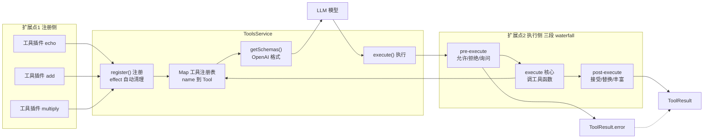

# DeepSeek Harness 从 0 开始：Tools 模块（工具注册与执行）

> 本系列从 0 开始，基于 Cordis 框架一步步实现一个简略版本的 DeepSeek Harness（loop、session、tool、system prompt 等）。上一篇我们实现了 Session——Agent 的「记忆」，这一篇实现 Agent 的「手」：**Tools 模块**——模型怎么调用真实世界的工具。
>
> 配套代码：[blog-05-tools](./)，运行 `pnpm install && pnpm dev` 即可复现本文全部输出。

## 上一篇留下的问题

Session 记录下了 Agent 的每一步，但**模型只能输出文字**——它没法真的去查数据库、读文件、执行命令。于是有个关键设计：

```
LLM 不直接执行操作，而是「声明想调用哪个工具 + 参数」
→ Agent 框架拿到这个声明，真正去执行
→ 把结果作为 tool/result 事件写进 Session
→ 再把结果喂回给 LLM 继续推理
```

这正是上一篇 Session 事件里 `tool/call` → `tool/result` 的来源。而**执行工具这件事，需要一个统一的模块来管**：工具怎么注册、模型怎么知道有哪些工具（Schema）、执行时怎么拦截（权限/日志/验证）——这就是 **Tools 模块**。

## 项目目录结构

```
blog-05-tools/
├── package.json          # 项目配置：依赖、启动脚本
├── pnpm-lock.yaml        # 依赖锁定文件
└── src/
    └── main.ts           # 代码入口，pnpm dev 运行它
```

## 核心概念

| 概念 | 一句话理解 |
| --- | --- |
| **Tool** | 一个工具：描述 + 参数 Schema + `execute()` 执行函数 |
| **defineTool()** | 参数 schema 写在工具定义上（声明式 spec），自动生成 JSON Schema + 执行前校验 |
| **register()** | 注册工具（接收完整定义），用 `ctx.effect()` 保证卸载时自动清理 |
| **自动注入** | 声明工具插件清单（含 enabled 开关），批量自动 `ctx.plugin()`，不用手动一个个装 |
| **执行管道** | 三段 waterfall：pre-execute → execute → post-execute，每段都能插中间件 |

## Part 1：Tools 基础——工具注册与管理

### 第一步：类型定义

一个工具由三部分组成：**描述**（给 LLM 看）、**参数 Schema**（告诉 LLM 参数长什么样）、**execute 函数**（真正干活）：

```ts
// 一个工具：描述 + 参数 Schema + 执行函数
interface Tool {
  description: string
  parameters: {
    type: 'object'
    properties: Record<string, JSONSchema>
    required?: string[]
  }
  execute: (args: Record<string, unknown>) => Promise<unknown>
}

// JSON Schema 的简化版（type + 描述 + 枚举）
interface JSONSchema {
  type: string
  description?: string
  enum?: string[]
}

// 模型发出的「工具调用」声明
interface ToolCall {
  id: string
  name: string
  args: Record<string, unknown>
}

// 工具执行结果
interface ToolResult {
  id: string
  result?: unknown
  error?: string
}

// OpenAI 函数调用格式（发给模型用的 schema 外形）
interface OpenAITool {
  type: 'function'
  function: {
    name: string
    description: string
    parameters: any
  }
}
```

### 第二步：类型扩展

```ts
// 扩展 Cordis 类型：声明工具管道事件 + ctx.tools 服务
declare module '@cordisjs/core' {
  interface Events {
    // 工具管道：三段 waterfall（与 dsh 一致，洋葱模型）
    'tools/pre-execute': (call: ToolCall, next: () => Promise<string>) => Promise<string>  // 允许/拒绝/询问
    'tools/execute': (call: ToolCall, next: () => Promise<ToolResult>) => Promise<ToolResult>  // 执行（可包装）
    'tools/post-execute': (call: ToolCall, result: ToolResult, next: () => Promise<ToolResult>) => Promise<ToolResult>  // 接受/替换/丰富
  }

  interface Context {
    tools: ToolsService
  }
}
```

注意这三个事件是 **waterfall** 模式——这是上一篇洋葱模型的实际应用，Part 4 会展开讲。

### 第三步：ToolsService 实现

先看 ToolsService 的完整结构——它管理「工具注册表」（怎么存）和「执行管道」（怎么跑），两侧都开放扩展：



流程说明（箭头上的语义在正文里，不在图上）：`getSchemas()` 把注册表生成 OpenAI 格式发给 LLM（tools 字段），LLM 回 `tool/call` 进入 `execute()`；pre-execute 返回 `allow` 才进核心执行（`deny` 则短路到 error）；核心从注册表取出工具函数执行；post-execute 逐层包装结果。

图上三条线对应 ToolsService 的三个职责：

- **注册侧（左侧）**：工具插件通过 `register()` 把定义存进 `Map`——扩展新工具 = 新增插件，不动 ToolsService；
- **Schema 侧（上方）**：`getSchemas()` 从注册表生成 OpenAI 格式，发给模型——模型据此知道有哪些工具；
- **执行侧（下方）**：`execute()` 走三段 waterfall 管道（pre → 核心 → post）——扩展拦截逻辑 = 挂监听器，不动 ToolsService。

```ts
class ToolsService extends Service {
  private tools = new Map<string, Tool>()

  constructor(ctx: Context) {
    super(ctx, 'tools')
  }

  // 注册工具（接收完整定义，用 effect 实现自动清理）
  // 与 dsh 的 register(definition) 一致：name 在定义里
  register(definition: ToolDefinition) {
    const name = definition.name
    return this.ctx.effect(() => {
      this.tools.set(name, definition)
      console.log(`  🔧 注册工具: ${name}`)
      return () => {
        this.tools.delete(name)
        console.log(`  🗑️  移除工具: ${name}`)
      }
    })
  }

  // 获取工具
  get(name: string): Tool | undefined {
    return this.tools.get(name)
  }

  // 列出所有工具
  list(): string[] {
    return Array.from(this.tools.keys())
  }

  // 生成 OpenAI 格式的 schemas（给模型看有哪些工具可用）
  getSchemas(): OpenAITool[] {
    return Array.from(this.tools.entries()).map(([name, tool]) => ({
      type: 'function',
      function: {
        name,
        description: tool.description,
        parameters: tool.parameters,
      },
    }))
  }

  // 执行工具（三段 waterfall 管道，Part 4 详解）
  async execute(call: ToolCall): Promise<ToolResult> {
    try {
      // 1. pre-execute：允许/拒绝/询问（洋葱最外层）
      const decision = await this.ctx.waterfall('tools/pre-execute', call, async () => 'allow')
      if (decision !== 'allow') {
        return { id: call.id, error: `工具被拒绝: ${decision}` }
      }

      // 2. execute：核心执行（可被包装：超时、重试、指标）
      const result = await this.ctx.waterfall('tools/execute', call, async () => {
        const tool = this.tools.get(call.name)
        if (!tool) {
          throw new Error(`Tool ${call.name} not found`)
        }
        const value = await tool.execute(call.args)
        return { id: call.id, result: value }
      })

      // 3. post-execute：接受/替换/丰富结果
      return await this.ctx.waterfall('tools/post-execute', call, result, async () => result)
    } catch (error: any) {
      return { id: call.id, error: error.message }
    }
  }
}
```

关键点：

- **`super(ctx, 'tools')`**：Cordis v4 的 Service 构造函数只有两个参数（第三参数是 v3 遗留，已被忽略）；
- **`register(definition)` 接收完整定义**：name 在定义里（与 dsh 一致），注册和清理用 `ctx.effect()` 写在一起——插件卸载时工具自动移除，不会留下「幽灵工具」；
- **`execute()` 的错误处理**：任何阶段抛错都被捕获，统一转成 `ToolResult.error`，绝不把异常抛给调用方。

### 第四步：通过插件自动注入工具

**真实 dsh 里，工具不是直接 `ctx.tools.register()` 出来的，而是「工具插件」**——每个工具是一个插件，插件 `apply` 时注册自己。而且参数 schema **写在工具定义上**（用 `defineTool()` 声明式 spec，自动生成 JSON Schema + 执行前校验），不是手写 JSON 字面量（dsh 用 schemastery 做类型推导，这里用简化实现展示同样思路）。

#### defineTool：schema 写在工具上

```ts
// 参数 spec：声明式描述，挂在工具定义上（不用手写完整 JSON Schema）
interface ParameterSpec {
  type: string
  description?: string
  required?: boolean
}

// 工具定义：name 也在定义里（与 dsh 的 ToolDefinition 一致）
interface ToolDefinition {
  name: string
  description: string
  parameters: {
    type: 'object'
    properties: Record<string, JSONSchema>
    required?: string[]
  }
  execute: (args: Record<string, unknown>) => Promise<unknown>
}

// defineTool：spec → JSON Schema + 包装 execute（执行前自动校验参数）
function defineTool(options: {
  name: string
  description: string
  parameters: Record<string, ParameterSpec>
  execute: (args: Record<string, unknown>) => Promise<unknown>
}): ToolDefinition {
  // 1. 从参数 spec 生成 JSON Schema
  const properties: Record<string, JSONSchema> = {}
  const required: string[] = []
  for (const [key, spec] of Object.entries(options.parameters)) {
    properties[key] = { type: spec.type, description: spec.description }
    if (spec.required) required.push(key)
  }
  const parameters = {
    type: 'object' as const,
    properties,
    ...(required.length > 0 ? { required } : {}),
  }

  // 2. 校验函数：执行前检查参数是否合法
  const validate = (args: Record<string, unknown>): string[] => {
    const violations: string[] = []
    for (const key of required) {
      if (args[key] === undefined) violations.push(`缺少必填参数: ${key}`)
    }
    for (const [key, spec] of Object.entries(properties)) {
      const value = args[key]
      if (value === undefined) continue
      if (spec.type === 'number' && typeof value !== 'number') violations.push(`参数 ${key} 必须是 number`)
      if (spec.type === 'string' && typeof value !== 'string') violations.push(`参数 ${key} 必须是 string`)
      if (spec.type === 'boolean' && typeof value !== 'boolean') violations.push(`参数 ${key} 必须是 boolean`)
    }
    return violations
  }

  return {
    name: options.name,
    description: options.description,
    parameters,
    // 3. 包装 execute：先校验，不合法直接抛错（dsh 抛 ToolArgsError）
    async execute(args) {
      const violations = validate(args)
      if (violations.length > 0) {
        throw new Error(`参数校验失败: ${violations.join('; ')}`)
      }
      return options.execute(args)
    },
  }
}
```

这样工具定义时就只写「参数名 + 类型 + 描述」，JSON Schema 和校验逻辑都由 `defineTool()` 生成——**schema 是写在工具上的，不是写死的**。

#### 工具插件：每个工具一个插件，用 defineTool 注册

```ts
// 工具插件：echo —— schema 写在工具定义上
// 声明依赖 'tools'：Cordis 保证 apply 执行时 ctx.tools 已就绪
function echoTool(ctx: Context) {
  ctx.tools.register(defineTool({
    name: 'echo',
    description: 'Echo back the input text',
    parameters: {
      text: { type: 'string', description: 'Text to echo', required: true },
    },
    async execute(args) {
      return `Echo: ${args.text}`
    },
  }))
}
echoTool.inject = ['tools']

// 工具插件：add
function addTool(ctx: Context) {
  ctx.tools.register(defineTool({
    name: 'add',
    description: 'Add two numbers',
    parameters: {
      a: { type: 'number', description: 'First number', required: true },
      b: { type: 'number', description: 'Second number', required: true },
    },
    async execute(args) {
      return (args.a as number) + (args.b as number)
    },
  }))
}
addTool.inject = ['tools']

// 工具插件：multiply
function multiplyTool(ctx: Context) {
  ctx.tools.register(defineTool({
    name: 'multiply',
    description: 'Multiply two numbers',
    parameters: {
      a: { type: 'number', description: 'First number', required: true },
      b: { type: 'number', description: 'Second number', required: true },
    },
    async execute(args) {
      return (args.a as number) * (args.b as number)
    },
  }))
}
multiplyTool.inject = ['tools']
```

#### 自动注入：声明清单，批量装载

不用手动一个个 `ctx.plugin()`——声明工具插件注册表，一个函数批量自动注入（dsh 的插件由 loader 按配置自动加载，这里是简化版：清单 + enabled 开关）：

```ts
// 工具插件注册表：声明有哪些工具插件、是否启用
const toolPluginRegistry = [
  { name: 'echo', enabled: true, plugin: echoTool },
  { name: 'add', enabled: true, plugin: addTool },
  { name: 'multiply', enabled: true, plugin: multiplyTool },
]

// 自动注入：遍历注册表，只加载 enabled 的插件
async function autoMountToolPlugins(ctx: Context) {
  for (const entry of toolPluginRegistry) {
    if (!entry.enabled) {
      console.log(`  ⏭️  跳过工具插件: ${entry.name} (disabled)`)
      continue
    }
    await ctx.plugin(entry.plugin)
  }
}

// 主程序：先启动 Tools 服务，再自动注入工具插件
let ctx = new Context()
await ctx.plugin(ToolsService)

console.log('\n📦 自动注入工具插件...')
await autoMountToolPlugins(ctx)

console.log(`  ✅ 已注册工具: ${ctx.tools.list().join(', ')}`)
```

**为什么要插件 + 自动注入，而不是直接 register？**

1. **依赖可声明**：`echoTool.inject = ['tools']` 声明「我需要 tools 服务」——Cordis 保证 `apply` 执行时 `ctx.tools` 已就绪（不声明直接访问会报 `cannot get property "tools" without inject`）；
2. **生命周期自动管理**：插件卸载时，它注册的工具通过 effect 自动移除——插件 A 卸载，A 的工具跟着消失；
3. **可组合、可复用**：每个工具独立成插件，像乐高一样拼装（装 bash 插件就有 bash 工具，装 web 插件就有搜索工具），这正是 dsh 的架构——工具按插件发布、按需加载；
4. **按配置开关**：`enabled: false` 的插件自动跳过——想临时禁用某个工具，改一行配置即可，不用动代码。

运行输出：

```
📦 自动注入工具插件...
  🔧 注册工具: echo
  🔧 注册工具: add
  🔧 注册工具: multiply
  ✅ 已注册工具: echo, add, multiply
```

## Part 2：Schema 生成——让 LLM 知道怎么调用

模型看不到你的 TypeScript 代码，它只知道**你告诉它的事**。Schema 就是「告诉模型：这个工具叫什么、干什么、参数怎么填」的说明书：

```ts
// 查看 schemas
const schemas = ctx.tools.getSchemas()
for (const schema of schemas) {
  console.log(`\n  工具: ${schema.function.name}`)
  console.log(`  描述: ${schema.function.description}`)
  console.log(`  参数: ${JSON.stringify(schema.function.parameters, null, 2)}`)
}
```

运行输出（以 add 为例，三个工具的格式一致）：

```
📋 工具 Schemas (OpenAI 格式):

  工具: echo
  描述: Echo back the input text
  参数: {
    "type": "object",
    "properties": {
      "text": {
        "type": "string",
        "description": "Text to echo"
      }
    },
    "required": [
      "text"
    ]
  }

  工具: add
  描述: Add two numbers
  参数: {
    "type": "object",
    "properties": {
      "a": {
        "type": "number",
        "description": "First number"
      },
      "b": {
        "type": "number",
        "description": "Second number"
      }
    },
    "required": [
      "a",
      "b"
    ]
  }

  工具: multiply
  描述: Multiply two numbers
  参数: {
    "type": "object",
    "properties": {
      "a": {
        "type": "number",
        "description": "First number"
      },
      "b": {
        "type": "number",
        "description": "Second number"
      }
    },
    "required": [
      "a",
      "b"
    ]
  }
```

**这就是 OpenAI 函数调用（function calling）格式**：`type: 'function'` + `function: { name, description, parameters }`。把这些 schema 拼进请求发给模型，模型就会在需要时返回「我想调用 `add`，参数 `{a: 10, b: 20}`」——也就是上一篇的 `tool/call` 事件。

## Part 3：执行工具

```ts
// 执行工具
const r1 = await ctx.tools.execute({
  id: '1',
  name: 'echo',
  args: { text: 'Hello, World!' },
})
console.log(`  echo 结果: ${r1.result}`)

const r2 = await ctx.tools.execute({
  id: '2',
  name: 'add',
  args: { a: 10, b: 20 },
})
console.log(`  add 结果: ${r2.result}`)

const r3 = await ctx.tools.execute({
  id: '3',
  name: 'multiply',
  args: { a: 5, b: 6 },
})
console.log(`  multiply 结果: ${r3.result}`)

// 错误处理：不存在的工具
const r4 = await ctx.tools.execute({
  id: '4',
  name: 'unknown',
  args: {},
})
console.log(`  unknown 结果: ${r4.error}`)
```

运行输出：

```
🚀 执行工具...
  echo 结果: Echo: Hello, World!
  add 结果: 30
  multiply 结果: 30

❌ 错误处理...
  unknown 结果: Tool unknown not found
```

执行接口统一：调用方只给 `{ id, name, args }`，拿到 `{ id, result | error }`。**工具不存在也不会抛异常**——错误被吞进 `ToolResult.error`，由调用方决定怎么处理。

## Part 4：执行管道——三段 waterfall

只执行工具太简单了。真实场景要拦截：**这个工具允许用吗？参数合法吗？结果要记日志吗？** 如果每个工具自己写这些逻辑，重复且容易漏。

dsh 的做法是把执行拆成三段 **waterfall 管道**（洋葱模型）：

```
pre-execute（允许/拒绝） → execute（执行） → post-execute（处理结果）
```

每段都可以挂多个监听器，层层包裹。这正是上一篇讲的洋葱模型 = AOP 的实际应用。

```ts
// 重新创建 Context
ctx = new Context()
await ctx.plugin(ToolsService)

// ── pre-execute: 权限检查（不调 next() = 短路拒绝）──
ctx.on('tools/pre-execute', async (call, next) => {
  console.log('  [pre-execute] 权限检查...')
  if (call.name === 'dangerous') {
    console.log('  [pre-execute] ❌ 拒绝执行危险工具')
    return 'deny'  // 不调 next()，直接短路，返回拒绝决策
  }
  console.log('  [pre-execute] ✅ 权限通过')
  return next()  // 委托给下一层
})

// ── pre-execute: 参数验证 ──
ctx.on('tools/pre-execute', async (call, next) => {
  console.log('  [pre-execute] 参数验证...')
  if (!call.args || Object.keys(call.args).length === 0) {
    console.log('  [pre-execute] ❌ 参数为空')
    return 'deny'
  }
  console.log('  [pre-execute] ✅ 参数有效')
  return next()
})

// ── post-execute: 记录日志（结果逐层包裹）──
ctx.on('tools/post-execute', async (call, result, next) => {
  console.log('  [post-execute] 记录结果到日志')
  console.log(`    工具ID: ${result.id}`)
  console.log(`    结果: ${result.result}`)
  const final = await next()
  console.log('  [post-execute] 日志完成（结果已返回）')
  return final
})

// ── post-execute: 保存到 session ──
ctx.on('tools/post-execute', async (call, result, next) => {
  console.log('  [post-execute] 保存到 session')
  const final = await next()
  console.log('  [post-execute] session 已更新')
  return final
})
```

### 执行正常工具

```ts
// 工具插件：safe-tool（权限检查放行），用 defineTool 定义
function safeTool(ctx: Context) {
  ctx.tools.register(defineTool({
    name: 'safe-tool',
    description: 'A safe tool',
    parameters: {
      input: { type: 'string', description: 'Input text', required: true },
    },
    async execute(args) {
      return `Executed with args: ${JSON.stringify(args)}`
    },
  }))
}
safeTool.inject = ['tools']
await ctx.plugin(safeTool)

const result1 = await ctx.tools.execute({
  id: '1',
  name: 'safe-tool',
  args: { input: 'test' },
})
console.log(`  ✅ 最终结果: ${result1.result}\n`)
```

运行输出：

```
🚀 执行正常工具...
  🔧 注册工具: safe-tool
  [pre-execute] 权限检查...
  [pre-execute] ✅ 权限通过
  [pre-execute] 参数验证...
  [pre-execute] ✅ 参数有效
  [post-execute] 记录结果到日志
    工具ID: 1
    结果: Executed with args: {"input":"test"}
  [post-execute] 保存到 session
  [post-execute] session 已更新
  [post-execute] 日志完成（结果已返回）
  ✅ 最终结果: Executed with args: {"input":"test"}
```

**pre 段**按注册顺序层层进入（权限 → 参数），都 `next()` 委托，最后进入核心 execute；**post 段**结果一层层返回（session 先更新，日志最后完成）——洋葱的形状清晰可见。

### 执行参数校验失败的工具

管道之外，`defineTool()` 还有自己的参数校验——**schema 写在工具上，执行前自动检查**：

```ts
// 故意传类型错误的参数：safe-tool 的 input 是 string，defineTool 会拦截
const resultBad = await ctx.tools.execute({
  id: '1b',
  name: 'safe-tool',
  args: { input: 123 },  // 类型错误：应该是 string
})
console.log(`  ❌ 参数校验: ${resultBad.error}\n`)
```

运行输出：

```
🚀 执行参数校验失败的工具...
  [pre-execute] 权限检查...
  [pre-execute] ✅ 权限通过
  [pre-execute] 参数验证...
  [pre-execute] ✅ 参数有效
  ❌ 参数校验: 参数校验失败: 参数 input 必须是 string
```

注意这里有两层校验：**pre-execute 管道**检查「参数非空」，**defineTool** 检查「参数类型正确」——后者来自工具定义上的 schema（`{ type: 'string', required: true }`），不合法直接抛错，`execute` 函数根本不会执行。

### 执行被拒绝的工具

```ts
// 工具插件：dangerous（权限检查会拒绝它）
function dangerousTool(ctx: Context) {
  ctx.tools.register(defineTool({
    name: 'dangerous',
    description: 'A dangerous tool',
    parameters: {},
    async execute(args) {
      return 'SHOULD NOT RUN'  // 永远不会执行到
    },
  }))
}
dangerousTool.inject = ['tools']
await ctx.plugin(dangerousTool)

const result2 = await ctx.tools.execute({
  id: '2',
  name: 'dangerous',
  args: { foo: 'bar' },
})
console.log(`  ❌ 错误: ${result2.error}`)
```

运行输出：

```
🚀 执行被拒绝的工具...
  🔧 注册工具: dangerous
  [pre-execute] 权限检查...
  [pre-execute] ❌ 拒绝执行危险工具
  ❌ 错误: 工具被拒绝: deny
```

**权限检查在 pre 段短路了**：返回 `'deny'` 不调 `next()`，execute 段和 post 段全被跳过——`dangerous` 工具虽然真实注册了（`execute` 会返回 `'SHOULD NOT RUN'`），但永远不会执行到。这就是洋葱模型短路的威力：**在管道最外层拦截，内层全部免于执行**。

## 常见问题 FAQ

**Q: Tools 模块和 Session 是什么关系？**

A: 分工明确：Tools 负责「执行」，Session 负责「记录」。Agent Loop 拿到模型的 `tool/call` 声明后调用 `ctx.tools.execute()`，把返回的 `ToolResult` 追加为 Session 的 `tool/result` 事件——工具执行的结果成为对话历史的一部分，模型下次推理能看到。

**Q: 为什么工具要用插件注入，而不是直接 `ctx.tools.register()`？**

A: 三个原因：**依赖可声明**（`inject = ['tools']`，Cordis 保证 `apply` 时服务已就绪，不声明会报错）；**生命周期自动管理**（插件卸载 → 工具自动移除，不会残留）；**可组合可复用**（每个工具独立成插件，按需加载——dsh 的 bash、web、fs 工具都是独立插件）。直接 `register()` 在单文件演示里没问题，但真实项目里工具就是插件。

**Q: 为什么要用 waterfall 而不是 emit 做管道？**

A: `emit` 是「触发即忘」，监听器之间没有先后和包裹关系；waterfall 是洋葱模型——每层可以在 `next()` 前后加逻辑、可以短路、可以修改参数和结果。权限检查要「拦截」，日志要在「结果返回前后」都记录，这只有 waterfall 能做到。dsh 的 `tools/pre-execute`、`tools/execute`、`tools/post-execute` 全是 waterfall 模式。

**Q: 工具卸载时真的会自动清理吗？**

A: 会。`register()` 返回的是 `ctx.effect()` 的句柄——插件卸载或 Context 销毁时，effect 的清理函数自动执行 `tools.delete(name)`。所以插件 A 注册的工具，插件 A 卸载后就不存在了，不会残留成「幽灵工具」。想手动移除也可以调用 register 返回的 dispose 函数。

**Q: `getSchemas()` 生成的 schema 有什么用？**

A: 作为请求的 **`tools` 字段**（结构化参数，不是拼进 system prompt 正文）发给模型——dsh 里就是 `GenerateOptions.tools: ToolSchema[]`，适配器把它映射到 OpenAI 等提供方的 `tools` 参数（function calling 专用通道）。模型据此知道：有哪些工具可用、每个工具干什么、参数怎么填，返回的 `tool/call` 就是按 schema 生成的——**schema 是模型与真实世界的「接口契约」**。

**Q: 工具的 description 和 schema 会变成提示词的内容吗？**

A: **不会硬拼进 system prompt 正文**，而是走两条通道：

| 内容 | 通道 | 形态 |
| --- | --- | --- |
| 工具名 / description / parameters | 请求的 **`tools` 字段**（结构化） | 模型以声明式读取，不占 system prompt 字数 |
| 使用工具的规则（何时用、怎么用） | **system prompt 文本** | 文字 |

dsh 的 `GenerateOptions` 里 `tools?: ToolSchema[]` 和 `system?: string` 是**两个独立字段**：`getSchemas()` 的输出放进 `tools`，而「你有这些工具、按什么规则调用」这类说明文字写进 `system`。工具的 `description` 主要给模型在 `tools` 字段里读，不是展开成一大段 JSON 塞进提示词。

**Q: 一个工具的 execute 报错会怎样？**

A: 不会抛到调用方。`execute()` 里 catch 所有异常，转成 `ToolResult.error` 返回。调用方（Agent Loop）拿到带 error 的结果，照常写进 Session 的 `tool/result`（带 `error` 字段），模型能看到「这个工具失败了」并决定下一步。

**Q: 工具参数为什么用 defineTool 写，而不是手写 JSON Schema？**

A: 因为 schema 应该**写在工具定义上**，由框架生成而不是人肉维护。手写 JSON Schema 有三个问题：容易写错、和 execute 的参数类型脱节、没有校验逻辑。`defineTool()` 让你只声明「参数名 + 类型 + 描述」，它自动：**生成 JSON Schema**（给模型看）+ **生成校验逻辑**（执行前检查类型/必填）+ 和 execute 的类型对齐。dsh 用 schemastery 做到从 TypeScript 类型直接推导 schema，效果更强。

**Q: 自动注入和手动 `ctx.plugin()` 有什么区别？**

A: 手动一个个 `ctx.plugin(echoTool); ctx.plugin(addTool); ...` 工具少还行，工具多了就成了「注册流水账」，还要自己管开关。自动注入把清单集中声明（`toolPluginRegistry`），一个 `autoMountToolPlugins()` 批量装载，还支持 `enabled: false` 按配置开关——想禁用某个工具改一行配置就行。dsh 更进一步：插件由 loader 按 `cordis.yml` 配置自动加载，连清单都不用写死在代码里。

## 小结

1. **工具 = 描述 + Schema + execute**：模型看到的是 schema，框架执行的是函数；
2. **defineTool 把 schema 写在工具上**：声明式 spec → 自动生成 JSON Schema + 执行前校验，不手写 JSON 字面量；
3. **插件 + 自动注入**：每个工具一个插件（`inject = ['tools']`），清单批量装载、`enabled` 开关控制，卸载自动清理；
4. **Schema = OpenAI function calling 格式**：`type: 'function'` + `{name, description, parameters}`，是模型调用工具的接口契约；
5. **三段 waterfall 管道**：pre-execute（允许/拒绝）→ execute（执行）→ post-execute（处理结果）——洋葱模型的实际应用，权限、验证、日志全做成中间件，核心保持纯净。

Tools 模块让模型「有手了」。下一篇我们把它和 LLM 适配器、Session 串起来——**Agent Loop**：模型思考 → 调工具 → 看结果 → 再思考的完整循环。

**下一篇预告**：LLM 集成——适配器接口抽象、OpenAI API 调用、流式输出？还是直接进 Agent Loop？敬请期待系列后续。

---

*本文代码已验证可运行（Node.js + tsx，@cordisjs/core v4.0.0-beta.5）。完整源码见同目录 `src/main.ts`。*
