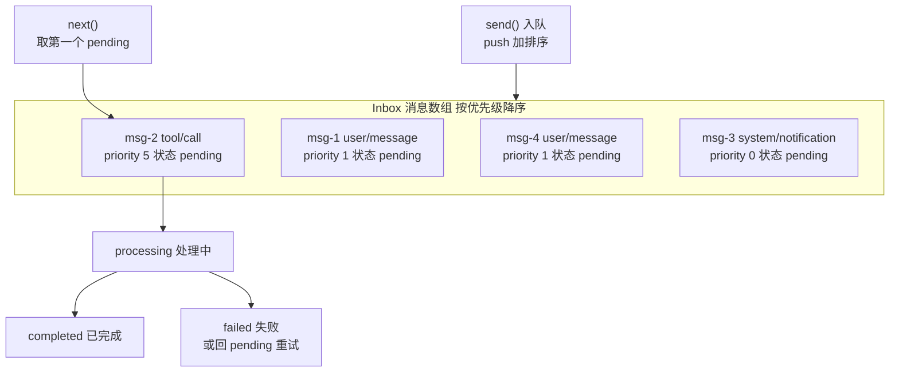

# DeepSeek Harness 从 0 开始：Inbox 模块（消息队列）

> 本系列从 0 开始，基于 Cordis 框架一步步实现一个简略版本的 DeepSeek Harness（loop、session、tool、system prompt 等）。上一篇我们让模型「有手了」（Tools 模块），这一篇解决「输入怎么排队」——**Inbox 模块**：Agent 的输入调度中枢。
>
> 配套代码：[blog-06-inbox](./)，运行 `pnpm install && pnpm dev` 即可复现本文全部输出。

## 上一篇留下的问题

Tools 模块能执行工具了，但还有个调度问题没解决：**用户的消息、系统通知、工具结果……这些「输入」涌进来的时候，Agent 怎么排队处理？**

设想几个场景：

- 用户连发三条消息，Agent 正在处理第一条——剩下的两条怎么办？
- 一条 `tool/call` 消息优先级很高，必须排在待处理队列最前面先被处理——怎么保证？
- 处理某条消息时失败了——是放弃还是重试？

如果每个模块自己管这些，逻辑会散落各处。需要一个**统一的消息队列**：接收消息（入队）、按优先级排队、失败重试、批量处理——这就是 **Inbox**。

> 💡 dsh 里 Inbox 更贴近 Agent 输入：它是基于 Session 事件的投影，维护 `next-turn`（下一轮对话）和 `next-step`（下一步）两个待处理队列，消息的入队/出队都以 `agent/inbox/spliced` 事件写入 Session（可重放）。我们这里实现一个**通用消息队列**版本，保留核心调度语义，下一篇 Agent Loop 会用到它。

## 项目目录结构

```
blog-06-inbox/
├── package.json          # 项目配置：依赖、启动脚本
├── pnpm-lock.yaml        # 依赖锁定文件
└── src/
    └── main.ts           # 代码入口，pnpm dev 运行它
```

## 核心概念

| 概念 | 一句话理解 |
| --- | --- |
| **InboxMessage** | 一条消息：id + 类型 + 载荷 + 优先级 + 状态 + 重试计数 |
| **优先级** | 数值越大越靠前，`send()` 后按优先级排序 |
| **状态机** | pending → processing → completed / failed |
| **失败重试** | 处理抛错自动重试，超过 maxRetries 才标记 failed |
| **批量处理** | 自动处理循环：不断取 pending 消息处理，直到队列清空 |

## Part 1：Inbox 基础——消息队列

### 第一步：类型定义

```ts
// 一条 Inbox 消息：完整的状态机 + 重试元数据
interface InboxMessage<T = any> {
  id: string          // 唯一 ID（自增 msg-<n>）
  type: string        // 消息类型（user/message、tool/call、system/notification...）
  payload: T          // 载荷：消息携带的数据
  priority: number    // 优先级：越大越先处理
  timestamp: number   // 入队时间
  status: 'pending' | 'processing' | 'completed' | 'failed'  // 状态机
  retries: number     // 已重试次数
  maxRetries: number  // 最大重试次数
  error?: string      // 最后一次失败的错误信息
}

// Inbox 的配置选项
interface InboxOptions {
  maxSize?: number           // 队列容量上限（默认 1000）
  defaultPriority?: number   // 默认优先级（默认 0）
  defaultMaxRetries?: number // 默认最大重试次数（默认 3）
}

// 扩展 Cordis 类型：声明 Inbox 事件 + ctx.inbox 服务
declare module '@cordisjs/core' {
  interface Events {
    'inbox/message': (message: InboxMessage) => void          // 新消息入队
    'inbox/processed': (message: InboxMessage) => void        // 消息处理完成
    'inbox/failed': (message: InboxMessage, error: Error) => void  // 消息最终失败
  }

  interface Context {
    inbox: InboxService
  }
}
```

**状态机**是 Inbox 的核心：每条消息在 `pending → processing → completed/failed` 之间流转，`retries`/`maxRetries` 记录重试进度。三个事件对应消息生命周期的关键时刻，任何模块都能监听（比如 Session 模块把 `inbox/processed` 写成 `tool/result` 事件）。

### 第二步：InboxService 实现

```ts
class InboxService extends Service {
  private messages: InboxMessage[] = []
  private counter = 0  // 自增计数器，生成唯一消息 ID
  private processing = false
  private options: Required<InboxOptions>

  constructor(ctx: Context, options: InboxOptions = {}) {
    super(ctx, 'inbox')
    this.options = {
      maxSize: options.maxSize ?? 1000,
      defaultPriority: options.defaultPriority ?? 0,
      defaultMaxRetries: options.defaultMaxRetries ?? 3,
    }
  }

  // 生成唯一消息 ID：自增 msg-<n>
  private mintId(): string {
    return `msg-${++this.counter}`
  }

  // 发送消息：入队 + 按优先级排序 + 广播
  send<T = any>(type: string, payload: T, priority?: number): InboxMessage<T> {
    if (this.messages.length >= this.options.maxSize) {
      throw new Error('Inbox is full')  // 队列满了直接报错
    }

    const message: InboxMessage<T> = {
      id: this.mintId(),
      type,
      payload,
      priority: priority ?? this.options.defaultPriority,
      timestamp: Date.now(),
      status: 'pending',
      retries: 0,
      maxRetries: this.options.defaultMaxRetries,
    }

    this.messages.push(message)
    this.messages.sort((a, b) => b.priority - a.priority)  // 按优先级降序排序

    console.log(`  📨 收到消息: ${type} (优先级: ${message.priority})`)
    this.ctx.emit('inbox/message', message)  // 广播：谁关心谁监听

    return message
  }

  // 获取下一条待处理的消息（返回第一个 pending）
  next(): InboxMessage | undefined {
    return this.messages.find(m => m.status === 'pending')
  }

  // 按类型过滤消息
  filter(type: string): InboxMessage[] {
    return this.messages.filter(m => m.type === type)
  }

  // 获取所有消息
  list(): InboxMessage[] {
    return [...this.messages]
  }

  // 标记消息为已完成
  complete(messageId: string): void {
    const message = this.messages.find(m => m.id === messageId)
    if (message) {
      message.status = 'completed'
      console.log(`  ✅ 消息已完成: ${message.type}`)
      this.ctx.emit('inbox/processed', message)
    }
  }

  // 标记消息为失败（自动重试逻辑在这里）
  fail(messageId: string, error: Error): void {
    const message = this.messages.find(m => m.id === messageId)
    if (!message) return

    message.retries++
    message.error = error.message

    if (message.retries >= message.maxRetries) {
      message.status = 'failed'  // 达到上限，放弃
      console.log(`  ❌ 消息失败（已达最大重试次数）: ${message.type}`)
      this.ctx.emit('inbox/failed', message, error)
    } else {
      message.status = 'pending'  // 未达上限，回到队列等待重试
      console.log(`  🔄 消息重试 (${message.retries}/${message.maxRetries}): ${message.type}`)
    }
  }

  // 处理单条消息：pending → processing → 成功 complete / 失败 fail
  async process(
    messageId: string,
    handler: (message: InboxMessage) => Promise<void>
  ): Promise<void> {
    const message = this.messages.find(m => m.id === messageId)
    if (!message || message.status !== 'pending') return

    message.status = 'processing'

    try {
      await handler(message)
      this.complete(messageId)
    } catch (error: any) {
      this.fail(messageId, error)
    }
  }

  // 启动自动处理循环：持续处理 pending 消息
  async startProcessing(
    handler: (message: InboxMessage) => Promise<void>
  ): Promise<void> {
    if (this.processing) return
    this.processing = true

    console.log('  🔄 启动自动处理循环...')

    while (this.processing) {
      const message = this.next()
      if (message) {
        await this.process(message.id, handler)
      } else {
        // 没有待处理消息，等待一段时间再查
        await new Promise(resolve => setTimeout(resolve, 100))
      }
    }
  }

  // 停止自动处理
  stopProcessing(): void {
    this.processing = false
    console.log('  ⏹️  停止自动处理')
  }

  // 清理已完成和失败的消息（释放队列空间）
  cleanup(): void {
    const before = this.messages.length
    this.messages = this.messages.filter(
      m => m.status !== 'completed' && m.status !== 'failed'
    )
    const removed = before - this.messages.length
    console.log(`  🗑️  清理了 ${removed} 条消息`)
  }

  // 获取统计信息（各状态消息数量）
  stats(): Record<string, number> {
    return {
      total: this.messages.length,
      pending: this.messages.filter(m => m.status === 'pending').length,
      processing: this.messages.filter(m => m.status === 'processing').length,
      completed: this.messages.filter(m => m.status === 'completed').length,
      failed: this.messages.filter(m => m.status === 'failed').length,
    }
  }
}
```

关键点：

- **`super(ctx, 'inbox')`**：Cordis v4 两参数构造（第三参数是 v3 遗留）；
- **`send()` 入队即排序**：`sort((a, b) => b.priority - a.priority)` 保证数组始终按优先级降序，`next()` 拿到的永远是最高优先级的 pending 消息；
- **`process()` 是核心**：状态机流转 + 异常捕获——handler 抛错自动走 `fail()`，而 `fail()` 内部决定「重试」还是「放弃」；
- **队列满保护**：`send()` 里 `maxSize` 超限直接抛 `Inbox is full`，防止内存无限增长。

### 第三步：发送消息并监听

```ts
let ctx = new Context()
// ctx.plugin() 是异步的，需要 await 等待服务激活
await ctx.plugin(InboxService, { maxSize: 100 })

// 监听 inbox 事件
ctx.on('inbox/message', (message) => {
  console.log(`  [事件] 新消息: ${message.type} (ID: ${message.id})`)
})
ctx.on('inbox/processed', (message) => {
  console.log(`  [事件] 消息已处理: ${message.type}`)
})
ctx.on('inbox/failed', (message, error) => {
  console.log(`  [事件] 消息失败: ${message.type} - ${error.message}`)
})

// 发送四条不同类型、不同优先级的消息
ctx.inbox.send('user/message', { text: 'Hello!' }, 1)
ctx.inbox.send('tool/call', { name: 'calculator', args: { a: 1, b: 2 } }, 5)
ctx.inbox.send('system/notification', { message: 'System update' }, 0)
ctx.inbox.send('user/message', { text: 'How are you?' }, 1)
```

运行输出：

```
👂 设置 Inbox 事件监听...

📨 发送消息...
  📨 收到消息: user/message (优先级: 1)
  [事件] 新消息: user/message (ID: msg-1)
  📨 收到消息: tool/call (优先级: 5)
  [事件] 新消息: tool/call (ID: msg-2)
  📨 收到消息: system/notification (优先级: 0)
  [事件] 新消息: system/notification (ID: msg-3)
  📨 收到消息: user/message (优先级: 1)
  [事件] 新消息: user/message (ID: msg-4)

📊 Inbox 统计:
  total: 4
  pending: 4
  processing: 0
  completed: 0
  failed: 0
```

消息 ID 自增（`msg-1` 到 `msg-4`），入队即广播（监听器打印事件），四条消息都在 `pending` 等待处理。

## Part 2：优先级处理——高优先级先走

先看发送四条消息后，Inbox 队列内部长什么样——数组始终按优先级降序排列，`next()` 永远取第一个 pending：



流程说明（箭头语义在正文）：`send()` 把消息 push 进队列并按优先级排序；`next()` 取第一个 pending（即 msg-2）；`process()` 把消息置为 processing，handler 成功则 completed，抛错则 failed 或回 pending 重试。

msg-2（`tool/call`，优先级 5）虽然第三个入队，但排序后排在数组最前——`next()` 第一个取到它。msg-1 / msg-4（都是优先级 1）按入队先后排在后面，msg-3（优先级 0）垫底。

`send()` 里按优先级排好序了，`next()` 拿到的就是**最高优先级的 pending 消息**：

```ts
// 手动处理消息（按优先级）：tool/call 优先级 5 最高，先被取出
const nextMsg = ctx.inbox.next()
if (nextMsg) {
  console.log(`  处理: ${nextMsg.type} (优先级: ${nextMsg.priority})`)
  await ctx.inbox.process(nextMsg.id, async (msg) => {
    console.log(`  执行: ${JSON.stringify(msg.payload)}`)
    await new Promise(resolve => setTimeout(resolve, 10))  // 模拟处理
  })
}

// 按类型过滤
const userMessages = ctx.inbox.filter('user/message')
console.log(`  找到 ${userMessages.length} 条 user/message`)
for (const msg of userMessages) {
  console.log(`    - ${msg.payload.text} (优先级: ${msg.priority})`)
}
```

运行输出：

```
🔧 手动处理消息（按优先级）...
  处理: tool/call (优先级: 5)
  执行: {"name":"calculator","args":{"a":1,"b":2}}
  ✅ 消息已完成: tool/call
  [事件] 消息已处理: tool/call

🔍 按类型过滤消息...
  找到 2 条 user/message
    - Hello! (优先级: 1)
    - How are you? (优先级: 1)
```

**优先级 5 的 `tool/call` 排在最前**，尽管它第三个入队——排序发生在入队时，与入队顺序无关。注意这是**非抢占式**：如果某条消息已经开始处理（`processing`），后到的高优消息不会打断它，只会在待处理队列里排到最前，等当前这条处理完。`filter()` 则支持按类型查询（比如 Agent Loop 只关心 `user/message`）。

## Part 3：失败重试——自动重试最多 3 次

消息处理失败不应该直接放弃。`fail()` 里内置了重试逻辑：**未达 `maxRetries` 就回到 pending 等重试，达到才标记 failed**。

```ts
// 模拟失败和重试
const failMsg = ctx.inbox.send('test/fail', { value: 'test' })
let attempts = 0

// 第一次尝试：抛错 → fail() 把 retries 变 1，回 pending
await ctx.inbox.process(failMsg.id, async () => {
  attempts++
  console.log(`  尝试 ${attempts}...`)
  throw new Error('模拟失败')
})

// 第二次尝试：从队列取出再处理，又失败 → retries 变 2
const retry1Msg = ctx.inbox.next()
if (retry1Msg && retry1Msg.id === failMsg.id) {
  await ctx.inbox.process(retry1Msg.id, async () => {
    attempts++
    console.log(`  尝试 ${attempts}...`)
    throw new Error('模拟失败')
  })
}
```

运行输出（Part 3 开头部分）：

```
❌ 测试失败重试...
  📨 收到消息: test/fail (优先级: 0)
  [事件] 新消息: test/fail (ID: msg-5)
  尝试 1...
  🔄 消息重试 (1/3): test/fail
```

**关键语义**：

- handler 抛 `模拟失败` → `process()` 捕获 → 调 `fail()`；
- `fail()` 里 `retries++`（变 1），`1 < 3` 未达上限 → 状态回 `pending`，打 `🔄 消息重试 (1/3)`；
- 下次 `next()` 又能取出它重试——**失败的消息不会丢，只是排队等重试**；
- 直到 `retries >= maxRetries`（第 3 次失败）→ 状态变 `failed`，广播 `inbox/failed`。

**为什么不用抛异常的方式重试？** 因为 handler 抛错后调用栈就断了；`fail()` 把「重试决策」收进状态机，`process()` 只管「尝试 → 成功/失败」，重试是队列的职责——**调用方不需要知道重试的存在**。

## Part 4：批量处理与清理

### 清理

处理完的消息还占着队列空间，`cleanup()` 清掉 completed/failed：

```ts
// 清理已完成和失败的消息
ctx.inbox.cleanup()

// 查看清理后统计
const stats3 = ctx.inbox.stats()
```

### 批量处理循环

Inbox 的典型用法是「自动处理循环」：不断取 pending 消息处理，直到队列清空：

```ts
// 发送一批任务（随机优先级）
for (let i = 1; i <= 5; i++) {
  ctx.inbox.send('batch/task', { taskId: i }, Math.floor(Math.random() * 10))
}

console.log('\n  开始批量处理...')
let processedCount = 0

// 处理所有待处理的消息（每次取最高优先级）
while (ctx.inbox.next()) {
  const msg = ctx.inbox.next()
  if (msg) {
    await ctx.inbox.process(msg.id, async (message) => {
      processedCount++
      console.log(`  处理任务 ${message.payload.taskId}`)
      await new Promise(resolve => setTimeout(resolve, 50))
    })
  }
}
```

运行输出（部分）：

```
🔄 批量处理演示...
  📨 收到消息: batch/task (优先级: 2)
  ...
  📨 收到消息: batch/task (优先级: 9)

  开始批量处理...
  处理任务 3
  ✅ 消息已完成: batch/task
  处理任务 5
  ✅ 消息已完成: batch/task
  ...
  ✅ 批量处理完成，共处理 9 条消息

📊 最终统计:
  total: 9
  pending: 0
  processing: 0
  completed: 9
  failed: 0
```

**注意处理顺序**：任务 3（优先级 9）最先处理，任务 1（优先级最低）最后——`while (ctx.inbox.next())` 每次都取当前最高优先级的 pending 消息，直到队列清空。最终 9 条消息全部 completed，`pending: 0`。

## 常见问题 FAQ

**Q: Inbox 和 Session 是什么关系？**

A: 分工不同：Inbox 是「**待处理队列**」（输入还没被 Agent 处理），Session 是「**已完成历史**」（处理过的都记录成事件）。一条用户消息的旅程：进入 Inbox（pending）→ 被 Agent 处理（processing）→ 处理完成（completed）→ 同时作为 `user/message` 事件写入 Session。dsh 里两者更紧密：Inbox 本身就是 Session 事件的投影（`agent/inbox/spliced`），入队/出队都写入 Session，可重放。

**Q: 优先级是怎么排序的？**

A: `send()` 入队后立即 `sort((a, b) => b.priority - a.priority)`——数组始终保持按优先级降序，`next()` 取 `find(status === 'pending')` 就是最高优先级那条。数字越大越先被处理（默认 0，`tool/call` 传 5 就排到待处理队列最前）。**非抢占**：正在处理的消息不会被高优新消息打断，等它完成才轮到下一条。

**Q: 失败重试和「彻底失败」怎么区分？**

A: 看 `retries` 和 `maxRetries`：`retries < maxRetries` 时 `fail()` 把消息状态改回 `pending`（等重试），`retries >= maxRetries` 时才改 `failed` 并广播 `inbox/failed`。默认最多重试 3 次，可通过 `InboxOptions.defaultMaxRetries` 配置。

**Q: 队列满了会怎样？**

A: `send()` 检查 `maxSize`，满了直接抛 `Inbox is full`——这是「快速失败」设计：宁可入队时报错，也不让队列无限膨胀把内存打爆。满了可以先 `cleanup()` 清掉已处理消息腾空间。

**Q: `process()` 和 `startProcessing()` 有什么区别？**

A: `process()` 处理**单条**（手动指定消息 ID）；`startProcessing()` 是**自动循环**——内部不断 `next()` → `process()`，直到 `stopProcessing()` 或队列清空。批量场景用后者，单条调试用前者。

## 小结

1. **Inbox = 消息队列**：统一管理 Agent 的输入——入队、排序、过滤、批量处理；
2. **优先级调度**：入队即排序，`next()` 永远取最高优先级——高优消息排在待处理队列最前（非抢占）；
3. **状态机 + 自动重试**：pending → processing → completed/failed，失败自动重试、达上限才放弃；
4. **事件驱动**：`inbox/message` / `inbox/processed` / `inbox/failed` 广播给所有关心者——Session、Tools、Loop 都能监听。

Inbox 让 Agent 的输入「有秩序了」。下一篇我们把 Session、Tools、Inbox 全部串起来——**Agent Loop**：用户输入进 Inbox → 循环处理 → 调工具 → 写 Session 的完整执行循环。

**下一篇预告**：Agent Loop——模型思考 → 调工具 → 看结果 → 再思考的完整循环，以及 Turn/Step 的驱动逻辑。

---

*本文代码已验证可运行（Node.js + tsx，@cordisjs/core v4.0.0-beta.5）。完整源码见同目录 `src/main.ts`。*
