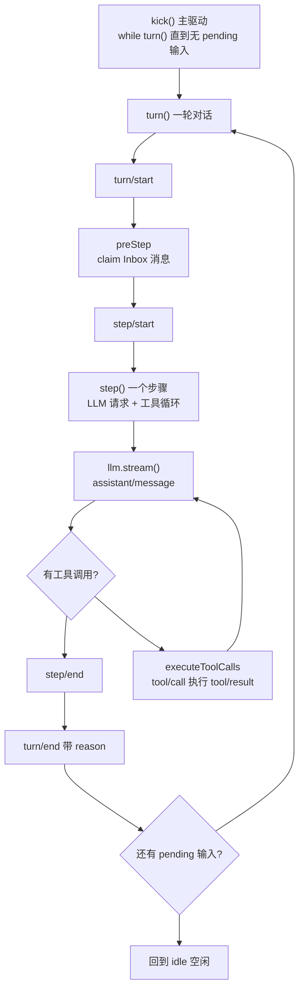

# DeepSeek Harness 从 0 开始：Loop 模块（Agent 执行循环）

> 本系列从 0 开始，基于 Cordis 框架一步步实现一个简略版本的 DeepSeek Harness（loop、session、tool、system prompt 等）。前几篇我们有了 Session（记忆）、Tools（手）、Inbox（输入），这一篇实现真正的**发动机**——按 dsh 源码结构实现 **ReactLoopAgent**：turn/step 状态机驱动的 Agent 执行循环。
>
> 配套代码：[blog-07-loop](./)，运行 `pnpm install && pnpm dev` 即可复现本文全部输出。

## Loop 是什么？

dsh 的 `agent-loop` 包（`packages/core/agent-loop`）实现的是 **turn/step 状态机**：`ReactLoopAgent` 通过 `kick()` → `while(turn())` 驱动一轮对话，turn 内跑多个 step，每个 step 是「LLM 请求 → 若返回工具调用则执行 → 带着结果再请求 → 直到模型输出最终回答」。它是 Agent 的「思考循环」——驱动模型与工具反复交互、直到完成任务的发动机。

## 项目目录结构

```
blog-07-loop/
├── package.json          # 项目配置：依赖、启动脚本
├── pnpm-lock.yaml        # 依赖锁定文件
└── src/
    └── main.ts           # 代码入口，pnpm dev 运行它
```

## 核心概念

| 概念 | 一句话理解 |
| --- | --- |
| **ReactLoopAgent** | Agent 驱动：kick → while(turn()) → turn 内多个 step（dsh: agent-loop/src/agent.ts） |
| **Turn（轮）** | 一轮对话：`turn/start` → 若干 step → `turn/end`（带 reason） |
| **Step（步）** | 一次「LLM 请求 + 它请求的工具执行」；一个 step 内可能多次请求 LLM |
| **Inbox claim** | preStep 从 next-turn / next-step 队列取出本轮输入（dsh: core/agent/src/inbox.ts） |
| **Phase 状态机** | idle / running 两态，`agent/status` 事件广播 |

## Part 1：Session 与 Inbox——两个前置组件

### Session：简化版事件日志

沿用 Session 篇的 Session 概念（事件日志 + 消息投影），这次按 dsh 的事件类型（`turn/start`、`turn/end` 带 reason、`step/start`、`tool/call`、`tool/result`……）来定义：

```ts
// 事件日志：Agent 循环的每一步都是事件（每个事件带 seq 单调序列号）
type SessionEvent =
  | { type: 'turn/start'; seq: number; turn: number; timestamp: number }                    // 一轮对话开始
  | { type: 'turn/end'; seq: number; turn: number; reason: TurnEndReason; timestamp: number }  // 一轮对话结束（带原因）
  | { type: 'step/start'; seq: number; turn: number; step: number; timestamp: number }      // 一个步骤开始
  | { type: 'step/end'; seq: number; turn: number; step: number; timestamp: number }        // 一个步骤结束
  | { type: 'user/message'; seq: number; content: string; timestamp: number }               // 用户消息
  | { type: 'assistant/message'; seq: number; content: string; toolCalls?: ToolCall[]; timestamp: number }  // 助手消息（可带工具调用）
  | { type: 'tool/call'; seq: number; turn: number; step: number; callId: string; name: string; arguments: string; timestamp: number }  // 工具调用
  | { type: 'tool/result'; seq: number; turn: number; step: number; callId: string; content: string; isError: boolean; timestamp: number }  // 工具结果

// turn 为什么结束：completed 正常完成 / blocked 无输入被拒 / error 出错 / aborted 取消 / max-tokens 超上限
type TurnEndReason =
  | { kind: 'completed' }
  | { kind: 'blocked' }
  | { kind: 'error'; error: string }
  | { kind: 'aborted' }
  | { kind: 'max-tokens' }

// 简化版 Session：事件日志 + 消息投影
class SimpleSession {
  readonly events: SessionEvent[] = []  // 事件数组（append-only，只追加）

  // 追加事件：自动分配 seq（等于当前事件数，从 0 连续递增）
  append(input: SessionEventInput): SessionEvent {
    const event = { seq: this.events.length, timestamp: Date.now(), ...input } as SessionEvent
    this.events.push(event)
    return event
  }

  // 从事件流投影模型消息（Surface，Session 篇讲过）
  deriveMessages(): Message[] {
    // user/message → user，assistant/message → assistant（含 tool_calls），
    // tool/result → tool（用 tool_call_id 关联）
  }
}
```

### Inbox：next-turn / next-step 双队列

dsh 的 Inbox 是「基于 Session 事件的投影」，维护**两个待处理队列**：`next-turn`（下一轮对话的输入）和 `next-step`（下一步边界的输入，如工具结果的附加上下文）：

```ts
// 队列目标：next-turn 下一轮输入 / next-step 下一步输入
type InboxTarget = 'next-turn' | 'next-step'

// Inbox：两个待处理队列（dsh 的 Inbox 投影）
class Inbox {
  // 状态：两个队列，各存待处理消息
  private state: Record<InboxTarget, InboxMessage[]> = { 'next-turn': [], 'next-step': [] }

  // 是否有待处理消息（任一队列非空）
  get hasPending(): boolean {
    return this.nextTurn.length > 0 || this.nextStep.length > 0
  }

  // 追加消息到目标队列（followup → next-turn，steer → next-step）
  append(target: InboxTarget, message: InboxMessage): void {
    this.state[target].push(message)
  }

  // claim：移除并返回本轮 step 的消息批次
  // 先清空 next-step，再按需取 next-turn 一条（dsh 的 claim 语义）
  claim(target: InboxTarget): InboxMessage[] {
    const claimed = this.state['next-step'].splice(0)
    if (target === 'next-turn') {
      claimed.push(...this.state['next-turn'].splice(0, 1))
    }
    return claimed
  }
}
```

**为什么两个队列？** 用户新消息走 `next-turn`（开启一轮新对话）；工具执行中的附加上下文走 `next-step`（在当前 step 结束后、下一 step 开始时消费）——dsh 用它们区分「新的一轮」和「正在进行的对话中的补充输入」。

## Part 2：Mock LLM——模拟模型决策

没有真实 API key 时，用一个 Mock 适配器模拟「模型返回文本或工具调用」。它按消息历史决策：先调 `calculator`，再调 `weather`，最后输出总结：

```ts
class MockLlm {
  constructor(readonly options: MockLlmOptions) {}

  // 模拟 llm.stream()：返回流式块（文本或 tool-call）
  stream(messages: Message[]): AsyncIterable<LlmChunk> {
    return (async function* () {
      const toolResults = messages.filter(m => m.role === 'tool')

      if (toolResults.length === 2) {
        // 两个工具结果都回来了：输出最终总结（无工具调用 → step 完成）
        const calc = toolResults[0]?.content
        const weather = toolResults[1]?.content
        yield { type: 'text', text: `最终回答: ${calc}；${weather}` }
        return
      }

      if (toolResults.length === 1) {
        // calculator 结果已回：再调 weather
        yield { type: 'tool-call', call: { id: 'weather-1', name: 'weather', arguments: JSON.stringify({ city: 'Shanghai' }) } }
        return
      }

      // 初始：先调 calculator
      yield { type: 'tool-call', call: { id: 'calc-1', name: 'calculator', arguments: JSON.stringify({ expression: '2 + 2' }) } }
    })()
  }
}
```

**Mock 的关键**：根据 `role: 'tool'` 消息的数量决定下一步——这正是真实模型的行为模式（看到工具结果才知道下一步），只是决策逻辑被硬编码了。

## Part 3：ReactLoopAgent——turn/step 状态机

这是 dsh 的核心。完整的执行循环：



**读图（箭头语义在正文）**：`CHECK`（有工具调用?）分两路——没有工具调用走 `step/end` 结束步骤；有工具调用走 `executeToolCalls` 执行，执行完**带着 `tool/result` 回到 `llm.stream()` 再请求**（`EXEC → STREAM` 回边），直到模型输出最终文本。`NEXT`（还有 pending 输入?）分两路——有则开启下一轮 turn（回边），没有则回到 idle 空闲。```ts
class ReactLoopAgent {
  readonly inbox: Inbox
  readonly session: SimpleSession
  private phase: Phase  // { kind: 'idle' } | { kind: 'running', turn, step }
  private tools = new Map<string, (args) => Promise<string>>()

  // followup：排入下一轮并唤醒驱动（dsh: send + wakeDriver）
  followup(content: string): void {
    this.inbox.append('next-turn', { id: `m-${Date.now()}`, content })
    if (this.phase.kind === 'idle') this.wakeDriver()
  }

  // 唤醒驱动：进入 running 并启动 kick 循环
  private wakeDriver(): void {
    this.setPhase({ kind: 'running', turn: this.phase.lastTurn, step: 0, aborted: false })
    void this.kick().finally(() => {
      if (this.phase.kind === 'running') {
        this.setPhase({ kind: 'idle', lastTurn: this.phase.turn })
      }
    })
  }

  // 主驱动循环：不断跑 turn，直到没有 pending 输入（dsh: kick）
  private async kick(): Promise<void> {
    try {
      while (this.phase.kind === 'running' && await this.turn()) {}
    } catch (error) { /* 错误已在 turn 内结构化记录 */ }
  }

  // 一轮对话（dsh: turn）
  private async turn(): Promise<boolean> {
    if (this.phase.kind !== 'running') return false
    const turn = this.phase.turn + 1
    this.phase.turn = turn
    this.session.append({ type: 'turn/start', turn })

    let turnEnds: TurnEndReason | null = null
    let target: InboxTarget = 'next-turn'

    try {
      while (this.phase.kind === 'running') {
        if (this.phase.aborted) { turnEnds = { kind: 'aborted' }; break }

        // preStep：从 Inbox claim 消息
        const step = this.phase.step + 1
        const claimed = this.inbox.claim(target)
        if (claimed.length === 0) {
          if (turnEnds !== null) break
          turnEnds = { kind: 'blocked' }
          return false
        }

        this.phase.step = step
        this.session.append({ type: 'step/start', turn, step })
        try {
          for (const message of claimed) {
            this.session.append({ type: 'user/message', content: message.content })
          }
          const stepEnd = await this.step(turn, step)
          if (turnEnds === null || turnEnds.kind !== 'max-tokens') turnEnds = stepEnd
        } finally {
          this.session.append({ type: 'step/end', turn, step })
        }

        // turn-stopping：没有新输入则结束本轮
        if (turnEnds !== null && this.inbox.nextStep.length === 0) break
        target = 'next-step'
      }
    } catch (error: any) {
      turnEnds = this.phase.aborted
        ? { kind: 'aborted' }
        : { kind: 'error', error: String(error?.message ?? error) }
    } finally {
      this.session.append({ type: 'turn/end', turn, reason: turnEnds ?? { kind: 'error', error: 'unknown' } })
    }

    if (!this.inbox.hasPending) return false
    this.phase.step = 0
    return true
  }

  // 一个步骤：LLM 请求 → 工具调用循环（dsh: step）
  private async step(turn: number, step: number) {
    while (this.phase.kind === 'running') {
      // 从 Session 投影消息，请求 LLM
      const messages = this.session.deriveMessages()
      const stream = this.llm.stream(messages)

      const toolCalls: ToolCall[] = []
      let text = ''
      for await (const chunk of stream) {
        if (chunk.type === 'text') text += chunk.text
        else if (chunk.type === 'tool-call' && chunk.call) toolCalls.push(chunk.call)
      }

      this.session.append({
        type: 'assistant/message',
        content: text,
        ...(toolCalls.length > 0 ? { toolCalls } : {}),
      })

      // 没有工具调用 → step 完成
      if (toolCalls.length === 0) return { kind: 'completed' }

      // 有工具调用 → 执行；执行完不 return，带着 tool/result 再请求 LLM
      await this.executeToolCalls(turn, step, toolCalls)
    }
    return null
  }

  // 执行工具调用（dsh: tool-calls.ts）
  private async executeToolCalls(turn: number, step: number, calls: ToolCall[]): Promise<void> {
    for (const call of calls) {
      this.session.append({ type: 'tool/call', turn, step, callId: call.id, name: call.name, arguments: call.arguments })

      let content: string
      let isError = false
      try {
        const args = JSON.parse(call.arguments || '{}')
        const tool = this.tools.get(call.name)
        if (!tool) throw new Error(`Tool ${call.name} not found`)
        content = await tool(args)
      } catch (error: any) {
        isError = true
        content = String(error?.message ?? error)
      }

      this.session.append({ type: 'tool/result', turn, step, callId: call.id, content, isError })
    }
  }
}
```

**这是整个框架的心脏**，几个关键设计（都来自 dsh 源码）：

- **`kick()` → `while(turn())`**：主驱动循环。`turn()` 返回 `false` 表示没有 pending 输入了，循环停止，agent 回到 idle——**空闲时零开销，有输入才唤醒**（dsh 的 wakeDriver 机制）；
- **step 内的 `while(true)` 工具循环**：这是最容易忽略的点——**一个 step 可以多次请求 LLM**。模型要工具 → 执行 → 结果写进 Session → 带着 `tool/result` 再请求 → 模型看到结果决定下一步 → 直到输出最终文本（无工具调用）；
- **`turn/end` 带 reason**：completed / blocked / error / aborted / max-tokens——记录「为什么结束」，可审计（Session 篇的 Session 事件现在有了真实的生产者）；
- **`finally` 保证边界闭合**：即使 step 抛错，`step/end` 和 `turn/end` 也会写入——事件流永远完整。

## Part 4：AgentLoop Service 与运行

### Service 封装

```ts
// AgentLoop 服务：管理 agent 生命周期（dsh: agent-loop/index.ts）
class AgentLoopService extends Service {
  private agents = new Map<string, ReactLoopAgent>()  // 注册表：sessionId → agent
  private counter = 0  // 自增计数器，生成唯一 session ID

  constructor(ctx: Context) {
    super(ctx, 'agentLoop')  // Cordis v4 两参数构造
  }

  // 生成唯一 session ID：自增 session-<n>
  private mintId(): string {
    return `session-${++this.counter}`
  }

  // 创建 agent（简化版：dsh 里通过 createAgent + publish 发布）
  create(options: AgentOptions & { llm?: MockLlm }): ReactLoopAgent {
    const agent = new ReactLoopAgent(
      this.mintId(),
      { provider: options.provider ?? 'mock', model: options.model ?? 'mock-model', maxTokens: options.maxTokens },
      options.llm ?? new MockLlm({ provider: 'mock', model: 'mock-model' }),  // 缺省用 Mock LLM
    )
    this.agents.set(agent.session.id, agent)  // 登记到注册表
    return agent
  }
}

// 扩展 Cordis 类型：ctx.agentLoop 可用
declare module '@cordisjs/core' {
  interface Context {
    agentLoop: AgentLoopService
  }
}
```

### 跑一个真实循环

```ts
let ctx = new Context()
// ctx.plugin() 是异步的，需要 await 等待服务激活
await ctx.plugin(AgentLoopService)

// 创建 agent（provider/model 指定路由，真实项目接真实适配器）
const agent = ctx.agentLoop.create({ provider: 'mock', model: 'react-loop', maxTokens: 512 })

// 注册 Agent 可用的工具（Tools 篇讲过：工具是插件注入的）
agent.registerTool('calculator', async (args) => {
  const match = (args.expression as string).match(/(\d+)\s*\+\s*(\d+)/)
  const sum = match ? Number(match[1]) + Number(match[2]) : NaN
  return `计算 ${args.expression} = ${sum}`
})

agent.registerTool('weather', async (args) => {
  return `${args.city} 天气: 晴天 25°C`
})

// 用户发消息：排入 next-turn 并唤醒驱动（agent 进入 running 开始循环）
agent.followup('帮我计算 2 + 2，然后查一下上海天气')

// 等待 agent 收敛（dsh: whenIdle，等所有 turn/step 跑完回到 idle）
while (agent.status === 'running') {
  await new Promise(resolve => setTimeout(resolve, 10))
}
```

运行输出——**Session 事件流完整记录了整个循环**：

```
👤 用户: 帮我计算 2 + 2，然后查一下上海天气

📜 Session 事件流:
  #0 turn/start   (turn 1)
  #1 step/start   (turn 1 step 1)
  #2 user/message "帮我计算 2 + 2，然后查一下上海天气"
  #3 assistant   "" 工具调用: calculator
  #4 tool/call    calculator({"expression":"2 + 2"})
  #5 tool/result  "计算 2 + 2 = 4"
  #6 assistant   "" 工具调用: weather
  #7 tool/call    weather({"city":"Shanghai"})
  #8 tool/result  "Shanghai 天气: 晴天 25°C"
  #9 assistant   "最终回答: 计算 2 + 2 = 4；Shanghai 天气: 晴天 25°C"
  #10 step/end     (turn 1 step 1)
  #11 turn/end     (reason: completed)
```

**读这条事件流，你能看到 Agent 的完整思考过程**：

1. `#1` step 开始，`#2` 用户消息进 Session；
2. `#3` 模型第一次响应：**要调 calculator**（assistant 消息带 tool_calls）；
3. `#4` `tool/call` 记录调用，`#5` `tool/result` 记录结果「计算 2 + 2 = 4」；
4. `#6` 模型带着结果**再次响应**：还要调 weather——这就是 step 内的循环！
5. `#7` `#8` weather 调用与结果；
6. `#9` 模型第三次响应：**输出最终文本**（无工具调用）→ step 完成；
7. `#10` `step/end`，`#11` `turn/end`（reason: completed）——一轮对话结束。

**一个 turn，一个 step，三次 LLM 请求**——每次工具执行的结果都回到模型，模型据此决定下一步。这正是 dsh `step()` 里 `while(true)` 循环的真实运行效果。

## 常见问题 FAQ

**Q: dsh 的 Loop 到底是定时器还是状态机？**

A: **状态机**。dsh 的 `agent-loop` 包是 `ReactLoopAgent`——`kick()` 驱动 `while(turn())`，turn 内跑 step，step 内 LLM 请求 + 工具执行循环。**没有 setInterval**：agent 空闲时（idle 态）零开销，`followup()`/`steer()` 排入 Inbox 并唤醒驱动才跑。「定时调度周期任务」是另一个概念（`dsh-schedule` 包），不是 agent-loop 的核心。

**Q: turn 和 step 到底什么区别？**

A: `turn`（轮）是「一轮对话」：从用户发消息到最终回答，`turn/start` → 若干 step → `turn/end`（带 reason）。`step`（步）是「一次 LLM 请求 + 它请求的工具执行」；**一个 step 内模型可能多次请求 LLM**（要工具 → 看结果 → 再要工具 → 看结果 → 输出回答）。一个 turn 通常 1~3 个 step。

**Q: step 内的工具循环怎么终止？**

A: 靠「模型不再要工具」——每次工具执行后，`tool/result` 写进 Session，模型再次请求时看到结果。Mock LLM 里：`tool` 消息满 2 条就输出最终文本（无 tool-call）。真实模型同理：看到足够信息后直接回答。**循环的终止条件是模型自己决定的，不是代码硬编码的轮数**。

**Q: 三层 while 循环各自的停止条件是什么？**

A: 三个循环，停止条件各不相同：

| 循环 | 位置 | 停止条件 |
| --- | --- | --- |
| 内层 `while` | `step()` 内 | 模型返回**无工具调用**的最终文本（`toolCalls.length === 0`）→ return completed |
| 中层 `while` | `turn()` 内 | step 完成 **且** `inbox.nextStep` 为空（`turnEnds !== null && nextStep.length === 0`）→ break |
| 外层 `while` | `kick()` 内 | `turn()` 返回 `false`（没有 pending 输入）→ 循环结束 |

三者的关系：**内层管「一个 step 内模型与工具反复交互」，中层管「一轮 turn 内多个 step」，外层管「多轮对话直到输入耗尽」**。每一层都是「有活干就继续，没活就退出」——不会空转。

**Q: 用户输入是怎么进入循环的？会重复处理吗？**

A: 用户输入通过 `followup()` 排入 Inbox 的 `next-turn` 队列，然后在 `turn()` 的中层循环里被 `claim()` 取走：`claim` 先清空 `next-step`，再取 `next-turn` 第一条，写入 Session 的 `user/message` 事件。**claim 用 `splice` 移除，消息只处理一次不会重复**；但内容已进 Session，之后每次 LLM 请求都通过 `deriveMessages()` 投影看到它——输入只消费一次，但对话历史里始终可见。

**Q: 插队（steer）的输入什么时候被处理？**

A: `steer()` 排入 `next-step` 队列，在**下一步边界**被 claim——注意 `claim()` 总是先清空 `next-step`，所以 steer 的输入**优先于** next-turn 的普通输入。时机：正在跑的 step 结束后的下一个 step 开头。比如工具执行过程中 `steer()` 一条补充指令，当前 step 跑完立刻轮到它——这就是「插队」：不用等下一轮 turn。而 `followup()` 排入 next-turn，要等当前 turn 结束、下一轮才开始。

**Q: 工具调用的执行顺序和优先级怎么定的？**

A: 本博客的简化版：**按模型返回的顺序串行执行**——`executeToolCalls` 里 `for (const call of calls)` 逐个执行，模型先要哪个就先跑哪个。dsh 真实实现更细（`tool-calls.ts`）：每个工具带并发模式（`executionMode`）——`exclusive`（独占，同一 step 内与别的调用互斥）和 `parallel`（可并行，受 `maxParallelToolCalls` 上限约束）。**优先级不是「谁重要先跑谁」，而是「模型声明的顺序 + 工具的并发能力」**——工具没有互相插队的机制，插队只发生在输入（steer）层面。

**Q: while 循环是怎么添加和控制新输入的？**

A: 循环本身不轮询输入——**输入是「唤醒」驱动的**：`followup()`/`steer()` 调用时，如果 agent 处于 idle，就 `wakeDriver()` 把 phase 置为 running 并启动 `kick()`；如果已经在 running，消息只是进 Inbox 排队，循环的下一轮迭代 claim 时自然取到。控制方式：`cancel()`（中止当前循环，可 keepInbox 保留未处理的输入）、`whenIdle()`（等循环自然收敛）。**没有 setInterval 轮询——空闲零开销，输入来了才动**。

**Q: `turn/end` 的 reason 有什么用？**

A: 记录「为什么这轮结束」：completed（正常完成）/ blocked（无输入被拒绝）/ error（出错）/ aborted（取消）/ max-tokens（超 token 上限）。这些是审计的关键——出 bug 时能回看「这轮是正常结束还是被中断」。dsh 的 `TurnEndReason` 就是合并可扩展的 sum type。

**Q: followup 和 steer 有什么区别？**

A: `followup`（普通追问）排入 `next-turn`——开启**新一轮**对话；`steer`（引导）排入 `next-step`——在当前对话的**下一步边界**消费（比如工具结果附带上下文）。claim 时先清 next-step，再按需取 next-turn 一条。

**Q: 为什么 agent 空闲时零开销很重要？**

A: 真实部署里 agent 大部分时间在等输入。如果空闲时也跑着定时器，纯属浪费。dsh 的 idle 态：没有驱动循环、没有定时器，`followup()` 来了才 `wakeDriver()` 进入 running——**按需启动，用完即停**。

## 小结

1. **Loop = ReactLoopAgent 状态机**：`kick()` → `while(turn())`，turn 内多个 step，step 内 LLM 请求 + 工具循环；
2. **step 循环是核心**：模型要工具 → 执行 → 结果回 Session → 再请求 → 直到输出最终回答——一个 step 可以多次请求 LLM；
3. **Inbox 双队列**：next-turn（新一轮）/ next-step（补充输入），preStep 时 claim；
4. **事件流完整**：turn/start → step/start → user/message → assistant（tool_calls）→ tool/call → tool/result → ... → step/end → turn/end（带 reason）——Session 记录 Agent 的每一步思考。

至此，系列的核心闭环完成了：**Inbox 提供输入 → ReactLoopAgent 驱动循环 → Tools 执行动作 → Session 记录历史**。下一篇（如果有）可以把 Mock LLM 换成真实 OpenAI 适配器，让整个循环调用真实模型。

---

*本文代码已验证可运行（Node.js + tsx，@cordisjs/core v4.0.0-beta.5）。完整源码见同目录 `src/main.ts`，实现结构对应 dsh 的 `packages/core/agent-loop`。*
