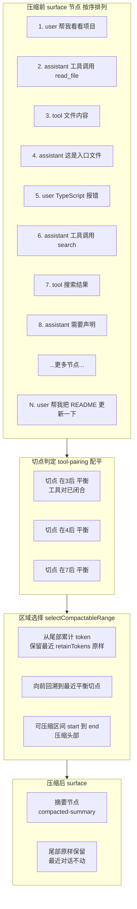

# DeepSeek Harness 从 0 开始：Compaction 模块（上下文压缩）

> 本系列从 0 开始，基于 Cordis 框架一步步实现一个简略版本的 DeepSeek Harness（loop、session、tool、system prompt 等）。上一篇我们实现了 ReactLoopAgent——Agent 的思考循环。这一篇解决一个绕不开的现实问题：**对话太长，上下文窗口装不下了**——**Compaction 模块**：把旧对话压缩成摘要。
>
> 配套代码：[blog-08-compaction](./)，运行 `pnpm install && pnpm dev` 即可复现本文全部输出。

## 上一篇留下的问题

LLM 的上下文窗口是有限的（几千到几百万 token）。Agent 跑得越久，Session 里的事件越多，总有一天**投影出来的消息会超过窗口**：

- 用户和 Agent 聊了 100 轮，历史消息 5 万 token，窗口只有 8 千——怎么办？
- 直接截断？最早的对话全丢了，Agent 失忆；
- 全部保留？模型报「context length exceeded」，根本发不出去。

**Compaction（压缩）** 的答案：把**早期对话**用 LLM 总结成一段**结构化摘要**，替换掉原文——信息还在（压缩形式），token 却大幅减少。事件溯源（Session）让这变得安全：**日志全量保留，压缩只影响投影（surface）**——想回溯随时可以。

> 💡 dsh 的 compaction 分多个包：`compaction`（词汇表 + tool-pairing）、`compaction-basic`（区域选择 + 摘要器 + 事务）、`compaction-tool-result-pruner`（裁剪超大工具结果）。本文实现 compaction-basic 的核心流程。

## 项目目录结构

```
blog-08-compaction/
├── package.json          # 项目配置：依赖、启动脚本
├── pnpm-lock.yaml        # 依赖锁定文件
└── src/
    └── main.ts           # 代码入口，pnpm dev 运行它
```

## 核心概念

| 概念 | 一句话理解 |
| --- | --- |
| **Surface（表面）** | 会话当前活跃节点的位置列表——压缩裁剪的就是它，日志不动 |
| **Tool-Pairing** | 平衡切点：绝不把「工具调用/结果」对劈开 |
| **区域选择** | 保留最近尾部原样，压缩头部——从尾部累计 token 找切点 |
| **结构化摘要** | LLM 把被压缩区域总结成 `<compacted-summary>` 检查点 |
| **工具结果修剪** | 无模型裁剪超大工具结果（保留头尾，中间替换标记） |
| **压缩事务** | start → summarize → surface replace → end，失败也闭合 |

## Part 1：词汇表——compaction 事件与结果

压缩在 Session 事件日志里留下三个**元事件**（只记日志，不进消息投影）：

```ts
// ↓ compaction 元事件（不进入 surface）
| { type: 'compaction/start'; seq: number; compactionId: string; turn: number | null; timestamp: number }
| {
    type: 'compaction/summary'
    seq: number
    compactionId: string
    summary: string                  // 摘要全文（带标签框架）
    shadowedRange: { start: number; end: number }  // 被替换区间的边界 seq
    shadowedSeqs: number[]           // 被替换的节点列表
    shadowedTokenCount: number       // 被替换内容的估计 token
    timestamp: number
  }
| { type: 'compaction/end'; seq: number; compactionId: string; error?: string; timestamp: number }
```

一次压缩事务的结果（dsh: `CompactionResult`）：

```ts
interface CompactionResult {
  compactionId: string
  startSeq: number       // compaction/start 的 seq
  summarySeq: number     // compaction/summary 的 seq
  endSeq: number         // compaction/end 的 seq
  summary: string        // 摘要文本
  shadowedRange: { start: number; end: number }
  shadowedSeqs: number[]       // 被替换节点
  shadowedTokenCount: number   // 被替换 token 数
}
```

**三个事件的语义**：`start` 记录「压缩开始了」（占锁）；`summary` 记录摘要内容 + **它替换了哪些节点**（`shadowedSeqs`）；`end` 记录「压缩结束」（释放锁，`error` 字段记录失败）。这是可审计的——事后能回看「哪次压缩把哪段对话换成了什么摘要」。

## Part 2：Surface 与 Session——可替换的表面

### 为什么需要 Surface？

Session 的事件日志是 **append-only**（Session 篇），不能改。但压缩要「替换旧对话」——这两者怎么共存？答案是 **Surface**：日志保持全量，surface 是「当前活跃节点」的位置列表，压缩只改 surface。

```ts
// Surface：surface 顺序的活跃事件 seq 列表
class Surface {
  private seqs: number[] = []

  push(seq: number): void {
    this.seqs.push(seq)
  }

  // 把 [startSeq, endSeq] 区间替换为一个新节点（dsh: surfaceOp replace）
  replaceRange(startSeq: number, endSeq: number, newSeq: number): void {
    const startIdx = this.seqs.indexOf(startSeq)
    const endIdx = this.seqs.indexOf(endSeq)
    if (startIdx === -1 || endIdx === -1 || startIdx > endIdx) {
      throw new Error(`replaceRange: invalid span ${startSeq}..${endSeq}`)
    }
    this.seqs.splice(startIdx, endIdx - startIdx + 1, newSeq)
  }
}

// 简化版 Session：事件日志 + 可替换的 surface + 消息投影
class CompactSession {
  readonly events: SessionEvent[] = []  // append-only 事件日志（全量）
  readonly surface = new Surface()      // 当前活跃节点（压缩裁剪后）

  // 追加事件：可附带 surfaceOp 执行替换
  append(input: SessionEventInput, surfaceOp?: { op: 'replace'; start: number; end: number }): SessionEvent {
    const event = { seq: this.events.length, timestamp: Date.now(), ...input } as SessionEvent
    this.events.push(event)

    // compaction 元事件只记录日志，不进 surface
    if (input.type.startsWith('compaction/')) return event

    if (surfaceOp) {
      // 压缩替换：新节点落在旧区间的位置
      this.surface.replaceRange(surfaceOp.start, surfaceOp.end, event.seq)
    } else {
      this.surface.push(event.seq)
    }
    return event
  }

  // 从 surface 投影模型消息（被压缩的旧节点不再出现）
  deriveMessages(): Message[] {
    return this.deriveMessagesFromSeqs(this.surface.nodes)
  }

  // 从任意 seq 列表投影（压缩器用它重建被压缩区域）
  deriveMessagesFromSeqs(seqs: readonly number[]): Message[] {
    // user/message → user，assistant/message → assistant（含 tool_calls），tool/result → tool
  }
}
```

**关键区分**：

| | 事件日志（events） | Surface（nodes） |
| --- | --- | --- |
| 写入方式 | append-only，永不修改 | 可 push、可 replace |
| 内容 | 全量历史 | 当前活跃节点 |
| 压缩时 | 不动 | 旧区间 → 摘要节点 |
| 用途 | 审计、重放、重建 | 投影给模型看 |

压缩后：日志里 40 个事件全在（可审计），surface 只剩 10 个节点（模型只看到这些）——**「先存全量事实，按需派生视图」的事件溯源思想，在这里开花结果**。

## Part 3：TokenMeter——上下文测量与压力

压缩的触发条件是「上下文压力过大」。需要一个计量器估算每个节点的 token 数：

```ts
class TokenMeter {
  constructor(
    readonly contextWindow: number,   // 模型上下文窗口
    readonly thresholdRatio = 0.8,    // 压力阈值比例
  ) {}

  // 压力阈值：窗口 * 比例（达到就触发压缩）
  get thresholdTokens(): number {
    return Math.floor(this.contextWindow * this.thresholdRatio)
  }

  // 单条文本的估计 token（真实项目用 provider 的 tokenizer）
  estimate(text: string): number {
    return Math.max(1, Math.ceil(text.length / 4))  // 约 4 字符 ≈ 1 token
  }

  // 测量一个会话：为每个 surface 活跃节点定价
  measure(session: CompactSession): TokenMeasurement {
    const seqs = [...session.surface.nodes]
    const tokensBySeq = new Map<number, number>()
    let totalTokens = 0
    for (const seq of seqs) {
      const tokens = this.estimateMessage(session.events[seq])
      tokensBySeq.set(seq, tokens)
      totalTokens += tokens
    }
    return { seqs, tokensBySeq, totalTokens }
  }

  // 估算一个事件占用的 token（工具调用参数 JSON 也算）
  private estimateMessage(event: SessionEvent | undefined): number {
    if (!event) return 0
    switch (event.type) {
      case 'user/message': return this.estimate(event.content)
      case 'assistant/message': {
        let tokens = this.estimate(event.content)
        for (const call of event.toolCalls ?? []) {
          tokens += this.estimate(call.arguments)
        }
        return tokens
      }
      case 'tool/result': return this.estimate(event.content)
      case 'compaction/summary': return this.estimate(event.summary)
      default: return 0
    }
  }
}
```

**压力模型**：`measure()` 算出总 token，`shouldCompact()` 判断 `totalTokens >= thresholdTokens`。演示配置 `contextWindow: 300, thresholdRatio: 0.8` → 阈值 240 token——对话累积到 270 token 就触发压缩。

## Part 4：Tool-Pairing——安全切点

压缩要切掉一段对话，但**不能把「工具调用」和它的「结果」劈开**——否则模型看到 `tool/call` 却没有 `tool/result`，会困惑（这轮工具到底执行了吗？）。

dsh 的思路：**每个切点必须「配平」**——切点之前所有工具调用都有对应结果。

```ts
// 每个事件的「进行中工具调用」增量（dsh: eventDelta）
// - assistant/message 携带 N 个 tool-call → +N
// - tool/result → -1
function eventDelta(event: SessionEvent): number {
  switch (event.type) {
    case 'assistant/message':
      return event.toolCalls?.length ?? 0
    case 'tool/result':
      return -1
    default:
      return 0
  }
}

// 计算 surface 每个切点的平衡状态（dsh: balanceCache 的折叠结果）
// N 个节点的 surface 有 N+1 个切点：入口 i 是节点 i 之前的切点
function toolPairingCuts(session: CompactSession): boolean[] {
  const cuts: boolean[] = [true]  // 第 0 个切点（入口）总是平衡
  let inProgress = 0
  for (const seq of session.surface.nodes) {
    inProgress += eventDelta(session.events[seq]!)
    if (inProgress < 0) {
      throw new Error(`tool-pairing balance: tool/result at seq ${seq} has no matching tool-call`)
    }
    cuts.push(inProgress === 0)  // 平衡 = 没有未响应的工具调用跨越切点
  }
  return cuts
}

// 某个 surface 节点「之前」的切点是否平衡
function toolPairingBalancedBefore(session: CompactSession, seq: number): boolean {
  const idx = session.surface.indexOf(seq)
  if (idx === -1) throw new Error(`tool-pairing balance: surface seq ${seq} not found`)
  return toolPairingCuts(session)[idx]!
}

// 某个 surface 节点「之后」的切点是否平衡
function toolPairingBalancedAfter(session: CompactSession, seq: number): boolean {
  const idx = session.surface.indexOf(seq)
  if (idx === -1) throw new Error(`tool-pairing balance: surface seq ${seq} not found`)
  return toolPairingCuts(session)[idx + 1]!
}
```

**为什么不用 step 标记判断切点？** 因为压缩会改变 surface 位置（替换节点），step 边界不可靠；而「工具调用/结果配平」是数据本身的性质——`assistant` 带 N 个 tool-call 就 +N，每个 `tool/result` 就 -1，归零即平衡。这是 dsh 选它的原因：**切点合法性只取决于工具对的配对状态**。

## Part 5：区域选择——保留尾部，压缩头部

切哪一段？dsh 的策略：**保留最近尾部原样，压缩头部**——最近的对话最相关，不能动；最早的对话最可压缩。

先看压缩的完整过程——从 surface 节点、切点、区域选择到摘要替换：



读图：上半部分是压缩前的 surface（节点 1 到 N 按序排列）；中间是**切点判定**——`tool/call` 和 `tool/result` 配平的地方（节点 3 后、节点 4 后、节点 7 后）才是安全切点，绝不能切在「调用了工具但结果没回来」的位置；再往下是**区域选择**——从尾部累计 token 保住最近 `retainTokens`，向前回溯到平衡切点，得到可压缩区间；最后**压缩结果**——头部旧节点替换成 `<compacted-summary>` 摘要节点，尾部原样保留。

```ts
// 解析出「以头部为锚、向前延伸」的可压缩区间（dsh: selectCompactableRange）
function selectCompactableRange(
  session: CompactSession,
  measurement: TokenMeasurement,
  retainTokens: number,  // 必须保留的最近尾部 token 数
): { start: number; end: number } | null {
  const seqs = measurement.seqs
  if (seqs.length === 0) return null

  // 1. 从尾部反向累计 token，确定「保留尾部」的最小起点
  let accumulated = 0
  let keepFromIdx = seqs.length
  for (let index = seqs.length - 1; index >= 0; index--) {
    accumulated += measurement.tokensBySeq.get(seqs[index]!) ?? 0
    keepFromIdx = index
    if (accumulated >= retainTokens) break
  }
  if (keepFromIdx === 0) return null  // 整段都要保留，无可压缩

  // 2. 往前回溯到最近的平衡切点：绝不分割工具对
  while (keepFromIdx > 0) {
    if (toolPairingBalancedBefore(session, seqs[keepFromIdx]!)) break
    keepFromIdx--
  }
  if (keepFromIdx === 0) return null

  // 3. 可压缩区间 = 从头部第一个节点，到保留区前一个节点
  return { start: seqs[0]!, end: seqs[keepFromIdx - 1]! }
}
```

三步：**尾部累计**（保留最近 `retainTokens` 原样）→ **回溯平衡切点**（多切一点也要配平）→ **返回区间**。

演示里：`contextWindow: 300, retainRatio: 0.16` → `retainTokens = 48`——尾部累计到 48 token 的位置是第 9 个节点附近，再往前回溯到平衡切点，最终压缩了 31 个节点（从 seq 0 到 seq 39 的区域），保留尾部 9 个节点。

## Part 6：Summarizer——结构化摘要

摘要不是随便一句话，dsh 用**结构化检查点**：固定章节 + `<compacted-summary>` 标签，让后续模型把它当作既定背景而不是重新叙述。

```ts
// 摘要标签（dsh: summarizer.ts 的 SUMMARY_OPEN_TAG / SUMMARY_CLOSE_TAG）
const SUMMARY_OPEN_TAG = '<compacted-summary>'
const SUMMARY_CLOSE_TAG = '</compacted-summary>'

// 摘要前置说明：让后续模型把摘要当作既定背景
const CHECKPOINT_PREAMBLE =
  'This is an automatically generated checkpoint condensing an earlier span of the conversation. ' +
  'Treat the captured context as established background and continue the task directly from the messages that follow.'

// 压缩指令：作为最后一条 user message 追加（复用 provider 的 KV 缓存）
const COMPACTION_INSTRUCTION = [
  'You are now acting as a compaction engine for this AI coding assistant. ...',
  'Output the following sections, in order, using terse bullets:',
  '- Primary Request and Intent',
  '- Key Technical Concepts',
  '- Files and Code',
  '- Errors and Fixes',
  '- Pending Jobs',
  '- Current Work',
  '- Next Step',
  '- Critical Context',
  '...',
].join('\n')

// 把模型摘要包进检查点框架（dsh: frameSummary）
function frameSummary(summary: string): string {
  return `${CHECKPOINT_PREAMBLE}\n\n${SUMMARY_OPEN_TAG}\n${summary}\n${SUMMARY_CLOSE_TAG}`
}

// Mock 摘要器：模拟 LLM 生成结构化摘要
// 真实项目调用 ctx.llm.stream()（dsh: summarizeWithLlm）
class MockSummarizer {
  async summarize(messages: readonly Message[]): Promise<string> {
    const userMsgs = messages.filter(m => m.role === 'user').map(m => m.content)
    const toolCalls = messages.flatMap(m => m.tool_calls?.map(tc => tc.function.name) ?? [])
    const sections = [
      `Primary Request and Intent: ${userMsgs[0]?.slice(0, 24) ?? '(none)'}`,
      `Key Technical Concepts: tools=${[...new Set(toolCalls)].join(',') || 'none'}`,
      `Current Work: ${userMsgs.length} user turns, results returned`,
      `Next Step: (none)`,
    ]
    return sections.join('\n')
  }
}
```

**为什么要这些章节？** 让摘要**可操作**——后续模型恢复时知道：最初要干什么（Intent）、用了什么技术（Concepts）、改了什么文件（Files）、卡在哪（Errors）、下一步做啥（Next Step）。比「早期对话摘要」这种模糊描述有用得多。

## Part 7：工具结果修剪——第二种压缩（无模型）

摘要压缩要调 LLM，很贵。但很多上下文压力来自**单条超大工具结果**——比如 `bash` 跑构建输出几百行日志、`read_file` 读了个大文件。dsh 专门有 `compaction-tool-result-pruner` 包处理这种情况：**不需要 LLM，纯文本裁剪**。

```ts
// 配置（dsh: compaction-tool-result-pruner config.ts）
interface PruneConfig {
  thresholdChars?: number  // 超过多少字符才修剪（默认 8192）
  headChars?: number       // 保留开头字符数（默认 4096）
  tailChars?: number       // 保留结尾字符数（默认 1024）
}

// 剪裁标记：替换被剪掉的中间部分
const PRUNE_MARKER = '\n\n[... tool result middle pruned ...]\n\n'

// 按 Unicode code point 计数（不劈开代理对，如 emoji）
function codePointLength(text: string): number {
  return Array.from(text).length
}

/**
 * 工具结果修剪器（dsh: compaction-tool-result-pruner）。
 * 无模型（model-free）：超大工具结果 → 保留头 + 剪裁标记 + 保留尾，
 * 确定性、可重放、零 LLM 成本。
 */
class ToolResultPruner {
  private readonly config: Required<PruneConfig>

  constructor(options: PruneConfig = {}) {
    this.config = {
      thresholdChars: options.thresholdChars ?? 8192,
      headChars: options.headChars ?? 4096,
      tailChars: options.tailChars ?? 1024,
    }
  }

  // 是否应该修剪（超阈值）
  shouldPrune(content: string): boolean {
    return codePointLength(content) > this.config.thresholdChars
  }

  // 修剪一条文本：保留头尾，中间替换为标记
  prune(content: string): { content: string; prunedChars: number } {
    const original = codePointLength(content)
    if (original <= this.config.thresholdChars) {
      return { content, prunedChars: 0 }  // 未超阈值，原样返回
    }

    const head = Array.from(content).slice(0, this.config.headChars).join('')
    const tail = Array.from(content).slice(-this.config.tailChars).join('')
    const pruned = head + PRUNE_MARKER + tail

    return { content: pruned, prunedChars: original - codePointLength(pruned) }
  }

  // 修剪一个会话里所有超阈值的 tool/result 内容（返回修剪了几条）
  pruneSession(session: CompactSession): number {
    let prunedCount = 0
    for (const event of session.events) {
      if (event.type !== 'tool/result') continue
      if (!this.shouldPrune(event.content)) continue

      const { content, prunedChars } = this.prune(event.content)
      ;(event as { content: string }).content = content
      prunedCount++
      console.log(`  ✂️  修剪 tool/result #${event.seq}: 剪掉 ${prunedChars} 字符`)
    }
    return prunedCount
  }
}
```

**策略特点**：

- **无模型（model-free）**：纯文本处理，不调 LLM——快、便宜、**确定性**（同样输入永远同样输出，可重放）；
- **头/尾/中间**：保留头部（通常是最有用的开头）+ 尾部（错误信息常在末尾），中间用 `[... tool result middle pruned ...]` 标记替换；
- **Unicode 安全**：按 code point 裁剪，不劈开 emoji 等代理对；
- **可配置**：`thresholdChars` / `headChars` / `tailChars` 三个预算，dsh 默认 8192/4096/1024。

## Part 8：压缩事务——start → summarize → replace → end

核心事务（dsh: `compactSurfaceRegion`）：

```ts
async function compactSurfaceRegion(
  session: CompactSession,
  meter: TokenMeter,
  summarizer: MockSummarizer,
  start: number,
  end: number,
): Promise<CompactionResult> {
  // 1. 校验：区间合法 + 无未闭合压缩
  const selection = validateSurfaceRegion(session, start, end)
  if (hasOpenCompaction(session)) {
    throw new Error('compaction already in progress; the session compaction lock is active')
  }

  // 2. 记录开始（占锁）：compactionId 用 randomUUID（dsh: CompactionId(randomUUID())）
  const compactionId = `cmp-${randomUUID().slice(0, 8)}`
  const startEvent = session.append({ type: 'compaction/start', compactionId, turn: null })

  try {
    // 3. 快照被压缩区域（token + 消息）
    const measurement = meter.measure(session)
    const shadowedTokenCount = selection.shadowedSeqs.reduce(
      (total, seq) => total + (measurement.tokensBySeq.get(seq) ?? 0), 0,
    )
    const input = buildSummarizationInput(session, selection.shadowedSeqs)

    // 4. 生成摘要（异步：此刻 surface 可能已变化 → dsh 抛 SurfaceChangedError）
    const summary = await summarizer.summarize(input)

    // 5. 校验：摘要必须比被压缩内容更小（否则压缩没意义）
    const framed = frameSummary(summary)
    const framedTokens = meter.estimate(framed)
    if (framedTokens >= shadowedTokenCount) {
      throw new Error(`summary is not smaller than the shadowed content (${framedTokens} >= ${shadowedTokenCount})`)
    }

    // 6. 记录摘要 + 紧跟 user/message（surface replace：新节点替换旧区间）
    const summaryEvent = session.append({
      type: 'compaction/summary',
      compactionId,
      summary: framed,
      shadowedRange: { start, end },
      shadowedSeqs: [...selection.shadowedSeqs],
      shadowedTokenCount,
    })
    session.append(
      { type: 'user/message', content: framed },   // 摘要作为 user 消息进 surface
      { op: 'replace', start, end },               // 替换旧区间
    )

    // 7. 释放锁
    const endEvent = session.append({ type: 'compaction/end', compactionId })

    return { compactionId, startSeq: startEvent.seq, summarySeq: summaryEvent.seq, endSeq: endEvent.seq, ... }
  } catch (error: any) {
    // 失败也要闭合：记录 error，留下可检测的痕迹（dsh: fail-closed）
    session.append({ type: 'compaction/end', compactionId, error: String(error?.message ?? error) })
    throw error
  }
}
```

**事务的三个关键设计**：

1. **锁（start/end 配对）**：`hasOpenCompaction()` 检查「有没有未闭合的压缩」——并发压缩会被拒绝，`compaction/end` 带 `error` 字段保证失败也闭合（fail-closed）；
2. **摘要必须更小**：`framedTokens >= shadowedTokenCount` 就报错——压缩如果没变小，不如不压；
3. **replace 是日志外的操作**：`compaction/summary` 记日志（可审计），真正的替换是紧跟的 `user/message` 携带 `surfaceOp: replace` 改变 surface——**日志不撒谎，surface 只给模型看**。

## Part 9：CompactionService 与运行

### Service 封装

```ts
// 配置：contextWindow 窗口 / thresholdRatio 压力阈值比例 / retainRatio 保留尾部比例 / prune 修剪配置
class CompactionService extends Service {
  readonly meter: TokenMeter
  private summarizer = new MockSummarizer()
  private pruner: ToolResultPruner | null  // 策略②：工具结果修剪（可选）
  private config: Required<...>

  constructor(ctx: Context, options: CompactConfig = {}) {
    super(ctx, 'compaction')  // Cordis v4 两参数构造
    this.config = {
      contextWindow: options.contextWindow ?? 4096,
      thresholdRatio: options.thresholdRatio ?? 0.8,
      retainRatio: options.retainRatio ?? 0.16,
      maxTokens: options.maxTokens ?? 512,
    }
    this.meter = new TokenMeter(this.config.contextWindow, this.config.thresholdRatio)
    this.pruner = options.prune ? new ToolResultPruner(options.prune) : null
  }

  // 是否达到压缩压力（总 token >= 阈值）
  shouldCompact(session: CompactSession): boolean {
    const { totalTokens } = this.meter.measure(session)
    return totalTokens >= this.meter.thresholdTokens
  }

  /**
   * 执行一次自动压缩（dsh: compactIfNeeded）：
   * 策略①先修剪超大工具结果（便宜）→ 重新测量 → 压力降了就结束；
   * 压力还在 → 策略②摘要压缩（贵）。
   */
  async compact(session: CompactSession): Promise<CompactionResult | null> {
    // 策略①：先修剪超大工具结果（无模型，零成本）
    let pruned = 0
    if (this.pruner) {
      pruned = this.pruner.pruneSession(session)
      if (pruned > 0) {
        const afterPrune = this.meter.measure(session)
        console.log(`  ✅ 修剪后重新测量: ${afterPrune.totalTokens} tokens（阈值 ${this.meter.thresholdTokens}）`)
        if (!this.shouldCompact(session)) {
          console.log('  🟢 修剪后压力已下降，无需摘要压缩')
          return null  // 只做了修剪，没做摘要
        }
      }
    }

    // 策略②：摘要压缩（需要 LLM）
    const measurement = this.meter.measure(session)
    const retainTokens = Math.floor(this.config.contextWindow * this.config.retainRatio)

    const range = selectCompactableRange(session, measurement, retainTokens)
    if (range === null) {
      throw new Error('nothing compactable: the whole surface must be retained')
    }

    return compactSurfaceRegion(session, this.meter, this.summarizer, range.start, range.end)
  }
}

declare module '@cordisjs/core' {
  interface Context {
    compaction: CompactionService
  }
}
```

**两种压缩的配合流程**（dsh: `compactIfNeeded` 的真实顺序）：

```
压力触发（totalTokens >= threshold）
  │
  ├─ 策略① toolResultPruner：修剪所有超阈值的工具结果（便宜，无模型）
  │    └─ 重新测量
  │         ├─ 压力降了 → 🟢 结束（只修剪，不摘要）
  │         └─ 压力还在 → ↓
  └─ 策略② compaction-basic：选择区域 → LLM 摘要 → surface replace（贵）
```

**为什么先修剪后摘要？** 修剪零成本，摘要要花一次 LLM 调用。很多情况下压力就是几个超大工具结果撑起来的——修剪掉就够了，根本不用摘要。只有修剪完压力还超，才值得花 LLM 的钱做摘要。

### 运行完整压缩

```ts
let ctx = new Context()
await ctx.plugin(CompactionService, {
  contextWindow: 300,
  thresholdRatio: 0.8,
  retainRatio: 0.16,
  // 策略②：工具结果修剪配置（演示阈值调小，让构建日志触发修剪）
  prune: { thresholdChars: 200, headChars: 60, tailChars: 30 },
})

// 构造一段会触发压缩的对话（窗口 300，阈值 240，保留尾部 48）
const session = new CompactSession('session-demo')
appendConversation(session, [
  { user: '帮我看看项目结构，然后修复报错', tool: { name: 'read_file', ... }, assistant: '这是入口文件...' },
  { user: 'TypeScript 报错：ctx.sessions 不存在', tool: { name: 'search', ... }, assistant: '需要声明 sessions 服务' },
  // ... 共 8 轮对话，每轮都调工具
])

// 检查压力
const pressured = ctx.compaction.shouldCompact(session)
console.log(`  压力阈值: ${ctx.compaction.meter.thresholdTokens} tokens → ${pressured ? '🟡 需要压缩' : '🟢 安全'}`)

// 压缩（策略①先修剪 → 重新测量 → 策略②摘要）
const result = await ctx.compaction.compact(session)

if (result === null) {
  console.log('  ✅ 本轮只做了工具结果修剪，未触发摘要压缩')
} else {
  console.log(`  ✅ 摘要压缩完成: ${result.shadowedSeqs.length} 个节点 → 1 个摘要节点`)
}
```

运行输出（完整）：

```
👤 构建对话...
  事件数: 45, surface 节点: 45, 总 token: 413
  压力阈值: 240 tokens → 🟡 需要压缩

📋 压缩前消息投影:
  [user] 帮我看看项目结构，然后修复报错
  [assistant] 工具调用: read_file
  [tool] import { Context } from "@cordisjs/core"...
  ...（共 45 个节点，完整对话，含一轮 bash 构建日志）

🚀 执行压缩...
  ✂️  修剪 tool/result #38: 剪掉 388 字符        ← 策略①：构建日志超阈值，剪掉中间
  ✅ 修剪后重新测量: 316 tokens（阈值 240）        ← 重新测量，压力仍在
  🔒 compaction/start  #45 (cmp-22a7be90)       ← 策略②：压力还在，开始摘要压缩
  📦 被压缩区域: 36 个节点, ~246 tokens
  ✍️  摘要生成: ~107 tokens < 原 246 tokens
  🔁 compaction/summary #46 + user/message replace
  🔓 compaction/end    #48

  ✅ 摘要压缩完成: 36 个节点 → 1 个摘要节点

📊 压缩前后对比:
  事件数: 49（日志全量保留）
  surface 节点: 45 → 10
  总 token: 413 → 177 (节省 57%)

📋 压缩后消息投影:
  [user] <compacted-summary> 摘要节点（替换了旧对话）
  [assistant]
  [tool] $ pnpm build

> blog-08@0.1.0 build /workspace/blo...
  [assistant] 构建报错，需要补类型声明
  [user] 帮我把 README 更新一下
  ...（最近 2 轮对话原样保留）

  🔍 校验: surface[0] = seq 47 (user/message), 是摘要节点 = true
  🔍 校验: 被替换的 36 个旧节点已全部消失 = true
  🔍 校验: 尾部切点平衡 = true
```

**读这次压缩（两种策略配合）**：

- 45 个节点、413 token 的对话，压力超过 240 阈值 → 触发压缩；
- **策略①修剪**：`bash` 的构建日志（约 600 字符）超阈值 200 → 剪掉 388 字符，保留头 60 + 尾 30；
- **重新测量**：413 → 316 token，**压力还在**（>240）→ 继续策略②；
- **策略②摘要**：保留尾部 48 token（最近 2 轮对话原样），头部 36 个节点（~246 token）被压缩成摘要；
- **最终 413 → 177 token，节省 57%**——比只用摘要更高（修剪先省了一截）；
- 三个校验全过：摘要节点在 surface 开头、36 个旧节点全部消失、尾部切点配平（没劈开工具对）；
- **事件数从 45 → 49**：日志全量保留，只多了 3 个 compaction 元事件 + 1 个摘要 user 消息——**审计无损**。

> 如果修剪后压力就降了（比如只有一个超大结果撑爆上下文），`compact()` 会返回 `null`——**只修剪，不摘要**。这是 dsh 的优化路径：能省则省，LLM 调用是最后手段。

## 常见问题 FAQ

**Q: Surface 存在哪里？是缓存吗？**

A: **Surface 不是缓存，是「从事件日志折叠（fold）出来的投影状态」**。dsh 里它是 `SurfaceManager` 的内存状态 `{ nodes: [], replaceGeneration: 0 }`——`nodes` 是当前活跃节点的 seq 列表。它不是独立存储的副本，而是**从日志实时折叠计算**的结果：

- **可重放重建**：`foldSurface(events)` 是纯函数，从日志前缀从头折叠就能得到相同的 surface——持久化后端不用存 surface，**只存日志，重启后重放日志即恢复**；
- **增量折叠**：`SurfaceManager._processDelta()` 记住 `_lastProcessedSeq`，新事件来了只折叠新增部分（O(新增)），不是每次全量重算；
- **与缓存的区别**：缓存是「独立副本 + 失效策略」，surface 是「日志的派生视图 + 可随时重建」——日志是唯一真源，surface 只是投影。这也是压缩敢改 surface 的原因：丢的只是投影，日志永远完整。

**Q: deriveMessages 每次都是全量投影吗？不是有缓存吗？**

A: 你问得对——**dsh 的 `deriveMessages()` 是有缓存的**，但缓存的是「Surface → 消息」的投影结果，不是「日志 → Surface」本身。看源码（`index.ts:695`）：

```ts
private derived: Message[] = []   // 消息缓存：冻结的投影结果
private derivedNodes = 0          // 缓存投影到 surface 的哪个位置（水位）
private derivedGeneration = 0     // 缓存在哪一代 surface 下构建

deriveMessages(): Message[] {
  // ① surface 被 replace 过（压缩）→ 缓存整代作废，重建
  if (generation !== this.derivedGeneration) {
    this.derived = []
    this.derivedNodes = 0
    this.derivedGeneration = generation
  }
  // ② 增量投影：只投影「没见过的新节点」——O(新节点) 而非 O(全部)
  for (const seq of nodes.slice(this.derivedNodes)) {
    const msg = this.deriveEventMessage(this.log[seq]!)
    if (msg) this.derived.push(msg)
  }
  this.derivedNodes = nodes.length
  return [...this.derived]  // 返回快照拷贝，调用方持有的数组不受后续 append 影响
}
```

三个关键设计：

1. **增量**：`derivedNodes` 水位记录「已投影到第几个节点」，每次调用只投影新节点——Agent Loop 每 step 调一次，代价是 O(新增消息) 而不是 O(全部历史)；
2. **代数失效**：`replaceGeneration` 是 surface 的压缩代数——**一旦发生 replace（压缩），缓存整代作废重建**，因为压缩改变了节点集合，旧缓存不可复用；
3. **快照 + 共享冻结**：`return [...this.derived]` 返回数组拷贝（调用方持有的数组不会因后续 append 变化），但里面的 `Message` 对象是共享的深冻结（复用日志已冻结的数据，不二次深拷贝）。

**三层总结**：事件日志（唯一真源）→ Surface（增量折叠投影，可重放重建）→ deriveMessages（带缓存的消息投影，增量 + 代数失效）。**Surface 不是缓存；deriveMessages 是缓存。**

**Q: 压缩会丢失信息吗？**

A: **日志不会，投影会**。事件日志（`events`）全量保留 44 条——原始对话、工具调用、结果都在，随时可重放、可审计。被「压缩」的是 surface 投影：旧节点从给模型看的消息里消失，换成摘要。模型看不到旧细节（这是代价），但框架层面没丢任何东西——想恢复可以重新派生或再次压缩。**这是事件溯源给压缩的底气：日志是唯一真源，surface 只是视图。**

**Q: 为什么压缩后要 append 一条 user/message 而不是直接改 surface？**

A: 因为日志必须 append-only。摘要文本作为 `user/message` 事件追加（携带 `surfaceOp: replace`），`compaction/summary` 元事件记录「谁替换了谁」。这样：**日志里能看到完整的压缩历史**（哪次压缩、替换了哪些 seq、摘要是什么），surface 的 replace 只是应用了日志声明的事实。想审计压缩本身，读日志就行。

**Q: 工具调用/结果对为什么不能劈开？**

A: 模型看历史时，「调用 calculator」和「calculator 返回 4」必须配对出现。如果压缩只切掉 `tool/call` 留下 `tool/result`（或反过来），模型会看到不完整的工具往返——它不知道这个结果对应什么调用，上下文就「脏」了。Tool-Pairing 保证切点配平：`assistant` 带 N 个 tool-call 就 +N，`tool/result` 就 -1，归零才是安全切点。

**Q: 什么时候触发压缩？**

A: `shouldCompact()`：`measure()` 的总 token ≥ `thresholdTokens`（窗口 × thresholdRatio）。演示：窗口 300、比例 0.8 → 阈值 240，对话到 270 token 触发。真实项目里 Agent Loop 会在每次 step 前检查——压力大就先压缩再请求模型，而不是等模型报「context length exceeded」。

**Q: 摘要必须比原文小吗？**

A: 必须——`framedTokens >= shadowedTokenCount` 直接报错。否则压缩没意义（甚至更占空间）。这是 dsh 的硬校验：**摘要的 token 必须严格小于被替换内容的 token**。

**Q: 压缩事务的锁是干什么的？**

A: 防止并发压缩。`compaction/start` 占锁、`compaction/end` 释放，`hasOpenCompaction()` 检查是否有未闭合的 start。如果两次压缩同时跑，第一次的 surface replace 会让第二次的区间失效（dsh 抛 `SurfaceChangedError`）——锁保证同一时刻只有一个压缩事务。而且**失败也闭合**：catch 里照样 append `compaction/end`（带 error），锁不会永远卡住。

**Q: dsh 有几种压缩？**

A: 两种压缩策略 + 一种组合：

| 策略 | 包 | 压缩对象 | 是否用 LLM | 成本 |
| --- | --- | --- | --- | --- |
| ①工具结果修剪 | compaction-tool-result-pruner | 单条超大工具结果 | ❌ 无模型 | 近零 |
| ②摘要压缩 | compaction-basic | 整段旧对话 | ✅ 需要 | 一次 LLM 调用 |

**配合流程**（`compactIfNeeded`）：先修剪（便宜）→ 重新测量 → 压力降了就结束（只修剪不摘要）；压力还在 → 摘要压缩（贵）。文档里还有第三条路径：修剪后压力已降，**不生成摘要直接推进 surface**——所以实际是「只修剪 / 只摘要 / 修剪+摘要」三种结果。另外 `command-compact` 是手动触发命令，不是新策略。

## 小结

1. **Compaction = 两种压缩策略**：策略①工具结果修剪（无模型，剪超大结果）→ 策略②摘要压缩（LLM，压缩旧对话），先便宜后贵；
2. **事件溯源让压缩安全**：日志全量保留（审计无损），surface 只改投影——「先存全量事实，按需派生视图」；
3. **Tool-Pairing 保证安全切点**：绝不劈开工具调用/结果对，切点必须配平；
4. **区域选择**：保留最近尾部原样，压缩头部——最近的对话最相关；
5. **事务化**：start（占锁）→ summarize → 校验摘要更小 → surface replace → end（释放，失败也闭合）。

至此，系列覆盖了完整 Agent 框架的核心模块：**Context/插件（01）→ 依赖注入（02）→ 事件系统（03）→ Session（04）→ Tools（05）→ Inbox（06）→ Loop（07）→ Compaction（08）**。下一篇（如果有）可以把 Mock LLM 换成真实 OpenAI 适配器，或补上 system prompt 模块，让整套框架跑真实任务。

---

*本文代码已验证可运行（Node.js + tsx，@cordisjs/core v4.0.0-beta.5）。完整源码见同目录 `src/main.ts`，实现结构对应 dsh 的 `packages/compaction/*`。*
