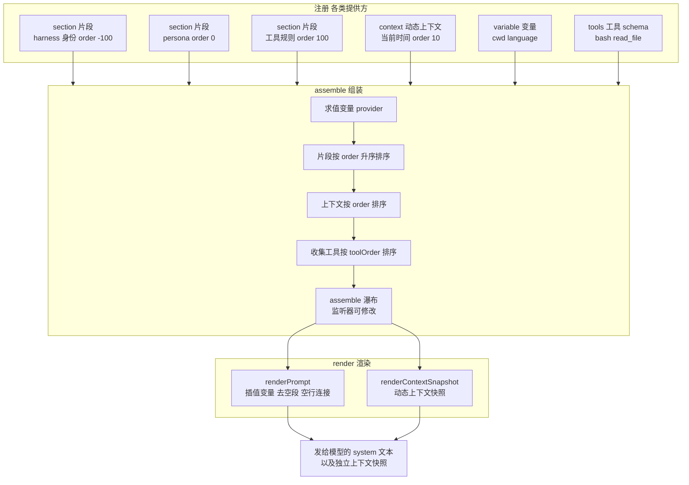

# DeepSeek Harness 从 0 开始：System Prompt 模块（提示词组装）

> 本系列从 0 开始，基于 Cordis 框架一步步实现一个简略版本的 DeepSeek Harness（loop、session、tool、system prompt 等）。前几篇我们有了 Session（记忆）、Tools（手）、Inbox（输入）、Loop（发动机）、Compaction（上下文管理），这一篇实现 Agent 的「人格」——**System Prompt 模块**：每次请求前，模型看到的系统提示词是怎么组装出来的。
>
> 配套代码：[blog-09-system-prompt](./)，运行 `pnpm install && pnpm dev` 即可复现本文全部输出。

## 上一篇留下的问题

Compaction 解决了「上下文太长」，但还有另一个问题：**模型每次请求前，那个「你是一个 AI 助手」的系统提示词从哪来？**

真实 Harness 的 system prompt 不是一段写死的文字，而是**很多来源拼起来的**：

- **harness 身份**：「You are an AI agent powered by DeepSeek Harness.」——框架自己加的；
- **deployment persona**：部署方定的人设——「你是一个专业的 TypeScript 编码助手」；
- **工具使用规则**：每个工具插件贡献一段「什么时候用我」的说明（blog-05 讲过）；
- **动态上下文**：当前时间、最近操作、工作目录——每次组装时实时求值；
- **变量**：`{{cwd}}`、`{{language}}`——渲染时插值；
- **工具 schema**：给模型看的工具清单（blog-05 FAQ 讲过：走 `tools` 字段，不进正文，但组装时一起收集）。

如果这些各自为政，prompt 会乱序、重复、冲突。dsh 用 **SystemPrompt 模块**统一管理：注册 → 排序 → 组装 → 渲染。

> 💡 dsh 的实现（`packages/core/system-prompt/src/index.ts`，545 行）核心概念：`PromptSection`（有序片段）、`PromptContext`（动态上下文）、`PromptAssembly`（组装结果）、`renderPrompt`（渲染）。本文实现它的简化版，保留全部核心机制。

## 项目目录结构

```
blog-09-system-prompt/
├── package.json          # 项目配置：依赖、启动脚本
├── pnpm-lock.yaml        # 依赖锁定文件
└── src/
    └── main.ts           # 代码入口，pnpm dev 运行它
```

## 核心概念

| 概念 | 一句话理解 |
| --- | --- |
| **PromptSection** | 一段提示词片段：名字 + order 顺序 + 文本（静态或按上下文求值） |
| **PromptContext** | 动态上下文片段：每次组装时实时求值（当前时间、最近操作等） |
| **PromptAssembly** | 组装结果：片段 + 上下文 + 工具 + 变量（都未插值，渲染时才插） |
| **变量插值** | `{{name}}` 引用，渲染时替换为注册变量的值 |
| **assemble 瀑布** | 洋葱模型：监听器可以修改/替换整个组装结果 |
| **complete 片段** | 标记「这段就是完整提示词」，组装后只保留它 |

先看提示词是怎么从「注册的片段」一步步拼成「发给模型的文本」的：



读图：**注册**（左）——各模块通过 `section()` / `context()` / `variable()` / `tools()` 贡献片段、上下文、变量、工具；**组装**（中）——`assemble()` 按固定步骤处理：先求值变量 → 片段/上下文按 order 排序 → 工具按 toolOrder 排序 → 跑 assemble 瀑布（监听器可改）；**渲染**（右）——`renderPrompt()` 插值变量、去空段、空行连接成 system 文本，`renderContextSnapshot()` 生成独立的动态上下文快照。**注册与渲染解耦：注册方只声明「贡献什么」，顺序和拼装由 order + assemble 决定。**

## Part 1：类型定义与注册 API

### 第一步：类型

```ts
// 一段提示词片段：名字 + 顺序 + 文本（静态或按上下文求值）
interface PromptSection {
  name: string
  order: number  // 升序拼接；-100 是 harness 身份，0 是 persona
  text: string | ((context: AssembleContext) => string)
  complete?: boolean  // 视作完整提示词（组装后只保留它）
}

// 动态上下文片段：同样有名字和顺序
interface PromptContext {
  name: string
  order: number
  text: string | ((context: AssembleContext) => string)
}

// 组装上下文：scope 作用域 + 取消信号
interface AssembleContext {
  scope?: string
  signal?: AbortSignal
}

// 工具 schema 提供方的返回
interface ToolProviderResult {
  schemas: ToolSchema[]
}

// 组装结果：片段 + 上下文 + 工具 + 变量（都未插值，渲染时才插）
interface PromptAssembly {
  sections: Array<{ name: string; text: string }>
  contexts: Array<{ name: string; text: string }>
  tools: ToolSchema[]
  variables: Record<string, string | undefined>
}

// 扩展 Cordis 类型
declare module '@cordisjs/core' {
  interface Events {
    // 组装瀑布：监听器可以修改/替换整个 assembly（洋葱模型）
    'system-prompt/assemble': (
      assembly: PromptAssembly,
      context: AssembleContext,
      next: () => Promise<PromptAssembly>,
    ) => Promise<PromptAssembly>
    // 任何提示词提供方变化时广播
    'system-prompt/change': () => void
  }

  interface Context {
    systemPrompt: SystemPrompt
  }
}
```

**关键设计**：`text` 可以是**字符串或函数**——函数在每次组装时求值，这是动态上下文的基础（同一段代码，每次组装拿到不同的当前时间）。

### 第二步：变量插值

```ts
// 合法变量名：小写字母开头，后续字母/数字/下划线
const VARIABLE_NAME = /^[a-z][a-z0-9_]*$/

// 插值 {{name}} 引用：未知变量、无值变量、畸形引用都会抛错
function interpolate(
  input: { name: string; text: string },
  variables: Record<string, string | undefined>,
  kind: 'section' | 'context',
): string {
  const text = input.text
  let result = ''
  let last = 0
  for (let open = text.indexOf('{{'); open >= 0; open = text.indexOf('{{', last)) {
    // 找到完整的 {{...}} 组
    const close = text.indexOf('}}', open + 2)
    if (close < 0) {
      // 只有 {{ 没有 }}：视为普通文字
      result += text.slice(last, open + 2)
      last = open + 2
      continue
    }
    const name = text.slice(open + 2, close)
    if (!VARIABLE_NAME.test(name)) {
      throw new Error(`malformed prompt variable reference "{{${name}}}" in ${kind} "${input.name}"`)
    }
    if (!Object.hasOwn(variables, name)) {
      throw new Error(`unknown prompt variable "{{${name}}}" in ${kind} "${input.name}"`)
    }
    const value = variables[name]
    if (value === undefined) {
      throw new Error(`prompt variable "{{${name}}}" has no value for this assembly (${kind} "${input.name}")`)
    }
    result += text.slice(last, open) + value
    last = close + 2
  }
  return result + text.slice(last)
}
```

**dsh 的严谨之处**：插值不是简单的字符串替换——**未知变量、未注册变量、无值变量都会抛错**。这保证 prompt 不会出现「`{{typo}}`」这种幽灵引用——写错变量名在渲染时就炸，而不是模型看到奇怪的占位符。

## Part 2：SystemPrompt Service——注册与组装

### 注册 API

```ts
class SystemPrompt extends Service {
  private sections = new Map<string, PromptSection>()
  private contexts = new Map<string, PromptContext>()
  private variables = new Map<string, (context: AssembleContext) => string | undefined>()
  private toolProviders: Array<(context: AssembleContext) => ToolProviderResult> = []
  private runtimeContextSuppressed = false
  private toolOrder: string[] | undefined

  constructor(ctx: Context, config: SystemPromptConfig = {}) {
    super(ctx, 'systemPrompt')
    this.toolOrder = config.toolOrder

    // 内置两个片段：harness 身份（-100）+ persona（0）
    if (config.includeHarnessIdentity ?? true) {
      this.section({
        name: 'harness:identity',
        order: -100,
        text: 'You are an AI agent powered by DeepSeek Harness.',
      })
    }
    this.section({
      name: 'deployment:persona',
      order: 0,
      text: config.persona ?? '',
    })
    this.runtimeContextSuppressed = !(config.includeRuntimeContext ?? true)
  }

  // 注册有序提示片段：同名重复抛错；effect 管理生命周期（插件卸载自动移除）
  section(section: PromptSection): () => void {
    if (!Number.isFinite(section.order)) {
      throw new TypeError(`prompt section "${section.name}" order must be a finite number`)
    }
    if (this.sections.has(section.name)) {
      throw new Error(`prompt section "${section.name}" is already registered`)
    }
    return this.ctx.effect(() => {
      this.sections.set(section.name, section)
      this.ctx.emit('system-prompt/change')
      return () => {
        this.sections.delete(section.name)
        this.ctx.emit('system-prompt/change')
      }
    })
  }

  // 注册动态上下文（同名重复抛错）
  context(context: PromptContext): () => void { /* 同 section 模式 */ }

  // 注册提示变量 {{name}}（名字必须合法，重复抛错）
  variable(name: string, provider: (context: AssembleContext) => string | undefined): () => void { /* ... */ }

  // 注册工具 schema 提供方
  tools(provider: (context: AssembleContext) => ToolProviderResult): () => void { /* ... */ }
}
```

**三个关键设计**（都来自 dsh）：

1. **同名重复抛错**：两个插件都想注册 `deployment:persona`？直接报错——冲突要显式暴露，不能静默覆盖；
2. **`ctx.effect()` 管理生命周期**：插件卸载时片段自动移除，并广播 `system-prompt/change`——其他模块（比如缓存 prompt 的）收到通知重新组装；
3. **内置片段**：构造函数里注册 `harness:identity`（-100）和 `deployment:persona`（0）——框架身份在最前，人设紧随其后。

### 组装：assemble()

```ts
async assemble(context: AssembleContext = {}): Promise<PromptAssembly> {
  // 1. 求值所有变量
  const variables: Record<string, string | undefined> = {}
  for (const [name, provider] of this.variables) {
    variables[name] = provider(context)
  }

  // 2. 片段：按 order 升序
  const sections = [...this.sections.values()]
    .sort((a, b) => a.order - b.order)
    .map(section => ({
      name: section.name,
      text: typeof section.text === 'function' ? section.text(context) : section.text,
    }))

  // complete 校验：多个 complete 片段报错
  const completeSections = [...this.sections.values()].filter(s => s.complete === true)
  if (completeSections.length > 1) {
    throw new Error(`multiple complete prompt sections are active: ...`)
  }

  // 3. 上下文（除非被 suppress）
  const contexts = this.runtimeContextSuppressed
    ? []
    : [...this.contexts.values()]
      .sort((a, b) => a.order - b.order)
      .map(entry => ({
        name: entry.name,
        text: typeof entry.text === 'function' ? entry.text(context) : entry.text,
      }))

  // 4. 工具 schema
  const collected: ToolSchema[] = []
  for (const provider of this.toolProviders) {
    collected.push(...provider(context).schemas)
  }
  const tools = this.orderTools(collected)

  const assembly: PromptAssembly = { sections, contexts, tools, variables }

  // 5. 组装瀑布：监听器可以修改/替换整个 assembly
  const transformed = await this.ctx.waterfall(
    'system-prompt/assemble', assembly, context,
    () => Promise.resolve(assembly),
  )

  // 6. complete 片段兜底
  if (completeSections.length === 1) {
    return { ...transformed, sections: [/* 只保留 complete 片段 */] }
  }
  return transformed
}
```

**assemble 的分步逻辑**：

1. **变量先求值**——所有 provider 跑一遍，得到 `variables` 字典；
2. **片段按 order 排序**——`-100` 身份 → `0` 人设 → `50` 运行时信息 → `100` 工具规则 → `200` 行为准则；
3. **上下文排序**——动态上下文独立排序（`suppressRuntimeContext` 可整体关闭）；
4. **工具收集**——所有 tool provider 的 schema 合并，按 `toolOrder` 排序；
5. **瀑布扩展**——`system-prompt/assemble` 是 waterfall（洋葱模型）：监听器可以修改 sections、加片段、换 persona，返回值权威；
6. **complete 兜底**——如果有 complete 片段，组装后只保留它（覆盖一切）。

### 渲染：renderPrompt()

```ts
// 渲染提示词：插值变量 → 去掉空片段 → 空行连接
function renderPrompt(assembly: PromptAssembly): string {
  return assembly.sections
    .map(section => interpolate(section, assembly.variables, 'section'))
    .filter(text => text.length > 0)
    .join('\n\n')
}

// 渲染动态上下文快照（dsh: renderContextSnapshot）
// 带「Current runtime context」前缀，声明它取代早前的快照
function renderContextSnapshot(assembly: PromptAssembly): string {
  const sections = assembly.contexts
    .map(context => ({ name: context.name, text: interpolate(context, assembly.variables, 'context') }))
    .filter(section => section.text.length > 0)
  const body = sections.map(s => s.text).join('\n\n')
  if (body.length === 0) return ''
  return `Current runtime context. This snapshot supersedes earlier runtime-context snapshots.\n\n${body}`
}
```

**为什么组装和渲染分离？** 组装得到的是「结构化数据」（片段列表 + 变量字典），渲染才变成「文本」。这样：瀑布监听器可以操作结构（加片段、换顺序），不用管字符串拼接；渲染是纯函数（同样 assembly 永远同样文本），可缓存。

## Part 3：演示——六步看透提示词组装

### 第 1 步：片段注册与排序

```ts
let ctx = new Context()
await ctx.plugin(SystemPrompt, {
  includeHarnessIdentity: true,
  includeRuntimeContext: true,
  persona: '你是一个专业的 TypeScript 编码助手，帮助用户实现 DeepSeek Harness。',
})

// 工具使用规则（order 100，工具提示约定用 100-199）
ctx.systemPrompt.section({
  name: 'tool:usage-rules',
  order: 100,
  text: '工具使用规则：\n- 需要执行命令时使用 bash 工具\n- 需要读取文件时使用 read_file 工具\n- 每次工具调用后检查结果再决定下一步',
})

// 行为准则（order 200）
ctx.systemPrompt.section({
  name: 'behavior:rules',
  order: 200,
  text: '行为准则：\n- 回答要简洁、准确\n- 不确定时明确说明\n- 代码要附带注释',
})
```

渲染结果——**片段严格按 order 排列**：

```
📋 已注册片段（按 order 排序）:
  [order -100] harness:identity: You are an AI agent powered by DeepSeek Harness.
  [order 0] deployment:persona: 你是一个专业的 TypeScript 编码助手，帮助用户实现 DeepSeek Harness。
  [order 100] tool:usage-rules: 工具使用规则：
  [order 200] behavior:rules: 行为准则：

📝 渲染结果:
You are an AI agent powered by DeepSeek Harness.

你是一个专业的 TypeScript 编码助手，帮助用户实现 DeepSeek Harness。

工具使用规则：
- 需要执行命令时使用 bash 工具
- 需要读取文件时使用 read_file 工具
- 每次工具调用后检查结果再决定下一步

行为准则：
- 回答要简洁、准确
- 不确定时明确说明
- 代码要附带注释
```

**order 约定**（dsh 文档原文）：`-100` 是 harness 身份，`0` 是部署人设，工具指导用 `100-199`，其他负 order 在人设之前。**注册顺序无关紧要，order 决定一切**。

### 第 2 步：变量插值

```ts
// 注册变量：当前工作目录 + 用户语言
ctx.systemPrompt.variable('cwd', () => '/workspace/blog-09-system-prompt')
ctx.systemPrompt.variable('language', () => 'Chinese')

// 在片段里引用变量
ctx.systemPrompt.section({
  name: 'runtime:info',
  order: 50,
  text: '当前工作目录: {{cwd}}\n用户语言: {{language}}',
})
```

渲染结果——`{{cwd}}` 和 `{{language}}` 被替换：

```
📝 渲染结果（含变量插值）:
...
当前工作目录: /workspace/blog-09-system-prompt
用户语言: Chinese
...
```

`runtime:info`（order 50）插在人设（0）和工具规则（100）之间——**变量让同一段片段在不同会话渲染出不同内容**。

### 第 3 步：动态上下文

```ts
// 注册动态上下文：当前时间（每次组装时求值）
ctx.systemPrompt.context({
  name: 'runtime:time',
  order: 10,
  text: () => `当前时间: ${new Date().toLocaleTimeString()}`,
})

// 注册上下文：最近操作（模拟）
ctx.systemPrompt.context({
  name: 'runtime:last-action',
  order: 20,
  text: () => '最近操作: 用户要求实现 System Prompt 模块',
})
```

上下文快照（独立的 `renderContextSnapshot`，带前缀）：

```
📝 上下文快照:
Current runtime context. This snapshot supersedes earlier runtime-context snapshots.

当前时间: 12:47:31 PM

最近操作: 用户要求实现 System Prompt 模块
```

**context 与 section 的区别**：section 是「模型的长期人格」（人设、规则），context 是「当前时刻的短时状态」（现在几点、刚做了什么）。dsh 把它们分开管理——`renderPrompt()` 输出人格，`renderContextSnapshot()` 输出当前状态快照，前缀「This snapshot supersedes earlier...」告诉模型**最新的快照取代旧快照**（防止模型把过时的 runtime 信息当最新）。

### 第 4 步：工具 schema 提供方

```ts
// 注册工具 schema（模拟 Tools 篇的 Tools 模块）
ctx.systemPrompt.tools(() => ({
  schemas: [
    {
      name: 'bash',
      description: 'Execute a bash command',
      parameters: { type: 'object', properties: { command: { type: 'string' } } },
    },
    {
      name: 'read_file',
      description: 'Read a file from disk',
      parameters: { type: 'object', properties: { path: { type: 'string' } } },
    },
  ],
}))
```

组装结果中的工具：

```
📋 组装结果中的工具:
  - bash: Execute a bash command
  - read_file: Read a file from disk
```

**呼应 blog-05 FAQ**：工具 schema 收集进 `assembly.tools`，渲染时走 `GenerateOptions.tools` 字段（不是拼进 system prompt 正文）——但**组装是统一入口**：`assemble()` 同时收集片段、上下文、工具，Agent Loop 一次组装拿到所有模型输入。

### 第 5 步：完整组装 + 瀑布扩展

```ts
// 监听 assemble 瀑布：可以修改 assembly（洋葱模型）
ctx.on('system-prompt/assemble', async (assembly, context, next) => {
  const result = await next()
  // 在片段后追加一段「会话说明」
  result.sections.push({ name: 'session:note', text: '（本条消息由 assemble 瀑布追加）' })
  return result
})
```

最终渲染——瀑布追加的片段出现在末尾：

```
📝 最终渲染结果:
You are an AI agent powered by DeepSeek Harness.

你是一个专业的 TypeScript 编码助手，帮助用户实现 DeepSeek Harness。

当前工作目录: /workspace/blog-09-system-prompt
用户语言: Chinese

工具使用规则：
- 需要执行命令时使用 bash 工具
- 需要读取文件时使用 read_file 工具
- 每次工具调用后检查结果再决定下一步

行为准则：
- 回答要简洁、准确
- 不确定时明确说明
- 代码要附带注释

（本条消息由 assemble 瀑布追加）
```

**`system-prompt/assemble` 是 waterfall（洋葱模型）**——这是 blog-03 讲的模式的实际应用：任何插件可以在组装时包装、修改、替换 prompt。权限插件可以追加安全约束，审计插件可以加 trace 信息——**不用改 SystemPrompt 本身，挂监听器就行**。

### 第 6 步：complete 片段（覆盖式）

```ts
// 注册一个 complete 片段：组装后只保留它（忽略其他所有片段）
const disposeComplete = ctx.systemPrompt.section({
  name: 'override:everything',
  order: 999,
  complete: true,
  text: '你是评审模式。只输出评审意见，不写代码。',
})
```

```
📝 complete 片段渲染（其他片段被忽略）:
你是评审模式。只输出评审意见，不写代码。

📝 移除 complete 后恢复:
You are an AI agent powered by DeepSeek Harness. ...
```

**complete 片段 = 一键换人格**：某些场景（评审模式、诊断模式）需要完全不同的 system prompt——注册一个 `complete: true` 的片段，组装后只保留它，其他全被忽略。`dispose()` 移除后恢复正常。dsh 里同一个会话中多个 complete 片段同时活跃会报错（冲突显式化）。

## 常见问题 FAQ

**Q: section 和 context 有什么区别？**

A: 定位不同：section 是模型的**长期人格**（身份、人设、规则、工具使用指南）——跨会话稳定；context 是**当前时刻的短时状态**（当前时间、最近操作、工作目录）——每次组装实时求值。渲染时两者也分开：`renderPrompt()` 输出人格，`renderContextSnapshot()` 输出带「Current runtime context」前缀的状态快照。

**Q: order 数字有什么约定？**

A: dsh 文档约定：`-100` harness 身份，`0` 部署人设（persona），`100-199` 工具使用指导，其他负 order 在人设之前。片段按 order **升序**拼接——order 越小越靠前。注册顺序无关紧要，order 决定位置。

**Q: `{{变量}}` 引用写错了会怎样？**

A: **渲染时抛错**，不是静默替换。dsh 的 `interpolate` 有三种报错：变量名不合法（`{{Foo}}` 大写）、变量未注册（`{{typo}}`）、变量注册了但值为 undefined。这是刻意设计——prompt 出现幽灵占位符比渲染失败更危险（模型会看到 `{{cwd}}` 原样输出）。只有 `{{` 没有 `}}` 的才是普通文字。

**Q: 组装和渲染为什么要分离？**

A: 组装产出**结构化数据**（片段列表 + 变量字典 + 工具），渲染才变成**文本**。好处：瀑布监听器操作结构（加片段、换顺序、改 persona）不用管字符串；渲染是纯函数（同样输入永远同样输出），可缓存、可测试。Agent Loop 每次请求前 `assemble()` 一次，需要文本时 `renderPrompt()`。

**Q: 和 Tools 篇的工具 schema 什么关系？**

A: 工具 schema 是 `assemble()` 收集的一部分（`assembly.tools`）——Tools 模块通过 `ctx.systemPrompt.tools()` 注册提供方，组装时自动收集。但渲染时 tools **不走 prompt 正文**，走 `GenerateOptions.tools` 字段（blog-05 FAQ 讲过）。`assemble()` 是统一入口：一次调用同时拿到片段、上下文、工具，Agent Loop 不用分别调各模块。

**Q: complete 片段有什么用？**

A: **一键换人格**。某些模式需要完全不同的 system prompt（评审、诊断、只读），注册一个 `complete: true` 片段，组装后只保留它——不用注销其他所有片段。多个 complete 同时活跃会报错（冲突显式化）。`dispose()` 移除后恢复正常 prompt。

## 小结

1. **SystemPrompt = 提示词注册中心**：section（人格）/ context（状态）/ variable（变量）/ tools（工具）四类注册，统一组装；
2. **order 驱动排序**：`-100` 身份 → `0` 人设 → `50-200` 规则，注册顺序无关紧要；
3. **变量插值严格校验**：`{{name}}` 未知/非法/无值都抛错——杜绝幽灵占位符；
4. **assemble 瀑布扩展**：`system-prompt/assemble` 是洋葱模型，插件可修改/替换整个 prompt；
5. **complete 覆盖**：一键换人格，冲突显式化；
6. **组装渲染分离**：结构化组装 + 纯函数渲染，可缓存可测试。

至此，系列覆盖了 dsh 的核心 Agent 模块：**Cordis 基础（01-03）→ Session（04）→ Tools（05）→ Inbox（06）→ Loop（07）→ Compaction（08）→ System Prompt（09）**。下一篇可以把 Mock LLM 换成真实 OpenAI 适配器（LLM 模块），让整套框架跑真实模型。

**下一篇预告**：LLM 模块——适配器接口抽象、OpenAI API 调用、流式输出、错误重试。

---

*本文代码已验证可运行（Node.js + tsx，@cordisjs/core v4.0.0-beta.5）。完整源码见同目录 `src/main.ts`，实现结构对应 dsh 的 `packages/core/system-prompt`。*
