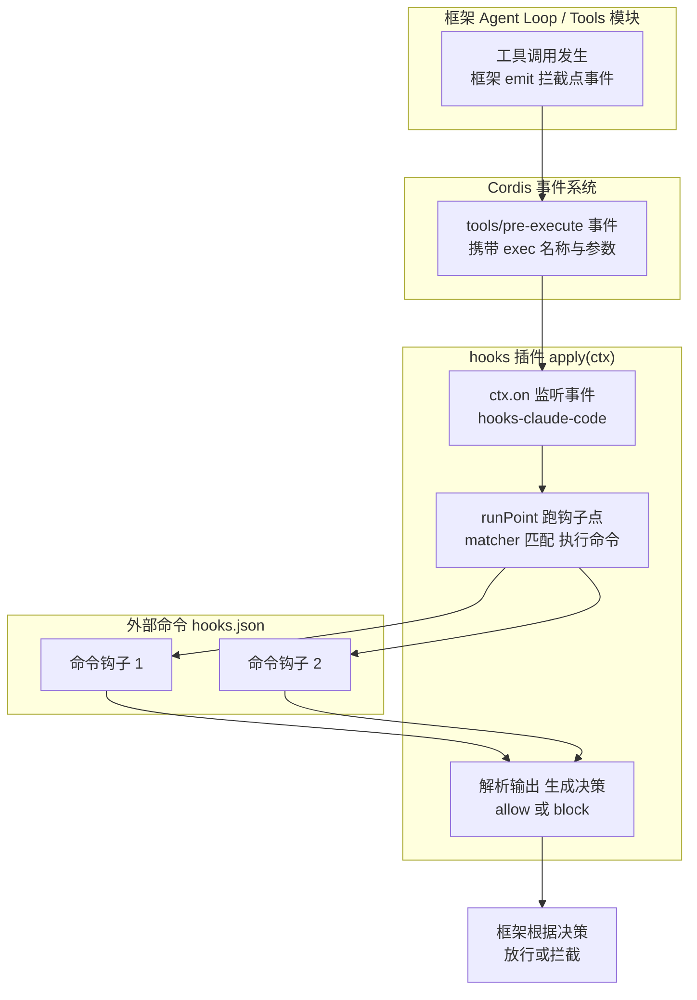

# DeepSeek Harness 从 0 开始：Hooks 模块（钩子协议）

> 本系列从 0 开始，基于 Cordis 框架一步步实现一个简略版本的 DeepSeek Harness（loop、session、tool、system prompt 等）。前九篇覆盖了核心 Agent 模块，这一篇实现大纲里承诺的最后一块：**Hooks 模块**——钩子协议。
>
> 配套代码：[blog-10-hooks](./)，运行 `pnpm install && pnpm dev` 即可复现本文全部输出。

## 核心问题：框架和 hooks 插件怎么通信？

回顾整个系列，我们多次遇到「拦截点」：事件系统篇的洋葱模型、Tools 篇的 pre-execute 瀑布、Agent Loop 篇的 agent/pre-step、System Prompt 篇的 assemble 瀑布——**Cordis 的事件系统已经能做拦截**。但还缺一层：

- **谁来决定拦截逻辑？** 目前是插件写监听器——但「策略」和「机制」混在一起；
- **外部工具怎么接入？** 真实世界里，Claude Code / Codex 有自己的 hooks 机制（`hooks.json` 配置命令钩子）——怎么让它们跑在 dsh 的拦截点上？

dsh 的答案是把「外部 CLI 的钩子协议」**桥接**到 Cordis 拦截点。而理解这一切的钥匙，是先看**通信链路**——两个独立的模块怎么对话：

```
【框架】Agent Loop / Tools 模块
    │  （它们是事件的"发送方"）
    │  ctx.emit('tools/pre-execute', exec)     ← 框架发事件
    ▼
【Cordis 事件系统】派发给所有监听器
    ▼
【hooks 插件】（监听者，ctx.on 注册）
    │  收到事件 → 调用 runPoint('PreToolUse', exec.name, payload)
    │    ├─ matcher 匹配 hooks.json 里的钩子组
    │    ├─ runHook 执行外部命令（bash）
    │    └─ 解析输出 → 决策
    │  返回决策 → 事件瀑布 next() 继续
    ▼
【框架】根据决策放行/拦截
```



**读这个链路，三个要点**：

1. **框架是发送方**：Agent 每次要调工具、进 step、结束 turn，框架在关键节点 `ctx.emit` 拦截点事件——**框架不知道 hooks 存在**；
2. **hooks 插件是监听方**：它 `ctx.on` 注册监听，收到事件后执行外部命令、解析输出、返回决策——**hooks 不改框架**；
3. **两者通过「事件契约」通信**：事件名（`tools/pre-execute`）、载荷（`exec` 对象）、决策协议（`allow`/`block`）——**这就是保证通信的约定**。

> 💡 dsh 的 `packages/hooks/` 有三个包：`hook-protocol`（方言无关的词汇表：matcher / codec / runner / events）、`hooks-claude-code`（桥接 Claude Code 的 hooks.json）、`hooks-codex`（桥接 Codex）。本文实现 hook-protocol 的核心，用模拟命令演示完整链路。

## 双方各自要实现什么

### 框架侧：发事件，等决策

框架（Agent Loop / Tools 模块）要做的事很简单——**在拦截点发事件，然后根据监听者的返回决定放行/拦截**：

```ts
// Tools 模块 execute() 里（简化，对应 Tools 篇的 pre-execute 瀑布）
async execute(call: ToolCall): Promise<ToolResult> {
  // ① 发拦截点事件：谁关心谁监听（hooks 插件就是监听者之一）
  const decision = await this.ctx.waterfall('tools/pre-execute', call, async () => 'allow')

  // ③ 根据决策放行/拦截
  if (decision !== 'allow') {
    return { id: call.id, error: `工具被拒绝: ${decision}` }
  }
  // ...执行工具
}
```

框架侧**只做三件事**：

| 框架做什么 | 代码 | 说明 |
| --- | --- | --- |
| 发事件 | `ctx.waterfall('tools/pre-execute', call, next)` | 在拦截点广播，等监听者返回 |
| 提供载荷 | `call`（工具名、参数） | 让监听者知道「要调什么」 |
| 处理决策 | `decision !== 'allow' → 拒绝` | 根据返回值放行/拦截 |

**框架的关键设计**：用 **waterfall（洋葱模型）** 而不是 emit——因为要「等监听者返回决策」，emit 是触发即忘不返回。waterfall 的 `next()` 让多个监听者层层包裹，最终返回一个权威决策。

### hooks 插件侧：收事件，跑命令，返回决策

hooks 插件要做的事复杂一些——**监听事件 → 匹配钩子 → 执行命令 → 解析输出 → 返回决策**。而它本身也是标准 Cordis 插件：

```ts
// hooks 插件 = 标准 Cordis 插件（dsh: hooks-claude-code/src/index.ts）
export const inject = ['shell']                     // ① 声明依赖：执行命令需要 shell

export function apply(ctx: Context, config: Config): void {
  const parsed = parseClaudeCodeConfig(readFileSync(config.configPath))  // ② 加载 hooks.json

  async function runPoint(point, matchQuery, payload, opts) {
    const groups: MatcherGroup[] = parsed[point] ?? []   // ③ 取这个钩子点的组
    for (const group of groups) {
      if (!matchesMatcher(group.matcher, matchQuery, 'claude-code')) continue
      for (const hook of group.hooks) {
        // appendHookInvoked → runHook(执行命令) → appendHookResult（配对事件）
      }
    }
  }

  // ④ 核心：ctx.on 把外部钩子点「桥接」到 Cordis 拦截点事件
  ctx.on('tools/pre-execute', async (exec, next) => {
    const merged = await runPoint('PreToolUse', exec.name, payload, ...)
    return next()  // 钩子结果 → PreToolDecision
  })
  ctx.on('tools/post-execute', ...)   // PostToolUse
  ctx.on('agent/pre-step', ...)       // UserPromptSubmit
  ctx.on('agent/turn-stopping', ...)  // Stop
}
```

hooks 插件侧**做的五件事**：

| hooks 插件做什么 | 代码 | 说明 |
| --- | --- | --- |
| 声明依赖 | `inject = ['shell']` | 执行命令需要 shell 服务（Cordis 保证就绪） |
| 加载配置 | `parseClaudeCodeConfig(hooks.json)` | 把外部钩子配置解析成 matcher 组 |
| 监听事件 | `ctx.on('tools/pre-execute', ...)` | **桥接**：外部钩子点 ↔ Cordis 拦截点 |
| 匹配并执行 | `runPoint()` + `runHook()` | matcher 选中钩子 → 跑外部命令 |
| 返回决策 | `next()` / 决策对象 | 把钩子结果映射成拦截点决策 |

### 保证通信的三个契约

框架和 hooks 插件互相不认识，能通信全靠三个「契约」：

| 契约 | 内容 | 谁定义 |
| --- | --- | --- |
| **事件名** | `tools/pre-execute`、`agent/pre-step`…… | 框架（拦截点事件） |
| **载荷形状** | `exec`（name、arguments、agent） | 框架定义，hooks 读取 |
| **决策协议** | `allow` / `deny` / `block` / `ask` | hook-protocol 归一化 |

**框架发什么形状的载荷，hooks 插件就读什么**；**hooks 返回什么决策，框架就怎么处理**——这就是「插件和 hooks 结合」的全部秘密：**没有任何直接调用，全靠事件契约解耦**。

## 项目目录结构

```
blog-10-hooks/
├── package.json          # 项目配置：依赖、启动脚本
├── pnpm-lock.yaml        # 依赖锁定文件
└── src/
    └── main.ts           # 代码入口，pnpm dev 运行它
```

## 核心概念

| 概念 | 一句话理解 |
| --- | --- |
| **Hook（钩子）** | 在拦截点执行的命令：matcher 匹配 + 命令 + 超时 |
| **Matcher（匹配器）** | 模式匹配：`*` 匹配所有 / 字面量 / 正则 |
| **Codec（解码器）** | 解析钩子进程输出：exit 0 JSON / exit 2 block / 其他 = 非阻塞错误 |
| **Runner（执行器）** | 执行钩子命令、超时控制、基础设施故障容错 |
| **hook/invoked + hook/result** | 一次钩子调用的配对日志事件（可审计） |

## Part 1：类型定义——钩子词汇表

```ts
// 一条命令钩子：要执行的 shell 命令 + 超时（秒）
interface CommandHook {
  command: string
  timeoutSec?: number
}

// 一个 matcher 组：模式 + 匹配时执行的钩子列表
interface MatcherGroup {
  matcher?: string  // 缺省 / '' / '*' = 匹配所有
  hooks: CommandHook[]
}

// 钩子输出：解码后的中立结果（每个字段都可选——钩子可能只用其中几个）
interface HookOutput {
  exitCode: number | undefined
  stderr: string
  stdout: string
  continue?: boolean      // false = 请求停止
  stopReason?: string     // continue=false 时展示给用户
  decision?: 'approve' | 'allow' | 'block' | 'deny' | 'ask'
  reason?: string
  additionalContext?: string  // 注入下一轮请求的额外上下文
  systemMessage?: string      // 警告信息
}

// 钩子方言（dsh 桥接 Claude Code / Codex；这里演示）
type HookDialect = 'claude-code' | 'codex'

// 匹配模式解释方式
type MatcherMode = 'claude-code' | 'codex'

// 一次钩子调用的配对标识
interface HookInvocation {
  turn: number
  point: string       // 钩子点：PreToolUse / Stop / UserPromptSubmit ...
  dialect: HookDialect
  handlerId: string   // 关联 invoked/result 的稳定 id
  matcher?: string
}
```

**关键设计**：`HookOutput` 的每个字段都是可选的——一个钩子可能只输出 `continue: false`（停止），也可能只输出 `decision: deny`（拒绝），还可能带 `additionalContext`（注入上下文）。**解码器负责把「进程输出」翻译成这个中立词汇表**，具体哪个字段有意义由钩子点决定。这正是「决策协议」契约的实现——框架读 `decision`，hooks 插件产出 `decision`。

## Part 2：Matcher——模式匹配

钩子怎么知道「自己该不该跑」？靠 matcher 匹配查询值（工具名、会话来源等）：

```ts
// 缺省 / 空 / '*' = 匹配所有
function isMatchAll(matcher: string | undefined): boolean {
  return matcher === undefined || matcher === '' || matcher === '*'
}

// Claude 字面量模式：纯字母数字下划线 + '|'（'|' = 精确匹配的或）
const CLAUDE_LITERAL = /^[A-Za-z0-9_|]+$/

// 编译非锚定正则；非法模式返回 undefined（不抛）
function compileRegex(pattern: string): RegExp | undefined {
  try {
    return new RegExp(pattern)
  } catch {
    return undefined
  }
}

// matcher 是否选中 query：
// - Claude 字面量：精确匹配 | 分隔的替代项
// - 其他：非锚定正则
function matchesMatcher(matcher: string | undefined, query: string, mode: MatcherMode): boolean {
  if (isMatchAll(matcher)) return true
  const pattern = matcher as string
  if (mode === 'claude-code' && CLAUDE_LITERAL.test(pattern)) {
    return pattern.split('|').includes(query)  // 字面量：管道分隔的精确匹配
  }
  const regex = compileRegex(pattern)
  return regex === undefined ? false : regex.test(query)  // 正则：非锚定匹配
}
```

**两种匹配语义**（dsh 文档原文）：
- **Claude Code**：纯 `[A-Za-z0-9_|]+` 模式按**字面量**解释（`|` = 精确匹配的或）；其他模式按**正则**；
- **Codex**：所有非空模式都按**非锚定正则**。

运行验证（Part 1 输出）：

```
📋 matcher 匹配测试（dialect: claude-code）:
  matcher "*" vs "bash" → true
  matcher "bash" vs "bash" → true
  matcher "bash" vs "read_file" → false
  matcher "read_.*" vs "read_file" → true
  matcher "read_.*" vs "write_file" → false
  matcher "bash|read_file" vs "read_file" → true    ← 管道 = 精确匹配或
  matcher "bash|read_file" vs "write_file" → false
```

**`*` 匹配所有**（match-all 哨兵）、**`bash` 精确匹配**、**`read_.*` 正则匹配**、**`bash|read_file` 管道或**——一个 matcher 覆盖多种工具的钩子配置。

## Part 3：Codec——钩子输出解码

钩子进程跑完，stdout/stderr/exit code 怎么变成决策？这是 codec 的工作：

```ts
// exit 2 = 阻塞错误（stderr 作为原因）
const BLOCKING_EXIT_CODE = 2

// 顶层 decision 只有 approve/block（allow/deny/ask 是 hookSpecificOutput 专属）
function topLevelDecisionOf(value: string | undefined): HookOutput['decision'] {
  return value === 'approve' || value === 'block' ? value : undefined
}

// permissionDecision 只有 allow/deny/ask
function permissionDecisionOf(value: string | undefined): HookOutput['decision'] {
  return value === 'allow' || value === 'deny' || value === 'ask' ? value : undefined
}

/**
 * 解码钩子进程输出（dsh: parseHookOutput）
 * - exit 0 + stdout 是 JSON 对象 → 解析结构化字段
 * - exit 2 → block，stderr 作为 reason
 * - 其他 exit / 无法运行 → 非阻塞错误
 * - 非法 JSON 保持为普通 stdout
 */
function parseHookOutput(exitCode: number | undefined, stdout: string, stderr: string): HookOutput {
  const trimmedErr = stderr.trim()
  const trimmedOut = stdout.trim()
  const output: HookOutput = { exitCode, stderr: trimmedErr, stdout: trimmedOut }

  // exit 2 = 阻塞，stderr 为原因
  if (exitCode === BLOCKING_EXIT_CODE) {
    output.decision = 'block'
    if (trimmedErr.length > 0) output.reason = trimmedErr
  }

  // exit 0 才解析结构化 stdout
  if (exitCode === 0 && trimmedOut.startsWith('{')) {
    let parsed: Record<string, unknown> | undefined
    try {
      parsed = asObj(JSON.parse(trimmedOut))
    } catch {
      parsed = undefined  // 非法 JSON 保持普通文本
    }
    if (parsed) applyStructured(output, parsed)
  }

  return output
}
```

**解码规则**（dsh 文档原文）：
- **exit 0**：stdout 以 `{` 开头 → 尝试解析 JSON（结构化决策）；非法 JSON → 保持普通文本（宽容，和参考引擎一致）；
- **exit 2**：**阻塞**——`decision: 'block'`，stderr 作为 reason；
- **其他 exit**：非阻塞错误（钩子失败了但请求继续）；
- **无法运行**（基础设施故障）：无 exitCode，同样非阻塞。

**决策字段的两个通道**：
- **顶层 `decision`**：只有 `approve` / `block`（legacy 兼容，`allow/deny/ask` 在顶层无效且忽略）；
- **`hookSpecificOutput.permissionDecision`**：`allow` / `deny` / `ask`（**覆盖**顶层 decision）+ `additionalContext` / `permissionDecisionReason`。

运行验证（Part 2 输出）：

```
📋 输出解码测试:
  exit=0 stdout="{"decision":"approve"}" → decision=approve
  exit=0 stdout="{"hookSpecificOutput":{"permissionDecisi" → decision=deny reason="不合规"
  exit=2 stdout="" → decision=block reason="检测到危险操作"
  exit=1 stdout="some error output" → decision=无
  exit=undefined stdout="" → decision=无
```

## Part 4：Runner——执行钩子命令

```ts
// 参考默认超时：10 分钟（Claude Code / Codex 的默认）
const DEFAULT_HOOK_TIMEOUT_MS = 600_000

interface RunHookOptions {
  payload: unknown            // 写入 stdin 的 JSON
  env?: Record<string, string>  // 额外环境变量
  cwd?: string
  signal: AbortSignal
  defaultTimeoutMs?: number
}

/**
 * 执行一条钩子命令（dsh: runHook）
 * 通过子进程执行（教学简化：直接 spawn），超时控制，
 * 基础设施故障 → 无 exitCode 的非阻塞错误（绝不抛到调用方）
 */
async function runHook(hook: CommandHook, options: RunHookOptions): Promise<RunHookResult> {
  const started = Date.now()
  const timeoutMs = hook.timeoutSec !== undefined
    ? hook.timeoutSec * 1000
    : (options.defaultTimeoutMs ?? DEFAULT_HOOK_TIMEOUT_MS)
  const stdin = JSON.stringify(options.payload)

  try {
    const { execFile } = await import('node:child_process')
    const { promisify } = await import('node:util')
    const execFileAsync = promisify(execFile)

    const result = await execFileAsync('/bin/sh', ['-c', hook.command], {
      input: stdin,
      timeout: timeoutMs,
      cwd: options.cwd,
      env: { ...process.env, ...options.env },
      maxBuffer: 1024 * 1024,
    })

    return {
      output: parseHookOutput(0, result.stdout, result.stderr ?? ''),
      durationMs: Date.now() - started,
    }
  } catch (error: any) {
    // 子进程非零退出：execFile 抛错，error.code 是 exit code
    if (typeof error?.code === 'number') {
      return {
        output: parseHookOutput(error.code, error.stdout ?? '', error.stderr ?? ''),
        durationMs: Date.now() - started,
      }
    }
    // 基础设施故障（超时/无法运行）：无 exitCode，非阻塞
    const message = error instanceof Error ? error.message : String(error)
    return {
      output: parseHookOutput(undefined, '', message),
      durationMs: Date.now() - started,
    }
  }
}
```

**Runner 的两个关键设计**：

1. **超时**：`hook.timeoutSec`（秒，协议单位）覆盖默认 10 分钟——钩子卡死不会挂住整个 turn；
2. **绝不抛异常**：钩子跑不了（超时、无 shell、坏 workdir）→ 返回无 exitCode 的非阻塞错误——**钩子失败不 crash 请求，只留一条记录**（dsh: "A hook that cannot run is a non-blocking error: no exit code, the failure on stderr for the record. The turn proceeds."）。

## Part 5：HookService——注册、匹配、执行、事件日志

```ts
class HookService extends Service {
  private groups: MatcherGroup[] = []
  private counter = 0        // handlerId 计数器
  private logSeq = 0         // 事件日志 seq（连续递增）
  readonly dialect: HookDialect

  constructor(ctx: Context, config: HooksConfig = {}) {
    super(ctx, 'hooks')
    this.dialect = config.dialect ?? 'claude-code'
    // 注册配置里的钩子组
    for (const group of config.groups ?? []) {
      this.registerGroup(group)
    }
  }

  // 注册一个 matcher 组（校验 matcher 合法性；effect 管理生命周期）
  registerGroup(group: MatcherGroup): () => void {
    const diagnostic = matcherDiagnostic(group.matcher, this.dialect)
    if (diagnostic !== undefined) {
      throw new Error(`hook config: ${diagnostic}`)
    }
    return this.ctx.effect(() => {
      this.groups.push(group)
      return () => {
        this.groups.splice(this.groups.indexOf(group), 1)
      }
    })
  }

  // 在某个钩子点执行所有匹配的钩子（dsh: 桥接到拦截点）
  async fire(point: string, query: string, payload: Record<string, unknown>, turn = 1): Promise<HookOutput[]> {
    const results: HookOutput[] = []

    for (const group of this.groups) {
      if (!matchesMatcher(group.matcher, query, this.dialect)) continue

      for (const hook of group.hooks) {
        const handlerId = `hook-${++this.counter}`
        // 记录 invoked（配对开始）
        const invoked: SessionEvent = {
          type: 'hook/invoked', seq: ++this.logSeq, turn, point,
          ...(group.matcher !== undefined ? { matcher: group.matcher } : {}),
          handlerId, timestamp: Date.now(),
        }
        this.log(invoked)

        // 执行钩子
        const { output, durationMs } = await runHook(hook, {
          payload: { ...payload, hookEventName: point },
          env: { DSH_HOOK_POINT: point, DSH_HOOK_QUERY: query },
          signal: new AbortController().signal,
        })

        // 记录 result（配对结束）
        const decision = output.decision ?? (output.continue === false ? 'stop' : 'pass')
        const result: SessionEvent = {
          type: 'hook/result', seq: ++this.logSeq, turn, point, handlerId,
          decision,
          ...(output.exitCode !== undefined ? { exitCode: output.exitCode } : {}),
          durationMs, timestamp: Date.now(),
        }
        this.log(result)

        console.log(`  🔌 [${point}] matcher=${group.matcher ?? '*'} 钩子 "${hook.command}" → ${decision}${output.reason ? ` (${output.reason})` : ''}`)
        results.push(output)
      }
    }

    return results
  }
}
```

**`fire()` 的完整链路**：对每个 matcher 组——`matchesMatcher` 判断是否选中 → 选中则逐个执行钩子 → 每个钩子记录 `hook/invoked`（开始）+ `hook/result`（结束，用 `handlerId` 配对）→ 返回所有输出供调用方决定拦截结果。

**事件配对是审计的关键**：`hook/invoked` 和 `hook/result` 用 `handlerId` 关联（`hook-1` ↔ `hook-1`），记录了钩子点、matcher、决策、exit code、耗时——**每次钩子执行都有完整审计轨迹**（这也是 dsh 把 `hook/*` 写成 Session 事件的原因：可重放、可排查）。

## Part 6：演示——钩子拦截工具调用

### 配置三种钩子

```ts
let ctx = new Context()
await ctx.plugin(HookService, {
  dialect: 'claude-code',
  groups: [
    // 匹配所有工具的钩子：记录每个工具调用
    { matcher: '*', hooks: [
      { command: 'echo "{\\"continue\\":true,\\"hookEventName\\":\\"PreToolUse\\"}"', timeoutSec: 5 },
    ] },
    // 精确匹配 bash 的钩子：要求批准
    { matcher: 'bash', hooks: [
      { command: 'echo "{\\"decision\\":\\"block\\",\\"reason\\":\\"bash 需要人工批准\\"}"', timeoutSec: 5 },
    ] },
    // 正则匹配 read_* 的钩子：注入额外上下文
    { matcher: 'read_.*', hooks: [
      { command: 'echo "{\\"hookSpecificOutput\\":{\\"permissionDecision\\":\\"allow\\",\\"additionalContext\\":\\"文件读取需谨慎\\"}}"', timeoutSec: 5 },
    ] },
  ],
})
```

### 模拟 Agent 调用工具（触发 PreToolUse 拦截点）

```ts
// 模拟 Agent 要调用工具前触发 PreToolUse 钩子
const bashResults = await ctx.hooks.fire('PreToolUse', 'bash', {
  tool_name: 'bash', tool_input: { command: 'rm -rf /' },
})
const readResults = await ctx.hooks.fire('PreToolUse', 'read_file', {
  tool_name: 'read_file', tool_input: { path: '/etc/passwd' },
})
const writeResults = await ctx.hooks.fire('PreToolUse', 'write_file', {
  tool_name: 'write_file', tool_input: { path: '/tmp/x' },
})
```

运行输出：

```
🚀 Agent 尝试调用 bash...
  🔌 [PreToolUse] matcher=* 钩子 "echo ...continue:true..." → pass
  🔌 [PreToolUse] matcher=bash 钩子 "echo ...decision:block..." → block (bash 需要人工批准)
  决策汇总: pass, block

🚀 Agent 尝试调用 read_file...
  🔌 [PreToolUse] matcher=* 钩子 "echo ..." → pass
  🔌 [PreToolUse] matcher=read_.* 钩子 "echo ...permissionDecision:allow..." → allow
  决策汇总: pass, allow
  📎 附加上下文: 文件读取需谨慎

🚀 Agent 尝试调用 write_file...
  🔌 [PreToolUse] matcher=* 钩子 "echo ..." → pass
  决策汇总: pass
```

**读这次拦截**：

- **bash**（`rm -rf /`）：匹配 `*` 的钩子返回 pass（记录），匹配 `bash` 的钩子返回 **block**「bash 需要人工批准」——危险操作被拦截；
- **read_file**（读 /etc/passwd）：匹配 `read_.*` 的钩子返回 **allow + additionalContext**「文件读取需谨慎」——放行但注入上下文给模型；
- **write_file**：只有 `*` 钩子匹配 → pass——无专门策略，默认放行。

**这就是通信链路落地的样子**：Agent 每次要调工具（框架侧），`fire('PreToolUse', toolName, payload)` 跑所有匹配的钩子（hooks 插件侧），汇总决策决定「放行 / 拦截 / 询问」。真实 dsh 里这个 `fire` 接在 `tools/pre-execute` 瀑布上——**框架发的 `tools/pre-execute` 事件，hooks 插件监听后调用 `fire`，钩子结果映射成 `PreToolDecision` 返回给框架**。

### 事件日志（审计）

```
📜 hook/invoked + hook/result 配对事件:
  #1 hook/invoked point=PreToolUse matcher=* id=hook-1
  #2 hook/result  id=hook-1 decision=pass exit=0 6ms
  #3 hook/invoked point=PreToolUse matcher=bash id=hook-2
  #4 hook/result  id=hook-2 decision=block exit=0 5ms
  #5 hook/invoked point=PreToolUse matcher=* id=hook-3
  #6 hook/result  id=hook-3 decision=pass exit=0 4ms
  #7 hook/invoked point=PreToolUse matcher=read_.* id=hook-4
  #8 hook/result  id=hook-4 decision=allow exit=0 4ms
  #9 hook/invoked point=PreToolUse matcher=* id=hook-5
  #10 hook/result  id=hook-5 decision=pass exit=0 4ms
```

**每次钩子执行都有完整审计**：哪个钩子点、哪个 matcher、哪个 handlerId、什么决策、exit code、耗时——`hook/invoked` 和 `hook/result` 用 handlerId 配对。这就是 dsh 把 `hook/*` 写成 Session 事件的原因：**可重放、可排查、可追溯**。

## 常见问题 FAQ

**Q: 我的插件需要「注入」hooks 插件才能用吗？**

A: **通常不需要**。hooks 插件是独立运行的——它自己 `inject = ['shell']`（执行命令需要 shell 服务），自己 `apply(ctx)` 里 `ctx.on()` 监听拦截点事件，**部署后自动生效**，你的插件无感。只有当你**显式调用 `ctx.hooks` 的 API**（比如 `ctx.hooks.registerGroup()` 注册钩子组）时，才需要在自己的插件里 `inject = ['hooks']`。**用钩子能力才要注入；只是想让钩子跑起来，部署 hooks 插件即可。**

**Q: 是我的插件「通过事件发 hook」吗？**

A: **不是**。方向是**框架发事件、hooks 插件收**：Agent Loop / Tools 模块在拦截点自动 `ctx.emit('tools/pre-execute', exec)` 等，hooks 插件用 `ctx.on()` 监听并执行外部钩子命令、返回决策。你的插件通常既不用发也不用收——**hooks 是框架在关键节点自动触发的策略检查**。如果你的插件想加自定义拦截，直接挂 `ctx.on` 监听（与 hooks 插件并列，不冲突）。

**Q: 我怎么知道框架对外发了哪些事件？要自己翻代码吗？**

A: **不用翻实现代码**，dsh 有三层「事件目录」：

| 方法 | 是什么 | 怎么用 |
| --- | --- | --- |
| **编辑器自动补全** | 插件 `declare module` 声明合并事件表 | 写 `ctx.on('` 时 TS 提示所有事件名——**类型即目录** |
| **docs/persistence-catalog.md** | 脚本自动生成的事件总目录 | 查「有哪些事件」最快（`scripts/gen-persistence-catalog.ts` 生成） |
| **docs/subsystems/*.md** | 每个子系统的事件文档 | 查「某个模块的事件」最全 |

三层的关系：插件用 `declare module '@cordisjs/core'` 声明新事件（类型层面，编辑器立刻补全）→ 脚本从所有声明**自动生成目录文档** → 开发者查文档或靠 IDE 提示，不用读实现。每个事件还标注 `@mode`（emit / waterfall / parallel / serial）——**waterfall 就是「要返回决策」的拦截点**，hooks 插件监听的就是这类。

**Q: Hooks 和事件系统（事件系统篇）什么关系？**

A: 事件系统是**机制**（emit/waterfall 派发），Hooks 是**协议**（外部命令接入拦截点的约定）。dsh 的 hooks 桥接把外部 CLI（Claude Code/Codex）的 `hooks.json` 配置翻译成事件监听器——钩子跑命令，结果通过 `hook/*` 事件记录。**底层是事件系统，上层是钩子协议。**

**Q: 钩子的决策有哪些？分别什么意思？**

A: `approve` / `allow`（放行）、`block` / `deny`（拒绝，stderr/reason 作为原因）、`ask`（请求确认）、`continue: false`（停止 + stopReason）、无输出（pass，默认放行）。还有 `additionalContext`（注入下一轮请求的上下文）、`systemMessage`（用户警告）。

**Q: `decision` 和 `permissionDecision` 有什么区别？**

A: 两个通道：顶层 `decision` 是 legacy 格式，只有 `approve` / `block`（`allow/deny/ask` 在顶层**无效且忽略**）；`hookSpecificOutput.permissionDecision` 是 per-event 格式，有 `allow` / `deny` / `ask`，**覆盖**顶层 decision。这是 dsh 兼容两种参考协议（Claude Code / Codex）的归一化设计。

**Q: 钩子进程失败会怎样？**

A: **绝不 crash 请求**。三个层次：exit 0 → 解析输出（JSON 或纯文本）；exit 2 → block（stderr 为 reason）；其他 exit / 无法运行 → **非阻塞错误**（无 exitCode，stderr 记录，turn 继续）。钩子是「尽力而为的增强」，失败不该挂住 Agent。

**Q: matcher 的 `*` 和 `bash|read_file` 有什么区别？**

A: `*`（或缺失/空）是 **match-all 哨兵**——匹配所有查询值；`bash|read_file` 在 Claude 模式下是**字面量或**——只精确匹配这两个工具名（`|` 分隔替代项）。`read_.*` 是正则——匹配任何以 `read_` 开头的工具。

**Q: 钩子事件为什么要 invoked/result 配对？**

A: 审计的完整性。`hook/invoked` 记录「开始」（哪个点、哪个 matcher、哪个 handlerId），`hook/result` 记录「结束」（决策、exit code、耗时）——**用 handlerId 关联**。出问题时能回看「哪个钩子、什么时候、做了什么决定、花了多久」。不配对的话，只记录结果丢了「哪次调用产生的」，只记录开始不知道「结果如何」。

## 小结

1. **Hooks = 钩子协议**：matcher 匹配 → 执行命令 → codec 解码 → 决定拦截结果——外部命令接入 Agent 拦截点的约定；
2. **通信链路**：**框架发事件（`ctx.emit`）、hooks 插件收（`ctx.on`）**——通过事件名、载荷形状、决策协议三个契约解耦，互不认识但能协作；
3. **框架侧只做三件事**：发事件、提供载荷、处理决策（waterfall 等返回）；
4. **hooks 插件侧做五件事**：声明依赖、加载配置、监听事件（桥接）、匹配执行、返回决策；
5. **Matcher 三层匹配**：`*` 匹配所有 / 字面量（`|` 或）/ 正则（非锚定）；
6. **Codec 解码规则**：exit 0 JSON（结构化）/ exit 2 block（stderr 为 reason）/ 其他 = 非阻塞错误；
7. **Runner 容错**：超时控制 + 基础设施故障不 crash 请求；
8. **事件配对审计**：`hook/invoked` + `hook/result` 用 handlerId 关联，完整轨迹可重放。

至此，大纲的学习目标全部完成：**loop（07）· session（04）· tool（05）· system prompt（09）· 压缩（08）· Hooks（10）**——一个基于 Cordis 的简略版 DeepSeek Harness 的核心模块齐了。

**下一篇（可选）**：LLM 模块——把 Agent Loop 篇的 Mock LLM 换成真实 OpenAI 适配器，或补 Persistence 持久化（JSONL/SQLite），让整套框架跑真实任务。

---

*本文代码已验证可运行（Node.js + tsx，@cordisjs/core v4.0.0-beta.5）。完整源码见同目录 `src/main.ts`，实现结构对应 dsh 的 `packages/hooks/hook-protocol`。*
