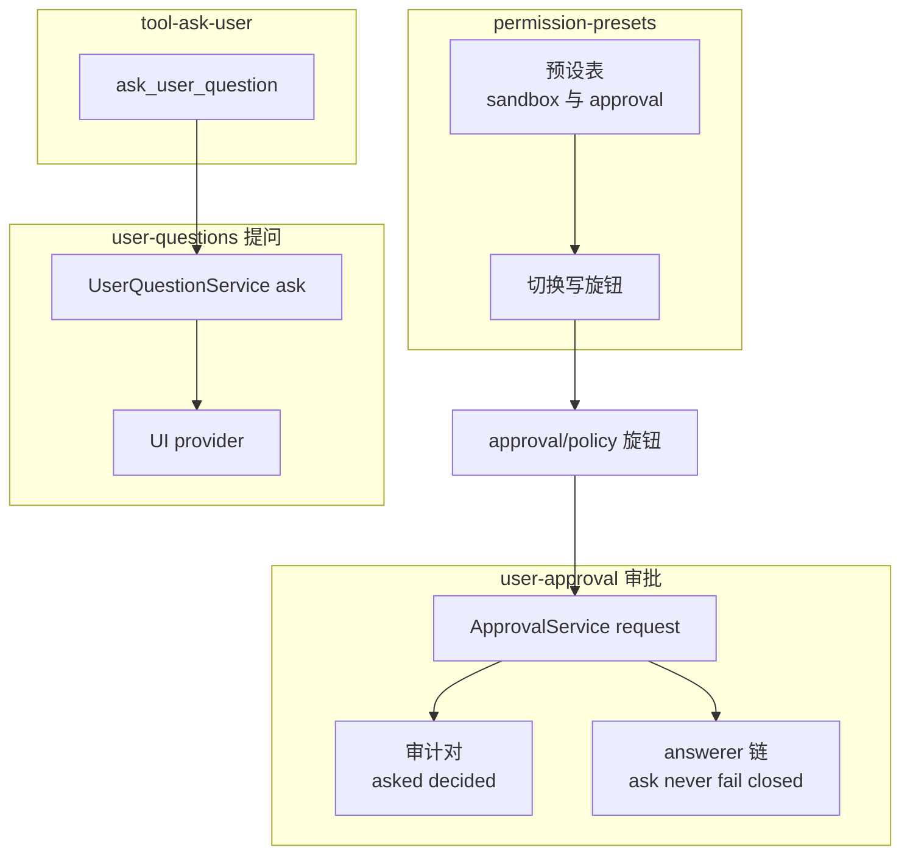
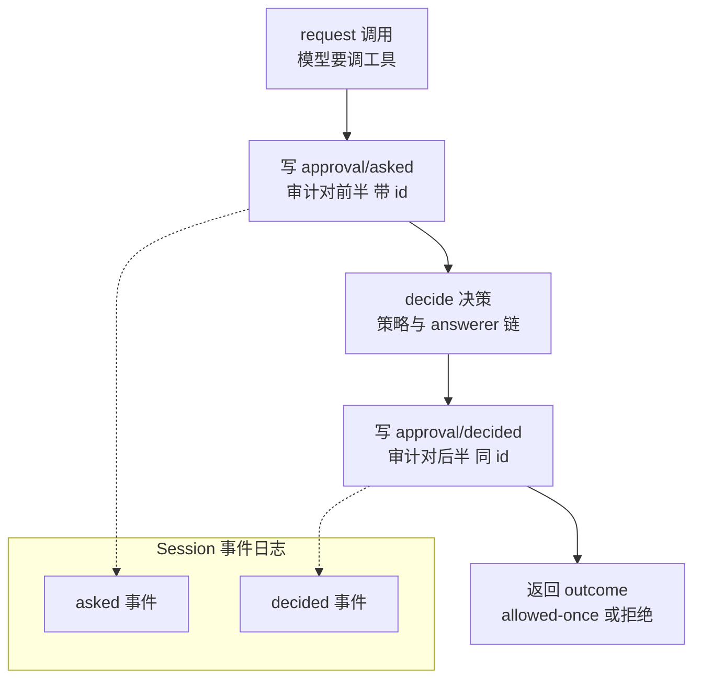
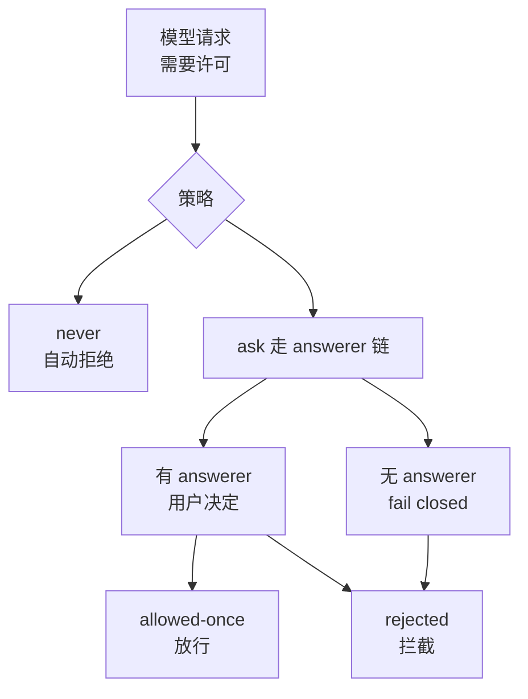
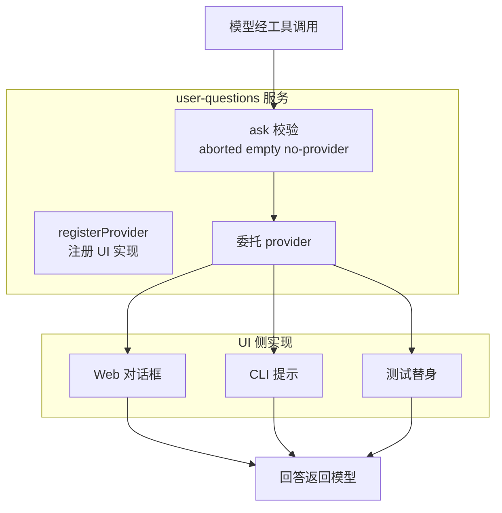
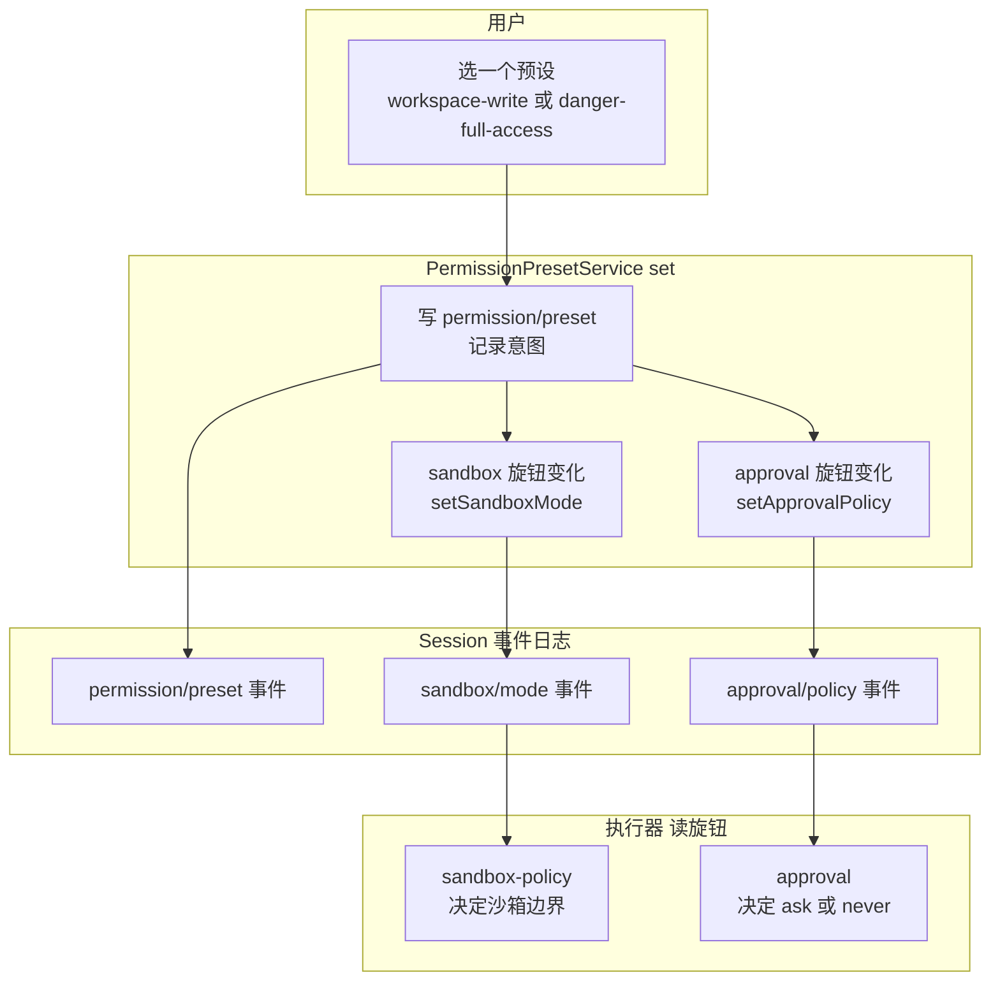
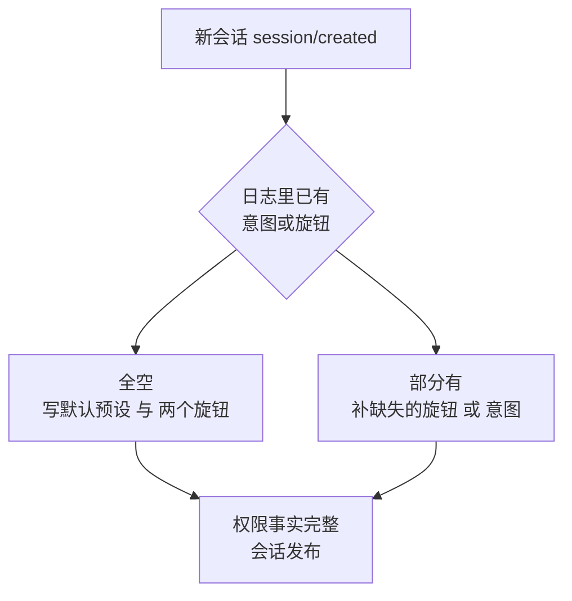
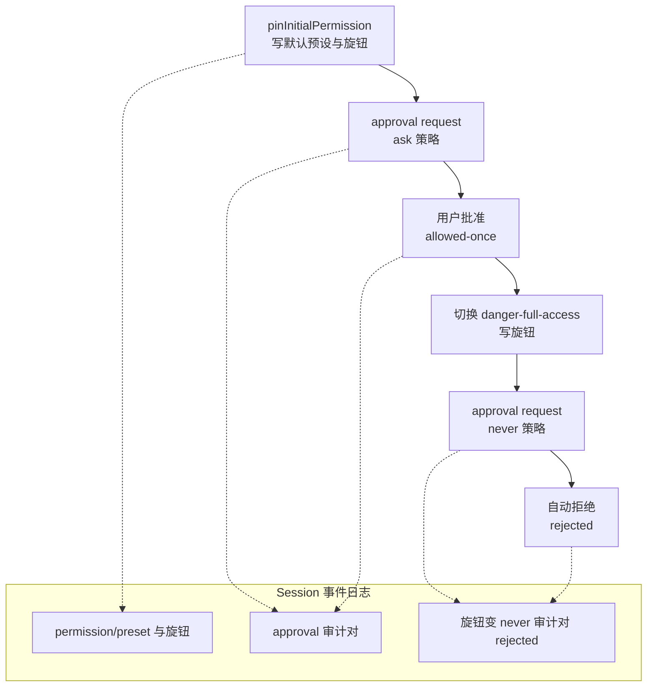

# DeepSeek Harness 从 0 开始：interaction 域（权限预设 + 审批 + 用户提问）

> 本系列从 0 开始，基于 Cordis 框架一步步实现一个简略版本的 DeepSeek Harness（loop、session、tool、system prompt 等）。这一篇讲 **interaction 域**——dsh `packages/interaction/` 下的四个包：**审批**（user-approval）、**提问**（user-questions）、**提问工具**（tool-ask-user）、**权限预设**（permission-presets）。
>
> 配套代码：[blog-13-interaction](./)，运行 `pnpm install && pnpm dev` 即可复现本文全部输出。

## interaction 域：四个包，一条依赖链

dsh 把「人怎么和 Agent 协作」组织成一个域（`packages/interaction/`）。域内是 4 个独立 npm 包，**章节顺序 = 域内依赖链**：先讲被依赖的服务定义，再讲消费它们的工具与上层：

| 包 | Role | ctx key / 挂载点 | 被谁依赖 |
| --- | --- | --- | --- |
| `user-approval` | 审批服务定义：ask/never 策略、answerer 链、fail closed、审计事件对 | `ctx.approval` | `permission-presets` |
| `user-questions` | 提问服务定义：provider 模式、多问题 | `ctx.userQuestions` | `tool-ask-user` |
| `tool-ask-user` | 模型侧工具：消费 `ctx.userQuestions` | 注册到 `ctx.tools` | — |
| `permission-presets` | 预设表：捆绑旋钮，经 canonical setter 写路径 | `ctx.permissionPresets` | — |

**两条「问用户」的通道**是本篇的核心线索：

- **审批**（user-approval）：模型要提权 → 框架拦下 → 问用户。受策略约束（ask/never）、有结果语义（allowed-once/rejected/cancelled/unavailable）、写审计事件对；
- **提问**（user-questions + tool-ask-user）：模型缺信息 → 主动问用户。provider 模式（UI 注册回答者）、支持一次多问题。

域内依赖与运行时的旋钮闭环：



**读图**：左侧是**审批通道**（预设经旋钮 `approval/policy` 联动审批服务，审批走 answerer 链、落审计对）；右侧是**提问通道**（模型工具消费提问服务，服务委托 UI provider）。两通道独立，但都围绕「人和 Agent 协作」。

> 💡 域还含第 5 个包 `commands`（`/permission` 命令行写路径），本篇略过——`PermissionPresetService` 已提供 `set()` 写路径，命令只是它的薄封装。

## 上一篇留下的问题

Agent 能执行工具了（blog-05），但**人和 Agent 怎么协作**？三个问题：

1. **「ask」怎么实现**？blog-05 的 pre-execute 决策点有 `ask` 分支——模型要执行危险操作时，怎么把问题送到用户面前、等用户决定？
2. **模型能主动问吗**？模型做到一半发现缺信息（「项目用什么语言？」）——能不能暂停工作、问用户、拿回答继续？
3. **权限怎么配**？底层有两个独立旋钮：`sandbox/mode`（能写哪）+ `approval/policy`（要不要问）——用户不该分别调两个旋钮，要的是「**选一个预设**，两个旋钮自动配好」？

dsh 的答案就是 interaction 域：**user-approval（问题 1）、user-questions + tool-ask-user（问题 2）、permission-presets（问题 3）**。注意顺序：审批在最前，因为预设依赖它。

## 项目目录结构

```
blog-13-interaction/
├── package.json          # 项目配置：依赖、启动脚本
├── pnpm-lock.yaml        # 依赖锁定文件
└── src/
    └── main.ts           # 代码入口，pnpm dev 运行它
```

## 核心概念

| 概念 | 一句话理解 |
| --- | --- |
| **ApprovalService** | 审批通道：`request()` → allowed-once / rejected / cancelled / unavailable |
| **ApprovalPolicy** | ask（问用户）/ never（自动拒绝，CI 无人值守） |
| **answerer** | 回答审批问题的人/UI（可组合链） |
| **fail closed** | 没有 answerer → 自动拒绝（unavailable），不静默放行 |
| **审计事件对** | `approval/asked` + `approval/decided`——每次审批的完整记录 |
| **canonical setter** | `setApprovalPolicy`——校验 + append 的唯一切换入口 |
| **provider 模式** | UI 注册一个 provider，`ask()` 委托给它（不是服务自己轮询） |
| **PresetSpec** | 一个预设 = sandbox 模式 + 审批策略 的捆绑 |
| **pinInitialPermission** | 新会话自动填充初始预设 + 旋钮 |
| **custom** | 有效旋钮值不匹配任何预设时的状态（不是可选开关） |

## Part 1：基础设施——事件类型 + 简化工具注册表

三个主题共享基础设施（`src/main.ts` 顶部）：会话事件日志（blog-04）、审批/提问的类型、以及一个**简化工具注册表**（对应 dsh 的 `ctx.tools`，blog-05 讲过完整版）。

```ts
// 沙箱模式（dsh: SandboxMode 的简化子集）
type SandboxMode = 'workspace-write' | 'danger-full-access'

// 审批策略（dsh: ApprovalPolicy）
type ApprovalPolicy = 'ask' | 'never'

// 审批结果（dsh: ApprovalOutcome）——只有 allowed-once 是授权
type ApprovalOutcome = 'allowed-once' | 'rejected' | 'cancelled' | 'unavailable'

// 会话事件（简化：interaction 域涉及的全部事件）
type SessionEvent =
  | { type: 'permission/preset'; seq: number; preset: string; timestamp: number }
  | { type: 'sandbox/mode'; seq: number; mode: SandboxMode; timestamp: number }
  | { type: 'approval/policy'; seq: number; policy: ApprovalPolicy; timestamp: number }
  | { type: 'approval/asked'; seq: number; id: string; toolName: string; reason?: string; timestamp: number }
  | { type: 'approval/decided'; seq: number; id: string; outcome: ApprovalOutcome; timestamp: number }

// 会话（简化：事件日志，blog-04 的实现）
class Session {
  readonly events: SessionEvent[] = []
  append(event: Omit<SessionEvent, 'seq' | 'timestamp'>): SessionEvent {
    const full = { ...event, seq: this.events.length, timestamp: Date.now() } as SessionEvent
    this.events.push(full)
    return full
  }
}

// 一次审批请求（dsh: ApprovalRequest）
interface ApprovalRequest {
  agent: string          // 提问的 agent（路由 + 审计）
  toolName: string       // 请求涉及的工具
  callId?: string        // 关联的工具调用
  reason?: string        // 为什么问（用户可见）
  signal?: AbortSignal
}

// 用户问题（dsh: user-questions 的 AskUserQuestionItem）
interface AskUserQuestionItem {
  id: string
  question: string
  header?: string
  options?: Array<{ label: string; description?: string }>
  multiSelect?: boolean
}

// 提问请求（dsh: AskUserQuestionRequest）——支持一次问多个问题
interface AskUserQuestionRequest {
  questions: AskUserQuestionItem[]
  agent?: string
  signal?: AbortSignal
}

// 提问回答（dsh: AskUserQuestionAnswer）
interface AskUserQuestionAnswer {
  answers: Array<{ id: string; selected: string[]; custom?: string }>
}

// 简化工具注册表（dsh: ctx.tools.register + defineTool）
interface ToolDef {
  name: string
  description: string
  execute: (args: any, exec: { agent?: string; signal?: AbortSignal }) => Promise<any>
}

class ToolRegistry extends Service {
  private tools = new Map<string, ToolDef>()
  constructor(ctx: Context) { super(ctx, 'tools') }
  register(tool: ToolDef): void { this.tools.set(tool.name, tool) }
  async invoke(name: string, args: any, exec: { agent?: string; signal?: AbortSignal } = {}): Promise<any> {
    const tool = this.tools.get(name)
    if (tool === undefined) throw new Error(`tool "${name}" not registered`)
    return tool.execute(args, exec)
  }
}
```

**注意事件类型里的 `approval/asked` + `approval/decided`**——这是审批的**审计事件对**（dsh 源码注释："`id` pairs it with the `approval/decided` that always follows"）。每次审批问出、必有配对的结果记录，Session 日志完整可审计。

## Part 2：[user-approval] 审批服务——策略折叠 + canonical setter + 审计对

第一个包是 `user-approval`——**审批服务定义**。它不依赖域内任何包，是被依赖方（`permission-presets` 要 import 它的 `setApprovalPolicy`）。

```ts
// 从日志折叠会话策略覆盖（dsh: effectiveApprovalPolicy）——最后一条 approval/policy 事件
function effectiveApprovalPolicy(events: readonly SessionEvent[]): ApprovalPolicy | undefined {
  for (let i = events.length - 1; i >= 0; i--) {
    const e = events[i]!
    if (e.type === 'approval/policy') return e.policy
  }
  return undefined
}

// 写会话策略覆盖（dsh: setApprovalPolicy）——canonical setter：校验 + append
function setApprovalPolicy(session: Session, policy: ApprovalPolicy): void {
  if (policy !== 'ask' && policy !== 'never') {
    throw new TypeError('approval policy must be one of "ask" or "never"')
  }
  session.append({ type: 'approval/policy', policy })
}

/**
 * 审批服务（dsh: ApprovalService）：
 * 应用会话策略（ask/never）→ 记录 approval/asked → 交给 answerer 链 → 记录 approval/decided。
 */
class ApprovalService extends Service {
  private defaultPolicy: ApprovalPolicy
  private answerer: ((req: ApprovalRequest) => Promise<ApprovalOutcome>) | null = null

  constructor(ctx: Context, config: { policy?: ApprovalPolicy } = {}) {
    super(ctx, 'approval')
    this.defaultPolicy = config.policy ?? 'ask'
  }

  /** 会话的有效策略（dsh: effectivePolicy）：日志覆盖 ?? 部署默认 */
  effectivePolicy(session: Session): ApprovalPolicy {
    return effectiveApprovalPolicy(session.events) ?? this.defaultPolicy
  }

  /** 注册 answerer（UI 回答者；dsh 是可组合链，这里简化单链） */
  setAnswerer(answerer: (req: ApprovalRequest) => Promise<ApprovalOutcome>): void {
    this.answerer = answerer
  }

  /** 切换会话策略（dsh: setPolicy）：写事件 + 通知模型 */
  setPolicy(session: Session, policy: ApprovalPolicy): void {
    const previous = this.effectivePolicy(session)
    if (previous === policy) return
    setApprovalPolicy(session, policy)
    console.log(`  🔐 审批策略: ${previous} → ${policy}（已写入会话，模型下次步骤感知）`)
  }

  /** 发起一次审批请求（dsh: request）——审计对包裹决策 */
  async request(req: ApprovalRequest): Promise<ApprovalOutcome> {
    const session = sessions.get(req.agent)
    if (session === undefined) {
      throw new Error(`approval.request(): no session for agent "${req.agent}"`)
    }
    const id = `ask-${req.agent}-${session.events.length}`
    session.append({ type: 'approval/asked', id, toolName: req.toolName,
      ...req.reason !== undefined ? { reason: req.reason } : {} })
    const outcome = await this.decide(req, session)
    session.append({ type: 'approval/decided', id, outcome })
    console.log(`  📤 审批结果: ${outcome}`)
    return outcome
  }
}
```

**一次 `request()` 的完整生命周期**——审计对（asked + decided）包裹决策：



**读图**：`request()` 先落 `approval/asked`（审计对前半），中间是 `decide` 决策，最后必落 `approval/decided`（同 id 配对）——**无论决策结果如何，审计记录完整**。

**三个关键设计**（都来自 dsh 源码）：

1. **canonical setter**：策略切换的唯一入口是 `setApprovalPolicy()`——**校验 + append**。非法值在日志变化前抛错（dsh: "Invalid values throw before the log changes"）。所有写路径（服务自身、预设）都经它，保证格式永远合法；
2. **审计事件对**：`request()` 在决策**前后**各 append 一条事件（`approval/asked` + `approval/decided`，同 `id` 配对）——dsh 注释："Exactly one per ask, appended when the outcome is known"。审批失败也不会丢记录；
3. **策略折叠**：`effectivePolicy()` 从日志**折叠**最后一条 `approval/policy`（事件溯源，blog-04）——重放日志即状态，无需缓存。

## Part 3：审批请求——ask 批准（演示 Part 1）

决策的核心（dsh 源码注释原文）——ask 策略下，一次审批的走向：



1. **策略先行**：`never` → 直接拒绝（"the deterministic CI/unattended stance"）；`ask` → 走 answerer 链；
2. **answerer 链**：`approval/request` 是 waterfall（洋葱模型）——多个 answerer 层层处理（UI 回答者、自动策略、审计监听器）；
3. **fail closed**：没有 answerer → `unavailable`（"missing or throwing answerer yields 'unavailable' (fail closed)"）；
4. **`allowed-once` 是唯一授权**：一次性的——这次调用允许，下次还要再问（"a grant applies only to the requested action"）。

```ts
ctx.approval.setAnswerer(async (req) => {
  console.log(`  👤 [用户] 看到审批: ${req.toolName}（${req.reason ?? '无原因'}）`)
  console.log(`  👤 [用户] 点击「允许这一次」`)
  return 'allowed-once'
})
const r1 = await ctx.approval.request({
  agent: 'agent-1', toolName: 'bash', reason: '需要删除临时文件',
})
```

运行输出：

```
🚀 agent-1 要执行危险操作（bash），触发审批:
  📨 审批请求: agent-1 要调 bash（原因: 需要删除临时文件） [策略: ask]
  👤 [用户] 看到审批: bash（需要删除临时文件）
  👤 [用户] 点击「允许这一次」
  📤 审批结果: allowed-once
  ✅ 结果: allowed-once（可以执行）
  审计事件对:
    #0 approval/asked id=ask-agent-1-0 tool=bash
    #1 approval/decided id=ask-agent-1-0 outcome=allowed-once
```

**ask 策略 → 问题送到 answerer（用户）→ 用户批准 → allowed-once**。Session 日志里留下一对审计事件（同 id `ask-agent-1-0`）。

## Part 4：三种拒绝——用户拒绝 / never / fail closed / cancelled（演示 Part 2-5）

**用户拒绝**（Part 2）：

```
🚀 agent-1 要读 /etc/passwd，用户拒绝:
  📨 审批请求: agent-1 要调 read_file（原因: 读取系统密码文件） [策略: ask]
  👤 [用户] 看到审批: read_file
  👤 [用户] 点击「拒绝」
  📤 审批结果: rejected
  ✅ 结果: rejected（不能执行）
```

**never 策略**（CI 无人值守，Part 3）——`never` 不是「允许所有」而是「拒绝所有」：

```
  🔐 审批策略: ask → never（已写入会话，模型下次步骤感知）

🚀 agent-ci 要执行操作（never 策略，不提示用户）:
  📨 审批请求: agent-ci 要调 bash（原因: CI 中自动执行） [策略: never]
  ❌ 策略 never → 自动拒绝
  📤 审批结果: rejected
  ✅ 结果: rejected（自动拒绝）
```

**fail closed**（Part 4）——没有 answerer 时：

```
🚀 agent-2 请求审批（ask 策略但无 answerer）:
  📨 审批请求: agent-2 要调 bash（原因: 需要写文件） [策略: ask]
  ⚠️  无 answerer → fail closed (unavailable)
  📤 审批结果: unavailable
  ✅ 结果: unavailable（无 answerer → fail closed）
```

**cancelled**（Part 5）——请求被 abort（用户撤回/超时）。这里藏着 dsh 的一个精细设计：**signal 与 answer 竞速**——abort 立即返回 `cancelled`，晚到的回答被丢弃：

```ts
private async decide(req: ApprovalRequest, session: Session): Promise<ApprovalOutcome> {
  if (req.signal?.aborted) return 'cancelled'
  // ...
  const answer: Promise<ApprovalOutcome> = (async () => { /* answerer 链 */ })()

  // 与请求信号竞速：abort 撤回问题 → cancelled；晚到的回答被丢弃
  const signal = req.signal
  if (signal === undefined) return answer
  return await new Promise<ApprovalOutcome>((resolve) => {
    const onAbort = () => {
      signal.removeEventListener('abort', onAbort)
      console.log(`  ⏹️  请求被取消`)
      resolve('cancelled')
    }
    signal.addEventListener('abort', onAbort, { once: true })
    void answer.then((outcome) => {
      signal.removeEventListener('abort', onAbort)
      resolve(outcome)
    })
  })
}
```

运行输出：

```
🚀 agent-3 请求审批但被取消:
  📨 审批请求: agent-3 要调 bash（原因: 慢审批） [策略: ask]
  ⏹️  请求被取消
  📤 审批结果: cancelled
  ✅ 结果: cancelled（请求被撤回）
```

**四种结果的语义**（dsh 注释）：aborted → `cancelled`；缺失/抛错 answerer → `unavailable`（fail closed）；answerer 返回非法值 → 归一化为 `unavailable`；只有 `allowed-once` 是授权。

## Part 5：[user-questions] 提问服务——provider 模式

第二个包是 `user-questions`——**提问服务定义**。它同样不依赖域内包，被 `tool-ask-user` 依赖。

**关键：provider 模式**（dsh 源码："a UI-backed service ... UI packages provide the single active provider"）——服务自己不轮询、不收集答案，而是**注册一个 provider，`ask()` 委托给它**：

```ts
// UI 侧提问提供者（dsh: UserQuestionProvider）——收集人类答案
interface UserQuestionProvider {
  ask(request: AskUserQuestionRequest): Promise<AskUserQuestionAnswer>
}

class UserQuestionService extends Service {
  private provider: UserQuestionProvider | undefined

  constructor(ctx: Context) { super(ctx, 'userQuestions') }

  /** 注册 UI provider（dsh: registerProvider）——同一上下文只允许一个活跃 provider */
  registerProvider(provider: UserQuestionProvider): () => void {
    if (this.provider !== undefined) {
      throw new Error('a user-questions provider is already registered')
    }
    this.provider = provider
    return () => { this.provider = undefined }
  }

  /** 向活跃 provider 提问并等待回答（dsh: ask） */
  async ask(request: AskUserQuestionRequest): Promise<AskUserQuestionAnswer> {
    if (request.signal?.aborted) {
      throw new Error('ask_user_question was aborted before the user answered')
    }
    if (request.questions.length === 0) {
      throw new Error('ask_user_question requires at least one question')
    }
    if (this.provider === undefined) {
      throw new Error('no user-questions provider is registered')
    }
    return this.provider.ask(request)
  }
}
```

**provider 模式的分工**——服务与 UI 解耦：



**读图**：服务只做两件事——`registerProvider` 收下 UI 实现、`ask` 校验后**委托**；真正收集答案的是注入的 provider（Web/CLI/测试替身任选其一）。这就是"服务定义 + 后端实现"分层在提问域的体现。

**为什么 provider 模式**（对应 dsh 的三个校验）：服务定义只管**能力契约**，UI 实现（Web 对话框、CLI 提示、测试替身）通过 `registerProvider` 注入——和 fs 域的"服务定义 + 后端实现"是同一个分层思想。`ask()` 在委托前校验：aborted（`ASK_ABORTED`）、空问题（`EMPTY_QUESTIONS`）、无 provider（`NO_PROVIDER`）——dsh 还有 `CALLER_NOT_LIVE`（agent 必须存活）、`DELEGATED_CALLER`（被子代理拥有的 agent 不能问人）等校验。

## Part 6：[tool-ask-user] ask_user_question 工具（演示 Part 6）

第三个包是 `tool-ask-user`——**模型侧工具**。它消费 `ctx.userQuestions`（工具 + 服务配对，dsh: "Model-facing `ask_user_question` tool over `ctx.userQuestions`"）：

```ts
function registerAskUserQuestionTool(ctx: Context): void {
  ctx.tools.register({
    name: 'ask_user_question',
    description: 'Ask the user a concise question when you need confirmation, a choice, or missing information before proceeding. '
      + 'Send one or more questions, each with a stable id that will be echoed in the answer.',
    async execute(args, exec) {
      const result = await ctx.userQuestions.ask({
        questions: args.questions.map((q: any) => ({
          id: q.id, question: q.question,
          ...q.header !== undefined ? { header: q.header } : {},
          ...q.options !== undefined ? { options: q.options } : {},
          ...q.multi_select !== undefined ? { multiSelect: q.multi_select } : {},
        })),
        ...exec.agent !== undefined ? { agent: exec.agent } : {},
        signal: exec.signal,
      })
      return { answers: result.answers.map(a => ({ id: a.id, selected: [...a.selected],
        ...a.custom !== undefined ? { custom: a.custom } : {} })) }
    },
  })
}
```

**工具 schema 支持多问题**：`questions` 数组，每个问题有 `id` / `question` / `header` / `options`（label + description）/ `multi_select`——回答按 `id` 回填。dsh 的真实 schema 完全一致（`tool-ask-user/src/index.ts`）。

运行输出（注册 provider 后）：

```
🚀 模型通过 ask_user_question 工具问用户「用什么语言」:
  🖥️ [UI] 收到问题: 项目用什么语言？（选项: TypeScript, Python, Go）
  👤 [用户] 回答完成
  ✅ 工具返回: {"answers":[{"id":"q1","selected":["TypeScript"]}]}

🚀 模型一次问两个问题（多问题 + 自由输入）:
  🖥️ [UI] 收到问题: 要保留演示文件吗？（选项: 保留, 删除）
  🖥️ [UI] 收到问题: 有什么补充？
  👤 [用户] 回答完成
  ✅ 工具返回: {"answers":[{"id":"q2","selected":["保留"]},{"id":"q3","selected":[],"custom":"TypeScript"}]}
```

**为什么模型要通过工具问用户**（blog-05 核心思想）：工具是模型与系统的接口——模型不能直接碰 `ctx.userQuestions`（内部服务），它声明 `ask_user_question` 工具调用 → 框架执行 → 内部调服务。**模型看到的是工具 schema，框架执行的是函数**——和 bash、read_file 一样统一走工具管道（可审计、可拦截）。

## Part 7：[permission-presets] 预设服务——表 + derive + canonical setter 写路径

第四个包是 `permission-presets`——**预设服务**。它是依赖链的**顶层**：import `user-approval` 的 `setApprovalPolicy`（还有 sandbox-policy 的 `setSandboxMode`），把两个旋钮捆绑成用户开关。

```ts
// 一个预设 = sandbox 模式 + 审批策略 的捆绑（dsh: PresetSpec）
interface PresetSpec {
  sandbox: SandboxMode
  approval: ApprovalPolicy
  name?: string        // 展示名（省略 = 表键）
  description?: string // 一句用户说明
}

// 旋钮状态：每个旋钮事件的最后值（null = 未覆盖，组合默认在视图时应用）
interface KnobState {
  preset: string | null
  sandbox: SandboxMode | null
  approval: ApprovalPolicy | null
}

const EMPTY_KNOBS: KnobState = { preset: null, sandbox: null, approval: null }

// 单事件旋钮转换（dsh: applyKnobEvent）——不感兴趣的事件返回同一引用
function applyKnobEvent(state: KnobState, event: SessionEvent): KnobState {
  switch (event.type) {
    case 'permission/preset': return { ...state, preset: event.preset }
    case 'sandbox/mode': return { ...state, sandbox: event.mode }
    case 'approval/policy': return { ...state, approval: event.policy }
    default: return state
  }
}

function foldKnobs(events: readonly SessionEvent[]): KnobState {
  let state = EMPTY_KNOBS
  for (const event of events) state = applyKnobEvent(state, event)
  return state
}

class PermissionPresetService extends Service {
  // ...构造：预设表（workspace-write + danger-full-access）+ custom 保留名校验 + 默认预设推导

  /**
   * 切换预设（dsh: set）——写路径：
   * 1. 记录 permission/preset 事件（durable 用户意图，不进模型）
   * 2. sandbox 旋钮变了 → setSandboxMode（canonical setter）
   * 3. approval 旋钮变了 → setApprovalPolicy（来自 user-approval 包！）
   * 选当前预设 → 什么都不追加（幂等）
   */
  set(session: Session, name: string): void {
    const spec = this.resolve(name)
    const current = this.current(session)
    if (current === name) {
      console.log(`  ⏭️  已是 ${name} 预设，不追加`)
      return
    }
    session.append({ type: 'permission/preset', preset: name })   // 1. 意图
    console.log(`  🔀 切换预设: ${name}`)

    const effectiveSandbox = effectiveSandboxMode(session.events) ?? this.defaults.sandbox
    if (spec.sandbox !== effectiveSandbox) {
      session.append({ type: 'sandbox/mode', mode: spec.sandbox })  // 2. sandbox 旋钮
      console.log(`  🏜️  sandbox 模式 → ${spec.sandbox}`)
    }

    const effectiveApproval = effectiveApprovalPolicy(session.events) ?? this.defaults.approval
    if (spec.approval !== effectiveApproval) {
      setApprovalPolicy(session, spec.approval)  // 3. approval 旋钮 ← canonical setter！
      console.log(`  🔐 approval 策略 → ${spec.approval}`)
    }
  }
}
```

**一次预设切换的完整写路径**——一个开关 → 三个事件：



**读图**：`set()` 一次做三件事——写**意图**（`permission/preset`）+ 两个**事实**（sandbox/approval 旋钮，经 canonical setters）。执行器（沙箱/审批）只读自己的旋钮事件，**完全不知道预设的存在**——预设和执行器通过事件解耦，通过 canonical setter 联动。

**这是 interaction 域内协作的关键**：dsh 源码里 `permission-presets` 明确 `import { setApprovalPolicy } from '@deepseek-ai/dsh-user-approval'`——**预设切换调的是 user-approval 包的 canonical setter**（我们简化版保留了这一点，第 3 步 `setApprovalPolicy(session, spec.approval)`）。`approval/policy` 旋钮事件由此产生，审批服务折叠它决定 ask/never。**预设是配置侧，审批是执行侧——通过事件解耦，通过 canonical setter 联动。**

三个关键设计（都来自 dsh 源码）：

1. **预设 = 捆绑，切换 = 写两个旋钮**：`set()` 记录意图（`permission/preset`）+ 只写**变化**的旋钮——执行器（沙箱/审批）继续读各自的旋钮，**不用感知预设**；
2. **推导 vs 记录**：`current()` 是**从旋钮值反推**（推导），`permission/preset` 是**记录**（意图）。两者可能不一致——用户手动调了旋钮后，推导出 custom，但意图记录还在；
3. **共享捆绑时保留用户意图**（dsh 源码注释原文）："The preset event preserves user intent when two presets share a bundle"——如果两个预设捆绑相同，旋钮值分不清，但 `permission/preset` 记录了用户最后选的是哪个。

## Part 8：pinInitialPermission——新会话自动填充（演示 Part 7-8）

dsh 还有一个设计：**新会话自动填充初始权限**（`session/created` 时调用 `pinInitialPermission`）。全新会话写默认预设 + 两个旋钮；部分初始化的会话只补缺失的事实：

**pin 的决策树**——按日志已有的旋钮/意图决定补什么：



```ts
/** 新会话填充初始权限（dsh: pinInitialPermission） */
pinInitialPermission(session: Session): void {
  const events = session.events
  const selected = effectivePermissionPreset(events)
  const sandbox = effectiveSandboxMode(events)
  const approval = effectiveApprovalPolicy(events)
  if (selected === undefined && sandbox === undefined && approval === undefined) {
    const spec = this.resolve(this.defaultPreset)
    session.append({ type: 'permission/preset', preset: this.defaultPreset })
    session.append({ type: 'sandbox/mode', mode: spec.sandbox })
    setApprovalPolicy(session, spec.approval)
    return
  }
  // 部分初始化：补缺失的旋钮/意图
  if (selected === undefined && this.current(session) !== CUSTOM_PRESET) {
    session.append({ type: 'permission/preset', preset: this.current(session) })
  }
  if (sandbox === undefined) session.append({ type: 'sandbox/mode', mode: this.defaults.sandbox })
  if (approval === undefined) setApprovalPolicy(session, this.defaults.approval)
}
```

运行输出（Part 7-8）：

```
📋 有效预设: workspace-write（新会话无旋钮事件 → 组合默认推导）
   选项:
    - workspace-write ← 当前
    - danger-full-access

🔀 模拟 dsh 的 session/created：新会话触发 pin:
  事件日志:
    #0 permission/preset = workspace-write
    #1 sandbox/mode = workspace-write
    #2 approval/policy = ask

  有效预设: workspace-write
```

**新会话无任何旋钮事件 → 组合默认（workspace-write + ask）推导出 workspace-write**；`pin` 之后日志里有了完整的三条事实（意图 + 两个旋钮）——任何时刻重放日志都能恢复会话的权限状态。

## Part 9：切换 / 幂等 / custom / 未知预设（演示 Part 9-11）

**切换预设**（Part 9）——一次切换写 3 条事件：

```
🔀 切换到 danger-full-access:
  🔀 切换预设: danger-full-access
  🏜️  sandbox 模式 → danger-full-access
  🔐 approval 策略 → never

  有效预设: danger-full-access
  事件日志:
    #0 permission/preset = workspace-write
    #1 sandbox/mode = workspace-write
    #2 approval/policy = ask
    #3 permission/preset = danger-full-access
    #4 sandbox/mode = danger-full-access
    #5 approval/policy = never
```

**幂等 + custom**（Part 10）：

```
🔀 再切一次 danger-full-access:
  ⏭️  已是 danger-full-access 预设，不追加
  事件数: 6（没变 = 幂等）

📋 有效预设: custom（danger-full-access + ask 不匹配任何预设）
   选项（追加了 custom）:
    - workspace-write
    - danger-full-access
    - Custom ← 当前
```

**未知预设报错**（Part 11）：

```
❌ 正确报错: permission: unknown preset "unknown-preset" (known: workspace-write, danger-full-access)
```

## Part 10：域内闭环——预设写旋钮，审批读旋钮（演示 Part 12）

把四个包串起来：**新会话 pin 初始权限 → 审批服务按策略问用户 → 切换预设 → 审批策略自动跟随 → 无提示拒绝**。先看完整时序——每一行是一个真实日志事件：



**读图**：预设事件（L1）和审批审计对（L2、L3）**交错落在同一份 Session 日志**——预设写配置、审批落审计，全部事件溯源可重放。

运行输出（Part 12）：

```
🔀 初始: 预设=workspace-write 审批策略=ask

🚀 agent-final 请求审批（ask 策略 → 用户批准）:
  📨 审批请求: agent-final 要调 bash（原因: 写构建脚本） [策略: ask]
  👤 [用户] 点击「允许这一次」
  📤 审批结果: allowed-once
  ✅ 结果: allowed-once（ask + answerer → 放行）

🔀 切换到 danger-full-access（approval 旋钮自动变 never）:
  🔀 切换预设: danger-full-access
  🏜️  sandbox 模式 → danger-full-access
  🔐 approval 策略 → never
  有效预设: danger-full-access 审批策略: never

🚀 agent-final 请求审批（never 策略 → 自动拒绝）:
  📨 审批请求: agent-final 要调 bash（原因: 危险操作） [策略: never]
  ❌ 策略 never → 自动拒绝
  📤 审批结果: rejected
  ✅ 结果: rejected（never → 无审批提示）

  最终事件日志:
    #0 permission/preset = workspace-write
    #1 sandbox/mode = workspace-write
    #2 approval/policy = ask
    #3 approval/asked id=ask-agent-final-3
    #4 approval/decided id=ask-agent-final-3 outcome=allowed-once
    #5 permission/preset = danger-full-access
    #6 sandbox/mode = danger-full-access
    #7 approval/policy = never
    #8 approval/asked id=ask-agent-final-8
    #9 approval/decided id=ask-agent-final-8 outcome=rejected
```

**看这个日志**：预设和旋钮事件（#0-2、#5-7）与审批审计对（#3-4、#8-9）**交错在同一份 Session 日志**——预设写配置、审批落审计，全部事件溯源可重放。**这就是 interaction 域作为一个整体的样子：四个包各司其职，共享同一份日志作为唯一真源。**

## 常见问题 FAQ

**Q: interaction 域为什么是四个包？能合并吗？**

A: 四个包是 dsh 的真实拆分，各自职责单一：`user-approval`（审批，被预设依赖）、`user-questions`（提问服务）、`tool-ask-user`（模型工具）、`permission-presets`（预设，依赖前两者）。**它们组合成"人和 Agent 协作"的完整能力**，所以按域组织成一篇文章——这正是一个"域"的定义：服务定义 + 消费工具 + 上层封装的能力家族。

**Q: 审批和提问有什么区别？**

A: **方向不同**。审批是「**模型要提权** → 框架拦下 → 问用户」——危险操作需要许可，有策略（ask/never）、有 answerer 链、结果有 allowed-once/rejected/cancelled/unavailable、写审计对；提问是「**模型缺信息** → 主动问用户」——正常流程的补充，纯问答（拿回答继续）。两者通道独立，但都复用「事件 + 服务 + 工具」的 Cordis 模式。

**Q: `allowed-once` 是什么意思？**

A: **一次性授权**——只对这一次请求有效（dsh: "a grant applies only to the requested action"）。下次同样的操作还要再问。不是「记住我，以后都放行」。这保证权限不累积——每次危险操作都是独立决策。

**Q: `never` 策略是「全部放行」还是「全部拒绝」？**

A: **全部拒绝**（凡是需要审批的操作）。dsh 注释原文："`'never'` — never prompt anyone: every ask resolves `'rejected'`"。它用于 CI/无人值守——**不需要人介入的操作照常执行，需要审批的操作一律拒绝**（安全默认）。所以 `danger-full-access` 配 `approval: never` 是因为沙箱全开、没有需要审批的操作。

**Q: fail closed 是什么？**

A: **审批系统故障时拒绝而非放行**。三个场景都归 unavailable：没有 answerer、answerer 抛错、answerer 返回非法值（归一化）。设计哲学：审批的存在是为了安全——**审批坏了，放行比拒绝危险**。宁可误伤，不可漏放。

**Q: answerer 链是什么？**

A: 回答审批问题的人/系统的**组合链**（`approval/request` 是 waterfall，洋葱模型）。多个 answerer 可以层层处理：UI 回答者（给用户看）、自动策略（按规则答）、审计监听器（记录）。dsh 注释："a UI answerer only answers for agents it owns"——每个 answerer 可以只处理它负责的 agent。

**Q: 审批为什么要写审计事件对？**

A: 每次审批问出（`approval/asked`）必有配对结果（`approval/decided`，同 id）——**Session 日志完整可审计**：谁问了什么工具、为什么问、结果如何，全部事件溯源可重放。dsh 中这对事件还有 turn 约束（必须夹在 turn/start 与 turn/end 之间），保证崩溃重放不会产生"半条"审计记录。

**Q: canonical setter 是什么？为什么切换策略必须经它？**

A: `setApprovalPolicy` 是策略写入的**唯一入口**：校验值合法（ask/never）→ append 事件。所有写路径（审批服务自身、权限预设）都经它，**保证日志里永远不会出现非法策略值**（dsh: "Invalid values throw before the log changes"）。这也是 `permission-presets` import `user-approval` 的原因——域内共享同一个写入规范。

**Q: user-questions 为什么是 provider 模式而不是自己轮询？**

A: 服务定义只管**能力契约**，答案收集是 UI 的事（Web 对话框、CLI 提示、测试替身各不相同）。`registerProvider` 注入实现、`ask()` 委托——和 fs 域"服务定义 + 后端实现"同一分层思想。dsh 还借此做严格校验：无 provider 抛 `NO_PROVIDER`、agent 不存活抛 `CALLER_NOT_LIVE`、被子代理拥有的 agent 抛 `DELEGATED_CALLER`。

**Q: 为什么模型问用户要通过工具而不是直接调服务？**

A: **工具是模型与系统的接口**（blog-05 核心思想）。模型不能直接碰 `ctx.userQuestions`（那是内部服务）；它通过 `ask_user_question` 工具声明「我要问用户」→ 框架执行工具 → 内部调服务。**模型看到的是工具 schema，框架执行的是函数**——和 bash、read_file 完全一样，统一走工具管道（可审计、可拦截）。

**Q: 预设怎么真正「阻止」操作？预设本身拦东西吗？**

A: **预设本身不拦任何东西——它只写旋钮事件**。阻断发生在**执行时**：`sandbox/mode` 被 sandbox-policy 读（沙箱边界），`approval/policy` 被审批服务读（ask/never）。所以链路是：**预设通知执行器（写事件）→ 执行器阻止 return（读事件）**。预设是「配置阻断器」，sandbox/approval 是「执行阻断器」——两者通过事件解耦。

**Q: `permission/preset` 事件和 `sandbox/mode`、`approval/policy` 什么区别？**

A: **preset 是意图，旋钮是事实**。preset 记录「用户选了哪个预设」（用于共享捆绑时保留意图、审计）；旋钮事件是执行器（沙箱/审批）**实际消费的**值。切换预设时三个都写：意图 + 两个事实。手动调旋钮只写事实——这时推导可能变成 custom。

**Q: `custom` 是什么？能选它吗？**

A: custom 是**推导出的「不匹配任何预设」状态**——当有效旋钮值（可能被手动调过）对不上任何表项时。UI 可以显示它作为当前值，但**它不是可选的开关目标**（保留名，dsh: "never a switch target or event payload"）。想回到预设，选一个真实预设即可。

**Q: 切换预设为什么不直接重写所有旋钮？**

A: **幂等 + 最小写入**。只写**变化的**旋钮：`spec.sandbox !== effectiveSandbox` 才写 sandbox/mode——旋钮值没变就不产生事件（dsh: "Selecting the effective preset again appends nothing"）。这避免日志被无意义的重复事件污染。

## 小结

1. **interaction 域 = 四个包一条依赖链**：审批（user-approval）→ 提问服务（user-questions）→ 模型工具（tool-ask-user）→ 预设（permission-presets）——章节顺序就是依赖链；
2. **审批 = 提权问用户**：ask/never 策略 + answerer 链 + fail closed + cancelled，`allowed-once` 唯一授权，审计事件对完整记录每次问与答；
3. **canonical setter**：`setApprovalPolicy` 校验 + append——所有写路径共享，日志永不出现非法值；
4. **提问 = 主动问用户**：provider 模式（UI 注入回答者）+ 多问题工具 schema——模型经 `ask_user_question` 工具间接用服务；
5. **预设 = 捆绑 + 联动**：一个开关捆绑 sandbox + approval，切换经 canonical setter 写旋钮（域内协作！），新会话 `pinInitialPermission` 自动填充，custom 表示不匹配；
6. **事件溯源统一**：预设旋钮、审批审计对、提问都落在同一份 Session 日志——重放即状态。

下一篇预告：**Scope 作用域**——`dsh-scope` 独立包，作用域隔离（agent 边界、工具隔离、事件过滤）。

---

*本文代码已验证可运行（Node.js + tsx，@cordisjs/core v4.0.0-beta.5）。完整源码见同目录 `src/main.ts`，实现结构对应 dsh 的 `packages/interaction/{user-approval,user-questions,tool-ask-user,permission-presets}`。*
