# DeepSeek Harness 从 0 开始：subagent 域（子代理委托）

> 本系列从 0 开始，基于 Cordis 框架一步步实现一个简略版本的 DeepSeek Harness（loop、session、tool、system prompt 等）。这一篇讲 **subagent 域**——dsh `packages/subagent/` 下让 **agent 把工作委托给子代理** 的能力家族。
>
> 配套代码：[blog-14-subagent](./)，运行 `pnpm install && pnpm dev` 即可复现本文全部输出。

## 为什么需要子代理？

Agent 的核心能力已经齐了（执行工具、问用户、独立作用域），但**一个大任务只有一个 Agent 在跑**：

- 一个 Agent 的上下文有限——任务太复杂，全塞给它，上下文很快耗尽；
- 任务里有**相互独立的部分**（调研 A + 实现 B + 审查 C）——串行做太慢，应该并行委托；
- 委托出去的工作**不该污染主 Agent 的上下文**——子代理独立跑、只把结果拿回来。

**子代理（subagent）就是答案**：主 Agent 把子任务委托给一个独立的子 Agent——子代理有自己的会话、自己的提示词、自己的执行循环，跑完把结果返回。这篇按四个核心问题讲清实现：**创建 → 提示词 → 执行位置 → 通信**。

## 先回答四个问题

子代理最让人困惑的四个问题，这篇博客会逐个讲透（都对应 dsh 源码）：

| 问题 | 答案 | dsh 源码位置 |
| --- | --- | --- |
| **怎么通过工具创建 subagent？** | 模型声明 `subagent` 工具调用 → 工具调 `ctx.subagents.start` → provider 调 **`ctx.agents.create()`** 在同一个 Cordis context 上创建**全新的 Agent** | tool-subagent + subagent-in-process-driver |
| **subagent 有自己的提示词吗？** | **有**。`applyChildComposition()` 组装：继承父预设 + 注入固定权限声明 + persona 覆盖——注册在子代理自己的作用域 | child-agent.ts |
| **subagent 在哪里执行？** | **同一个进程**（spawn-in-process）：同 context 上的新 Agent，own session、own system prompt、zero parent context | subagent-spawn-in-process |
| **subagent 和 main agent 如何通信？** | 父 **`followup(prompt)`** 投递任务 → 子执行 → 父 **`whenIdle()`** 等待 → **`finalAssistantOutput()`** 从子会话日志读最后一条 assistant 消息作为结果 | in-process-driver + assistant-output.ts |

## subagent 域：一个主题，十一包

dsh 的 `packages/subagent/` 下有 11 个独立 npm 包，围绕一个主题：**Agent 把任务委托给子代理**（子代理独立跑、返回结果，不消耗父代理上下文）。本篇聚焦**进程内实现**（服务定义 + 共享驱动 + spawn provider + 模型工具），外部进程 provider 不展开。核心包一览（Package / Role / ctx key）：

| 包 | Role | ctx key / 挂载点 |
| --- | --- | --- |
| `subagent` | 服务定义：命名 provider 注册表 + start + 生命周期 | `ctx.subagents` |
| `subagent-in-process-driver` | **共享驱动：ctx.agents.create + followup + whenIdle** | — |
| `subagent-spawn-in-process` | provider：从零新建进程内子代理（**本篇实现**） | 注册到 `ctx.subagents` |
| `subagent-fork-in-process` | provider：从父历史 fork 子代理（未展开） | 注册到 `ctx.subagents` |
| `tool-subagent` | 模型侧工具：委托 | 注册到 `ctx.tools` |
| `tool-subagent-control` | 模型侧工具：send_message / interrupt_agent / list_agents | 注册到 `ctx.tools` |
| `tool-subagent-report` | 子代理向父汇报通道 | 注册到子作用域 |

**最重要的设计：这不是"单 executor"，而是"命名 provider 注册表"**。dsh 源码注释原文："Unlike the bash seam (one executor per context, second load throws), MULTIPLE providers coexist here: each registers under a unique name and a caller picks one by name. The shape mirrors the LLM adapter registry (`LlmRuntime.registerAdapter`), not the single-service bash executor."——**多个 provider 共存、按名选择**（spawn 新建 / fork 继承），形状类似 blog-11 的 LLM adapter registry。

域结构——服务定义在前，provider 实现与模型工具在后：

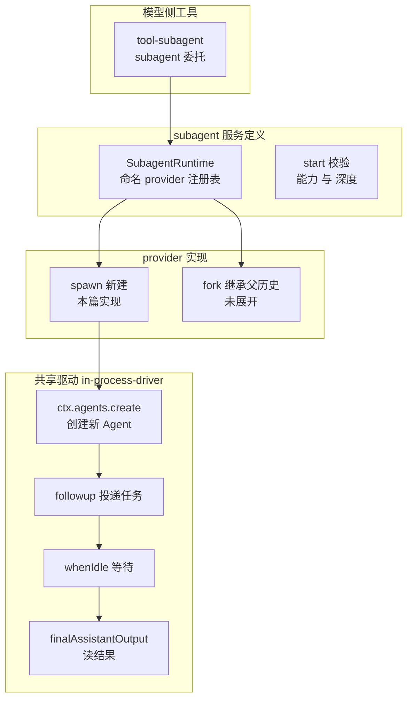

**读图**：服务定义（注册表 + 校验）在最前；**共享驱动**（in-process-driver）是 spawn/fork 共用的"创建 + 通信"骨架；provider 实现挂到注册表上；模型工具消费服务。**本篇重点讲驱动层的四个机制**——它们回答了开篇的四个问题。


## 项目目录结构

```
blog-14-subagent/
├── package.json          # 项目配置：依赖、启动脚本
├── pnpm-lock.yaml        # 依赖锁定文件
└── src/
    ├── main.ts           # 演示入口：组装 + 演示
    ├── types.ts          # 类型定义（dsh: subagent/src/types.ts）
    ├── session.ts        # Session 事件日志（dsh-session）
    ├── agent.ts          # Agent + AgentFactory（dsh-agent）
    ├── tools.ts          # ToolRegistry（dsh-tools）
    ├── subagent.ts       # SubagentRuntime 服务定义（subagent/src/index.ts）
    ├── child-agent.ts    # 深度 + 委托策略 + 组合（subagent/src/child-agent.ts）
    ├── driver.ts         # 共享驱动 startInProcessRun（subagent-in-process-driver）
    ├── provider-spawn.ts # spawn provider（subagent-spawn-in-process）
    └── tool-subagent.ts  # subagent 工具（tool-subagent）
```

**每个文件对应 dsh 的一个包/模块**——这正是"以包为主题"在代码上的体现：服务定义（subagent.ts）、共享驱动（driver.ts）、provider（provider-spawn.ts）、模型工具（tool-subagent.ts）各司其职，`main.ts` 只做组装和演示。

## 核心概念

| 概念 | 一句话理解 |
| --- | --- |
| **SubagentRuntime** | 命名 provider 注册表 + start API（多 provider 共存，按名选择） |
| **Agent** | 同进程代理：own session + own system prompt + 消息收发（父和子同一个类） |
| **agents.create** | 创建新 Agent（子代理 = 委托时被创建的新 Agent） |
| **applyChildComposition** | 组装子代理 system prompt：继承父预设 + 固定权限声明 + persona |
| **followup / whenIdle** | 父子通信：父投递消息、父等待子代理跑完 |
| **finalAssistantOutput** | 从子会话日志读最后一条 assistant 消息作为结果 |
| **委托策略固定** | 子代理权限在委托瞬间钉死：sandbox 继承 + approval 一律 never |
| **深度控制** | 子深度 = 父深度 + 1，超过 maxDepth 上限 → 抛错（防无限委托） |

## Part 1：基础设施——Agent 类（父和子同一个类）

子代理域的核心设施是 **Agent 类**：每个 Agent 有**自己的 Session**（blog-04）+ **自己的 systemPrompt** + 消息收发 + 执行循环。**父代理和子代理是同一个类**——"子代理"只是"在委托时被创建的新 Agent"：

```ts
class Agent {
  readonly id: string
  readonly session: Session
  /** 创建它的 context（dsh: agent.ctx——agents.create 绑定） */
  readonly ctx: Context
  /** 组装好的 system prompt（own system prompt） */
  systemPrompt: string[] = []
  private inbox: ContentBlock[] = []                 // 简化 inbox（dsh: agent inbox）
  private running = false
  private idleResolvers: Array<() => void> = []

  constructor(ctx: Context, id: string) {
    this.ctx = ctx
    this.id = id
    this.session = new Session(id)
  }

  /** 父 → 子：投递一条用户消息（dsh: followup）——FIFO 入队 + 唤醒执行 */
  followup(message: ContentBlock): void {
    this.inbox.push(message)
    void this.drain()
  }

  /** 等到本代理空闲（dsh: whenIdle）——父等待子代理跑完用 */
  whenIdle(): Promise<void> {
    if (!this.running && this.inbox.length === 0) return Promise.resolve()
    return new Promise((resolve) => { this.idleResolvers.push(resolve) })
  }

  /** 执行循环（简化：真实是 agent-loop + LLM，blog-07）——模拟模型按 system prompt 回复 */
  private async drain(): Promise<void> {
    if (this.running) return
    this.running = true
    while (this.inbox.length > 0) {
      const msg = this.inbox.shift()!
      this.session.append({ type: 'user/message', text: msg.text })
      const reply = this.reply(msg.text)
      this.session.append({ type: 'assistant/message', text: reply })
    }
    this.running = false
    const resolvers = this.idleResolvers
    this.idleResolvers = []
    for (const r of resolvers) r()
  }

  /** 模拟模型回复：体现 system prompt 的影响（persona + delegation 声明） */
  private reply(text: string): string {
    const persona = this.systemPrompt.find(p => p.startsWith('Persona:'))?.slice(8).trim()
    const isDelegated = this.systemPrompt.some(p => p.includes('delegated subagent'))
    const head = persona ? `[${persona}]` : `[${this.id}]`
    return `${head} 收到任务「${text.slice(0, 20)}...」，${isDelegated ? '按固定权限' : ''}完成并返回结果。`
  }
}
```

**Agent 的三个自持状态**（dsh 的 Agent 也这样）：

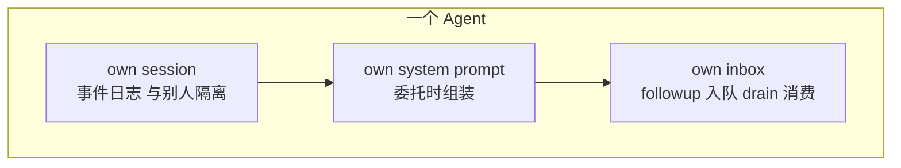

1. **own session**——自己的事件日志，与父完全隔离（blog-04）；
2. **own system prompt**——`systemPrompt: string[]` 数组，委托时组装（Part 3 详讲）；
3. **inbox 消息队列**——`followup` 入队、`drain` 消费，FIFO 顺序执行（这就是父子通信的载体）。

配套的 `AgentFactory`（dsh: `ctx.agents.create`）——创建并登记 Agent：

```ts
class AgentFactory extends Service {
  private agents = new Map<string, Agent>()
  constructor(ctx: Context) { super(ctx, 'agents') }
  create(id: string): Agent {
    const agent = new Agent(this.ctx, id)
    this.agents.set(id, agent)
    return agent
  }
  get(id: string): Agent | undefined { return this.agents.get(id) }
}
```

## Part 2：怎么通过工具创建 subagent？

**委托一个子代理，一共七步**——模型声明、工具组装、服务校验、创建、投递、执行、取回：

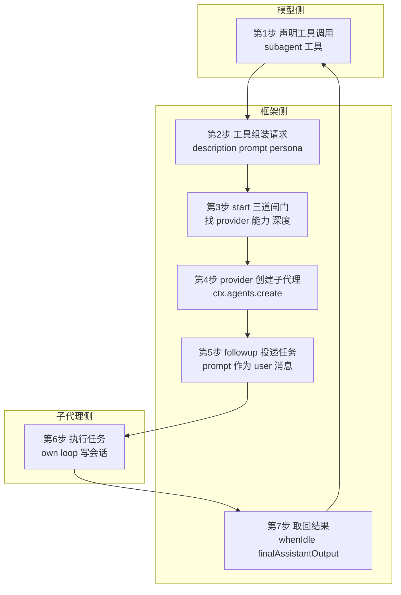

**读图**：三步在模型侧/框架侧交界（1-3），两步是创建与投递（4-5），一步是子代理执行（6），一步是取回（7）。**核心在第 4 步**——`ctx.agents.create()` 真正创建子代理；**任务在第 5 步投递**——`prompt` 变成子代理会话里的第一条 user 消息。

模型侧的工具（tool-subagent）——把 `ctx.subagents.start` 包装成模型可调用：

```ts
function registerSubagentTool(ctx: Context): void {
  ctx.tools.register({
    name: 'subagent',
    description: 'Delegate a self-contained task to a subagent (a separate agent that works in its own context) '
      + 'to offload focused, independent work. The subagent returns its result, not its intermediate steps.',
    async execute(args, exec) {
      const parent = exec.agent
      if (!parent) throw new Error('subagent tool requires a calling agent')
      // 工具 → 服务 → provider → agents.create 的完整链路
      const run = await ctx.subagents.start(args.provider ?? 'spawn', {
        label: args.description,
        prompt: [{ type: 'text', text: args.prompt }],
        parent,
        ...args.persona !== undefined ? { persona: args.persona } : {},
        ...args.maxDepth !== undefined ? { maxDepth: args.maxDepth } : {},
      })
      const result = await run.result
      if (result.stopReason !== 'completed') {
        throw new Error(`subagent run failed: ${result.stopReason}`)
      }
      return { runId: run.id, output: result.output.map(b => b.text).join('') }
    },
  })
}
```

**给子代理的任务长什么样**——模型的工具参数最终变成子代理会话里的消息：

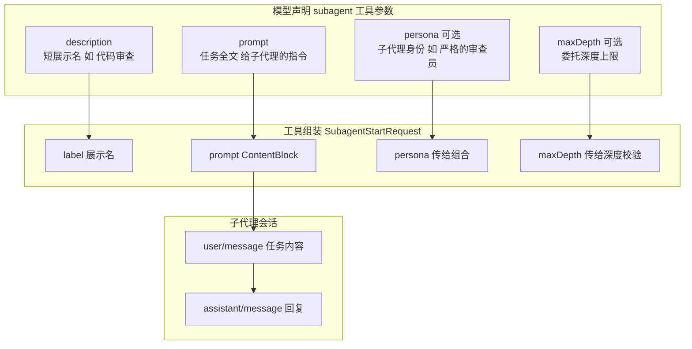

**读图**：模型只写四个参数——**`description`（展示名）、`prompt`（任务全文，子代理真正执行的指令）、`persona`（可选身份）、`maxDepth`（可选深度上限）**。工具把它们组装成 `SubagentStartRequest`，其中 `prompt` 经 followup 变成子代理会话的第一条 `user/message`——**任务不是"传参"，是"投递消息"**，子代理像收到一条用户消息一样开始干活。

一次真实的委托（运行输出，Part 6）：

```
🚀 模型声明 subagent 工具调用:
  模型 ──▶ subagent 工具 ──▶ ctx.subagents.start ──▶ spawn provider
       ──▶ ctx.agents.create（新 Agent）──▶ followup 投递 ──▶ 子执行 ──▶ 结果返回
  ✅ 工具返回: [严格的代码审查员] 收到任务「审查 blog-13 的 interac...」，按固定权限完成并返回结果。
  runId: child-parent-1-3
```

服务定义 `SubagentRuntime.start()`——三道闸门 + 生命周期：

```ts
async start(name: string, request: SubagentStartRequest): Promise<SubagentRun> {
  const provider = this.expectProvider(name)              // 1. 找 provider
  this.assertCapabilities(provider, request)              // 2. 能力校验
  resolveChildDepth(request.parent, request.maxDepth)     // 3. 深度校验
  const descriptor = { mode: 'one-shot' as const, provider: name,
    ...request.label !== undefined ? { label: request.label } : {} }
  const run = await provider.start({ ...request, descriptor })
  const info: SubagentRunInfo = { runId: run.id, provider: name, id: run.id }
  this.ctx.emit('subagent/start', info)
  void run.result.then((outcome) => {
    this.ctx.emit('subagent/end', { ...info, outcome: outcome.stopReason })
  })
  return run
}
```

**start() 的完整流程**——校验在前，委托在后：

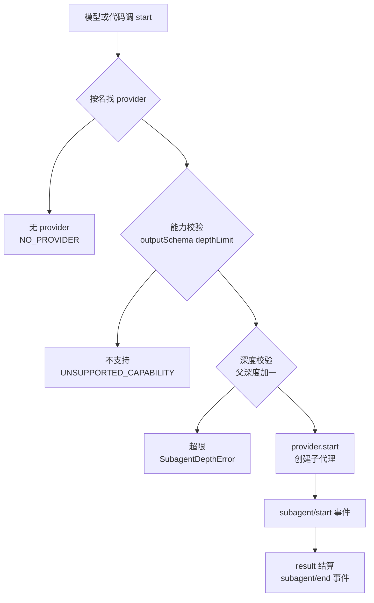

**读图**：`start()` 先做**三道闸门**——找 provider、能力校验、深度校验，全部通过才真正委托；生命周期事件（start/end）包裹整个运行。

## Part 3：子代理有自己的提示词吗？

**有**。子代理的 system prompt 在创建窗口内由 `applyChildComposition()` 组装（dsh: child-agent.ts）——**三部分**：继承父预设 + 固定权限声明 + persona 覆盖，全部注册在子代理自己的作用域（父和兄弟看不见）：

```ts
/** 子代理的个性化组合（dsh: ChildComposition） */
interface ChildComposition { persona?: string; toolFilter?: { allow?: string[]; deny?: string[] } }

/**
 * 组装子代理（dsh: applyChildComposition）：
 * 1. 继承父的预设（dsh: agentPresets.composeFrom——父的 system prompt 公共段）
 * 2. 注入固定权限声明（order 120 的 runtime context）
 * 3. persona 覆盖（order 0 的 shadowing section，可选）
 * 全部注册在子代理自己的作用域，父和兄弟看不见。
 */
function applyChildComposition(child: Agent, parent: Agent, composition: ChildComposition): void {
  child.systemPrompt = [...parent.systemPrompt]              // 1. 继承父预设
  child.systemPrompt.push(SUBAGENT_DELEGATION_CONTEXT)        // 2. 固定权限声明
  if (composition.persona !== undefined) {
    child.systemPrompt.push(`Persona: ${composition.persona}`) // 3. persona 覆盖
  }
}
```

**子代理提示词的组装**：

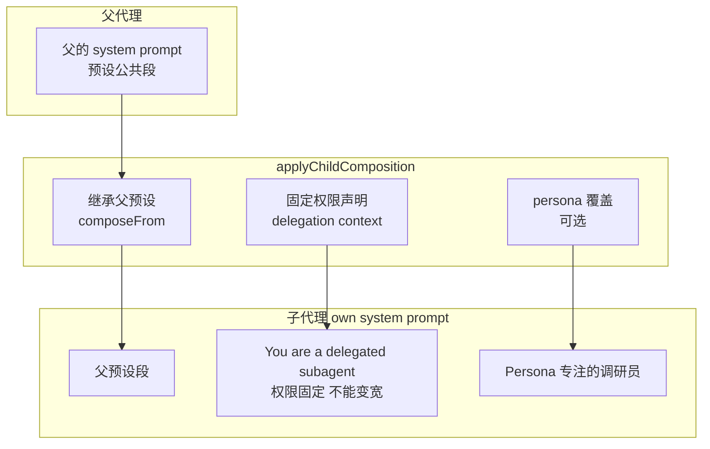

**读图**：子代理的提示词 = 父预设段 + 固定权限声明 + persona。其中**固定权限声明**（`SUBAGENT_DELEGATION_CONTEXT`）是子代理专属的——父代理没有这段：

```ts
const SUBAGENT_DELEGATION_CONTEXT = 'You are a delegated subagent: your permission scope was fixed when you were started '
  + 'and cannot be widened from inside this session — operations that require approval are rejected automatically.'
```

运行输出（Part 2）——父和子的提示词对比一目了然：

```
🧠 父代理的 system prompt:
  - You are the main agent. You coordinate subtasks and integrate results.

🧠 子代理的 system prompt（委托时组装，own system prompt）:
  - You are the main agent. You coordinate subtasks and integrate results.
  - You are a delegated subagent: your permission scope was fixed when you were started and cannot be widened from inside this session — operations that require approval are rejected automatically.
  - Persona: 专注的调研员
```

**看这个对比**：子代理继承了父的预设段（第 1 行）、多了固定权限声明（第 2 行）、多了 persona（第 3 行）——**own system prompt 不是"复制父"，而是"在父基础上按子代理身份组装"**。回复也体现了：`[专注的调研员] 收到任务「...」，按固定权限完成并返回结果。`

## Part 4：子代理在哪里执行？

**同一个进程**（spawn-in-process）：子代理是**同一个 Cordis context 上的新 Agent**——own session、own system prompt、zero parent context。dsh 源码注释原文："runs each child as a fresh child Agent on the same cordis context (its own session, its own system prompt, zero parent context). The cheapest transport."

**同 context，但各自独立**——父和子共享进程，不共享状态：

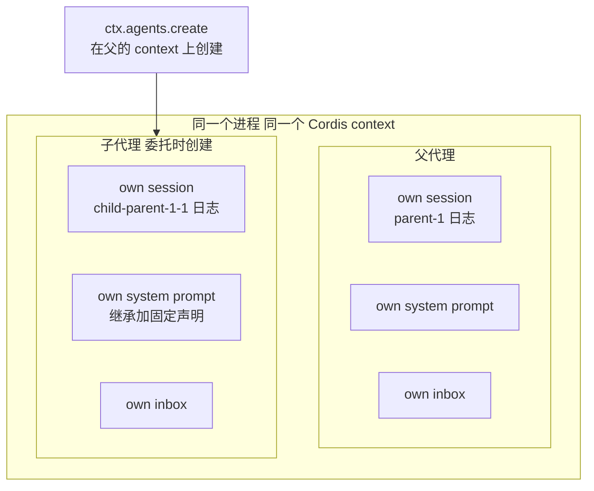

**读图**：父和子**在同一个进程、同一个 Cordis context**（共享 Service 注册、插件环境），但**各自独立**——own session（日志互不可见）、own system prompt、own inbox。子代理不是父的一部分，是**父的 context 上新建的另一个 Agent**。

spawn provider 只是**薄封装**——真正的创建在共享驱动 `startInProcessRun`（in-process-driver）：

```ts
const spawnProvider: SubagentProvider = {
  name: 'spawn',
  capabilities: { outputSchema: true, depthLimit: true, toolFilter: true, persona: true },
  inheritsParentContext: false,  // 全新子代理：zero parent context
  async start(request: ResolvedSubagentStartRequest): Promise<SubagentRun> {
    // ===== 共享驱动 startInProcessRun（dsh: subagent-in-process-driver）=====
    const childDepth = resolveChildDepth(request.parent, request.maxDepth)
    const inherited = captureDelegatedPolicyOverrides(request.parent)  // 委托策略固定

    // 1. 创建子代理：同一个 Cordis context 上的全新 Agent
    //    dsh: parent.ctx.agents.create({ sessionId, meta, setup })
    const childId = `child-${request.parent.session.id}-${++childCounter}`
    const child = request.parent.ctx.agents.create(childId)
    child.session.meta = { parentSession: request.parent.session.id, origin: 'subagent', delegationDepth: childDepth }

    // 2. 创建窗口内的 setup：委托策略事件 + 子代理组合（system prompt 组装）
    appendDelegatedPolicyOverrides(child.session, inherited)
    applyChildComposition(child, request.parent, {
      persona: request.persona,
      toolFilter: request.toolFilter,
    })

    // 3. 驱动一轮：父投递任务 → 等子代理跑完 → 读结果
    const result: Promise<SubagentResult> = (async () => {
      child.followup({ type: 'text', text: request.prompt.map(b => b.text).join('') })
      await child.whenIdle()
      const output = finalAssistantOutput(child.session)
      return { output, stopReason: 'completed' }
    })()

    return { id: childId, localAgent: child, result, dispose: async () => {} }
  },
}
```

运行输出（Part 2 的子会话日志）——**子代理的完整状态都在自己的 Session 里**：

```
📜 子会话事件日志（own session）:
    #0 sandbox/mode = workspace-write source=delegation
    #1 approval/policy = never source=delegation
    #2 user/message: 调研 dsh 的 subagent 域包含哪些包
    #3 assistant/message: [专注的调研员] 收到任务「调研 dsh 的 subagent 域包...」，按固定权限完成并返回结果。
```

**看这个日志**：最前面是两条**委托策略事件**（`source=delegation`）——子代理一出生权限就被固定；然后才是消息流（任务、回复）。**子代理的整个状态都在自己的 Session 日志里，重放即完整历史**——父代理的 Session 完全没被污染。

## Part 5：subagent 和 main agent 如何通信？

**通信发生在同一个进程，载体是 inbox 消息队列 + Session 日志**——时序自上而下：

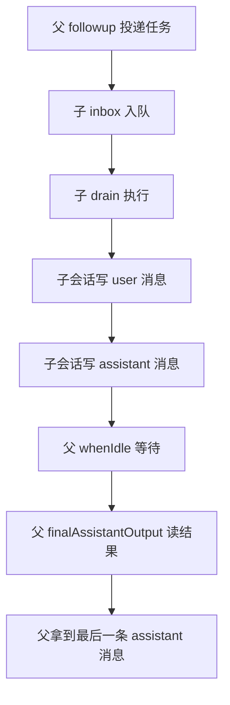

**读图**：父投递（followup）→ 子执行（drain，会话写消息）→ 父等待（whenIdle）→ 父读结果（finalAssistantOutput）。**同进程，无网络。**

**关键：父只读结果，不读过程**——子代理的中间工作留在自己的日志里，父只拿走最后一条 assistant 消息：

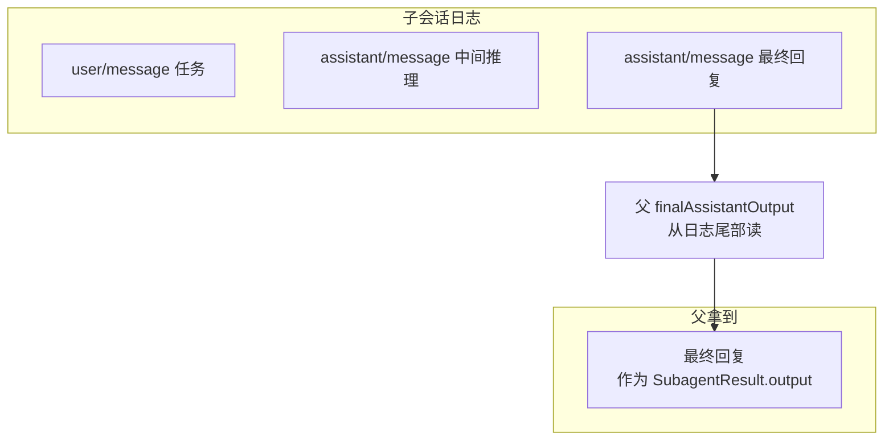

**读图**：子会话里可能有多条消息（任务、中间推理、最终回复），但父**只读最后一条 assistant 消息**作为结果——中间过程不进入父的上下文。这正是委托的核心价值：**子代理的完整工作留在自己的日志（可审计），父只消费最终结果。**

四个通信原语（dsh 源码对应）：

| 原语 | 方向 | 作用 | dsh 源码 |
| --- | --- | --- | --- |
| `followup(message)` | 父 → 子 | 投递一条用户消息（inbox 入队 + 唤醒） | `child.followup(createUserMessage(...))` |
| `whenIdle()` | 父 → 子 | 等子代理跑完（阻塞直到空闲） | `await child.whenIdle()` |
| `finalAssistantOutput()` | 子 → 父 | 从子会话日志读最后一条 assistant 消息 | `finalAssistantOutput(child)` |
| `run.result` | 子 → 父 | 把结果（output + stopReason）交给父 | `SubagentRun.result` |

运行输出（Part 3）：

```
📤 父拿到子代理结果（stopReason: completed）:
  [专注的调研员] 收到任务「调研 dsh 的 subagent 域包...」，按固定权限完成并返回结果。

🔁 通信时序（同进程，无网络）:
  父 followup(prompt)  ──▶  子 inbox 入队
  子 drain() 执行       ──▶  子会话写 user + assistant 消息
  父 whenIdle() 等待    ◀──  子回复完成
  父 finalAssistantOutput()  ◀─  读子会话最后一条 assistant 消息
```

**关键**：子代理的"回复"落在**子自己的 Session 日志**，父通过 `finalAssistantOutput()` **读**它——不是子主动"发"给父。这保证了父子隔离：**子代理的工作只存在于自己的日志，父只拿走最终结果**。dsh 里还有 `tool-subagent-report`（子代理主动向父汇报中间内容）和 `tool-subagent-control`（send_message 后续消息），博客省略。

## Part 6：深度控制 + 委托策略固定

**深度控制**（dsh: resolveChildDepth）——为什么需要？**子代理还可以再委托**（A 委托 B、B 委托 C...），不管会无限加深。方案：子深度 = 父深度 + 1，委托带 maxDepth 上限：

**深度链**——每委托一层，深度加一，maxDepth 是绝对上限：

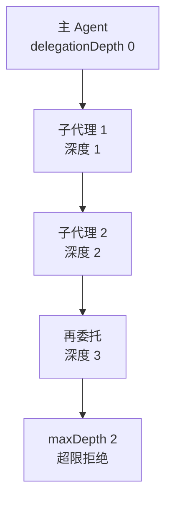

**读图**：主 Agent 深度 0。委托一次 → 子深度 1；子再委托 → 深度 2。maxDepth=2 时，深度 2 的子代理**还想**委托 → 子深度 3 超限 → 拒绝。**深度是持久化的**（存子会话 meta），恢复的会话不能假装顶层再无限委托（dsh: "a resumed parent cannot delegate as if it were top-level"）。

```ts
function delegationDepthOf(agent: Agent): number { return agent.session.meta.delegationDepth }
function resolveChildDepth(parent: Agent, maxDepth: number | undefined): number {
  const childDepth = delegationDepthOf(parent) + 1
  if (maxDepth !== undefined && childDepth > maxDepth) {
    throw new Error(`subagent depth ${childDepth} exceeds maxDepth ${maxDepth}`)
  }
  return childDepth
}
```

运行输出（Part 4）——注意边界：maxDepth=2 时，深度 1 的父 → 子深度 2（未超限）；深度 2 的父 → 子深度 3（超限）：

```
✅ 深度 1 的父委托 maxDepth=2 → 子深度 2（未超限）
❌ 深度 2 的父委托 maxDepth=2 → 正确报错: subagent depth 3 exceeds maxDepth 2
```

**委托策略固定**（dsh: captureDelegatedPolicyOverrides / appendDelegatedPolicyOverrides）——**子代理的权限在委托瞬间被钉死**，sandbox 继承父的显式覆盖，approval 一律 never：

```ts
function captureDelegatedPolicyOverrides(parent: Agent): DelegatedPolicyOverrides {
  let sandboxMode: SandboxMode | undefined
  for (let i = parent.session.events.length - 1; i >= 0; i--) {
    const e = parent.session.events[i]!
    if (e.type === 'sandbox/mode' && e.source !== 'delegation') { sandboxMode = e.mode; break }
  }
  return { sandboxMode, approvalPolicy: 'never' }
}

function appendDelegatedPolicyOverrides(childSession: Session, overrides: DelegatedPolicyOverrides): void {
  if (overrides.sandboxMode !== undefined) {
    childSession.append({ type: 'sandbox/mode', mode: overrides.sandboxMode, source: 'delegation' })
  }
  if (overrides.approvalPolicy !== undefined) {
    childSession.append({ type: 'approval/policy', policy: overrides.approvalPolicy, source: 'delegation' })
  }
}
```

运行输出（Part 4）：

```
🔒 委托策略固定:
  sandbox/mode: workspace-write（继承父的 workspace-write）
  approval/policy: never（无论父是 ask 一律 never）
```

**为什么 approval 钉死 never**（dsh 原文）："your permission scope was fixed when you were started and cannot be widened from inside this session — operations that require approval are rejected automatically."——**子代理没有独立的"人"可问**（blog-13 的 answerer 只服务 live root agent），它继承父的固定边界；需要更宽权限时报错，让父代理处理。**这是 subagent 域和 blog-13 权限的联动点。**

## Part 7：能力校验 + 生命周期 + 注销

**能力校验**（dsh: assertCapabilities）——provider 声明能力，start 前校验请求。spawn 声明全部支持，simple provider 什么都不支持：

```
❌ simple provider 不支持 outputSchema → 正确报错: subagent provider "simple" does not support the "outputSchema" capability

📦 现在 providers: spawn, simple
```

**生命周期事件**——`subagent/start` + `subagent/end` 配对（同 runId），全程可监听：

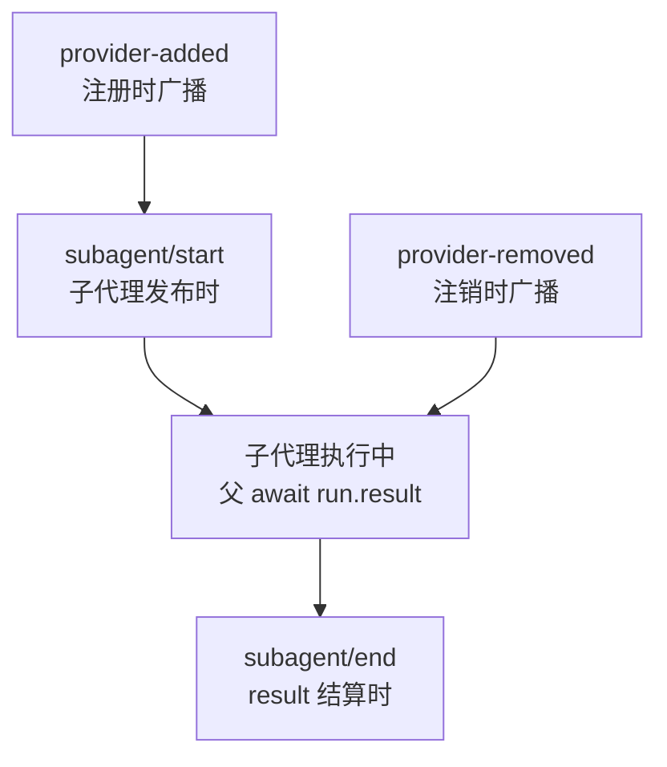

**读图**：一个子代理的完整生命周期——provider 注册（provider-added）→ 委托发布（start）→ 执行（父等待 result）→ 结算（end，带 outcome）；provider 注销（provider-removed）只影响后续委托，不影响已进行的运行。**start/end 配对**让父和监听器全程可见、可审计。

```
📡 事件 subagent/provider-added: spawn（capabilities: outputSchema, depthLimit, toolFilter, persona）
📡 事件 subagent/start: runId=child-parent-1-1 provider=spawn
📡 事件 subagent/end: runId=child-parent-1-1 outcome=completed
```

**注销**（dsh: "removing a provider blocks new starts but does not revoke runs that were already returned to their holders"）——只拦新委托，不撤销已进行的运行：

```
🔌 注销 spawn provider 后 providers: simple
  getProvider('spawn'): undefined（新委托会 NO_PROVIDER）
```

## 常见问题 FAQ

**Q: 怎么通过工具创建 subagent？完整链路是什么？**

A: 模型声明 `subagent` 工具调用 → `ctx.tools` 找到工具 → 工具调 `ctx.subagents.start`（三道闸门：找 provider、能力校验、深度校验）→ provider 调 **`ctx.agents.create()`** 创建同进程新 Agent → followup 投递任务 → 子执行 → 结果返回模型。**工具是模型与系统的接口（blog-05）**，真正创建子代理的是 `ctx.agents.create()`（dsh: in-process-driver）。

**Q: subagent 有自己的提示词吗？**

A: **有**，且是委托时组装（`applyChildComposition`）：继承父预设 + 注入固定权限声明（`SUBAGENT_DELEGATION_CONTEXT`）+ persona 覆盖，注册在子代理自己的作用域。**own system prompt 不是"复制父"，而是"在父基础上按子代理身份组装"**——回复会体现 persona 和"按固定权限"的声明。

**Q: subagent 在哪里执行？**

A: 取决于 provider。本篇实现的 **spawn-in-process：同一个进程**——同 Cordis context 上的新 Agent（own session、own system prompt、zero parent context），复用 agent 工厂的创建事务，最便宜的传输（dsh 原文："The cheapest transport"）。

**Q: subagent 和 main agent 如何通信？**

A: 四个原语：父 `followup(prompt)` 投递（inbox 入队）→ 子 `drain` 执行（会话写 user/assistant 消息）→ 父 `whenIdle()` 等待 → 父 `finalAssistantOutput()` 从**子会话日志**读最后一条 assistant 消息作为结果。**同进程、无网络**；子代理的工作只存在于自己的日志，父只拿走最终结果（`run.result`）。

**Q: 子代理和父代理是什么关系？权限怎么继承？**

A: 子代理是**独立的 Agent**：独立 Session、独立上下文、独立 system prompt。权限在**委托瞬间被固定**：sandbox 继承父的显式覆盖，approval 一律 never——子代理不能问用户（没有独立的"人"可问），只能在固定范围内工作，需要更宽权限时报错让父处理。

**Q: subagent 的生命周期是什么？什么时候结束？**

A: 一个 one-shot 子代理的完整生命周期：

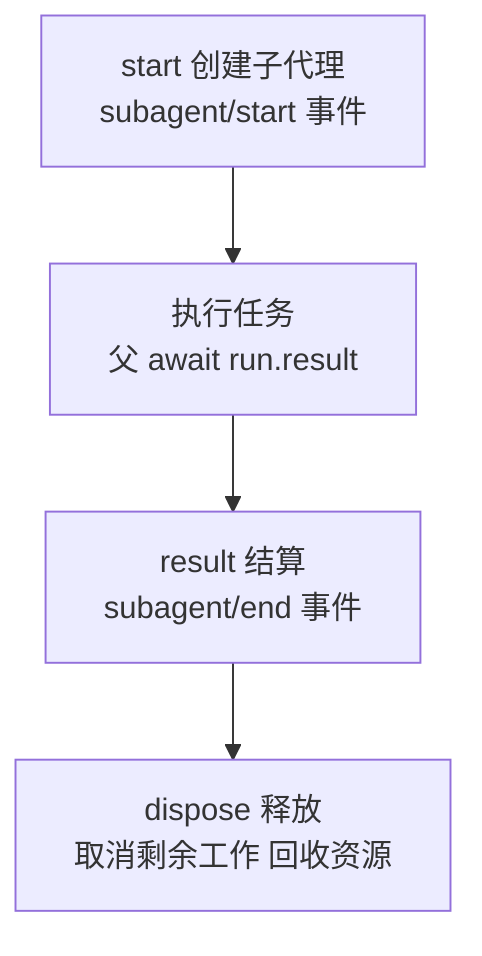

**结束时机**：`run.result` 结算（`subagent/end` 事件发出）后，**必须 `dispose()`** 释放资源（dsh: "Cancel remaining work, reach child quiescence, and release resources. Idempotent."）。前台调用由工具自动释放（`settleForegroundRun` 拿结果后 dispose）；后台调用由 `settleRun` 结算后释放。**不 dispose 的子代理会泄漏**——它的 Agent、Session、inbox 都还占着资源。

**Q: 下次使用子代理，是新创建还是复用？**

A: **默认是新创建（one-shot）**——每次 `ctx.subagents.start()` 都 `ctx.agents.create()` 一个全新的子代理，跑完 dispose 销毁，不留任何可复用的句柄。dsh 源码中 `start()` 的注释："`start` returns one published owned one-shot run"。

**复用是另一种模式（continuable）**——`ctx.subagents.startContinuable()` 建立**持久的可续子代理**：返回 durable child id + 持久化 Session，之后用 `send_message` / `followup` 给同一个子代理续消息（跨 turn 存活，不在内存时从持久化**冷恢复**）。两种模式的对比：

| | one-shot（`start`） | continuable（`startContinuable`） |
| --- | --- | --- |
| 子代理 id | 一次性 | durable，可跨 turn 使用 |
| 结束后 | dispose 销毁 | 保留（可冷恢复） |
| 复用方式 | 无，每次新建 | `followup` / `send_message` 续消息 |
| 适用 | 独立一次性任务（调研/审查） | 需要多轮协作的后台子代理 |

**怎么选**：一次性任务用 one-shot（用完即毁，简单）；需要多次交互的后台子代理用 continuable（dsh 的 `tool-subagent` 配置 `backgroundMode: 'continuable'` 时，后台委托返回 durable subagentId 而不是一次性 jobId）。

**Q: 深度控制是什么？为什么需要？**

A: 子代理还能再委托（A→B→C...），不加限制会无限加深耗尽资源。dsh 的方案：**子深度 = 父深度 + 1**，委托时带 `maxDepth` 上限，超限抛 `SubagentDepthError`。深度**持久化在子会话元数据**里——恢复的会话不能假装顶层再无限委托（dsh: "a resumed parent cannot delegate as if it were top-level"）。

**Q: 能力校验是什么？为什么 provider 要声明 capabilities？**

A: 不同 provider 支持的能力不同（spawn 支持 outputSchema，simple 不支持）。**provider 声明能力，start 前校验请求**——请求要求了 provider 没有的能力 → `UNSUPPORTED_CAPABILITY`，在委托前拦截（子代理没创建、没消耗资源）。

**Q: 委托策略固定和 blog-13 的权限预设什么关系？**

A: **联动**。blog-13 讲权限旋钮（sandbox/mode + approval/policy）怎么被预设写、被执行器读；这里讲**委托边界怎么处理旋钮**——子代理的旋钮在出生时被写入 `source: 'delegation'` 事件（sandbox 继承、approval 钉死 never），之后子代理的一切审批请求都按 never 自动拒绝。**blog-13 是"单代理的权限"，这篇是"代理间委托的权限"**。

**Q: subagent 域为什么是"命名 provider 注册表"而不是像 bash 那样的单服务？**

A: 子代理的**启动方式多种多样**：进程内新建（spawn，本篇实现）、继承父历史（fork）。它们共用同一套 start/result/生命周期语义，但实现完全不同——**注册表按名选择，能力各自声明**。dsh 源码明确说这"mirrors the LLM adapter registry (LlmRuntime.registerAdapter), not the single-service bash executor"（blog-11）。

**Q: 注销 provider 后正在跑的子代理会怎样？**

A: **不受影响**（dsh: "removing a provider blocks new starts but does not revoke runs that were already returned to their holders"）。注册表是"发号"的地方——注销只拦新委托，已发布的 run 由 holder 继续拥有，结果照常返回。

## 小结

1. **四个问题一条链**：怎么创建（工具 → start → `ctx.agents.create`）、有什么提示词（`applyChildComposition` 组装）、在哪执行（同进程新 Agent）、怎么通信（followup / whenIdle / finalAssistantOutput）；
2. **子代理 = 委托时创建的新 Agent**：own session、own system prompt、own inbox——父和子同一个类；
3. **提示词按子代理身份组装**：继承父预设 + 固定权限声明 + persona 覆盖（父和兄弟看不见）；
4. **通信靠消息 + 日志**：父投递、子执行、父读结果——子代理的工作只在子日志，父只拿结果；
5. **三道闸门**：找 provider → 能力校验 → 深度校验（父深度 + 1 + maxDepth）；
6. **委托策略固定**：sandbox 继承 + approval 钉死 never（接 blog-13）；
7. **生命周期事件**：subagent/start + subagent/end 配对，全程可监听、可审计。

下一篇预告：**Schedule 定时任务**——dsh 的 `schedule` 域：基于 Session 事件日志的一次性 + 固定间隔提醒（cron 语义的 agent 化实现）。

---

*本文代码已验证可运行（Node.js + tsx，@cordisjs/core v4.0.0-beta.5）。完整源码见同目录 `src/`（main.ts 演示入口 + 每文件对应 dsh 一个包），实现结构对应 dsh 的 `packages/subagent/{subagent,subagent-in-process-driver,subagent-spawn-in-process,tool-subagent}`。*
