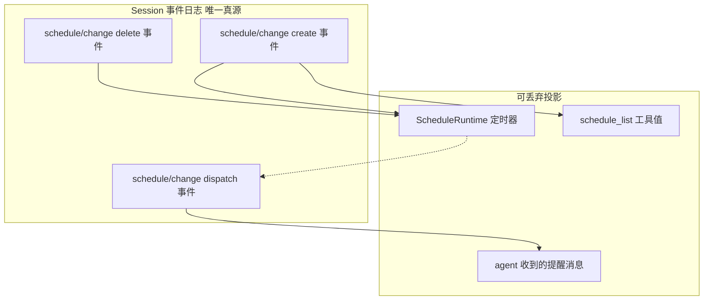
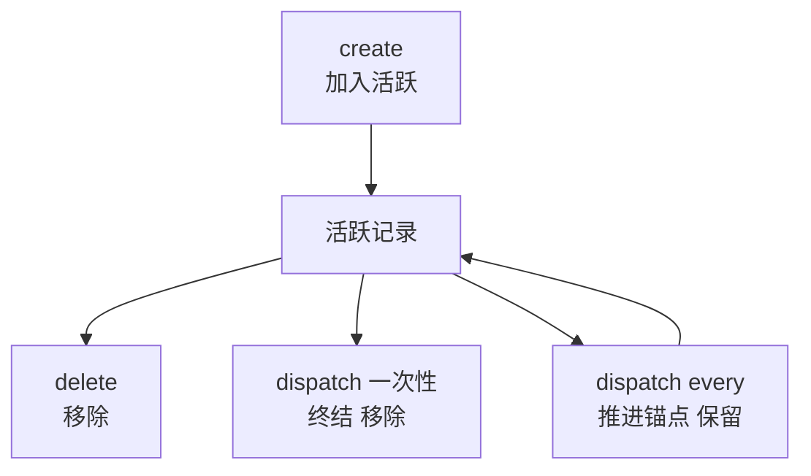
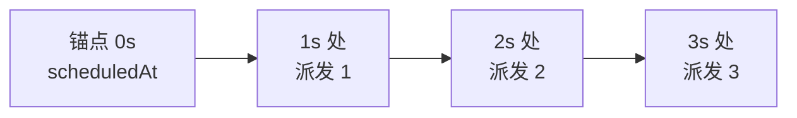
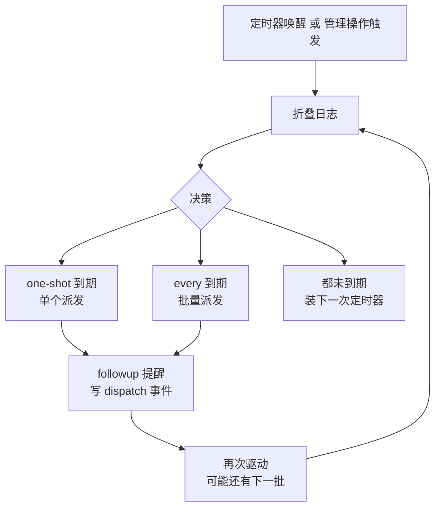
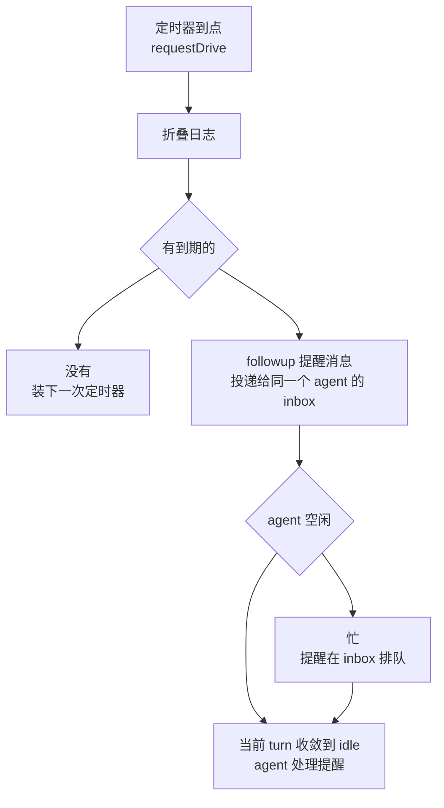
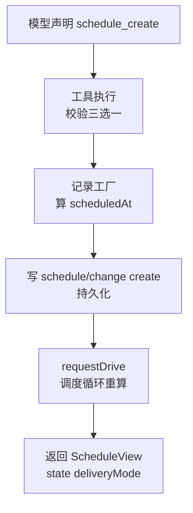

# DeepSeek Harness 从 0 开始：schedule 域（定时任务）

> 本系列从 0 开始，基于 Cordis 框架一步步实现一个简略版本的 DeepSeek Harness（loop、session、tool、system prompt 等）。这一篇讲 **schedule 域**——dsh `packages/schedule/` 下让 **Agent 拥有定时提醒** 的能力。
>
> 配套代码：[blog-15-schedule](./)，运行 `pnpm install && pnpm dev` 即可复现本文全部输出。

## 为什么需要定时任务？

Agent 会干活了（执行工具、问用户、委托子代理），但都是**被动响应**——用户问一句，Agent 答一句。**主动行为**怎么来？

- **"两分钟后提醒我检查构建结果"**——Agent 需要一个延迟一次性提醒（after）；
- **"每个小时给我汇总一次日志"**——Agent 需要一个固定间隔提醒（every）；
- **"明早九点叫我开会"**——Agent 需要一个绝对时刻提醒（at）。

dsh 的答案是 **schedule 域**（`packages/schedule/schedule` 单包）：**基于 Session 事件日志的持久提醒**——Agent 的定时任务状态全部落在 Session 日志里（事件溯源，blog-04），定时器只是日志的可丢弃投影。

## 核心理念：定时器是可丢弃投影，日志才是唯一真源

这是 schedule 域最重要的设计，dsh README 原文：

> "The Session event log owns reminder state; timers, tool values, and model follow-ups are disposable projections of that log."

**状态在日志里，不在定时器里**：



**读图**：提醒的**状态**（创建了哪些、删了哪些、派发到哪一步）全在日志里——重放日志就能恢复；定时器、工具返回值、提醒消息都是**从日志算出来的临时投影**，进程重启、定时器丢失都无所谓，**日志在，状态就在**。这就是事件溯源（blog-04）在定时任务上的应用。

**对比传统 cron**：传统 cron 把定时规则存在系统服务里（crontab 文件、内存定时器）；dsh 把定时规则存在 **Session 日志里**——和 Agent 的其他状态（消息、权限旋钮）同源同真，可审计、可重放、可持久化。

## 项目目录结构

```
blog-15-schedule/
├── package.json          # 项目配置：依赖、启动脚本
├── pnpm-lock.yaml        # 依赖锁定文件
└── src/
    ├── main.ts           # 演示入口：组装 + 演示
    ├── types.ts          # Schedule 值类型（schedule/src/types.ts）
    ├── session.ts        # Session 事件日志（dsh-session）
    ├── agent.ts          # Agent + AgentFactory（dsh-agent）
    ├── tool-registry.ts  # ToolRegistry（dsh-tools）
    ├── domain.ts         # 纯函数核心（schedule/src/domain.ts）
    ├── runtime.ts        # ScheduleRuntime（schedule/src/runtime.ts）
    ├── tools.ts          # schedule 管理工具（schedule/src/tools.ts）
    └── index.ts          # 装配：attachSchedule（schedule/src/index.ts）
```

**每个文件对应 dsh 的一个模块**——domain 是纯函数（fold、记录工厂、推进），runtime 是定时器投影，tools 是模型侧工具，index 是装配。

## 核心概念

| 概念 | 一句话理解 |
| --- | --- |
| **schedule/change 事件** | 提醒的唯一持久状态：create / delete / dispatch 三种操作 |
| **日志折叠（fold）** | 重放 schedule/change 得到活跃提醒列表 + 历史 id（唯一真源） |
| **after / at / every** | 三种提醒规则：延迟 / 绝对时刻 / 固定间隔 |
| **ScheduleRuntime** | 定时器投影：到期 → 决策 → 派发（可丢弃，日志在状态就在） |
| **dispatch 语义** | 一次性派发终结记录；every 派发用 acceptedAt 推进锚点 |
| **allocateScheduleId** | id 分配永不重用（schedule-1, schedule-2...） |
| **三个管理工具** | schedule_create / schedule_list / schedule_delete |
| **触发 = followup 复用** | 定时器到点 → 提醒投递给**同一个 agent**（不新建），进入 inbox |
| **忙时排队** | agent 在执行 turn → 提醒在 inbox 排队，等 idle 再处理（不打断不丢失） |

## Part 1：类型定义——三种记录 + 事件联合

schedule 域的类型（`types.ts`）围绕两个核心：**三种提醒记录**（after/at/every）+ **schedule/change 事件联合**（create/delete/dispatch）：

```ts
// ---- 三种持久化记录（dsh: AfterScheduleRecord 等）----

/** 延迟一次性提醒（after_seconds） */
interface AfterScheduleRecord {
  readonly id: ScheduleId
  readonly kind: 'after'
  readonly prompt: string          // 修剪后的提醒内容
  readonly afterSeconds: number    // 创建时接受的延迟秒数
  readonly scheduledAt: string     // RFC 3339 UTC 目标时刻
}

/** 绝对时刻一次性提醒（at） */
interface AtScheduleRecord {
  readonly id: ScheduleId
  readonly kind: 'at'
  readonly prompt: string
  readonly scheduledAt: string
}

/** 固定间隔重复提醒（every_seconds）——scheduledAt 是未派发的最早锚点对齐时刻 */
interface EveryScheduleRecord {
  readonly id: ScheduleId
  readonly kind: 'every'
  readonly prompt: string
  readonly everySeconds: number
  readonly scheduledAt: string
}

type OneShotScheduleRecord = AfterScheduleRecord | AtScheduleRecord
type ScheduleRecord = OneShotScheduleRecord | EveryScheduleRecord

// ---- schedule/change 事件（dsh: ScheduleChange 联合）----

/** create：携带完整记录 */
interface ScheduleCreateChange {
  readonly version: 1
  readonly operation: 'create'
  readonly schedule: ScheduleRecord
}

/** delete：只带 id（移除活跃记录） */
interface ScheduleDeleteChange {
  readonly version: 1
  readonly operation: 'delete'
  readonly id: ScheduleId
}

/** 一次性派发：id-only（记录终结） */
interface OneShotScheduleDispatchChange {
  readonly version: 1
  readonly operation: 'dispatch'
  readonly id: ScheduleId
}

/** 固定间隔派发：acceptedAt 用于推进到下一锚点 */
interface EveryScheduleDispatchChange {
  readonly version: 1
  readonly operation: 'dispatch'
  readonly id: ScheduleId
  readonly acceptedAt: string
}
```

**三个关键设计**（都来自 dsh 源码）：

1. **版本化联合**：所有事件带 `version: 1`——日志是持久化的，将来加字段必须升版本，旧日志才能兼容解码（dsh: "Replay rejects unknown versions"）；
2. **dispatch 的两种形状**：一次性派发只有 id（记录终结，从活跃列表移除）；every 派发带 `acceptedAt`（决策时刻，用于把 scheduledAt 推进到下一个锚点）。**一个联合区分两种语义**，fold 时据此决定"删记录"还是"改记录"；
3. **at 记录只存 UTC**：dsh 的 at 输入支持本地日历 + 时区，但**持久化只保留规范 UTC scheduledAt**——不存提交的偏移、本地日历字段或解释时区（"no Schedule path reads the browser, Session header, model time-context, connection, or process time zone"）。

## Part 2：日志折叠——唯一真源

**提醒状态不单独存**——每次需要时从日志折叠（事件溯源，blog-04）。fold 的逻辑就是"重放 schedule/change"：create 加入、delete 移除、dispatch 终结或推进：

```ts
export function foldScheduleEvents(events: readonly SessionEvent[], seedLength = 0): FoldedSchedules {
  const active = new Map<string, ScheduleRecord>()
  const seen = new Set<string>()
  for (const event of events.slice(seedLength)) {
    if (event.type !== 'schedule/change') continue
    const change = decodeScheduleChange(event.data)
    switch (change.operation) {
      case 'create':
        if (seen.has(change.schedule.id)) throw new ScheduleError('corrupt_schedule_log', `schedule id ${change.schedule.id} was reused`)
        seen.add(change.schedule.id)
        active.set(change.schedule.id, change.schedule)
        break
      case 'delete':
        if (!active.delete(change.id)) throw new ScheduleError('corrupt_schedule_log', `schedule delete targets inactive id ${change.id}`)
        break
      case 'dispatch': {
        const record = active.get(change.id)
        if (record === undefined) throw new ScheduleError('corrupt_schedule_log', `schedule dispatch targets inactive id ${change.id}`)
        const next = dispatchedRecord(record, change)
        if (next === undefined) active.delete(change.id)
        else active.set(change.id, next)
        break
      }
    }
  }
  return Object.freeze({
    active: Object.freeze([...active.values()]),
    seenIds: Object.freeze([...seen]),
  })
}
```

**fold 的状态机**——三种操作对活跃记录的转移：



**读图**：create 把记录加入活跃集合；delete 和一次性 dispatch 都把它移出；every 的 dispatch **不删记录**，而是推进 `scheduledAt` 后放回活跃集合（继续等下一次）。**非法转移（复用 id、删不活跃记录、派发不活跃记录）抛 `corrupt_schedule_log`**——日志是权威，错误要 fail loud。

**fold 返回两个东西**：`active`（活跃提醒）+ `seenIds`（历史所有 id）。后者用于 id 分配永不重用：

```ts
export function allocateScheduleId(folded: FoldedSchedules): ScheduleId {
  const seen = new Set(folded.seenIds)
  let sequence = seen.size + 1
  let candidate = ScheduleId(`schedule-${sequence}`)
  while (seen.has(candidate)) {
    sequence += 1
    candidate = ScheduleId(`schedule-${sequence}`)
  }
  return candidate
}
```

## Part 3：三种记录工厂 + 固定间隔推进

**记录工厂**（dsh: createAfter/At/EveryScheduleRecord）——纯函数：校验输入 → 计算 scheduledAt → 返回冻结记录。**只算目标时刻，不写日志**（写日志是工具的事）：

```ts
/** after：延迟一次性提醒 */
function createAfterScheduleRecord(id: ScheduleId, prompt: string, afterSeconds: number, now: number): OneShotScheduleRecord {
  const normalizedPrompt = prompt.trim()
  if (normalizedPrompt.length === 0) throw new ScheduleError('invalid_prompt', 'prompt must be non-empty after trimming')
  if (!Number.isSafeInteger(afterSeconds) || afterSeconds <= 0) {
    throw new ScheduleError('invalid_rule', 'after_seconds must be a positive safe integer')
  }
  const target = now + afterSeconds * 1000
  return Object.freeze({ id, kind: 'after', prompt: normalizedPrompt, afterSeconds, scheduledAt: futureInstant(target, now) })
}
```

**固定间隔的锚点推进**（dsh: resolveEveryOccurrence）——every 的核心：`scheduledAt` 是"未派发的最早锚点对齐时刻"，每次派发后向后推进一个间隔：

```ts
export function resolveEveryOccurrence(
  record: EveryScheduleRecord,
  now: number,
): { occurrenceAt: string; nextScheduledAt: string | undefined } {
  const intervalMs = record.everySeconds * 1000
  const anchor = Date.parse(record.scheduledAt)
  // 从锚点向后取最近不晚于 now 的对齐时刻
  let occurrence = anchor
  while (occurrence + intervalMs <= now) occurrence += intervalMs
  const next = occurrence + intervalMs
  return {
    occurrenceAt: new Date(occurrence).toISOString(),
    nextScheduledAt: new Date(next).toISOString(),
  }
}
```

**锚点推进**——错过多个周期也只会"补齐当前时刻"，不积压：



**读图**：每个间隔派发一次，`scheduledAt` 逐步推进。如果进程睡了 5 秒才醒（错过多个周期），`while (occurrence + intervalMs <= now)` 直接跳到当前对齐时刻——**不补跑错过的每个周期**（dsh: "advances directly to the first anchor-aligned target after that decision time"）。

## Part 4：ScheduleRuntime——定时器投影

**ScheduleRuntime**（dsh: runtime.ts）是"定时器 + 派发"的可丢弃投影。它不存任何状态——每次驱动都重新折叠日志、做决策：

```ts
/**
 * 决策：选一个到期的一次性提醒（按目标时刻 + 创建序）、
 * 或一批到期的固定间隔提醒、或下一次唤醒目标。
 */
function dueDecision(folded: FoldedSchedules, now: number): DueDecision {
  const oneShot = folded.active
    .filter((r): r is OneShotScheduleRecord => r.kind !== 'every' && Date.parse(r.scheduledAt) <= now)
    .sort(byTarget)[0]
  if (oneShot !== undefined) return { kind: 'one-shot', record: oneShot }

  const every = folded.active
    .filter((r): r is EveryScheduleRecord => r.kind === 'every' && Date.parse(r.scheduledAt) <= now)
    .sort(byTarget)
  if (every.length > 0) {
    return {
      kind: 'every',
      acceptedAt: new Date(now).toISOString(),
      reminders: every.map((record) => ({
        record,
        occurrenceAt: resolveEveryOccurrence(record, now).occurrenceAt,
      })),
    }
  }

  const target = folded.active.reduce<number | undefined>((selected, record) => {
    const candidate = Date.parse(record.scheduledAt)
    return candidate > now && (selected === undefined || candidate < selected) ? candidate : selected
  }, undefined)
  return { kind: 'wait', ...(target === undefined ? {} : { target }) }
}
```

**驱动的决策循环**——三个分支：



**读图**：每次唤醒（定时器到点 / 管理操作提交）都**重新折叠日志**再决策——一次唤醒处理一个到期的一次性提醒（按目标时刻排序，**一次性优先于 every**），或一批到期的 every；都未到期就装下一次定时器；派发后**再次驱动**（every 可能有下一批，或新记录提前了下一个唤醒点）。

派发动作（dsh: runtime 的 driveOnce）——**先给 agent 投递提醒消息，再写 dispatch 事件**：

```ts
// 派发：构造提醒消息 → followup 给 agent → 写 dispatch 事件
const text = decision.kind === 'one-shot'
  ? renderReminderFraming(decision.record)
  : renderEveryReminderBatchFraming(decision.reminders)
this.agent.followup({ type: 'text', text })

if (decision.kind === 'one-shot') {
  this.agent.session.append({ type: 'schedule/change', data: { version: 1, operation: 'dispatch', id: decision.record.id } })
} else {
  for (const reminder of decision.reminders) {
    this.agent.session.append({
      type: 'schedule/change',
      data: { version: 1, operation: 'dispatch', id: reminder.record.id, acceptedAt: decision.acceptedAt } as ScheduleChange,
    })
  }
}
```

**定时器细节**（dsh 的两个精细设计）：
1. **分段定时器**：Node 的 `setTimeout` 最大延迟约 24.8 天（`MAX_TIMER_DELAY_MS = 2_147_483_647`），更长的等待**分段装**——每段唤醒后重读墙钟（dsh: "splits waits longer than the Node timer range and rereads the wall clock after every wake"）；
2. **墙钟回拨安全**：每次唤醒重读 `Date.now()` 做决策——**系统时间回拨不会提前触发**（目标时刻没到就不派发），**向前跳变让记录变 overdue**（到期就派发）。

### 触发了怎么办：复用同一个 agent，不新建

定时器到点后，**提醒投递给谁**？这是 schedule 域最容易误解的点——**答案是复用同一个 agent，绝不新建**。`this.agent.followup(message)` 里的 `this.agent` 就是挂载 schedule 的那个 agent 实例，提醒作为一条用户消息进入它的 inbox：



**读图**：定时器触发 → 折叠日志确认到期 → `followup` 把提醒投递给**同一个 agent** 的 inbox（复用，不新建）。如果 agent 正忙（在执行当前 turn），提醒在 inbox **排队**，等当前 turn 收敛到 idle 再处理。

**为什么不是新建 agent？** 因为提醒是**这个 agent 自己的待办**——"两分钟后检查构建结果"就该由**同一个** agent 在下一轮处理，它有完整的上下文（会话、system prompt、权限）。新建一个 agent 既没有上下文，也会破坏"提醒属于这个会话"的语义（dsh 的 fork 子代理用 seedLength 明确不继承父的提醒）。

**agent 忙时怎么办？inbox 排队**（dsh: "The Agent inbox is the only turn queue"）。派发走 `runMaintenance`——从 **true idle 阶段**执行：agent 忙时提醒进 inbox 排队（"later waking input remains in the inbox until the task settles"），当前 turn 收敛到 idle 后才被处理。**提醒不会打断正在进行的 turn，也不会丢。**

运行输出（演示 Part 6）——agent 忙时的排队全过程：

```
🚀 busy-1 创建 1 秒后提醒（等价 schedule_create，手动 append create 事件）:
  ✅ 创建成功: id=schedule-1 scheduledAt=2026-08-23T06:20:33.787Z

🔨 busy-1 立刻开始一个 1.5 秒的长 turn（模拟正在执行的任务）:

⏳ 等 1.1 秒让提醒触发（此时 busy-1 仍在执行长 turn）...
  ⏳ agent 忙（当前 turn 执行中）→ 提醒进 inbox 排队: Reminder (after): 忙完再处理我...
  📌 busy-1 忙状态: true（提醒已触发，但 agent 还在忙 → 提醒进 inbox 排队）

⏳ 等长 turn 结束（剩余约 0.4 秒），排队提醒被处理...

📜 busy-1 的消息流（提醒在长 turn 之后才被处理）:
  📥 user/message: 处理大型重构
  📤 assistant/message: [busy-1] 完成 turn: 处理大型重构...
  📥 user/message: Reminder (after): 忙完再处理我
  📤 assistant/message: [busy-1] 收到提醒并处理: Reminder (after): 忙完再处理我...

🔑 关键: 定时器触发时 **不新建 agent**——`followup` 把提醒投递给同一个 busy-1 的 inbox
     agent 忙 → 提醒排队；当前 turn 收敛到 idle → 再处理（dsh: inbox is the only queue）
```

**看这个消息流**：长 turn（"处理大型重构"）先完整执行完，**之后**排队中的提醒（"忙完再处理我"）才被处理——顺序严格 FIFO，提醒不打断、不丢失、不复用新 agent。

## Part 5：管理工具——模型怎么创建/查看/删除提醒

三个工具（dsh: tools.ts）——模型通过工具创建、查看、删除提醒。核心：**工具调 domain 纯函数 → 写 schedule/change 事件 → 请求调度循环重算**：

```ts
export function registerScheduleTools(ctx, tools, agent, requestDrive): void {
  tools.register({
    name: 'schedule_create',
    description: 'Create a durable reminder: one of after_seconds, at, or every_seconds.',
    async execute(args) {
      const selectors = ['after_seconds', 'at', 'every_seconds'].filter(key => args[key] !== undefined)
      if (selectors.length !== 1) {
        return toolError('invalid_selector', 'exactly one of after_seconds, at, every_seconds is required')
      }
      const folded = foldScheduleEvents(agent.session.events, agent.session.meta.seedLength)
      const id = allocateScheduleId(folded)
      const now = Date.now()
      const record = args.after_seconds !== undefined
        ? createAfterScheduleRecord(id, args.prompt, args.after_seconds, now)
        : args.at !== undefined
          ? createAtScheduleRecord(id, args.prompt, args.at, now)
          : createEveryScheduleRecord(id, args.prompt, args.every_seconds, now)
      // 写 create 事件：持久化唯一真源
      agent.session.append({ type: 'schedule/change', data: { version: 1, operation: 'create', schedule: record } })
      requestDrive()  // 让调度循环重算（可能要提前装定时器）
      return scheduleView(record, now)
    },
  })
  // schedule_list：fold → 每记录加 state/deliveryMode
  // schedule_delete：校验活跃 → 写 delete 事件 → requestDrive
}
```

**一次 schedule_create 的完整链路**：



**读图**：工具先校验（三个选择器**必须恰好一个**——dsh: "requires exactly one of after_seconds, at, or every_seconds"），再算目标时刻，**写事件才是持久化**，然后请求调度循环重算（新记录可能比当前定时器更早到期，要重新装定时器），最后返回模型可见视图（state: scheduled/overdue）。

## Part 6：完整演示——真实定时触发

初始化（挂载 runtime + 工具）：

```ts
let ctx = new Context()
await ctx.plugin(AgentFactory)
await ctx.plugin(ToolRegistry)
const parent = ctx.agents.create('main-1')
attachSchedule(ctx, parent)
```

### 创建 after 提醒（2 秒后触发）

```
🚀 模型调用 schedule_create(after_seconds=2):
  ✅ 创建成功: id=schedule-1 kind=after scheduledAt=2026-08-23T05:37:08.981Z
  state=scheduled deliveryMode=session-local
```

**after 规则**：`scheduledAt = now + afterSeconds`——2 秒后到点。

### 创建 every 提醒（1 秒间隔）

```
🚀 模型调用 schedule_create(every_seconds=1):
  ✅ 创建成功: id=schedule-2 kind=every everySeconds=1
```

### 查看活跃提醒

```
📋 活跃提醒:
  - schedule-1 [after] 检查构建结果 → 2026-08-23T05:37:08.981Z (scheduled)
  - schedule-2 [every] 心跳上报 → 2026-08-23T05:37:07.982Z (scheduled)
```

### 等待真实定时触发（Part 4）

```
📡 触发后 agent 收到的提醒消息:
  📥 user/message: Recurring reminder (1s): 心跳上报
  📤 assistant/message: [main-1] 收到提醒并处理: Recurring reminder (1s): 心跳上报...
  📥 user/message: Reminder (after): 检查构建结果
  📤 assistant/message: [main-1] 收到提醒并处理: Reminder (after): 检查构建结果...
  📥 user/message: Recurring reminder (1s): 心跳上报
  📤 assistant/message: [main-1] 收到提醒并处理: Recurring reminder (1s): 心跳上报...

📜 会话日志中的 schedule/change 事件:
  #0 schedule/change create kind=after
  #1 schedule/change create kind=every
  #4 schedule/change dispatch id=schedule-2 acceptedAt=2026-08-23T05:37:07.983Z
  #7 schedule/change dispatch id=schedule-1
  #10 schedule/change dispatch id=schedule-2 acceptedAt=2026-08-23T05:37:08.982Z
```

**看这个日志**——三种事件的真实样子：
- `#0/#1 create`：两条提醒创建；
- `#4/#10 dispatch id=schedule-2 acceptedAt=...`：every 派发**两次**（带 acceptedAt 推进锚点），所以提醒消息里"心跳上报"出现两次；
- `#7 dispatch id=schedule-1`：after 派发**一次**（id-only，终结）——所以"检查构建结果"只出现一次。

**提醒消息的顺序**：`user/message`（提醒进来）+ `assistant/message`（agent 处理）配对——**定时器通过 followup 把提醒变成 agent 的一条用户消息**，进入正常的 agent 循环。注意 `[main-1]`——处理提醒的**就是挂载 schedule 的那个 agent**，不是新 agent（复用，Part 4 详讲）。

### every 持续触发 + 删除（Part 5-6）

```
📡 every 提醒已派发 3 次（acceptedAt 推进锚点）

🚀 模型调用 schedule_delete(id=schedule-2):
  ✅ 结果: {"id":"schedule-2","deleted":true}

⏳ 删除后再等 1.2 秒，确认不再触发...
  派发次数: 删除前 4 → 删除后 4（✅ 不再触发）
```

**删除后不再触发**——因为 delete 事件已从日志移除记录，fold 后调度循环看不到它了。**这就是"日志是唯一真源"的验证**：删掉日志里的记录，定时器（投影）自然就不再派发。

### 删除不存在的 id + 最终折叠（Part 7-8）

```
🚀 schedule_delete(schedule-999) → {"id":"schedule-999","deleted":false,"code":"schedule_not_found"}

📊 折叠结果:
  活跃提醒: 0 个
  历史 id: schedule-1, schedule-2

✅ 会话日志共 15 条事件——重放即完整状态，定时器只是可丢弃投影
```

## 常见问题 FAQ

**Q: schedule 和传统 cron 有什么区别？**

A: **状态存储位置不同**。传统 cron 把定时规则存在系统服务里（crontab、内存定时器）；dsh 把规则存在 **Session 事件日志里**——create/delete/dispatch 都是日志事件，和 Agent 的其他状态（消息、权限旋钮）同源同真。**日志在，状态就在**：进程重启、定时器丢失都不影响，重放日志即可恢复全部提醒。

**Q: 定时器丢了怎么办？状态会丢吗？**

A: **不会**。定时器是**可丢弃投影**（dsh: "timers ... are disposable projections of that log"）——提醒状态在日志里。进程重启后，fold 日志重新得到活跃提醒，runtime 重新计算最近的唤醒目标并装定时器。**日志是唯一真源，投影随时可从日志重建**。

**Q: after / at / every 三种规则的区别？**

A: after = 延迟一次性（`now + after_seconds`）；at = 绝对时刻一次性（`scheduledAt` 直接指定）；every = 固定间隔重复（`scheduledAt` 是未派发的最早锚点，每次派发后推进一个间隔）。**after 和 at 派发一次就终结**（从活跃移除），**every 派发后保留**（推进锚点继续等下一次）。

**Q: dispatch 事件为什么有两种形状？**

A: 一次性派发只需要 id（记录终结）；every 派发需要 `acceptedAt`（决策时刻）——**fold 用它把 scheduledAt 推进到下一个锚点**。一个联合区分两种语义：`dispatchedRecord` 里，一次性返回 undefined（删记录），every 返回推进后的记录（保留）。

**Q: every 错过多个周期会补跑吗？**

A: **不会**。`resolveEveryOccurrence` 的 `while (occurrence + intervalMs <= now)` 直接从锚点跳到当前对齐时刻——**不补跑错过的每个周期**（dsh: "advances directly to the first anchor-aligned target after that decision time"）。睡 5 秒醒来的 1 秒间隔提醒，只会派发当前时刻那一次，不会积压 5 次。

**Q: 系统时间回拨/跳变会怎样？**

A: dsh 每次唤醒都**重读墙钟**做决策（"rereads the wall clock after every wake"）——**回拨不会提前触发**（目标时刻没到就不派发），**向前跳变让记录变 overdue**（到期就派发）。定时器用分段（Node 最大约 24.8 天）避免超限，长等待拆成多段。

**Q: 为什么 create 要"恰好一个"选择器？**

A: dsh 的 `schedule_create` "requires exactly one of `after_seconds`, `at`, or `every_seconds`"——三个选择器互斥。传多个（如 after + every）或一个都不传 → `invalid_selector`。**一个提醒必须且只能有一个规则**，避免歧义。

**Q: 为什么 id 永不重用？**

A: 日志是持久的、可重放的——如果 id 重用，重放时两条 create 会冲突。`allocateScheduleId` 从 `seenIds`（历史所有 id）分配下一个没用过的序号（`schedule-1, schedule-2...`），fold 时发现重用会抛 `corrupt_schedule_log`。**id 是日志里的稳定身份，一旦用过永不再给**。

**Q: 删除不存在的 id 会怎样？**

A: **不抛错，返回非破坏性结果**（dsh: "an unknown or terminal id returns `{ id, deleted: false, code: 'schedule_not_found' }` after preflight"）。和 create 的严格校验不同，delete 对不存在是**宽容的**——幂等删除（已删/不存在都算成功意义上的"没了"）。

**Q: 定时提醒是怎么触发的？触发机制是什么？**

A: 三步：**定时器到点 → 折叠日志 → followup 投递**。`ScheduleRuntime` 装一个 setTimeout（到最近目标时刻），唤醒后 `requestDrive()` → 重新 `foldScheduleEvents`（确认到期，因为墙钟可能变过）→ `dueDecision` 决策 → 有到期提醒就 `agent.followup(提醒消息)` 派发。**每次唤醒都重读墙钟**——系统时间变了也不会误触发。

**Q: 提醒触发时，是新建一个 agent 还是复用之前的？**

A: **复用同一个 agent，绝不新建**。`this.agent.followup(message)` 里的 `this.agent` 就是挂载 schedule 的**那个 agent 实例**——提醒作为一条用户消息进入它的 inbox，下一轮由它自己处理。为什么不新建？提醒是**这个 agent 自己的待办**（"检查构建结果"要由有上下文的同一个 agent 做），新建 agent 既没有上下文，也破坏"提醒属于这个会话"的语义。

**Q: 如果 agent 正在执行（忙），提醒怎么办？会打断吗？**

A: **不打断，inbox 排队**。dsh: "The Agent inbox is the only turn queue"——`followup` 只是把提醒放进 inbox；派发走 `runMaintenance`（从 true idle 阶段执行），agent 忙时提醒排队（"later waking input remains in the inbox until the task settles"），当前 turn 收敛到 idle 才被处理。**提醒不会打断正在进行的 turn，也不会丢**——FIFO 顺序，等当前任务完成后再处理。

**Q: 窗口/进程关了，定时任务会自己重启执行吗？**

A: **不会自己重启——但重启后补发，不丢提醒**。两个层面：

1. **状态在日志里**：提醒的 create/delete/dispatch 事件持久化在 Session 日志（schedule 依赖 `sessionPersistence`）——**窗口/进程关了，定时器没了，但日志里状态还在**；
2. **重启后 overdue 补发**：重新启动后，新建 `ScheduleRuntime` 折叠日志——`dueDecision` 里 `Date.parse(scheduledAt) <= now` 的提醒就是到期，**过期的（overdue）提醒立即派发**（dsh 的 `state: 'overdue'`）。一次性提醒补发一次后终结；every 提醒从锚点跳到当前对齐时刻（不补跑每个周期）。

运行输出（演示 Part 9）——窗口关闭后重启的完整过程：

```
💤 模拟窗口关闭：restart-1 创建 1 秒提醒，但不启动 runtime（进程不在，定时器不存在）
  ✅ 提醒已写入日志: id=schedule-1 scheduledAt=2026-08-23T07:05:20.120Z
  ❌ 窗口关了 → 定时器没了 → 提醒"过期"（但日志里状态还在）

⏳ 等 1.3 秒（模拟窗口关闭期间，时间流逝，提醒过期）...

🔄 重新打开窗口：新建 ScheduleRuntime，折叠日志发现 overdue

📜 restart-1 的消息流（overdue 提醒被补发）:
  📥 user/message: Reminder (after): 窗口关了也要提醒我
  📤 assistant/message: [restart-1] 收到提醒并处理: Reminder (after): 窗口关了也要提醒我..

🔑 关键: 窗口关闭不丢提醒——日志在状态就在，重启后 overdue 立即补发
   活跃提醒: 0 个（过期的一次性提醒派发后终结）
```

**前提**：提醒状态要**持久化**（Session 日志落盘，blog-12 的补充篇讲过）。如果日志只存在内存里，进程一关就真丢了——这就是为什么 schedule 强制依赖 `sessionPersistence`（dsh: "Static injection makes a missing persistence service a composition error"）。

**Q: schedule 和 subagent（blog-14）什么关系？**

A: **独立能力，可组合**。schedule 是"定时提醒"（时间驱动，向 agent 投递消息）；subagent 是"委托子代理"（任务驱动，创建子 agent）。可以组合：定时器到点 → agent 收到提醒 → 委托子代理处理——**时间触发 + 任务分发的组合**。dsh 的 fork 子代理用 `seedLength` 不继承父的提醒（"a fork folds only its own suffix, so it does not inherit its parent's reminders"）。

## 小结

1. **核心理念**：Session 日志拥有提醒状态，定时器/工具值/提醒消息都是可丢弃投影——**日志是唯一真源**；
2. **事件模型**：schedule/change 联合（create/delete/dispatch），版本化、dispatch 两种形状（一次性终结 / every 推进）；
3. **日志折叠**：重放即状态——create 加入、delete 移除、dispatch 终结或推进，非法转移抛 corrupt_schedule_log；
4. **三种规则**：after（延迟）/ at（绝对时刻）/ every（固定间隔锚点推进，不补跑）；
5. **ScheduleRuntime**：定时器投影——每次唤醒重新折叠再决策（一次性优先 / every 批量 / wait），分段定时器 + 墙钟重读；
6. **管理工具**：schedule_create/list/delete——工具写事件 + 请求重算，模型经工具管理提醒；
7. **触发 = 复用 + 排队**：定时器到点 → followup 投递给**同一个 agent**（不新建）；agent 忙 → 提醒在 inbox 排队，等 idle 再处理（不打断不丢失）；
8. **重启补发**：窗口/进程关闭不丢提醒——日志在状态就在，重启后 overdue 立即补发（一次性补一次，every 跳到当前锚点）；
9. **agent 协作**：派发 = followup 提醒消息给 agent，进入正常 agent 循环。

下一篇预告：**Scope 作用域**——`dsh-scope` 独立包：作用域隔离（agent 边界、工具隔离、事件过滤）。

---

*本文代码已验证可运行（Node.js + tsx，@cordisjs/core v4.0.0-beta.5）。完整源码见同目录 `src/`（main.ts 演示入口 + 每文件对应 dsh 一个模块），实现结构对应 dsh 的 `packages/schedule/schedule`。*
