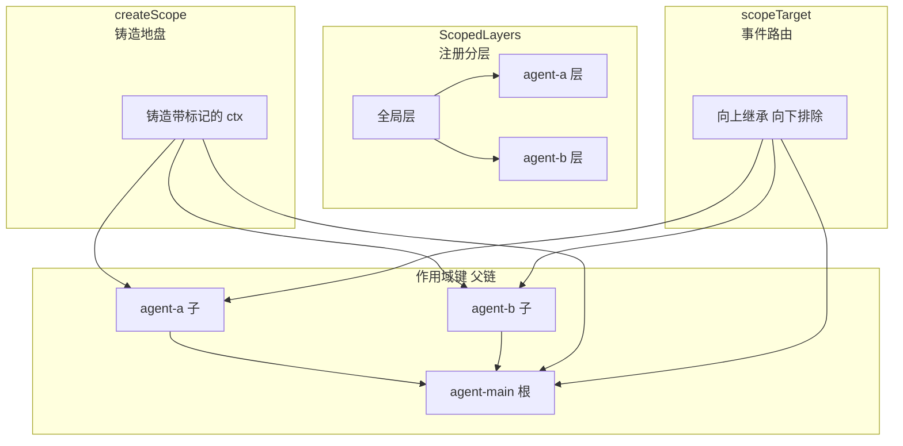
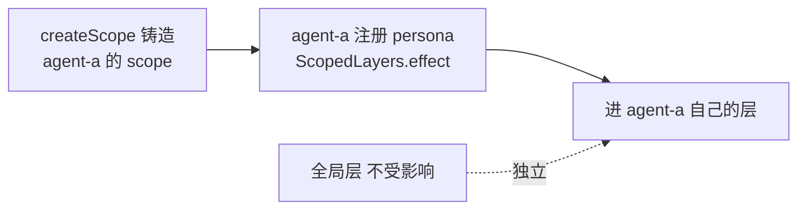
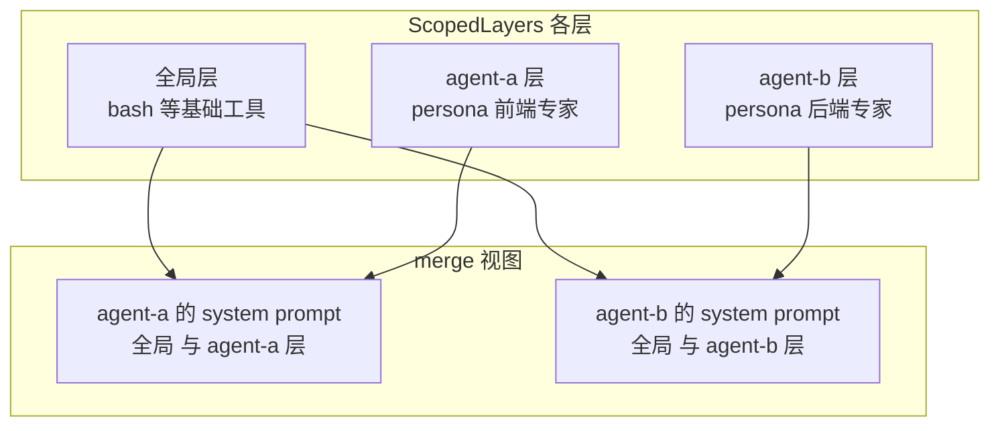
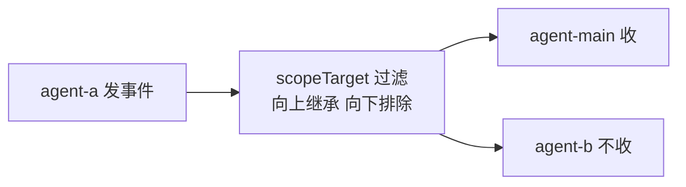
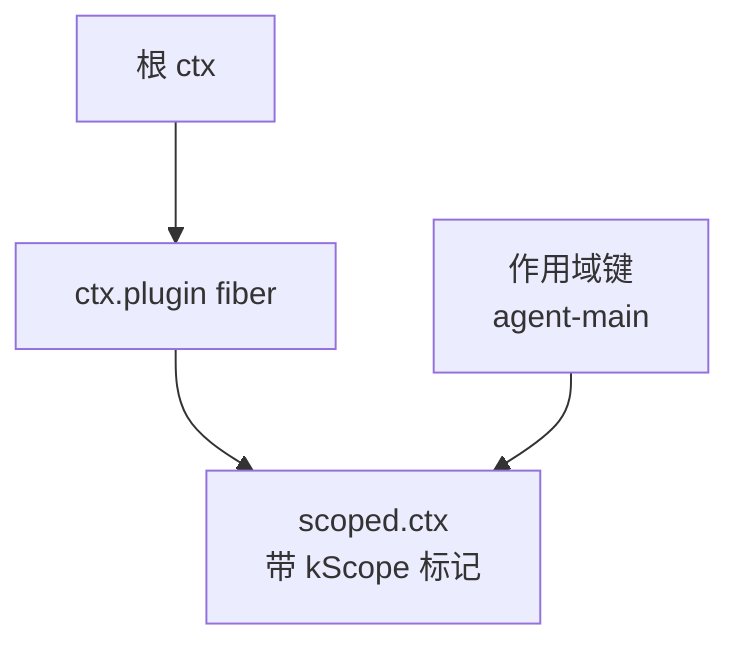
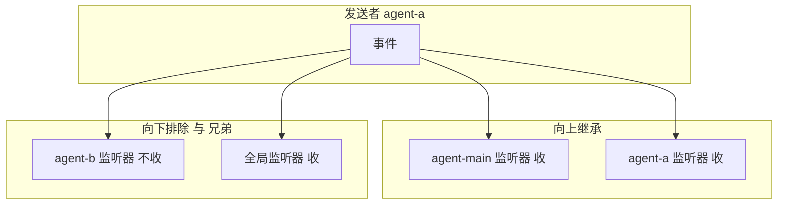
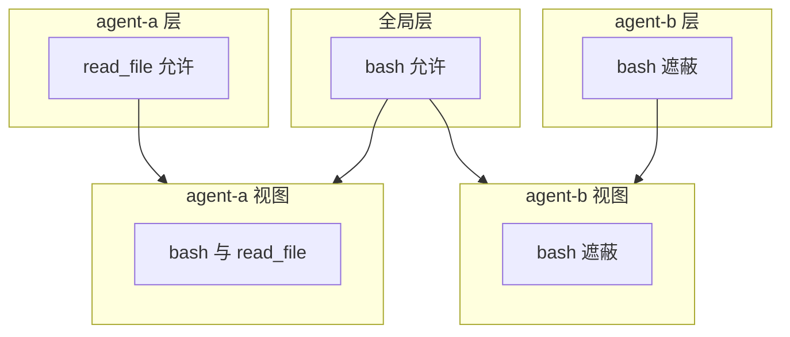

# DeepSeek Harness 从 0 开始：scope 域（作用域隔离）

> 做多 Agent 开发时，你是不是永远绕不开一个致命问题：**多个 Agent 共用同一个运行上下文，配置、工具、事件疯狂串扰？**
>
> - A 智能体设置的专属人设，莫名其妙跑到 B 智能体的提示词里；
> - A 禁用的工具，全体 Agent 一起失效；
> - 不同 Agent 的业务事件互相监听、错乱响应……
>
> 很多人尝试用 Session 隔离，最后发现治标不治本：**Session 只能隔离运行数据，完全管不住全局注册的配置与事件**。
>
> 而 DeepSeek Harness 解决多 Agent 串扰的核心答案，就是 **Scope 作用域**。作为 DSH 框架最核心的隔离原语，Scope 给每一个 Agent 单独划分出一块「独立注册地盘」，实现**人设隔离、工具权限隔离、事件路由隔离**，彻底解决多 Agent 运行冲突。
>
> 本文基于官方源码，从零拆解 Scope 三大核心机制：**createScope 作用域铸造、scopeTarget 事件路由、ScopedLayers 分层遮蔽**，带你彻底吃透 DSH 多 Agent 隔离的底层逻辑。
>
> 本系列从 0 开始，基于 Cordis 框架一步步实现一个简略版本的 DeepSeek Harness（loop、session、tool、system prompt 等）。配套代码：[blog-16-scope](./)，运行 `pnpm install && pnpm dev` 即可复现本文全部输出。

## 串扰的根源：所有 agent 共享同一个 ctx

引言里说的三种串扰（人设泄漏、工具失效、事件错乱），根源只有一个：**dsh 里每个 agent 的 ctx 都从同一个 `loopCtx` 派生**（agent-loop 源码：`this.scope = createScope(loopCtx, this)`）——**所有 agent 共享同一块注册空间**。你在 ctx 上注册了什么，所有 agent 都看得到。

**为什么 Session 治标不治本？** 因为 session 隔离"数据"，管不住"注册"：

| | session（blog-04） | scope（本篇） |
| --- | --- | --- |
| 隔离什么 | **数据**：事件日志、消息 | **注册**：persona、监听器、提示词片段 |
| 管得住 | 谁的事件写进谁的日志 | 谁在 ctx 上注册了什么 |
| 类比 | 每人一个**数据抽屉** | 每人一个**注册房间** |

**抽屉隔离不了共享房间里的注册**——session 只管日志，管不到"谁在 ctx 上注册了什么"。scope 就是给每个 agent 划一块独立注册空间，隔离这些注册。

**有 Java 经验的读者，可以这样理解**：scope 和 **ThreadLocal** 是同一个模式——**按身份隔离，同一个"名字"在不同身份下看到不同的东西**：

```java
// ThreadLocal：每个线程一份
ThreadLocal<String> persona = new ThreadLocal<>();
persona.set("前端专家");     // 当前线程存
persona.get();               // 当前线程读 → "前端专家"
// 另一个线程 get() → null（互不可见）
```

```ts
// dsh scope：每个 agent 一份
scopedLayers.effect(agentAScope.ctx, layer => layer.entries.insert('persona', '前端专家'))
// agent-b 的 ctx merge 读 → 没有（互不可见）
```

区别在于：ThreadLocal 是**隐式**的（挂当前线程，不需要传参）、只管一个值；scope 是**显式**的（必须持有对应 ctx）、管一整套注册与事件，还有父链继承（后面 Part 会讲）。

> 注意：基础工具（bash、read_file）是**全局共享**的，不在 scope 隔离范围内——scope 隔离的是**每个 agent 的专属配置**，不是基础能力。

## 作用域如何起作用？

三个原语**分工协作**，同一件事的三个面：



**三个原语的分工**：

| 原语 | 回答的问题 | 一句话 |
| --- | --- | --- |
| **createScope** | 地盘在哪 | 铸造带标记的 ctx，注册通过它 = 归属这个 agent |
| **ScopedLayers** | 注册存哪 | 全局层 + 每 agent 一层，merge 时最近遮蔽最远 |
| **scopeTarget** | 事件发给谁 | 父收子，子不收父，兄弟互不收 |

**看一个完整流程：agent-a 注册自己的 persona"你是前端专家"，agent-b 不该看到。**

**第 1 步：铸造地盘 + 注册进自己的层**（createScope → ScopedLayers.effect）：



**第 2 步：merge 时各看各的层**——agent-a 组装 system prompt 读到"前端专家"，agent-b 只读自己的层和全局层：



**第 3 步：事件路由（scopeTarget）**——agent-a 的事件发给"agent-a 和它的父"，agent-b 收不到：



**合起来**：**createScope 决定"地盘在哪"，ScopedLayers 决定"注册存哪层"，scopeTarget 决定"事件发给谁"**——三个原语一条链，作用域就起了作用。下面按实现逐个讲。

## 项目目录结构

```
blog-16-scope/
├── package.json          # 项目配置：依赖、启动脚本
├── pnpm-lock.yaml        # 依赖锁定文件
└── src/
    ├── main.ts           # 演示入口：组装 + 演示
    ├── index.ts          # 核心：createScope / scopeOf / scopeTarget / bindScopeParent
    ├── store.ts          # ScopedLayers 分层注册表
    └── scope-events.ts   # 作用域事件系统（scopeTarget 过滤语义演示）
```

**每个文件对应 dsh 的一个模块**——index 是核心原语，store 是分层存储，scope-events 是演示辅助（真实 dsh 用 Cordis 事件 + scopeTarget carrier 实现）。

## 核心概念

| 概念 | 一句话理解 |
| --- | --- |
| **ScopeKey** | opaque 作用域标识（object 身份比较，不解析） |
| **createScope** | 铸造作用域上下文（fiber + 标记，注册通过它 = 作用域可见 + 生命周期） |
| **scopeOf** | 读 context 的作用域标记（undefined = 全局） |
| **bindScopeParent / scopeChainOf** | 作用域父链（一条关系驱动注册继承 + 事件路由） |
| **scopeTarget / Scoped** | 事件路由载体（父收子，子不收父，兄弟互不收） |
| **ScopedLayers** | 分层注册表：全局层 + 每作用域层，merge 时最近遮蔽最远 |
| **effect** | 注册上下文决定可见性（scope）和所有权（生命周期） |

## Part 1：createScope——铸造作用域上下文

第一个原语是 **createScope**——**铸造一个带标记的 context**。核心：在 ctx 上建一个 fiber，fiber 的 context 扩展带 `kScope` 标记；之后通过 `scoped.ctx` 的注册既作用域可见、又作用域生命周期：

```ts
/** 作用域键：opaque 身份（dsh: ScopeKey = object）——用对象身份比较，不解析内容 */
export type ScopeKey = object

const kScope = Symbol('dsh.scope')

/** 铸造出的作用域（dsh: Scope） */
export interface Scope {
  ctx: Context        // 作用域上下文：通过它的注册既作用域可见又作用域生命周期
  rawDispose: () => void
  dispose(): Promise<void>  // 幂等：清理所有作用域注册
}

export function createScope(ctx: Context, key: ScopeKey, options?: { parent?: ScopeKey }): Scope {
  if (options?.parent !== undefined) bindScopeParent(key, options.parent)
  const fiber = ctx.plugin(scopePlugin)
  const scoped = fiber.ctx.extend({ [kScope]: key }) as Context & { [kScope]: ScopeKey }
  let disposing: Promise<void> | undefined
  return {
    ctx: scoped,
    rawDispose: fiber.dispose,
    dispose: () => (disposing ??= Promise.resolve().then(() => fiber.dispose())),
  }
}

export function scopeOf(ctx: Context): ScopeKey | undefined {
  return (ctx as Context & { [kScope]?: ScopeKey })[kScope]
}
```

**作用域的铸造**：



**读图**：`createScope` 在根 ctx 上建一个 fiber，fiber 的 context 扩展带 `kScope` 标记（指向作用域键）。之后通过 `scoped.ctx` 的注册（工具、事件、片段）都带上这个标记——**作用域可见 + 作用域生命周期**（dispose 时一起清理）。

**为什么用 fiber 而不是直接 extend**（dsh 的设计）：fiber 给作用域一个**独立的生命周期边界**——`dispose()` 清理**所有**通过这个 ctx 的注册（幂等、可并发），这正是"作用域隔离"的所有权保障：**注册在哪，就在哪销毁**。

作用域键为什么是 **object 而不是 string**（dsh: `ScopeKey = object`）：opaque 身份——只做身份比较，不解析内容。用字符串容易在别处误比较/误拼接，object 强制"只有持有引用的人能使用"。

运行输出（Part 1）：

```
📦 铸造作用域:
  - agent-main（根作用域）
  - agent-a（子作用域，父 = agent-main）
  - agent-b（子作用域，父 = agent-main）

🔍 scopeOf 读 context 的标记:
  mainScope.ctx → agent-main
  agentAScope.ctx → agent-a
  原始 ctx → undefined（全局）

🔗 作用域链（dsh: scopeChainOf，近到远）:
  agent-a 的链: agent-a → agent-main
  agent-main 的链: agent-main
```

**作用域父链**（dsh: bindScopeParent / scopeChainOf）——一条关系驱动两个方向：

```ts
const scopeParents = new WeakMap<ScopeKey, ScopeKey>()

export function bindScopeParent(key: ScopeKey, parent: ScopeKey): { rebind(next: ScopeKey): void } {
  if (scopeParents.has(key)) {
    throw new Error('dsh-scope: scope key is already bound to a parent')
  }
  linkScopeParent(key, parent)
  return { rebind(next) { linkScopeParent(key, next) } }
}

export function scopeChainOf(key: ScopeKey | undefined): ScopeKey[] {
  const chain: ScopeKey[] = []
  for (let cursor = key; cursor !== undefined; cursor = scopeParents.get(cursor)) chain.push(cursor)
  return chain
}
```

**父链的语义**（dsh README 原文）："registration views inherit DOWN it — a child scope sees its ancestors' layers, nearest shadowing farthest — and event admission extends UP it — a listener tagged with an ancestor receives a descendant key's events, never the reverse."——**注册视图向下继承**（子看得到祖先的层），**事件准入向上延伸**（祖先监听器收后代事件，反向不行）。

## Part 2：scopeTarget——事件路由载体

第二个原语是 **scopeTarget**——**构建事件路由载体**。它不直接过滤，而是返回一个带 `filter` 逻辑的 carrier（`Scoped<T>` 类型）：

```ts
declare const ScopedBrand: unique symbol

/** 路由载体类型（dsh: Scoped<T>）：只记录主题类型，不暴露属性 */
export type Scoped<T extends object> = object & { readonly [ScopedBrand]: T }

const carrierKeys = new WeakMap<object, ScopeKey | undefined>()

export function scopeTarget<T extends object>(base: T, key: ScopeKey | undefined): Scoped<T> {
  const carrier = {
    __scopeFilter(ctx: Context): boolean {
      const tag = scopeOf(ctx)
      if (tag === undefined) return true               // 无标记监听器：全局接收
      if (key === undefined) return false              // 无 key 的监听器不收作用域事件
      // 从发送者 key 沿父链向上走，碰到监听器 tag → 父监听器收子事件（向上继承）
      for (let cursor = key; cursor !== undefined; cursor = scopeParents.get(cursor)) {
        if (cursor === tag) return true
      }
      return false
    },
  }
  carrierKeys.set(carrier, key)
  return carrier as unknown as Scoped<T>
}
```

**路由语义**——从发送者沿父链向上，谁收谁：



**读图**：agent-a 发事件 → **父（agent-main）和它自己**收（向上继承），**兄弟（agent-b）不收**（隔离），**全局监听器收**（无标记 = 全局）。

运行输出（Part 2——完整路由矩阵）：

```
📡 过滤语义验证（谁收谁的事件）:
  agent-main 发 → agent-main 监听器:✅  agent-a 监听器:❌  agent-b 监听器:❌  全局监听器:✅
  agent-a 发 → agent-main 监听器:✅  agent-a 监听器:✅  agent-b 监听器:❌  全局监听器:✅
  agent-b 发 → agent-main 监听器:✅  agent-a 监听器:❌  agent-b 监听器:✅  全局监听器:✅
```

**看这个矩阵**：每一行是一个发送者，四列是四个监听器——**规则一目了然**：
- agent-main 发：只有 main 和全局收（子不收父事件，向下排除）；
- agent-a 发：main（父）+ a 自己 + 全局收，b（兄弟）不收；
- agent-b 发：main（父）+ b 自己 + 全局收，a（兄弟）不收。

**为什么是"载体"而不是"过滤函数"**（dsh 的设计）：`Scoped<T>` 是**编译期不透明载体**——事件声明用 `this: Scoped<Subject>` 强制派发时带 carrier，否则编译报错。**真实主题通过事件参数携带，carrier 只含路由状态**（dsh: "The carrier contains routing state only; the real subject is carried by the event arguments"）。

## Part 3：作用域事件系统——父收子，子不收父，兄弟互不收

dsh 用 Cordis 事件 + scopeTarget carrier 实现作用域过滤（scope-filtered dispatch）。这里用一个语义一致的事件总线演示路由效果：

```ts
export class ScopeEventBus {
  private listeners: RegisteredListener[] = []

  on(scope: ScopeKey | undefined, handler: Listener): () => void {
    this.listeners.push({ scope, handler })
    return () => { /* 移除 */ }
  }

  emit(fromScope: ScopeKey | undefined, payload: any): void {
    for (const listener of this.listeners) {
      if (this.shouldDeliver(listener.scope, fromScope)) listener.handler(payload)
    }
  }

  /** scopeTarget 过滤语义：父收子，子不收父，兄弟互不收 */
  private shouldDeliver(listenerScope: ScopeKey | undefined, fromScope: ScopeKey | undefined): boolean {
    if (listenerScope === undefined) return true    // 全局监听器收所有
    if (fromScope === undefined) return false       // 无作用域发送者，作用域监听器不收
    for (let cursor = fromScope; cursor !== undefined; cursor = scopeParentOf(cursor)) {
      if (cursor === listenerScope) return true     // 发送者向上走到监听器 = 父收子
    }
    return false
  }
}
```

运行输出（Part 3）：

```
📢 从 agent-a 发事件...
📢 从 agent-main 发事件...

📋 收到的监听器:
  [global] agent-a 的事件
  [agent-main] agent-a 的事件
  [agent-a] agent-a 的事件
  [global] agent-main 的事件
  [agent-main] agent-main 的事件
```

**看这个输出**——事件路由的完整验证：
- **agent-a 的事件**：global + agent-main（父）+ agent-a（自己）收到——**向上继承**；
- **agent-main 的事件**：global + agent-main 收到——**子（a/b）不收父事件**（向下排除）；
- **agent-b 全程没收到任何事件**——兄弟隔离。

## Part 4：ScopedLayers——分层注册表

第三个原语是 **ScopedLayers**——**分层注册表**：全局层 + 每作用域层，查询时沿作用域链合并（最近遮蔽最远）。这是 dsh 里工具注册、persona 片段、权限限制的实现基础：

```ts
export interface ScopeLayer {
  isEmpty(): boolean
}

export class ScopedLayers<L extends ScopeLayer> {
  readonly global: L
  private readonly scoped = new Map<ScopeKey, L>()

  constructor(
    private readonly createLayer: (scope: ScopeKey | undefined) => L,
    private readonly onChange: () => void = () => {},
  ) {
    this.global = createLayer(undefined)
  }

  /** 读一个已有的精确作用域层（dsh: peek）——故意链盲 */
  peek(scope: ScopeKey | undefined): L | undefined {
    if (scope === undefined) return undefined
    return this.scoped.get(scope)
  }

  /** 沿作用域链的已有覆盖层（dsh: chainLayers）——远祖先在前，精确作用域最后 */
  chainLayers(scope: ScopeKey | undefined): L[] {
    const layers: L[] = []
    for (const key of scopeChainOf(scope).reverse()) {
      const layer = this.scoped.get(key)
      if (layer !== undefined) layers.push(layer)
    }
    return layers
  }

  /** 合并视图（dsh: merge）：全局 + 沿链遮蔽，最近作用域的同名条目获胜 */
  merge<V>(scope: ScopeKey | undefined, pick: (layer: L) => NamedEntries<V>): Map<string, V> {
    const merged = new Map(pick(this.global).entries())
    for (const layer of this.chainLayers(scope)) {
      for (const [name, value] of pick(layer).entries()) merged.set(name, value)
    }
    return merged
  }

  /** 在注册上下文里做一层变更（dsh: effect）——上下文决定可见性和所有权 */
  effect(ctx: Context, action: (layer: L) => () => void, options: { label: string; notify?: boolean }): () => void {
    const scope = scopeOf(ctx)
    const layer = this.layerFor(scope)
    let undo: () => void
    try {
      undo = action(layer)
    } catch (error) {
      this.reclaim(scope, layer)
      throw error
    }
    return ctx.effect(
      function* (this: ScopedLayers<L>) {
        yield () => { undo(); this.reclaim(scope, layer); this.onChange() }
        this.onChange()
      }.bind(this),
      options.label,
    )
  }
}
```

**分层的合并视图**——谁看到什么：



**读图**：全局有 bash（允许）；agent-a 加了自己的 read_file → 视图 = bash + read_file；agent-b 遮蔽了全局 bash → 视图 = bash（遮蔽）。**每个作用域看到的是"全局 + 沿自己父链的遮蔽"**，同名条目最近者胜。

运行输出（Part 4——merge 合并视图）：

```
📋 各作用域可见的工具（merge 合并视图）:
  agent-a: bash, read_file
  agent-b: bash(遮蔽)
  全局: bash
```

**看这个输出**——分层的实际效果：
- **agent-a**：看到全局 bash + 自己的 read_file（合并）；
- **agent-b**：看到被遮蔽的 bash（覆盖了全局的允许）；
- **全局**：只有 bash（没有作用域层）。

**三个关键设计**（都来自 dsh 源码）：
1. **peek 链盲**（dsh: "peek() never creates and stays chain-blind"）：读一个作用域**自己**的贡献（它的限制、守卫）时，**不能静默吸收祖先的**——用 `peek`；需要继承才用 `chainLayers`/`merge`。两种读法语义不同；
2. **effect 的可见性与所有权绑定**（dsh: "the registration context determines both visibility and ownership"）：注册在哪个 context 做的，就进哪层的、随哪个作用域 dispose——**注册在哪，就在哪销毁**；
3. **空层回收**（dsh: "reclaims an exact-scope layer only when the complete aggregate is empty"）：作用域层全空时从 map 删除，防止泄漏。

## Part 5：作用域生命周期（dispose 清理）

最后一个设计：**dispose 清理**——销毁作用域时，它所有层里的注册一起消失，其他作用域不受影响：

运行输出（Part 5）：

```
🗑️  dispose agent-b 作用域（其注册被清理）...
  agent-b 的 bash 遮蔽已消失（回退到全局 bash）:
  agent-b 视图: bash(允许)
  全局视图: bash(允许)
  ✅ dispose 幂等（重复调用无副作用）
```

**dispose 的语义**（dsh: "Idempotent, shared quiescence boundary for every registration made through the scope"）：清理**所有**通过该作用域 ctx 的注册——agent-b 的 bash 遮蔽没了，回退到全局 bash；agent-a 的 read_file 不受影响（没演示但同理）。**幂等**：重复调用等同一完成。

## 常见问题 FAQ

**Q: scope 是安全沙箱吗？**

A: **不是**。dsh README 原文："Scopes route trusted same-process plugins; they are not sandboxes or authority boundaries."——它隔离的是**同一进程内的注册和事件**（工具注册互不干扰、事件不串线、片段不污染），不做权限/安全。真正的权限是 blog-13 的 sandbox/approval 那套。

**Q: 为什么所有 agent 共享同一个 ctx？这是框架的原因吗？**

A: **一半是 Cordis 模型，一半是 dsh 的设计**。Cordis 的服务是"单例注册在 ctx 上"的（`ctx.plugin(ToolRegistry)` 全局一份）——如果每个 agent 一个独立 ctx 根，服务就分裂成 N 份（agent-a 的工具 agent-b 查不到）。所以 dsh 让所有 agent 从**同一个 runtime.ctx** 派生（`loopCtx = this.runtime.ctx`），共享服务；再用 `createScope` 给每个 agent 划独立注册空间。**服务共享（必须）+ 注册隔离（scope）**。

**Q: scope 是不是一个注册中心？**

A: **不是**。注册中心是"集中的登记处，大家来查询"（谁在哪）；scope 是"划分边界的机制"（每个 agent 的注册放哪、事件发给谁）。真正的注册存储是 `ScopedLayers`（全局层 + 每作用域层），scope 在这里的角色是"注册该进哪层"的**路由依据**（`effect` 里 `scopeOf(ctx)` 决定进哪层），不是存注册的地方。

**Q: scope 和 Java 的作用域有什么区别？**

A: **同名不同物**。Java 作用域是**词法可见性**（编译期：这段代码能看到哪些变量，由大括号决定）；dsh scope 是**运行时身份边界**（ScopeKey 是对象身份，注册/事件按身份归属，动态创建销毁）。Java 生态里更像 dsh scope 的是 ThreadLocal（线程身份隔离）和 Spring 的 request/session scope。

**Q: 我是 Java 开发者，scope 和 ThreadLocal 是什么关系？**

A: **同一个模式：按身份隔离**——同一个"名字"，不同身份（线程/agent）下看到不同的东西。有 Java 经验的读者理解 ThreadLocal 就能理解 scope 的一半：

```java
// ThreadLocal：每个线程一份
ThreadLocal<String> persona = new ThreadLocal<>();
persona.set("前端专家");       // 当前线程存
persona.get();                 // 当前线程读 → "前端专家"
// 另一个线程 get() → null（互不可见）
```

```ts
// dsh scope：每个 agent 一份
scopedLayers.effect(agentAScope.ctx, layer => layer.entries.insert('persona', '前端专家'))
// agent-b 的 ctx merge 读 → 没有（互不可见）
```

**三个关键差异**（scope 比 ThreadLocal 完整得多）：

| | ThreadLocal | dsh scope |
| --- | --- | --- |
| 身份载体 | 当前执行线程（**隐式**，不需要传参） | ctx 对象（**显式**，必须持有对应 ctx） |
| 继承 | 子线程默认不继承（InheritableThreadLocal 只复制快照） | 完整父链（bindScopeParent）：注册向下继承、事件向上延伸 |
| 管什么 | 一个变量值（set/get） | 一整套：注册归属 + 事件路由 + 生命周期 |

**一句话**：ThreadLocal 是"隐式、无继承、只管值"的语言级小工具；dsh scope 是"显式 ctx、有父链继承、管注册+事件"的 agent 架构原语——**模式相同，完整度差一档**。

**Q: 为什么 ScopeKey 用 object 而不是 string？**

A: **opaque 身份**（dsh: "The typed, same-process key is trusted"）——只做身份比较，不解析内容。string 容易误比较/误拼接/误序列化；object 强制"只有持有引用的人能使用"，且天然支持 WeakMap（键不用了可被 GC）。

**Q: 作用域父链是什么？为什么一条关系驱动两个方向？**

A: 父链（`bindScopeParent`/`scopeChainOf`）是作用域嵌套关系。一条关系驱动两个方向（dsh: "One relation powers both directions"）：**注册视图向下继承**（子作用域看到祖先的层——ScopedLayers 的 chainLayers），**事件准入向上延伸**（祖先标签的监听器收到后代事件——scopeTarget）。**反向不行**：子看不到未来的层变更，后代标签不收祖先事件。

**Q: scopeTarget 的"向上继承，向下排除"具体指什么？**

A: 事件从 agent-a 发出时：**父（agent-main）和它自己**的监听器收到（向上继承），**兄弟（agent-b）和更深的**不收（隔离）；**全局监听器**（无标记）收所有。运行矩阵：agent-a 发 → main✅ a✅ b❌ global✅。**父能观察所有子的活动**（一个常驻组合观察每个它下属的 agent），子之间完全隔离。

**Q: ScopedLayers 的 peek 和 merge 有什么区别？**

A: **peek 链盲**（只看自己这一层，不创建、不吸收祖先）；**merge 链感知**（全局 + 沿父链的遮蔽合并，最近者胜）。dsh 源码注释："a scope's OWN contributions — restrictions, guards — must not silently pick up an ancestor's"——读自己的贡献（限制、守卫）用 peek，看完整可见视图用 merge。

**Q: scope 和 blog-15 的 subagent 什么关系？**

A: **子代理用的就是 scope**。blog-15 里 `ctx.agents.create` 创建的子代理有独立 Session、独立 system prompt——背后就是每个 agent 一个 scope（dsh: "The agent loop creates one scope per live agent"）。子代理的 persona、工具过滤（blog-15 的 applyChildComposition）就是注册在子代理自己的作用域层。

**Q: scope 和 blog-13 的权限预设什么关系？**

A: **独立机制，可配合**。scope 隔离"谁注册了什么"（工具、事件、片段）；权限（blog-13）决定"谁被允许做什么"（sandbox/approval）。一个 agent 既有自己的作用域（隔离注册），又有自己的权限旋钮（约束行为）。dsh 的 agent 预设 = 一个父作用域，覆盖它下面的所有 agents。

**Q: 为什么 dispose 是幂等的？**

A: 因为清理可能被多处触发（作用域销毁、宿主卸载、用户关闭 agent）。幂等保证**重复调用等同一完成**（dsh: "Racing/repeat calls await the same teardown"）——不会因为清理两次而报错或双重释放。实现上用 `disposing ??= ...` 缓存同一个 Promise。

## 小结

1. **scope = 注册作用域**：每个 agent 一个作用域——注册隔离、事件路由、分层遮蔽（不是安全沙箱）；
2. **为什么需要**：多 agent 共享 ctx，专属配置会泄漏——session 隔离数据（抽屉），scope 隔离注册（房间）；
3. **如何起作用**：createScope 决定地盘在哪，ScopedLayers 决定注册存哪层，scopeTarget 决定事件发给谁；
4. **createScope**：铸造带标记的 context（fiber + kScope），注册通过它 = 作用域可见 + 生命周期；
5. **作用域父链**：一条关系驱动两个方向——注册向下继承、事件向上延伸，反向不行；
6. **scopeTarget**：事件路由载体（父收子、子不收父、兄弟隔离、全局收所有）——Scoped<T> 编译期强制 carrier；
7. **ScopedLayers**：全局层 + 每作用域层，peek 链盲 / merge 链感知（最近遮蔽），effect 绑定可见性与所有权；
8. **dispose**：幂等清理所有作用域注册，其他作用域不受影响。

下一篇预告：**具体工具域**——fs 域（文件系统：read/write/edit + glob/grep + str_replace_editor）。

---

*本文代码已验证可运行（Node.js + tsx，@cordisjs/core v4.0.0-beta.5）。完整源码见同目录 `src/`（main.ts 演示入口 + index/store 对应 dsh 的 core/scope），实现结构对应 dsh 的 `packages/core/scope/scope`。*
