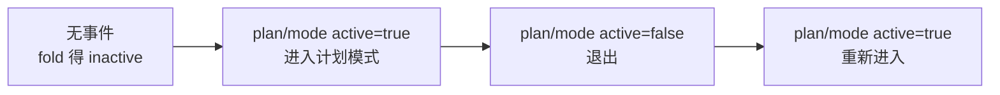
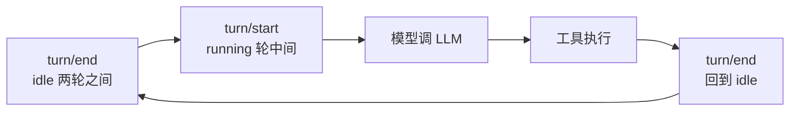
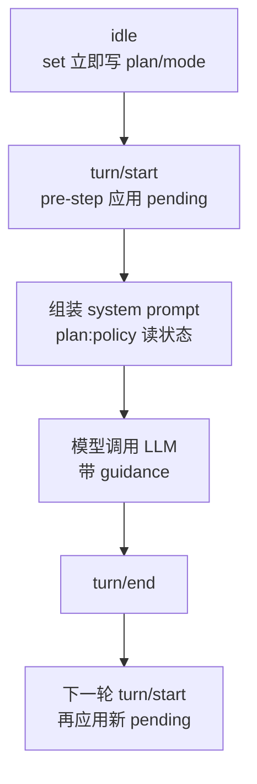
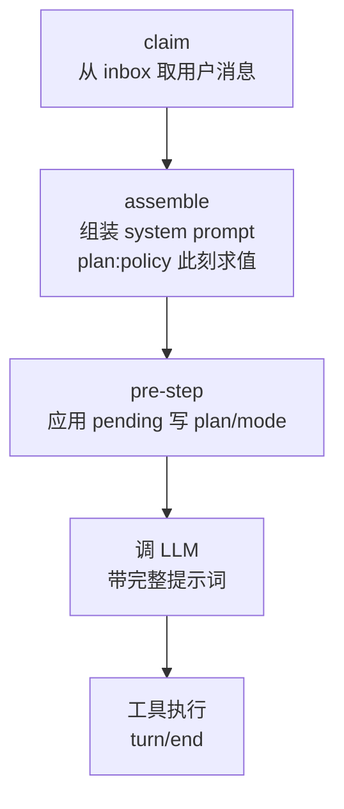
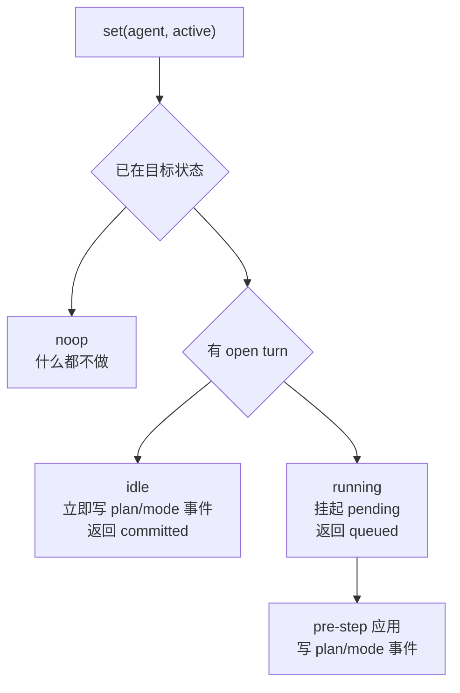
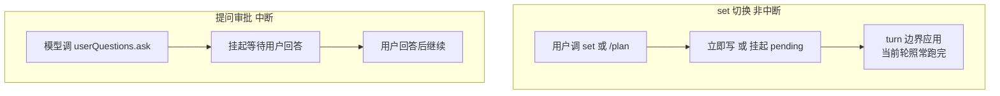
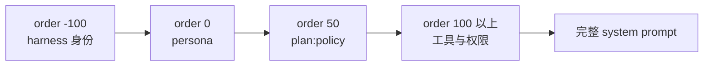
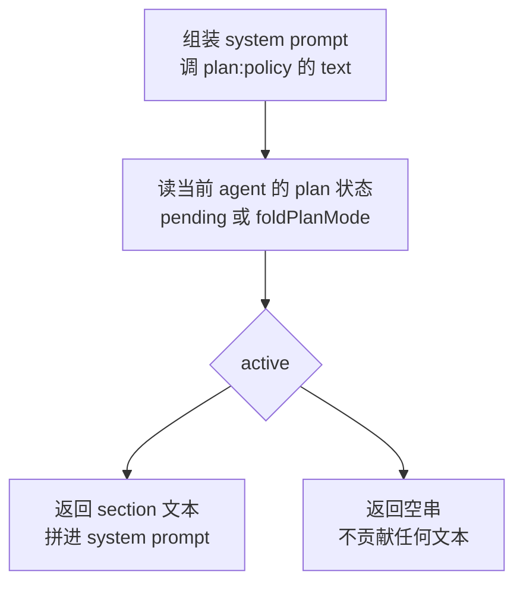
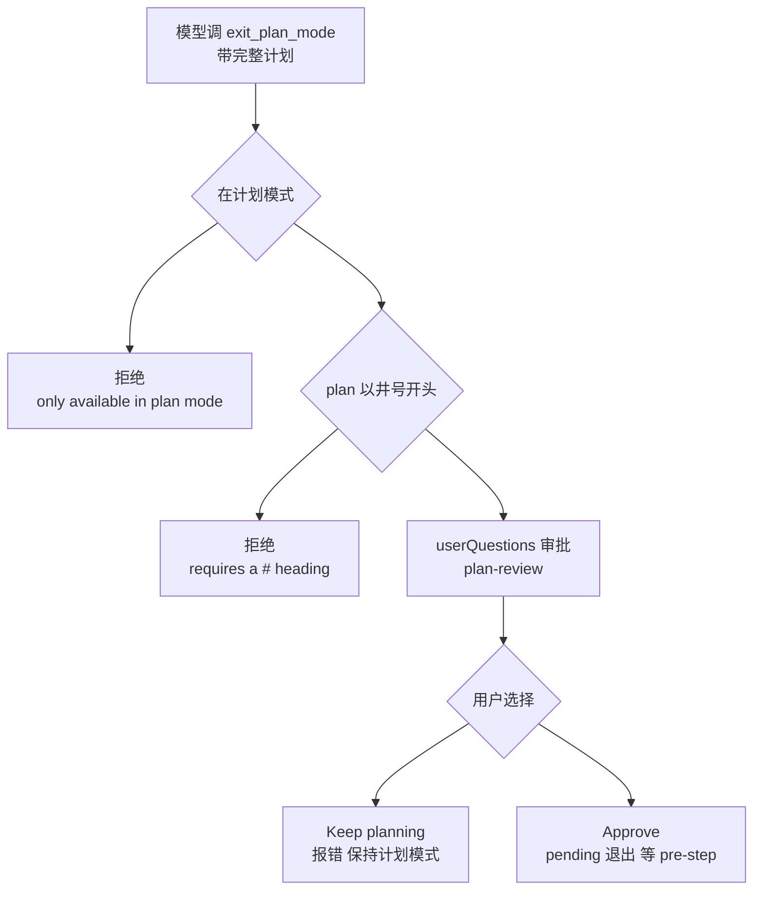
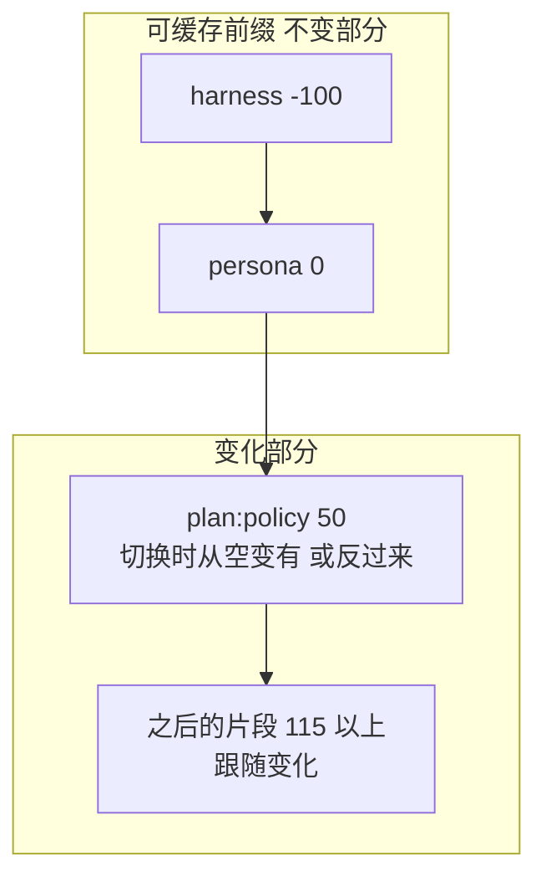

# DeepSeek Harness 从 0 开始：plan 域（计划模式）

> 本系列从 0 开始，基于 Cordis 框架一步步实现一个简略版本的 DeepSeek Harness（loop、session、tool、system prompt 等）。这一篇讲 **plan 域**——dsh `packages/plan/plan-mode` 下的**计划模式**。
>
> **一句话：plan mode 是"先规划再动手"的协作开关——进入后模型只探索和设计、不执行，完成计划后经用户审批再退出并开始干活。**
>
> 配套代码：[blog-17-plan](./)，运行 `pnpm install && pnpm dev` 即可复现本文全部输出。

## plan 域：一个包，一个协作状态

dsh 的 plan 域是**单包**（`plan-mode`，`ctx.planMode`），README 定位很明确：

> "Plan mode is logged, per-agent collaboration state rather than a generic mode registry or capability seam."——计划模式是**记录在案的、每个 agent 的协作状态**，不是通用模式注册表。

**它解决什么问题？** Agent 默认"边想边做"——但很多任务应该**先想清楚再动手**：重构前先出方案、大需求前先列步骤。plan mode 就是给这个流程加一个**强制开关**：


**读图**：进入计划模式 → 模型在 guidance 约束下只设计不执行 → 提交计划 → 用户审批（Approve 退出执行 / Keep planning 继续）——**一个完整的"先规划再动手"流程**。

**三个关键设计**（dsh 源码）：
1. **状态在日志里**：`plan/mode` 事件（`{ active: boolean }`）是 log-only、whole-value-replace——重放日志恢复（resume/fork 不需要实时镜像），和 blog-15 schedule 同思路；
2. **工具目录稳定**：`exit_plan_mode` **始终注册**（inactive 也在）——进入/退出只改 prompt 的 guidance section，不改模型看到的工具集；
3. **审批走 userQuestions**：退出必须经用户明确审批（复用 blog-13 的提问服务）——**计划不是模型自己说退就退的**。

## 项目目录结构

```
blog-17-plan/
├── package.json          # 项目配置：依赖、启动脚本
├── pnpm-lock.yaml        # 依赖锁定文件
└── src/
    ├── main.ts           # 演示入口：组装 + 演示
    ├── types.ts          # plan/mode 事件 + 读模型类型（plan-mode/src/types.ts）
    ├── session.ts        # Session 事件日志（dsh-session）
    ├── agent.ts          # Agent + AgentFactory（dsh-agent）
    ├── tools.ts          # ToolRegistry + userQuestions（dsh-tools / dsh-user-questions）
    ├── domain.ts         # foldPlanMode + resolveConfig + hasOpenTurn（plan-mode/src/index.ts）
    ├── system-prompt.ts  # SystemPromptService（dsh-system-prompt，blog-09 讲过）
    └── plan-mode.ts      # PlanModeController（plan-mode/src/index.ts）
```

**每个文件对应 dsh 的一个模块**——domain 是纯函数（重放/校验/turn 判定），plan-mode 是控制器（set/get/pending + exit 工具），system-prompt 是提示词组装（plan:policy 注册在这）。

## 核心概念

| 概念 | 一句话理解 |
| --- | --- |
| **plan/mode 事件** | 计划状态的唯一持久记录：`{ active: boolean }`，最后一条生效 |
| **foldPlanMode** | 重放日志算 plan 状态（最后一条生效，无事件 = inactive） |
| **idle / running** | loop（blog-07）的回合状态：两轮之间 / 轮中间 |
| **set 四结果** | committed（idle 立即）/ queued（running 挂起）/ cancelled / noop |
| **pendingIntents** | running 时的挂起选择（等下一个 accepted pre-step 应用） |
| **plan:policy 提示词** | 部署配置的 section，active 时织进 system prompt（order 50） |
| **exit_plan_mode 工具** | 始终注册；active 才可用；经 userQuestions 审批退出 |

## Part 1：plan/mode 事件——状态在日志里

计划状态**不单独存**——它就是一条 `plan/mode` 事件（`{ active: boolean }`），log-only、whole-value-replace：

```ts
// types.ts：plan/mode 事件（dsh: SessionEventMap 声明）
export interface PlanModeChange {
  readonly active: boolean
}

// session.ts：事件类型
export type SessionEvent =
  | { type: 'plan/mode'; seq: number; data: PlanModeChange; timestamp: number }
  | { type: 'user/message'; ... }
  | { type: 'turn/start'; seq: number; turn: number; timestamp: number }
  | { type: 'turn/end'; seq: number; turn: number; reason: { kind: string }; timestamp: number }
```

**重放日志恢复**（dsh: foldPlanMode）——从日志尾部往回找最后一条 `plan/mode`：

```ts
export function foldPlanMode(events: readonly SessionEvent[], end = events.length): boolean {
  for (let i = end - 1; i >= 0; i--) {
    const e = events[i]!
    if (e.type === 'plan/mode') return e.data.active
  }
  return false
}
```

**状态机**——plan/mode 事件流：



**读图**：日志里可能有多次切换（true → false → true...），**重放永远读最后一条**——重放即状态，resume/fork 恢复不需要实时镜像（dsh README: "resume, fork, and compaction recover plan state directly from the session log"）。

## Part 2：idle 是理解 plan 的钥匙

**理解 plan 必须先理解 idle**——因为"切换什么时候生效"完全由 agent 是 idle 还是 running 决定。这是本篇最重要的前置概念。

### idle / running 是什么：loop 的回合状态

它们是 **loop（blog-07）的回合状态**，不是 plan 的能力。agent 一轮一轮地跑：`turn/start` → 模型调 LLM → 工具执行 → `turn/end`。**当前有没有正在跑的一轮**，就是 idle/running：



**读图**：agent 在"idle（等你发消息）→ running（跑一轮）→ idle"之间循环。**idle 是两轮之间的空档**——agent 没在跑，等你发下一条消息；running 是轮中间——模型正在调用 LLM、执行工具。

**怎么判断**（dsh: hasOpenTurn）——从日志尾部找最近的 turn 边界：

```ts
export function hasOpenTurn(events: readonly SessionEvent[]): boolean {
  for (let i = events.length - 1; i >= 0; i--) {
    const type = events[i]!.type
    if (type === 'turn/start') return true   // 有 turn/start 没闭合 = running
    if (type === 'turn/end') return false    // 已闭合 = idle
  }
  return false
}
```

### 为什么 idle 是切换的钥匙：切换只能发生在 turn 边界

plan 状态要在**每轮组装 system prompt 时**读（plan:policy 提示词）。所以**切换的生效点只能是 turn 边界**——idle 时能立即写（下轮就用上），running 时只能挂起（本轮已定稿，等下一轮）：

| agent 状态 | 日志里 | set 的行为 | 为什么 |
| --- | --- | --- | --- |
| **idle**（两轮之间） | 最近是 `turn/end` | **立即写 plan/mode 事件**（committed） | 下一轮还没开始，写了下轮就能用上 |
| **running**（轮中间） | 有未闭合 `turn/start` | **挂起 pending**（queued） | 本轮 prompt 已定稿、模型已在跑，改也来不及 |

**turn 边界的时序**——plan 状态在每轮开始应用，不打断当前轮：



**读图**：**idle 时 set 立即写事件**（`T1`）→ 下一轮 start 时应用 → 组装 prompt（plan:policy 读到新状态）→ 模型带 guidance 跑 → end。**running 时 set 只挂起**，等到下一个 `turn/start`（`T6`）才应用——**不打断当前正在跑的一轮**。

**guidance 到底在 turn 流程的哪一刻添加？** 精确位置是 **claim 之后、pre-step 之前**——agent 从 inbox 取出用户消息、准备组装这一轮的模型请求时。dsh 源码（agent-loop）：

```ts
// dsh: agent-loop 的一轮，顺序固定
const claimed = this.inbox.claim(target, position.turn)   // 1. 从 inbox 取出用户消息
const assembly = await this.loopCtx.systemPrompt.assemble(...)  // 2. 组装 system prompt（plan:policy 在这里求值）
// 3. pre-step：决策是否进入该轮（plan 的 pending 在这里应用）
// 4. 模型调用（带上 guidance 的完整 system prompt）
```

**完整的一轮时序**——guidance 添加发生在"组装"这一步：



**读图**：每轮固定顺序——**先 claim 用户消息，再 assemble（plan:policy 的 text 函数在这里被调用、按当前 plan 状态返回 section 或空串），再 pre-step 应用 pending，最后调 LLM**。**guidance 是 assemble 这一步织进去的**——所以它"每轮重新求值"：idle 时 set 立即写事件，下一轮 assemble 就读到 active、织进 guidance；running 时 set 挂起 pending，pre-step 应用后，**再下一轮**的 assemble 才织进。**这就是"切换只能发生在 turn 边界"的根本原因**——assemble 在每轮固定位置运行，plan:policy 只能在这个位置生效。

## Part 3：set——切换，以及切换修改了什么

### set 的四结果

`PlanModeController.set(agent, active)` 是切换入口。idle 和 running 的行为不同，产生四个结果：

```ts
set(agent: Agent, active: boolean): 'committed' | 'queued' | 'cancelled' | 'noop' {
  const session = agent.session
  const pending = this.pendingIntents.get(session)
  const target = pending?.active ?? foldPlanMode(session.events)
  if (active === target) return 'noop'                       // 已在目标状态
  if (hasOpenTurn(session.events)) {
    this.pendingIntents.set(session, { active, narrate: true })  // running：挂起
    return foldPlanMode(session.events) === active ? 'cancelled' : 'queued'
  }
  session.append({ type: 'plan/mode', data: { active } })    // idle：立即 append
  return 'committed'
}
```

**set 的分支图**：



运行输出（Part 2——idle 立即生效）：

```
🚀 set(agent, true) → committed（idle 无 open turn，立即 append plan/mode 事件）
  plan 状态: {"active":true}
  会话日志:
    #0 plan/mode active=true
```

**看这个输出**：idle 切换立即 `committed`（日志立即有 `#0 active=true`）——**下一轮就能用上**。

### 切换模式，到底修改了什么内容？

**set 切换 plan 模式，实质只改变两处**：Session 日志多一条 `plan/mode` 事件 + 下一轮 system prompt 里 plan:policy 片段从"空"变"有"（或反过来）。**其他都不变**：

| 内容 | 切换前（inactive） | 切换后（active） | 变了吗 |
| --- | --- | --- | --- |
| **plan:policy 提示词** | 空（不贡献） | "You are in plan mode..." | ✅ **变了**（唯一实质变化） |
| **Session 日志** | 无 plan/mode 事件 | 多一条 `#0 plan/mode active=true` | ✅ 多一条事件 |
| harness / persona 片段 | 有 | 有 | ❌ 不变 |
| **工具集**（exit_plan_mode 等） | 注册着 | 注册着 | ❌ 不变（始终注册） |
| **权限**（sandbox/approval） | 不变 | 不变 | ❌ 完全无关 |

**用真实输出对照**——同样的组装，切换前后 plan:policy 一行：

```
未进入计划模式:   [order 50] plan:policy: （空——不贡献）
进入计划模式后:   [order 50] plan:policy: You are in plan mode. Explore and design...
```

**关键理解**：
1. **set 只写一条事件**（`plan/mode {active}`）——这就是切换的全部"动作"；
2. **提示词变化是连锁反应**：每轮组装时 plan:policy 的 text 函数读这条事件 → active 返回 section、inactive 返回空串——**不是 set 直接改提示词，是提示词"按事件开关"**；
3. **工具集、权限、其他片段都不变**——所以进入 plan 模式后，模型"变严谨"**完全来自那一段提示词的引导效果**，而不是任何硬性改动。

### 不打断的好处：一个真实场景

**为什么 running 时不打断？** 看这个场景——agent 在计划模式下，用户让它先写份报告（一轮长 turn），写一半时用户改主意切回默认模式：

```
📝 场景：agent 在计划模式下，用户让它先写份报告（一轮长 turn，进行到一半）...
👤 用户此刻切换回默认模式（set(agent, false)）...
  set 返回: queued（open turn → 挂起 pending，不打断写报告）

✅ 当前轮不受影响，agent 继续把报告写完:
  报告写完，turn 正常结束。
  对比：如果 set 打断当前轮，写到一半的报告就丢了——这就是"不打断"的好处。

⚙️  下一轮开始（turn/start），pre-step 应用挂起的 plan 选择:
  plan 状态: {"active":false}（此时才生效，因为新的一轮要组装 prompt）
  新一轮的 guidance（已退出计划模式，不渲染）:
    （空——已退出）

📋 时间线:
  turn 1 开始 → 用户 set(false) [挂起] → 写完报告 → turn 1 结束
  turn 2 开始 → pre-step 应用 pending → 新轮无 plan guidance → turn 2 结束
  （退出计划模式从 turn 2 才开始生效——写报告那轮完全没被打断）
```

**好处是什么**：
- **写报告那轮完整跑完**——用户切模式时 agent 正在写第 3/10 段，set 只是挂起，agent 继续写到第 10 段、turn 正常结束；
- **退出从下一轮才生效**——turn 2 组装 prompt 时才读到"已退出"，新轮不带 plan guidance；
- **如果 set 打断**：写到一半的报告就丢了——**切换模式不该毁掉正在进行的工作**。

**set 切换 vs 提问审批：两种交互方式**：



**读图**：**set 不打断**——用户切个计划模式，agent 当前正在做的一轮照常跑完（"预约下轮"）；**提问会打断**——模型问用户（blog-13 的审批、exit_plan_mode 的审批）时当前轮**挂起**，等用户回答才继续（"现在就要答案"）。

**idle 分支的完整语义**（dsh 源码，比简化版多两个细节）：
1. **cancelled**：idle 分支里 append 前再查一次 `active === foldPlanMode(session.events)`——如果 logged 状态已经变成了目标（比如 pending 期间另一个 set 生效了），撤销 pending 返回 `cancelled`；
2. **narration 注入**：append 成功后，`agent.inject(narration)`——如果最后一条 logged 请求描述的是另一种状态，注入一条用户消息"用户切换了模式"，让模型感知（dsh: "The user switched this session to plan mode."）。

## Part 4：plan:policy 提示词——怎么加进去，内容是什么

### 提示词内容：部署配置的 section（部署拥有）

plan 模式的提示词**不是写死的，是部署配置的**（`PlanModeConfig.section`，必填非空）。dsh README 的配置示例：

```yaml
# dsh 的部署配置
- id: plan-mode
  name: '@deepseek-ai/dsh-plan-mode'
  config:
    section: |
      You are in plan mode. Explore and design before presenting the complete
      plan through exit_plan_mode.
```

我们的代码里同样在插件加载时传入：

```ts
await ctx.plugin(PlanModeController, {
  section: 'You are in plan mode. Explore and design before presenting the complete plan through exit_plan_mode.',
})
```

**这段提示词说什么**：告诉模型"你在计划模式——先探索和设计，再通过 exit_plan_mode 提交完整计划"。**模型看到它就知道：现在只准设计，不准执行**。

### 怎么加进去：ctx.systemPrompt.section 注册（order 50）

plan 模式**不自己改 system prompt**——它通过 **blog-09 的 systemPrompt 服务**注册一个**有序片段**（section）。dsh 源码：

```ts
// dsh: plan-mode/src/index.ts
ctx.systemPrompt.section({
  name: 'plan:policy',
  order: 50,          // 在 system prompt 中的位置（升序拼接）
  text: (context) => {
    if (context.agent === undefined) return ''
    const pending = this.pendingIntents.get(context.agent.session)
    // 关键：按当前 agent 的 plan 状态动态返回
    return (pending?.active ?? foldPlanMode(context.agent.session.events)) ? this.section : ''
  },
})
```

**注册机制**（blog-09 讲过）：`systemPrompt.section({ name, order, text })`——所有片段按 `order` **升序拼接**成完整 system prompt；`text` 可以是**函数**，组装时按当前上下文动态计算。

**order 50 的位置**——plan:policy 排在组装序列的中间：



**读图**：`plan:policy`（order 50）排在 persona 之后、工具与权限片段之前——**模型先读到身份和人设，再读到"你在计划模式"，再读到工具**。dsh 里 blog-13 的 approval policy 是 order 115、subagent 委托声明是 order 120，都在 plan 之后。

**按 agent 动态返回**——这是和普通静态片段的区别：



**读图**：组装时 `text(context)` 被调用，**按"当前这个 agent"的 plan 状态决定返回什么**——active 返回 section（模型这轮看到"你在计划模式"），inactive 返回空串（正常模式，dsh: "inactive mode contributes no text"）。**每个 agent 组装自己的 system prompt 时，plan:policy 根据自己的 plan/mode 事件给出不同的结果**。

### 完整案例：提示词怎么进上下文

**未进入计划模式时**（plan:policy 不贡献文本）：

```
🧠 组装 system prompt（未进入计划模式）:
  [order -100] harness: You are DeepSeek Harness, an agentic coding tool.
  [order    0] persona: You are a helpful engineering assistant.
  [order   50] plan:policy: （空——不贡献）
```

**进入计划模式后**（plan:policy 贡献 section，完整提示词拼接）：

```
🧠 组装完整 system prompt（进入计划模式后，plan:policy 贡献 section）:
  [order -100] harness: You are DeepSeek Harness, an agentic coding tool.
  [order    0] persona: You are a helpful engineering assistant.
  [order   50] plan:policy: You are in plan mode. Explore and design before presenting t

📜 模型实际看到的完整 system prompt:
  ──────────────────────────────────────
  harness:
  You are DeepSeek Harness, an agentic coding tool.
  
  persona:
  You are a helpful engineering assistant.
  
  plan:policy:
  You are in plan mode. Explore and design before presenting the complete plan through exit_plan_mode.
  ──────────────────────────────────────
```

**看这个案例——提示词怎么一步步进上下文的**：
1. **注册**：PlanModeController 构造时 `ctx.systemPrompt.section({ name: 'plan:policy', order: 50, text: ... })`——**注册一个有序片段**，text 是函数；
2. **组装**：每轮请求前 `systemPrompt.assemble({ agent })`——所有片段按 order 升序，**plan:policy 的 text 函数被调用**，按这个 agent 的 plan 状态返回 section 或空串；
3. **拼接**：harness（-100）+ persona（0）+ plan:policy（50，**active 才有**）→ 完整提示词送给模型。

**核心**：plan 模式通过 **systemPrompt.section（order 50 + 按 agent 动态返回）** 把部署配置的提示词织进 model 请求——**不是 plan-mode 自己拼 prompt，而是注册一个"按 agent 状态开关的片段"**。这就是 blog-09 的 section 机制 + plan 状态的事件溯源结合的产物。

**这是软指导，不是硬限制**——真正限制是 blog-13 的 sandbox/approval（dsh README: "Plan mode is soft guidance; sandbox mode and approval policy enforce restrictions independently and do not read or write plan state"）。

## Part 5：exit_plan_mode 工具——提交计划 + 用户审批

**始终注册**（inactive 也在）——进入/退出只改 guidance，不改工具目录（dsh: "The exit tool remains registered while plan mode is inactive, so entering or leaving plan mode changes only the prompt section, not the request tool catalog"）。active 才可用，且必须**经用户审批**：

```ts
ctx.tools.register({
  name: EXIT_PLAN_MODE,   // 'exit_plan_mode'
  description: "Use only in plan mode. Present your plan for the user's review and, on approval, leave plan mode. ...",
  async execute(args, exec) {
    const agent = exec.agent
    if (!foldPlanMode(agent.session.events)) {
      throw new Error(`${EXIT_PLAN_MODE} is only available in plan mode`)
    }
    if (!/^#\s+\S/.test(String(args.plan ?? '').trim())) {
      throw new Error(`${EXIT_PLAN_MODE} requires a non-empty markdown plan starting with a # heading`)
    }
    // 经 userQuestions 审批（dsh: plan-review intent，UI 呈现为决策）
    const answer = await ctx.userQuestions.ask({ ... })
    const item = answer.answers.find(entry => entry.id === REVIEW_ID)
    if (item?.selected.length !== 1 || item.selected[0] !== APPROVE_LABEL || item.custom !== undefined) {
      throw new Error('The user chose to keep planning; revise the plan and present it again.')
    }
    this.pendingIntents.set(agent.session, { active: false, narrate: false })
    return { approved: true }
  },
})
```

**exit 的完整流程**——审批通过才退出：



**读图**：exit_plan_mode 三道关卡——**在计划模式**（否则拒绝）、**计划以 # 开头**（dsh 校验 markdown 计划）、**用户审批**（Approve 退出 / Keep planning 继续）。**审批是核心**：计划不是模型自己说退就退的，必须用户点头。

运行输出（Part 5-7）：

```
🚀 模型调用 exit_plan_mode(plan="# 重构方案..."):
  🖥️ [UI] 收到审批: Approve this plan and leave plan mode?
  🖥️ [UI] 选项: Approve / Keep planning
  👤 [用户] 点击 Approve
  ✅ 工具返回: {"approved":true}
  plan 状态: {"active":true,"pending":false}（pending 退出，pre-step 应用）
  pre-step 应用后: {"active":false}

🚀 模型再次调用 exit_plan_mode:
  👤 [用户] 点击 Keep planning（附反馈: 先加测试再重构）
  ❌ 工具报错（保持计划模式）: The user chose to keep planning; their feedback: 先加测试再重构

📋 当前 plan 状态: {"active":false}（已退出）
  ❌ 正确拒绝: exit_plan_mode is only available in plan mode
```

**三个场景**：Approve → 退出（pending 应用后 inactive）；Keep planning → 保持（带反馈给模型修订）；非计划模式调用 → 拒绝。**审批结果驱动流程**——这是 plan mode 的"人机协作"核心。

## Part 6：重放恢复——日志是唯一真源

最后验证"状态在日志里"：**resume/fork 恢复不需要实时镜像，重放日志即状态**。

运行输出（Part 8）：

```
📊 最终重放:
  foldPlanMode(events) = false（最后一条 plan/mode 生效）
  会话日志中的 plan/mode 事件:
    #0 active=true
    #2 active=false
    #4 active=true
    #5 active=false
    #6 active=true
    #7 active=false
  （共 6 条——重放即完整状态，resume/fork 恢复不需要实时镜像）
```

**看这个日志**：6 条 plan/mode 事件记录了整个会话的计划模式切换史（进入/退出/再进入/再退出...）——**fold 读最后一条（false）= 当前不在计划模式**。任何时刻重放日志都能恢复，这就是事件溯源（blog-04）在计划状态上的应用。

## 常见问题 FAQ

**Q: plan mode 是"通用模式注册表"吗？**

A: **不是**。dsh README 原文："Plan mode is logged, per-agent collaboration state rather than a generic mode registry or capability seam."——它不是让你注册任意模式的通用机制，而是**计划这个特定协作流程的状态**。dsh 只接受 `section` 配置，不接受任意命名模式、工具过滤、沙箱设置或审批策略（"The package does not accept arbitrary named modes, tool filters, sandbox settings, or approval policy"）。

**Q: plan mode 是"让 LLM 不能用其他操作工具"吗？**

A: **不是——它是"引导"不是"禁用"**。dsh README 原话："Plan mode guides rather than enforces"——计划模式只往提示词里注入 guidance（"先设计再执行"），**模型技术上仍能调用 bash/edit_file 等工具，只是被提示"别这么做"**。

真正**禁用工具**的是另外两个机制：

| 机制 | 方式 | 强度 | 回答的问题 |
| --- | --- | --- | --- |
| **plan mode**（本篇） | 注入提示词（引导） | 软 | "先设计再执行"（模型听劝） |
| **toolFilter**（blog-16 scope） | 从注册表移除工具 | 硬 | "这个工具你看不见" |
| **sandbox/approval**（blog-13） | 执行时拦截 | 硬 | "这个操作不允许" |

**一句话定位 plan mode**：核心是**注入提示词**（plan:policy section），目的是**解决 LLM 边想边做的问题**（先探索设计 → 提交计划 → 审批通过才执行）——但它只负责"引导"，硬性禁用靠 toolFilter 和 sandbox/approval 独立执行（dsh: "deployments that need enforced restrictions must configure sandbox and approval controls independently"）。

**Q: set 切换的是权限吗？**

A: **不是——切换的是"协作模式"，不是权限**。set 改的是 `plan/mode` 事件（active 与否），效果是提示词引导模型"先设计再执行"——**模型技术上仍能调工具，只是被提示别这么做**（软）。真正的权限收紧要靠 blog-13 的 sandbox/approval（执行时硬拦截）。"进入 plan 模式后模型变严谨"是**引导效果**，不是权限变严。

**Q: 计划模式和 blog-13 的权限/sandbox 什么关系？**

A: **独立机制，互补**。plan mode 是**软指导**（dsh: "Plan mode is soft guidance"）——告诉模型"先设计再执行"；真正限制是 blog-13 的 sandbox mode 和 approval policy，它们**独立执行，不读不写 plan 状态**（dsh: "sandbox mode and approval policy enforce restrictions independently and do not read or write plan state"）。plan mode 管"先不执行"，sandbox/approval 管"哪些操作不被允许"。

**Q: 为什么 exit_plan_mode 始终注册（inactive 也在）？**

A: **工具目录稳定**（dsh: "entering or leaving plan mode changes only the prompt section, not the request tool catalog"）——如果进入计划模式才出现 exit 工具、退出就消失，模型的工具集会随模式变化，prompt 组装和缓存都不稳定。**始终注册 + active 才可用**：inactive 时调用会拒绝（"only available in plan mode"），但模型始终知道有这个工具。

**Q: plan 注入方式会影响 LLM 的 token 缓存吗？**

A: **会——但 dsh 用 order 位置把影响控制在最小**。LLM 的 token 缓存按**前缀**复用（相同前缀不重新计算），plan 模式切换改变 system prompt 内容：



**读图**：`plan:policy` 在 order 50——**切换时从 order 50 开始的部分失效重算**，但 order 50 之前的 harness、persona（前缀）**保持不变，缓存仍可复用**。

**dsh 的缓存设计**（源码证据）：
1. **README 明说影响**："entering or leaving changes the system prompt **from order 50 onward**"——进入/退出，从 order 50 开始失效；
2. **放 order 50 而非最前**：如果 plan:policy 放最前面，切换会让**整个前缀失效**、所有缓存白费；放 order 50 只牺牲 persona 之后的部分，**harness + persona 前缀还在**；
3. **模式内稳定**："stable within plan mode"——**active 期间 section 不变**，同一模式内连续请求缓存照常复用，只有切换那一刻失效一次；
4. **对比 blog-13 的 approval policy**（order 115）：user-approval 源码注释 "switching policy does not rewrite the stable system-prompt cache prefix"——**同样的思路：易变内容放靠后，保住可缓存前缀**。

**结论**：

| 场景 | 缓存影响 |
| --- | --- |
| **计划模式内**（active 连续请求） | ✅ 无影响——section 稳定，前缀照常复用 |
| **切换那一刻**（进入/退出） | ⚠️ 从 order 50 开始失效——但 harness + persona 前缀保住，只重算后半 |
| 如果 plan:policy 放最前 | ❌ 整个前缀失效——所以 dsh 故意放 order 50 |

**一句话**：plan 注入**会**影响 token 缓存（切换时后半失效），但 dsh 把 `plan:policy` 放在 order 50（不在最前），**保住 harness + persona 的可缓存前缀**，且**模式内稳定**——把缓存损失控制在切换那一刻、后半段。

**Q: set 为什么分 committed / queued / cancelled / noop？**

A: 因为切换发生的时机不同：idle（无 open turn）→ 立即写事件（committed，下次 prompt 前没有 pre-step 可等）；running（open turn）→ 挂起 pending（queued，等下次 accepted pre-step 应用）；重复选择 → noop；选择相反于 logged 状态且 pending 覆盖 → cancelled。**四个结果精确表达"发生了什么"**。

**Q: pending 是什么？为什么需要它？**

A: **running 时的挂起选择**（dsh: WeakMap<Session, { active, narrate }>）——agent 正在跑（open turn）时用户切换计划模式，不能立即写事件（那会打断当前 turn），所以挂起等**下一个 accepted pre-step** 应用。`get` 返回 `{ active, pending? }` 区分 logged 状态和待应用选择。narrate 标记是否要通知模型（用户选择要通知，exit 工具结果已叙述不重复）。

**Q: plan mode 和 blog-15 的 schedule 什么关系？**

A: **都靠"状态在日志里"**。schedule 用 `schedule/change` 事件重放提醒状态，plan 用 `plan/mode` 事件重放计划状态——都是 log-only、事件溯源（blog-04），resume/fork 恢复不需要实时镜像。**不同的是触发**：schedule 是时间驱动（定时器到点），plan 是协作驱动（用户/模型切换模式 + 审批）。

**Q: exit_plan_mode 的审批为什么走 userQuestions？**

A: 复用 blog-13 的提问服务——**计划不是模型自己说退就退的，必须用户明确审批**。dsh 用 `plan-review` presentation intent：能识别的 UI 把计划呈现为"决策"（Approve / Keep planning），不识别的 UI 退化为普通问题——**两种方式答案一致**（dsh: "a capable UI presents the plan as a decision instead of a generic question; the answer the tool reads is the same either way"）。

**Q: 用户关掉审批（dismiss）会怎样？**

A: 不算失败——用户是想插话（"The user dismissed the plan review to speak instead"）。dsh 让模型**保持在计划模式、停下等用户消息**（"stay in plan mode, stop here, and wait for their message"）；其他审批失败（abort 等）保持各自的错误消息。

## 小结

1. **plan mode = 记录在案的协作状态**：核心是**注入提示词**（plan:policy section），解决**LLM 边想边做**的问题——先探索设计、提交计划、审批通过才执行（"引导"而非"禁用工具"，硬限制靠 toolFilter/sandbox/approval）；
2. **状态在日志里**：`plan/mode` 事件（log-only、whole-value-replace），foldPlanMode 重放日志恢复；
3. **idle 是理解 plan 的钥匙**：idle（两轮之间）是切换唯一的"即时生效窗口"——set 立即写（committed）；running（轮中间）只能挂起 pending 等下一轮（queued）——**切换何时生效由 loop 的回合节奏决定**；
4. **切换只改两处**：Session 日志多一条 plan/mode 事件 + 下一轮提示词里 plan:policy 从空变有——**工具集、权限、其他片段都不变**（模型变严谨是提示词引导效果）；
5. **guidance 软指导**：active 渲染 plan:policy section，模型只设计不执行；真正限制是 sandbox/approval（独立机制）；
6. **exit_plan_mode**：始终注册（目录稳定）、active 才可用、**必须经 userQuestions 审批**（Approve 退出 / Keep planning 继续）；
7. **事件溯源**：任何时刻重放日志即恢复计划状态，resume/fork 不需要实时镜像。

下一篇预告：**具体工具域**——fs 域（文件系统：read/write/edit + glob/grep + str_replace_editor）。

---

*本文代码已验证可运行（Node.js + tsx，@cordisjs/core v4.0.0-beta.5）。完整源码见同目录 `src/`（main.ts 演示入口 + 每文件对应 dsh 一个模块），实现结构对应 dsh 的 `packages/plan/plan-mode`。*
