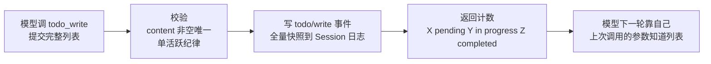
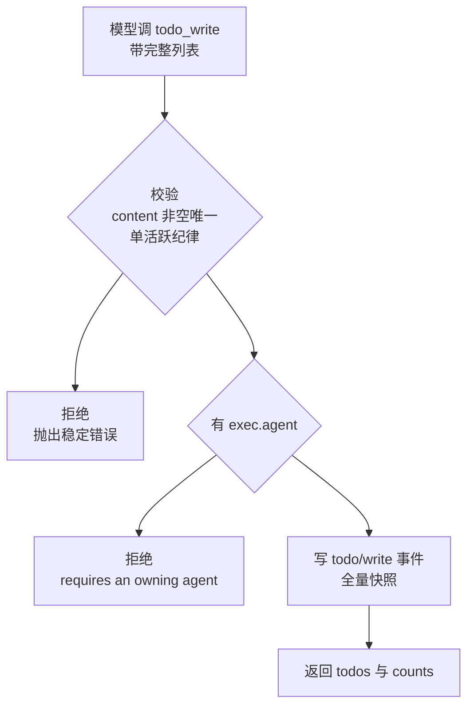
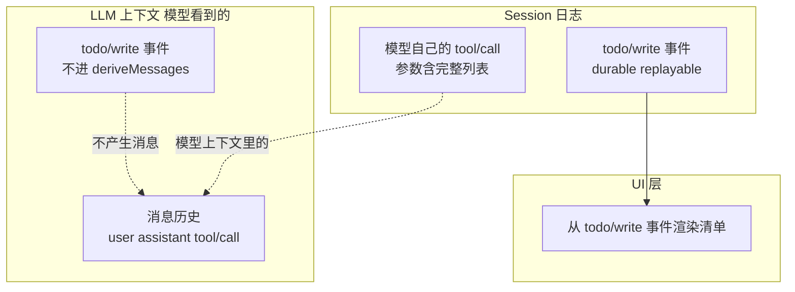
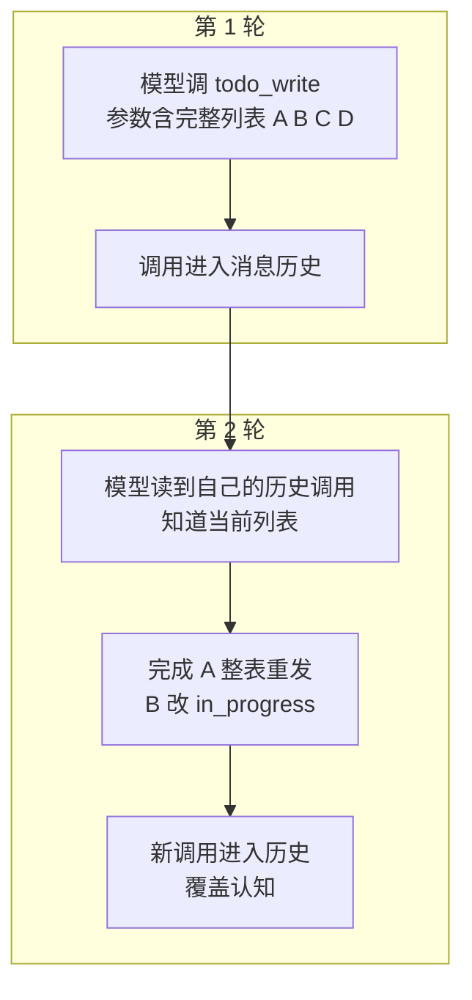
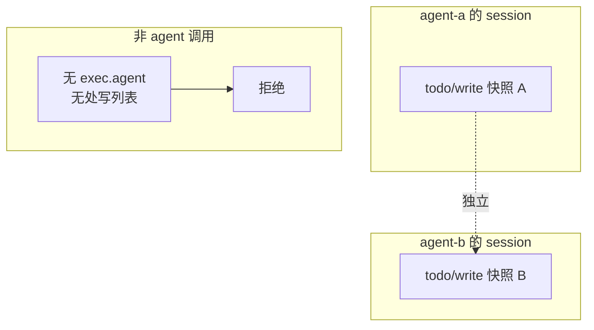
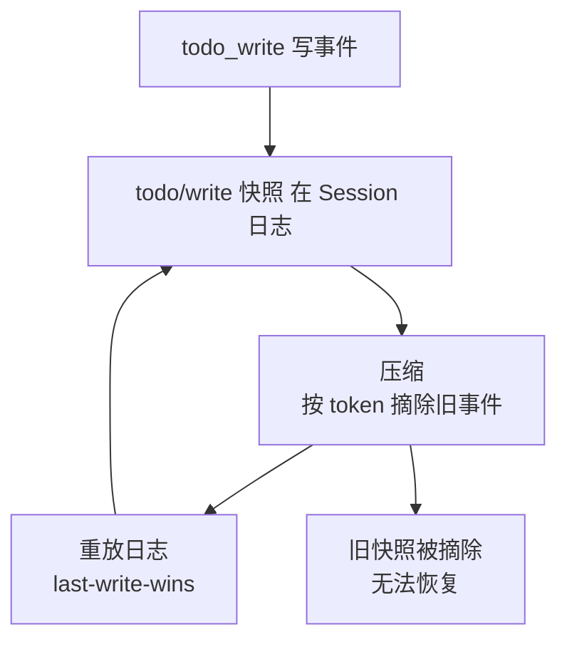
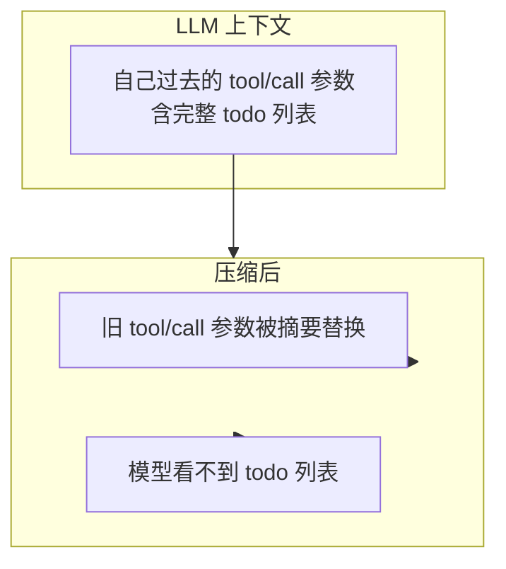

# DeepSeek Harness 从 0 开始：todo 任务记忆

> 本系列从 0 开始，基于 Cordis 框架一步步实现一个简略版本的 DeepSeek Harness（loop、session、tool、system prompt 等）。这一篇讲 **todo 域**——dsh `packages/todo/tool-todo` 下的**模型侧任务记忆**。
>
> **一句话：todo 域给模型一份"任务记忆"——模型用 `todo_write` 工具每次提交完整列表（整表替换），把"该做什么、做到哪了"记进 Session 日志；它不在模型上下文里（off the model surface），模型靠**自己每次调用的参数**知道列表，UI 从事件渲染。**
>
> **todo 的由来**：`TodoWrite` 最早来自 **Anthropic 的 Claude Code**（Agent Tools 之一）——本质是给 LLM 的**工作记忆**（LLM 没有持久记忆，长任务容易跑偏）。**Manus** 后来把它用得出名（任务拆解 + 用户可见进度）。**dsh 借鉴了 Claude Code V1、opencode、codex `update_plan` 的形状**（dsh Agent Note："the shape claude-code V1, opencode, and codex `update_plan` all use"），并加上了事件溯源（状态进 Session 日志）。
>
> 配套代码：[blog-18-todo](./)，运行 `pnpm install && pnpm dev` 即可复现本文全部输出。

## todo 域：一个包，一份任务记忆

dsh 的 todo 域是**单包**（`tool-todo`），README 定位很明确：

> "The model-facing todo capability. It is a single **product** package because **one agent session owns the list**; there is no replaceable provider contract."——模型侧 todo 能力，**一个 agent session 拥有一份列表**，没有可替换的 provider 契约。

**它解决什么问题？** 模型做长任务容易**走偏**——做了 10 步忘了"我本来要做哪几件事、现在做到哪了"。todo 给模型一份**任务记忆**。**关键：这份记忆不在模型上下文里，而是模型靠"自己每轮提交的完整列表"维持的**：



**读图**：模型每次调 `todo_write` **提交完整列表** → 校验 → 写 `todo/write` 快照到 Session 日志 → 返回计数 → **模型下一轮靠"自己上次调用的参数"（参数里有完整列表）知道该做什么**。

**三个关键设计**（dsh 源码）：
1. **整表替换**：模型每次发**整个列表**（"no partial updates, no per-item edits"）——这是 Claude Code V1、opencode、codex `update_plan` 的共同形状，**模型最熟悉的形式**；
2. **off the model surface**：`todo/write` 事件**不进模型上下文**（dsh Agent Note："The event stays off the model surface"）——它是**UI 状态**，模型靠自己的 tool/call 参数认知；
3. **单 owner**：列表属于**调用它的那个 agent session**（无 exec.agent 拒绝）。

## 项目目录结构

```
blog-18-todo/
├── package.json          # 项目配置：依赖、启动脚本
├── pnpm-lock.yaml        # 依赖锁定文件
└── src/
    ├── main.ts           # 演示入口：组装 + 演示
    ├── types.ts          # TodoItem + 配置（tool-todo/src/types.ts）
    ├── session.ts        # Session 事件日志（dsh-session，含 todo/write）
    ├── agent.ts          # Agent + AgentFactory（dsh-agent）
    ├── tools.ts          # ToolRegistry（dsh-tools）
    └── tool-todo.ts      # todo_write 工具（tool-todo/src/index.ts）
```

**每个文件对应 dsh 的一个模块**——tool-todo 是核心（工具 + 校验 + 渲染），session 是事件日志（todo/write 落这里）。

## 核心概念

| 概念 | 一句话理解 |
| --- | --- |
| **todo_write 工具** | 模型侧工具：每次提交完整任务列表（整表替换） |
| **TodoItem** | 一条待办：`{ content, status }`，status = pending / in_progress / completed |
| **todo/write 事件** | 全量快照落 Session 日志（last-write-wins），**不进模型上下文** |
| **off the model surface** | todo 是 UI 状态，不是模型消息；模型靠 tool/call 参数认知 |
| **整表替换** | 无部分更新——模型每次发整个列表（模型最熟悉的形状） |
| **单 owner** | 列表属于调用它的 agent session（无 exec.agent 拒绝） |
| **压缩丢失** | todo 是会话内状态，压缩摘事件 + 旧 tool/call 参数就丢（无 Task 式兜底） |

## Part 1：类型定义——TodoItem + 配置

todo 域的类型很精简（`types.ts`）：一条待办 + 部署配置：

```ts
/** 一条待办（dsh: TodoItem）——content + status */
export interface TodoItem {
  content: string
  status: 'pending' | 'in_progress' | 'completed'
}

/** 有效的 status 集合（dsh: TODO_STATUSES） */
export const TODO_STATUSES = ['pending', 'in_progress', 'completed'] as const

/** todo_write 工具的配置（dsh: TodoToolConfig）——必填的部署选择 */
export interface TodoToolConfig {
  /** 是否允许多个 in_progress 同时存在（并行 fan-out 用 true，单活跃纪律用 false） */
  allowParallelInProgress: boolean
}
```

**三种 status 的语义**（dsh 工具描述）：

| status | 含义 | 何时 |
| --- | --- | --- |
| `pending` | 未开始 | 计划里列出，还没动手 |
| `in_progress` | 正在做 | 正在工作的一项（或多项，如果允许并行） |
| `completed` | 已完成 | 做完的那一刻就标记（不批量补） |

**allowParallelInProgress 是必填部署选择**（dsh: "is required: every composition must choose"）——**是否允许并行活跃任务取决于运行时并发，工具自己观察不到**。`true` 适合会 fan-out 的 agent（并发子代理、后台命令），`false` 强制单活跃纪律。

## Part 2：todo_write 工具——整表替换

核心是 `todo_write` 工具：**模型每次提交完整列表，整表替换**。dsh 源码：

```ts
// dsh: tool-todo/src/index.ts（简化）
ctx.tools.register({
  name: 'todo_write',
  description: describe(allowParallel),   // 描述按并行策略变化
  execute(args, exec) {
    const todos = toTodoList(args.todos, allowParallel)   // 校验
    if (!exec.agent) {
      throw new Error('todo_write requires an owning agent session')
    }
    exec.agent.session.append('todo/write', { todos })    // 写全量快照
    return {
      todos: todos.map(todo => ({ content: todo.content, status: todo.status })),
      counts: {
        pending: count('pending'),
        inProgress: count('in_progress'),
        completed: count('completed'),
      },
    }
  },
})
```

**整表替换的流程**：



**读图**：模型提交完整列表 → 校验（非法则拒绝）→ 检查 exec.agent（无则拒绝）→ 写全量快照 → 返回列表 + 计数。**每次调用都是一次完整的"替换"**。

**为什么整表替换而不是部分更新？**（dsh 的设计）：

> **1. 模型最熟悉的形状**——Claude Code V1、opencode、codex `update_plan` 都用整表替换（dsh Agent Note："the shape the model is most trained on"）。模型不需要学增量 diff，发完整列表就行；
>
> **2. 不需要 id**——整表替换意味着条目无需稳定标识（dsh: "whole-list replace needs no stable identity"）。没有逐项编辑，就没有"改第几项"的需求；
>
> **3. 日志即快照**——每条 `todo/write` 事件都是当时的完整快照。重放任何时刻都得到完整列表（last-write-wins）。

## Part 3：todo 不在模型上下文——off the model surface

**这是 todo 最反直觉、也最重要的设计**。dsh Agent Note 明确说：

> "`todo/write` is deliberately excluded from `SurfaceEventType`. ... it is durable, replayable **UI state** that travels alongside the conversation **without being part of it**."——todo/write 故意排除在 surface 事件外，它是**UI 状态**，随对话存在但**不属于对话**。



**读图**：
- **LLM 上下文**：只有消息历史（含 tool/call 调用）——**todo/write 事件本身不产生消息、不进 deriveMessages**；
- **Session 日志**：todo/write 事件在这里（durable、replayable）；
- **UI**：从 todo/write 事件渲染清单（web 客户端投影到 `ConversationSnapshot.todos`）。

**那模型怎么知道 todo？** 靠**自己每轮 `todo_write` 调用的参数**——参数里带着完整列表（dsh README："Each assistant tool call retains the entire replacement list in its arguments"）：

```
模型: todo_write(todos=[A,B,C,D])   ← 调用的参数里有完整列表
  → 这个调用（含参数）进了消息历史
  → 模型下一轮能看到自己上次提交的列表
```

**模型感知 todo 的完整机制**——记忆载体是"工具调用参数"，不是"上下文状态"：



**读图**——todo 的"记忆"是**模型自己写、自己读**：
1. **第 1 轮**：模型调 `todo_write`，参数带完整列表——**这个调用（含参数）进了消息历史**；
2. **第 2 轮**：模型从自己的历史调用里**读到"我上次提交了 A B C D"**——知道当前列表；
3. **推进**：完成一项就**整表重发**（参数更新）——**新调用覆盖旧认知**；
4. 如此循环——**模型靠"反复提交 + 读自己的历史"维持任务记忆**。

**关键**：记忆载体是**上下文里的旧调用参数**——不是系统每轮注入的"当前 todo 状态"。所以：
- **整表替换是必须的**：模型必须每次带全量（它没有"系统喂的当前状态"，只能靠自己提交的）；
- **压缩会丢记忆**：压缩把历史区间替换成摘要节点，**旧调用参数没了，模型就看不到 todo 了**（Part 7 详讲）；
- **off surface 的代价**：不污染模型历史（省 token），但记忆依赖模型自己的调用纪律。

**为什么设计成 off surface？**（dsh 注释）："a todo update never perturbs derived model history"——**todo 更新不扰乱派生的模型历史**。如果 todo/write 产生消息，模型的对话历史会被这些"内部状态更新"污染（每轮多一条 todo 消息）；off surface 让 **todo 更新和模型消息分离**——模型看到的只有自己的工具调用和结果。

## Part 4：校验——fail loud，保证"日志 = 模型以为的"

校验（dsh: toTodoList）在 schema 之后做**值约束**：

```ts
function toTodoList(raw: Array<{ content: string; status: string }>, allowParallel: boolean): TodoItem[] {
  const todos: TodoItem[] = []
  const seen = new Set<string>()
  let active = 0
  for (const item of raw) {
    const content = item.content.trim()
    if (content.length === 0) throw new Error('invalid todo: `content` must be a non-empty string')
    if (seen.has(content)) throw new Error(`invalid todos: duplicate content ${JSON.stringify(content)}`)
    seen.add(content)
    if (item.status === 'in_progress') active++
    todos.push({ content, status: item.status as TodoItem['status'] })
  }
  if (!allowParallel && active > 1) {
    throw new Error(`invalid todos: at most one task may be in_progress (got ${active})`)
  }
  return todos
}
```

**四类校验拒绝**（dsh 源码的稳定错误）——运行输出（Part 3）：

```
❌ 空 content → invalid todo: `content` must be a non-empty string
❌ 重复 content → invalid todos: duplicate content "写博客"
❌ 两个 in_progress → invalid todos: at most one task may be in_progress (got 2)
❌ 非 agent 调用 → todo_write requires an owning agent session
```

**为什么严格校验**（dsh 注释）："keeping the logged snapshot equal to what the model believes it wrote"——**让日志快照等于模型以为它写的东西**。因为**模型靠自己的 tool/call 参数认知 todo**，如果日志里存的和模型以为的不一致（比如静默扁平化扩展字段），**模型下次会基于错误认知提交**。fail loud 让模型知道"这个写法不对"。

**注意**：单活跃纪律（`at most one in_progress`）只在校验层强制，**不写进日志不变量**（dsh: "The durable-log invariant does NOT follow it"）——日志在允许并行时写入后，部署收紧策略也要能重放。**校验是部署时的策略，日志是中性的事实**。

## Part 5：单 owner——列表属于一个 agent session

todo 域**没有共享/子代理作用域**（dsh: "There is no subagent/shared/swarm scope"）：

> "The list belongs to the ONE agent session that called the tool. There is no subagent/shared/swarm scope: a non-agent caller (no `exec.agent`) has nowhere to write the list and is rejected."



**读图**：每个 agent 的 todo 列表**各自独立**（agent-a 的在 agent-a 的 session，agent-b 的在 agent-b 的）——没有共享列表。非 agent 调用**没有所属 session，无处写列表**，拒绝而非静默 no-op。**这是刻意的作用域限制**（dsh Agent Note："no swarm machinery (YAGNI)"）——todo 是"这个 agent 自己的待办"，不是团队共享看板。

## Part 6：完整演示——计划到完成

初始化（注册工具，部署选择单活跃纪律）：

```ts
let ctx = new Context()
await ctx.plugin(AgentFactory)
await ctx.plugin(ToolRegistry)
registerTodoTool(ctx, { allowParallelInProgress: false })
```

### 完整对话案例（Part 0）——模型怎么用 todo_write

最直观的理解方式：看一轮真实任务里，模型怎么一步步用 todo_write 管理进度。模拟"重构配置系统"的任务：

```
👤 用户: "帮我重构这个项目的配置系统，分步做"

🤖 模型（第 1 步）: 好，我先列出计划
  调用 todo_write（列出 5 步计划，全部 pending，第 1 步 in_progress）...
  ✅ Updated todo list: 4 pending, 1 in progress, 0 completed.

🤖 模型（第 2 步）: 梳理完成，开始设计结构
  调用 todo_write（第 1 项 completed，第 2 项 in_progress）...
  ✅ Updated todo list: 3 pending, 1 in progress, 1 completed.

🤖 模型（第 3 步）: 结构设计完成，开始迁移
  调用 todo_write（第 2 项 completed，第 3 项 in_progress）...
  ✅ Updated todo list: 2 pending, 1 in progress, 2 completed.

👤 用户（中途查看）: UI 渲染最新的 todo/write 快照:
  ✅ [completed] 梳理现有配置
  ✅ [completed] 设计新配置结构
  🔄 [in_progress] 迁移旧配置
  ⬜ [pending] 更新测试
  ⬜ [pending] 写迁移文档

🤖 模型（第 4-5 步）: 迁移和测试完成，写文档
  调用 todo_write（第 3-4 项 completed，第 5 项 in_progress）...
  ✅ Updated todo list: 0 pending, 1 in progress, 4 completed.

🤖 模型（第 6 步）: 全部完成
  调用 todo_write（全部 completed）...
  ✅ Updated todo list: 0 pending, 0 in progress, 5 completed.

👤 用户: UI 显示 5 项全部 ✅，重构完成
```

**看这个案例**——todo 的完整使用模式：
- **计划**（第 1 步）：模型列出 5 步，第 1 步标 in_progress（"先做这个"），其余 pending；
- **逐项推进**（第 2-5 步）：每完成一步，模型**整表重写**（completed + 下一个 in_progress）——**没有"改第几项"的操作，每次发完整列表**（模型靠这些调用的参数自我锚定）；
- **进度可视化**（中途查看）：UI 渲染**最新的 todo/write 快照**——✅ 完成的、🔄 正在做的、⬜ 待办的，一目了然；
- **完成**（第 6 步）：全部 completed，`0 pending, 0 in progress, 5 completed`。

### 计划——整表写入（Part 1）

```
🚀 模型调 todo_write（列出 4 步计划，全量替换）:
  ✅ Updated todo list: 3 pending, 1 in progress, 0 completed.
  todos: ["实现 todo_write 工具[in_progress]","写 Session 事件[pending]","补测试[pending]","写博客[pending]"]

📜 Session 日志（todo/write 全量快照）:
    #0 todo/write 4 条
```

### 进度更新——整表重写（Part 2）

```
🚀 模型完成一步，整表重写（第 1 项 completed，第 2 项 in_progress）:
  ✅ Updated todo list: 2 pending, 1 in progress, 1 completed.
```

### 完成全部（Part 4）

```
🚀 模型完成所有步骤:
  ✅ Updated todo list: 0 pending, 0 in progress, 4 completed.
```

### 重放恢复（Part 5）

```
📊 重放日志得当前列表（最后一条 todo/write 生效）:
  当前列表（4 条）:
    - [completed] 实现 todo_write 工具
    - [completed] 写 Session 事件
    - [completed] 补测试
    - [completed] 写博客

  会话日志中的 todo/write 事件:
    #0 4 条快照
    #1 4 条快照
    #2 4 条快照
  （共 3 条——重放即完整历史，UI 从事件流渲染）
```

**看这个日志**：3 条 `todo/write` 事件记录了整个任务的生命周期——**重放最后一条（last-write-wins）= 当前全 completed 列表**。UI 从事件流渲染（dsh: "UIs subscribe to the event stream and render that durable list themselves"）。

## Part 7：压缩会丢 todo——todo 是会话内状态，无 Task 式兜底

**先看机制**：压缩（blog-08）按 token 保留策略摘除旧事件——**todo/write 事件和其他事件一样可能被摘除**。todo 的恢复**只依赖从 Session 日志重放**（todo Agent Note："a reopened session re-derives the standing plan from the latest `todo/write`"）——**没有单独的持久后端**（dsh 明确说："with no separate persistence backend"）：



**读图**：todo 状态**只存在 Session 日志里**（没有独立后端）——压缩摘除旧事件后，**被摘的快照无法恢复**。

**更关键：压缩后模型也失去 todo 锚点**。因为 todo 不在模型上下文（Part 3），模型靠**自己过去 tool/call 的参数**知道列表——而压缩把历史区间**替换成摘要节点**（dsh compaction："replace a history range with one summary node"），**旧的 todo_write 调用参数也被摘了**：



**读图**：todo 既不在上下文（off surface），又只靠旧 tool/call 参数维持——**压缩摘参数 = 模型彻底失去 todo 锚点**。**这正好违背 todo 的设计初衷（"长任务不跑偏"）**——压缩后模型可能忘了自己在做什么。

**对比：真正不丢的是 Task 方式（Claude Code V2）**。dsh 的 todo Agent Note 原文：

> "claude-code V1's item is `{ content, status, activeForm }`; later (V2) it grew ids, dependencies, and ownership — but only to support agent *swarms* (**disk-backed, lock-guarded, per-item mutation**)."

**Claude Code V2 的 Task 是 disk-backed（磁盘后端）**——每个任务项独立落盘、独立锁定、逐项变更，**压缩不影响它**。dsh 的 todo_write 是 **V1 形状**（整表替换、无 id），**明确不采用 V2 的 swarms 机制**（dsh: "This tool keeps the item at the minimum" + "no swarm machinery (YAGNI)"）。

**dsh 有没有 Task 方式？** **没有**。dsh 只有：
- **todo_write**（V1 式：会话内状态，压缩会丢）；
- **jobs 域**（后台任务协议：`job_output`/`job_list`/`job_kill`——是**长运行工具的后台执行机制**，不是 Claude Code 的 Task 工作项）。

**一句话**：**dsh 的 todo 压缩后会丢**——它是会话内状态（todo/write 事件存 Session 日志，无独立持久后端；且不在模型上下文，模型靠 tool/call 参数认知，压缩连参数一起摘）。**真正不丢的是 Claude Code V2 的 Task（disk-backed），dsh 没有采用它**（YAGNI）。todo 定位是"当前上下文窗口内的任务记忆"。

## 常见问题 FAQ

**Q: todo 在 LLM 上下文的哪个位置？**

A: **不在模型上下文里**。`todo/write` 是 off the model surface 的事件（dsh Agent Note："The event stays off the model surface"）——它不产生对话消息、不进 deriveMessages。**模型靠自己每轮 `todo_write` 调用的参数**知道列表（"Each assistant tool call retains the entire replacement list in its arguments"）。UI 从 todo/write 事件渲染。

**Q: todo 域为什么是"整表替换"而不是部分更新？**

A: **模型最熟悉的形状 + 不需要 id**。Claude Code V1、opencode、codex `update_plan` 都用整表替换（dsh: "the shape the model is most trained on"）——模型不需要学增量 diff。整表替换意味着条目无需稳定标识（"whole-list replace needs no stable identity"）。每条事件是完整快照，重放即状态。

**Q: todo_write 需要 exec.agent 吗？为什么？**

A: **需要，没有就拒绝**。列表属于**调用它的那个 agent session**（单 owner）——非 agent 调用（无 exec.agent）没有所属 session，**无处写列表**。这是刻意的作用域限制（dsh: "There is no subagent/shared/swarm scope"）。

**Q: allowParallelInProgress 是什么？为什么必填？**

A: **部署选择**：是否允许多个 in_progress 同时存在。dsh: "is required: every composition must choose"——因为**是否允许并行活跃任务取决于运行时并发，工具自己观察不到**。`true` 适合会 fan-out 的 agent，`false` 强制单活跃纪律。

**Q: 单活跃纪律会写进日志不变量吗？**

A: **不会**。校验层强制"at most one in_progress"，但**日志不变量不跟随**（dsh: "The durable-log invariant does NOT follow it"）——日志在允许并行时写入后，部署收紧策略也要能重放。**校验是部署时的策略，日志是中性的事实**。

**Q: 压缩会丢 todo 吗？模型会看不懂 todo 吗？**

A: **会丢，模型也会失去 todo**。两层：① todo/write 事件在 Session 日志，压缩摘除就恢复不到（无独立持久后端）；② todo 不在模型上下文，模型靠 tool/call 参数认知，**压缩把旧参数摘要替换，模型就看不到 todo 了**。真正不丢的是 Claude Code V2 的 Task（disk-backed），dsh 没有（YAGNI）。

**Q: todo 和 blog-17 的 plan 什么关系？**

A: **独立工具，可配合**。plan（blog-17）是**协作模式**（提示词引导"先设计再执行"）；todo 是**任务记忆**（模型记住自己"该做哪几件事、做到哪了"）。配合场景：plan 模式下模型先规划（用 todo_write 列步骤），审批通过后执行（todo 逐项 completed）——**plan 管"先不执行"，todo 管"执行中不跑偏"**。

**Q: 校验为什么 fail loud 而不是静默修正？**

A: **保证日志 = 模型以为的**（dsh: "keeping the logged snapshot equal to what the model believes it wrote"）。因为**模型靠自己的 tool/call 参数认知 todo**，日志里存的若和模型以为的不一致，**模型下次会基于错误认知提交**。fail loud 让模型知道"这个写法不对"。

**Q: 列表被 turn/start 清空会怎样？**

A: dsh 的 todo 读模型在 `turn/start` 时清空（standing plan）——**最新 todo 是"当前计划"**，新的一轮开始后旧计划不再展示（但日志里的事件还在，可审计）。`turn/end` 保留完成的清单。这是 UI 展示策略。

**Q: todo_write 的 token 成本高吗？**

A: **随列表长度增长，且保留到压缩**（dsh: "Token growth scales with every full list the model submits, and those call arguments remain until compaction"）——每次整表提交，参数在对话历史里直到压缩。但**KV cache 友好**：新增内容跟在可复用前缀后，不使已有缓存失效。

## 小结

1. **todo 域 = 一个工具，整表替换**：模型每次提交完整列表（Claude Code V1/opencode/codex 的共同形状，模型最熟悉）；
2. **off the model surface**：todo/write 不进模型上下文——**模型靠自己的 tool/call 参数认知**，UI 从事件渲染（dsh: "durable, replayable UI state"）；
3. **三种 status**：pending（未开始）/ in_progress（正在做）/ completed（已完成即标记）；
4. **校验 fail loud**：content 非空唯一 + 单活跃纪律——保证日志 = 模型以为的；
5. **单 owner**：列表属于调用它的 agent session，无 exec.agent 拒绝（无 swarms 机制，YAGNI）；
6. **压缩会丢，无 Task 保障**：todo 是会话内状态（事件在日志 + 模型靠参数认知），压缩摘事件和旧参数就丢；真正不丢的是 Claude Code V2 的 Task（disk-backed），dsh 没采用。

下一篇预告：**具体工具域**——fs 域（文件系统：read/write/edit + glob/grep + str_replace_editor）。

---

*本文代码已验证可运行（Node.js + tsx，@cordisjs/core v4.0.0-beta.5）。完整源码见同目录 `src/`（main.ts 演示入口 + 每文件对应 dsh 一个模块），实现结构对应 dsh 的 `packages/todo/tool-todo`。*
