# DeepSeek Harness 从 0 开始：jobs 后台任务

> 本系列从 0 开始，基于 Cordis 框架一步步实现一个简略版本的 DeepSeek Harness。这一篇讲 **jobs 域**——dsh `packages/jobs/` 下的**后台任务协议**。
>
> **一句话**：bash 命令、子代理这些动作可能跑很久，如果模型只能同步等，一次 `pnpm test` 跑 10 分钟，模型就被钉死。jobs 域把"执行"从"模型回合"里**拆出来**——工具调用立即返回一个任务 id，工作继续在后台跑；模型继续做别的事，任务完成时收到通知，最后用 `job_output` 收集结果。
>
> 配套代码：[blog-19-jobs](./)，运行 `pnpm install && pnpm dev` 即可复现本文全部输出。

## 先看问题：模型被长运行动作卡住

假设用户对模型说："跑一下测试，把结果告诉我。"bash 工具**同步执行** `pnpm test`——10 分钟后才返回。这 10 分钟里：

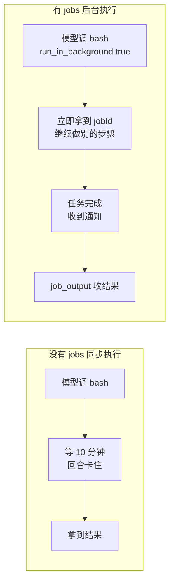

**读图**：左边是卡住的模型——一次 `pnpm test` 把整个回合钉死；右边是出路——工具**立即返回**，任务在后台跑，模型继续干别的，完成时被通知，最后收结果。

**没有 jobs，长运行动作带来四个问题**：

| 问题 | 表现 |
| --- | --- |
| **回合卡死** | 模型等工具返回，期间不能做任何别的事 |
| **无法中断** | 跑错了想停也停不了，只能等它跑完 |
| **无法增量了解** | 10 分钟里不知道跑到哪了、输出了什么 |
| **无法平行** | 三个独立任务（跑测试、装依赖、查文档）只能排队 |

## 方案：把"执行"从"模型回合"里拆出来

**方案一句话**：jobs 域把"执行"从"模型回合"里**拆出来**，变成一个**独立的、可观察、可控制的后台对象**——模型调工具拿到任务 id，回合立即结束，任务在后台继续跑。

### 先定义"后台"到底指什么

"后台"不是泛指"在别处跑"，它有精确语义，相对**模型回合（turn）**而言：

1. **回合**：模型收到一次输入、产出一段回复的完整过程——思考、调工具、看结果、继续，直到给出最终回复；
2. **前台执行**（没有后台时）：工具调用**阻塞**——bash 同步跑完才返回，回合被钉在"等这个工具"上（前面 10 分钟的卡死就是这么来的）；
3. **后台执行**（jobs 域）：工具调用**立即返回 jobId**，回合照常结束；工作实体（bash 子进程、子代理）**继续运行**。

**关键：任务是"跨回合存活"的**。回合结束、下一个回合开始，任务还在跑——任务的生命周期和回合的生命周期**完全解耦**（回合是秒级的，任务可以跑几分钟）：

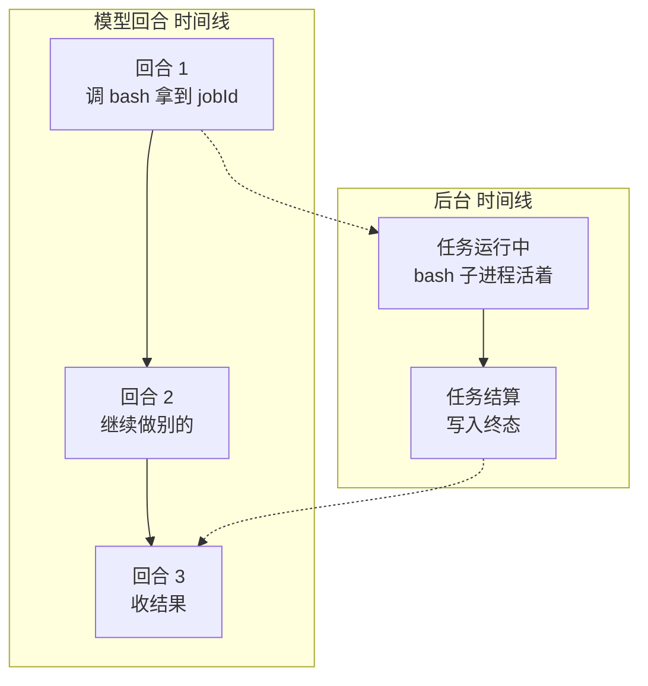

**读图**：任务在回合 1 启动，回合 1 照常结束；回合 2 模型干别的事，任务继续跑；回合 3 模型收结果——**任务横跨三个回合**。它活在注册表里（身份、状态、输出游标），执行资源在生产者的进程里。

**任务只在这四种情况下消亡**：

| 消亡方式 | 说明 |
| --- | --- |
| **结算** | 完成（completed）/ 失败（failed）/ 被终止（killed） |
| **owner 销毁** | 拥有它的 agent 被销毁，取消工作并等待配合的生产者 |
| **服务销毁** | jobs 服务本身被卸载 |
| **进程退出** | 注册表在内存里，进程退出记录即失 |

### 问题与机制一一对应

方案不是空话——上面四个问题，每个对应 jobs 的一个机制：

| 问题（没有 jobs） | jobs 的机制 | 实现细节在哪讲 |
| --- | --- | --- |
| 回合卡死 | `run_in_background: true` 立即返回 jobId，执行脱离回合 | Part 3 |
| 无法增量了解 | `job_output` 增量读 + `job_list` 列任务 | Part 4 / Part 8 |
| 无法中断 | `job_kill` → stopping → 生产者自己收场 | Part 6 |
| 完成不知道 | 结算 first-wins + 完成通知进上下文 | Part 5 |
| 无法平行 | 独立 id + 独立输出游标 + 独立结算 | 全篇 |

**平行的精确说法**：工具层本来就能并行——模型一个回合发多个工具调用，runtime 并行执行、一起收结果（parallel tool calls），这不需要 jobs。jobs 解决的是**回合外的平行**：多个后台任务同时跑、各自独立管理（独立 id、独立游标、独立结算、完成时各自通知）。**平行从"一次回合内"升级为"回合外持续、可查询、可中断"**。

### 全流程总览：一个后台任务的完整一生

下面这张**时序图**是整篇文章的**地图**——六个参与者（用户、模型、执行者、注册表、生产者、LLM 上下文）之间的完整消息流，从"输入端"（用户下达任务）到"输出端"（结果回到用户）。后面每个 Part 展开其中一环：

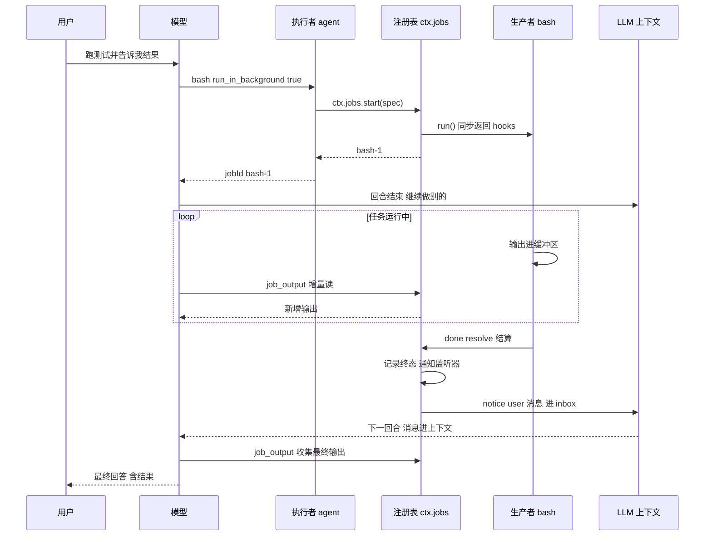

**按消息顺序走一遍**（每条标注对应 Part）：

1. **输入端**：用户下达任务——"跑测试并告诉我结果"；
2. **模型决定后台执行**——`run_in_background: true`（Part 9 讲决策）；
3. **执行者调 `ctx.jobs.start`**——创建任务属于执行者内部行为，模型不直接调（Part 2/3）；
4. **注册表调 `run()` 拿 hooks**，生产者（bash 子进程）开始跑（Part 1）；
5. **返回 `bash-1`**——执行者把 jobId 交给模型（Part 3）；
6. **回合结束**，模型继续做别的——任务跨回合存活（这是区别于"同步等待"的核心）；
7. **运行期间**：生产者输出进缓冲区；模型随时 `job_output` 增量读（Part 4）；
8. **生产者 `done` resolve**——结算 first-wins，记录终态、通知监听器（Part 5）；
9. **notice 消息进 inbox**，下一回合作为 user 消息进上下文——**这就是"输出端"**（Part 5）；
10. **模型收尾**：`job_output` 收集最终输出，或 `job_kill` 清理不相关的（Part 9）；
11. **最终回答给用户**，含任务结果。

**注意第 6 步到第 7 步之间**：回合 2 期间任务属于"无人盯"状态——模型不看它、它自己跑，直到完成通知把它拉回模型视野。

## 项目结构

dsh 的 jobs 域是**三个包**（能力族）：`jobs`（服务契约）+ `jobs-local`（进程内实现）+ `tool-jobs`（模型工具）——分别对应 src/ 里的 `jobs.ts`、`jobs-local.ts`、`tool-jobs.ts`（为什么拆三包、实现可替换，在 Part 2 讲）：

```
blog-19-jobs/
├── package.json          # 项目配置：依赖、启动脚本
├── pnpm-lock.yaml        # 依赖锁定文件
└── src/
    ├── main.ts           # 演示入口：组装 + 演示
    ├── types.ts          # 类型定义（jobs/src/types.ts）
    ├── jobs.ts           # 抽象 JobRegistry（jobs/src/index.ts）
    ├── jobs-local.ts     # LocalJobRegistry（jobs-local/src/index.ts）
    ├── tools.ts          # ToolRegistry（dsh-tools）
    ├── tool-jobs.ts      # 三个模型工具（tool-jobs/src/index.ts）
    └── agent.ts          # 最小执行者模型（dsh-agent 简化）
```

## 核心概念

| 概念 | 一句话理解 |
| --- | --- |
| **JobId** | `<kind>-N`：如 bash-1、subagent-2（kind 即 id 前缀） |
| **JobStatus** | running →（stopping）→ 恰好一个终态：completed / killed / failed |
| **JobStart / JobHooks** | 生产者声明：kind + label + owner + run，run 返回 cancel / done / readOutput |
| **JobSnapshot / JobRead** | 读模型（每次调用新对象）+ 输出与快照的读取结果 |
| **first-wins 结算** | done 只结算一次：记录终态、通知监听器、释放等待者 |
| **owner-fenced** | 访问按拥有者 session 隔离——授权而非保密 |
| **无 job_start 工具** | 创建任务属于执行者内部行为，模型只有 output/list/kill |

## Part 1：契约——后台对象长什么样

**解决"生产者和注册表怎么协作"**——生产者声明"我要做什么"（JobStart），注册表拿到"怎么控制它"（JobHooks），外部只能只读观察（JobSnapshot）。没有这套契约，生产者、注册表、模型工具各自为政。

```ts
/** 任务 id：`<kind>-N`（dsh: JobId，branded string） */
export type JobId = string & { readonly __brand: 'JobId' }

/** 生命周期：running →（stopping）→ 恰好一个终态（dsh: JobStatus） */
export type JobStatus = 'running' | 'stopping' | 'completed' | 'killed' | 'failed'

/** 任务种类（dsh: JobKindMap）——也是 id 前缀 */
export interface JobKindMap {
  bash: 'bash'
  subagent: 'subagent'
}

/** 生产者声明（dsh: JobStart）——start 的入参 */
export interface JobStart {
  kind: JobKind
  label: string
  owner?: { id: string }          // 拥有者 agent（简化：只记 id 做 fence）
  run(): JobHooks                 // 预检后启动工作，同步返回 hooks
}

/** 运行钩子（dsh: JobHooks）——注册表通过它控制/观察生产者 */
export interface JobHooks {
  cancel(reason?: string): void   // 请求终止（同步、幂等、最终 settle done）
  done: Promise<JobOutcome>       // 生产者释放资源后 resolve（不 reject）
  readOutput?(): string           // 消费自上次以来的输出（增量）
}
```

**三方职责**（dsh: "the producer owns execution resources while the runtime owns identity and lifecycle state"——**生产者拥有执行资源，注册表拥有身份与生命周期**）：

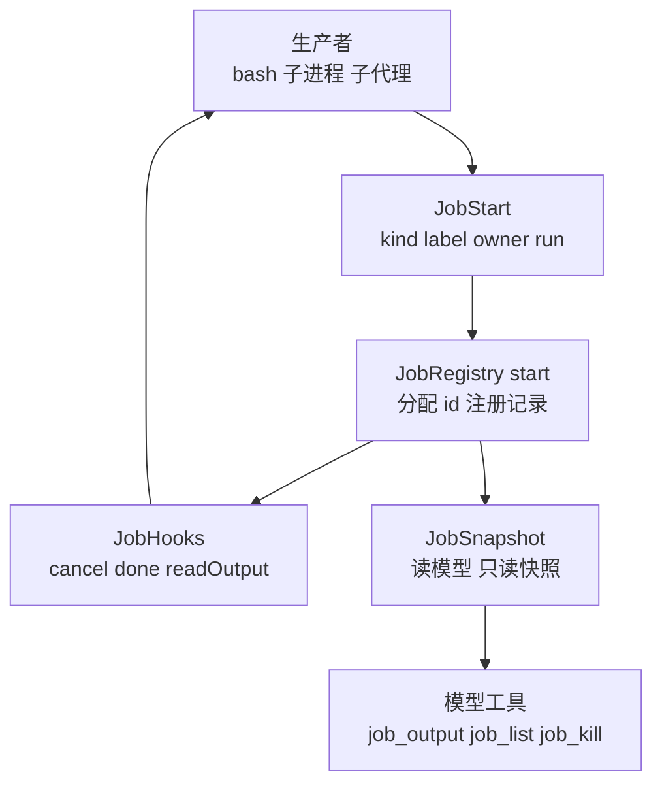

**读图**：生产者用 JobStart 声明自己 → 注册表 `start` 分配 id 并注册 → 拿到 JobHooks（注册表通过它**控制**生产者）→ 对外只暴露 JobSnapshot 读模型（**模型工具永远拿不到活的状态**）。

三个值得注意的细节（dsh 源码注释）：

1. **`done` 不 reject**——"Must not reject; the runtime converts a rejection to failed"。生产者释放完资源就 resolve，错误走 `failed` 状态而不是异常；
2. **`cancel` 必须同步、幂等、最终 settle `done`**——请求终止不是杀进程，而是告诉生产者"该停了"，**由生产者自己收场**（Part 6）；
3. **`readOutput` 是一个消费游标**——"each job has one consuming cursor"，每次调用取走自上次以来的新增输出（Part 4）。

## Part 2：注册表——谁来管这些后台对象

**解决"谁统一管理任务"**——一个服务契约（`ctx.jobs`），实现可替换、配错立刻报错，模型工具永远只依赖契约。

```ts
export abstract class JobRegistry extends Service {
  constructor(ctx: Context) {
    if (new.target === JobRegistry) {
      throw new Error('@dsh/jobs is the abstract job registry seam; load an implementation such as jobs-local')
    }
    super(ctx, 'jobs')
  }

  abstract start(spec: JobStart): JobId
  abstract read(id: JobId): JobRead
  abstract list(ownerSession?: string): JobSnapshot[]
  abstract kill(id: JobId, reason?: string): void
  abstract wait(id: JobId, timeoutMs?: number): Promise<JobSnapshot>
  abstract onDone(listener: JobDoneListener): () => void
  abstract onChanged(listener: JobsChangedListener): () => void
}
```

**为什么抽象 + 实现分离**（dsh 的 Service Definition 模式，和 blog-02 一样）——换实现 = 换插件，调用方不动；且一个 context 只能有一个实现（Cordis 重复注册即抛错）。

**为什么抽象类要 fail loud**（dsh 注释）："'abstract' erases at runtime, so a composition row naming this package would register a ctx.jobs with no method implementations and fail far from the misconfiguration. Fail loud at load instead."——**TS 的 abstract 在运行时被擦除**，配错时会把一个没有实现的 ctx.jobs 注册进去，错误远离问题源头；所以构造器检查 `new.target`，**加载时立刻抛错**。

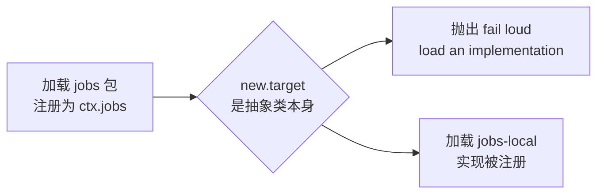

**运行输出**（完整输出 Part 0）：

```
直接实例化抽象 JobRegistry（没有实现时 fail loud）:
  ❌ @dsh/jobs is the abstract job registry seam; load an implementation such as jobs-local
```

## Part 3：生命周期——任务现在什么状态

**解决"做到哪了"有一个权威答案**——从启动到终态的状态机，`job_output` 返回的 status 就来自它。

`start` 的完整流程（dsh 注释）："Preflight access, validation, owner cleanup, and implementation-owned admission before starting and atomically registering work. Any preflight rejection leaves no job id or execution resource."——**预检失败不留任何 id 或执行资源**。我们的简化实现里，`spec.run()` 抛错则记录不注册（id 计数器也不动）：

```ts
start(spec: JobStart): JobId {
  const kind = spec.kind
  const hooks = spec.run()   // 同步返回 hooks；抛错则不留任何 id/资源
  const n = (this.counters.get(kind) ?? 0) + 1
  this.counters.set(kind, n)
  const id = brandJobId(`${kind}-${n}`)
  ...
}
```

**状态机**（dsh: "Task lifecycle: running, optionally stopping, then exactly one terminal status"）：

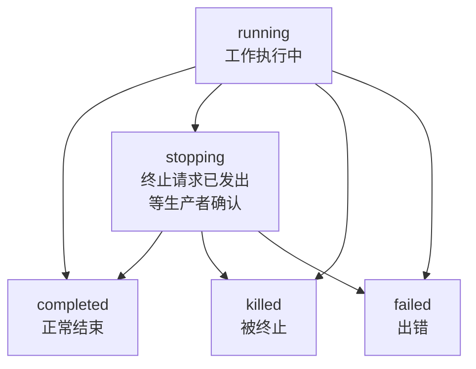

**读图**：running 可以正常结束（completed）、出错（failed）、被终止（killed）；被请求终止时先进入 stopping（**不是直接终态**），然后由生产者自己决定以哪种终态收场——**stopping 也可能最终 completed**（生产者决定把手里的事做完）。

**注意：job 没有 idle 状态**——idle 是 agent（执行者）的回合间状态，不是任务的状态。任务一旦 `start` 成功就是 running，预检失败则根本不注册。

**运行输出**（完整输出 Part 0/1）——一个正常任务的生命周期：

```
🚀 ctx.jobs.start → bash-1
   读取: status=running output=""
...
  +350ms 读取: status=running output="line 1"
  +400ms 读取: status=running output="line 2"
⏳ wait(bash-1, 5000) → status=completed finishedAt=已记录
```

## Part 4：增量读——怎么读任务的输出

**解决"输出很大，不能全量塞给模型"**——一次构建几百行输出，每次轮询都全量返回，模型上下文直接爆掉。dsh 用**一个消费游标**：`readOutput` 每次取走自上次以来的**增量**。

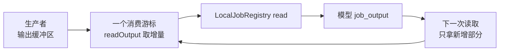

**读图**：生产者把输出写进缓冲区 → 游标从上次的位置消费 → `job_output` 返回**新增**那一段 → 游标前移，下一次只拿更新的。dsh 注释："Consume output produced since the previous call. ... each job has one consuming cursor."

工具实现（`tool-jobs.ts`）：

```ts
ctx.tools.register({
  name: 'job_output',
  description: '读取后台任务 {jobId} 的输出。返回 {finished, running, status, lines} 与最近追加的输出（增量读）。',
  execute: async (args: { jobId?: string }) => {
    const jobId = args.jobId ?? ''
    const read = ctx.jobs.read(jobId)
    return {
      finished: isTerminal(read.snapshot.status),
      running: read.snapshot.status === 'running',
      status: read.snapshot.status,
      lines: read.text,   // 增量：自上次读取以来的新增输出
      jobId,
    }
  },
})
```

**运行输出**（完整输出 Part 2）——模型轮询同一个任务，每次只拿到新增：

```
🚀 启动 bash-2，模型轮询输出:
  第 1 次 job_output → status=running lines="line 1"
  第 2 次 job_output → status=running lines="line 2"
```

**读 0 字节也是成功**（没有新输出是正常状态，dsh 渲染 `(no new output)`）；只有 `wait: true` 才阻塞到终态或超时。

## Part 5：完成——结算与通知

**解决"任务完成时谁、以什么顺序被通知"**——结算恰好一次：记录终态、通知监听器、释放等待者；完成通知放在最后（它可能要开模型回合）。

### 结算 first-wins

dsh 的核心语义："Settlement is first-wins: one terminal record, released waiters, and one round of contained listener notification, even against a late producer outcome."——**一个终态记录、释放等待者、一轮监听器通知；即使生产者迟到地重复结算，也只算第一次**。

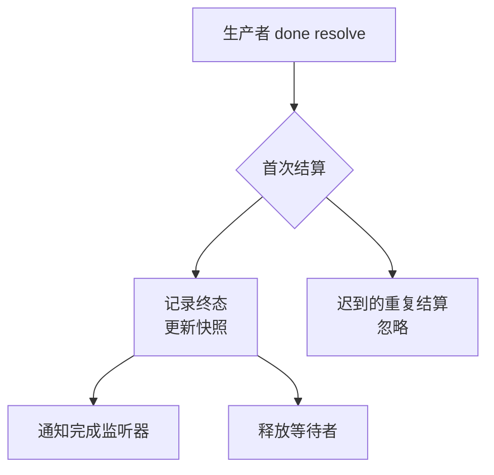

**两个观察通道**：

1. **onDone 监听器**——注册表级别的订阅（`onDone` 返回取消函数），每个结算通知一次；
2. **wait 等待者**——"等这个任务到终态"（可带超时），结算时统一 resolve。

**运行输出**（完整输出 Part 1）——监听器在 wait 之前收到通知：

```
  [done listener] bash-1 结算: completed
⏳ wait(bash-1, 5000) → status=completed finishedAt=已记录
```

**wait 超时不算错误**（完整输出 Part 6）：超时返回当前快照（`[status: running]`），任务继续跑——dsh: "A timed-out wait returns job state rather than a TOOL_TIMEOUT error"。

```
wait(bash-7, 200) → status=running（超时返回当前快照，任务继续跑）
```

### 完成通知怎么进模型上下文

**通知是一条 user 消息，不是直接写进当前上下文**。tool-jobs 插件用 `onJobDone` 监听结算，对**未上报**（`reported` 为假）的终态给 owner 发一条 notice 消息：

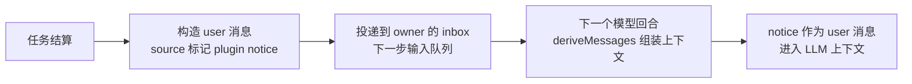

**通知文本长什么样**（dsh `fitCompletionNotice`）：

> "background job bash-1 (bash: 模拟构建) finished [status: completed]. Read its output with job_output."

**三个关键设计**：

1. **通知不含输出**——只有一行状态行（哪个任务、什么终态、自己用 job_output 读）；输出要模型主动读（增量读），大输出不会被动灌进上下文；
2. **通知不打断当前回合**——它排队进 inbox，**下一个回合**组装上下文时才作为 user 消息进入；空闲 owner 默认 `wakeup` 开一轮（"an unclaimed notice is a completion the model never learns about"），忙碌 owner **注入**下一步（多个任务一起结算只花一步），`quiet` 策略则挂起等别的事唤醒；`maxConsecutiveWakes` 默认 3，封顶"唤醒-启动-完成-再唤醒"的自激链；
3. **reported 抑制**——模型已经通过 `job_output` / `job_kill` / `wait` 接触过终态（`reported` 为真），通知器不再发（dsh: "Completion reporters suppress redundant notices when set"）。

**诚实标注**：demo 里的 `onDone` 监听器只 console.log（演示"结算恰好通知一次"这个触发点）；"构造 user 消息 + inbox + 下一回合进上下文"是 agent 层机制（blog-14 的 inbox/followup），简化版没有实现——上面讲的是 dsh 的完整行为。

## Part 6：终止——怎么停掉一个任务

**解决"不想要了怎么停"**——不直接杀，请求式终止：stopping 是信号，由生产者自己收场（能优雅清理中间产物、保存状态）。

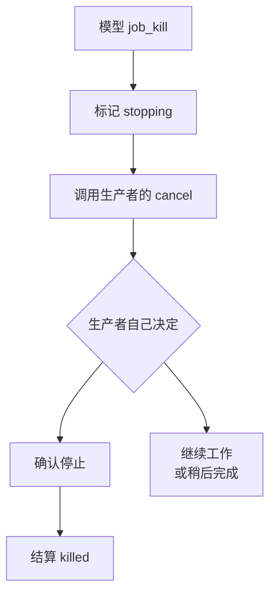

**为什么请求式而不是直接杀**？"终止"对不同工作含义不同——bash 进程可以 kill，子代理需要清理中间产物、保存状态。强制同步杀会丢状态；请求式让生产者优雅收场。如果 `cancel` 抛错，dsh 只 force-fail 注册表记录——"force-fail only the registry record without claiming that the work stopped"——**不假装工作真的停了**。

**运行输出**（完整输出 Part 3）：

```
🚀 启动 bash-3，模型决定终止它:
  job_kill → {"jobId":"bash-3","status":"stopping","done":false}
  +100ms 读取: status=stopping（已进入 stopping，等任务自己确认）
  [done listener] bash-3 结算: killed（cancel requested）
  wait → status=killed detail="cancel requested"
```

**看这个输出**：`job_kill` 立即返回 `stopping`（done 还是 false）→ 100ms 后仍是 stopping → 生产者确认后结算 `killed`（带 reason）。dsh 工具描述："Returns immediately; the job settles as killed once its work actually stops."——**请求立即返回，任务真正停下后才结算 killed**。

## Part 7：失败——出错怎么办

**解决"任务出错时怎么办"**——失败也是正常结算：done 不 reject，模型从 `detail` 知道失败原因。

**运行输出**（完整输出 Part 4）：

```
🚀 启动 bash-4（第 2 行后失败）:
  [done listener] bash-4 结算: failed（exit code 2）
  wait → status=failed detail="exit code 2"
```

**看这个输出**：生产者第 2 行后 resolve `{ status: 'failed', detail: 'exit code 2' }`——终态 failed，detail 渲染为状态行（dsh: "Kind-specific detail rendered into status lines ('exit code: 3', 'max-tokens')"）。**失败也是正常结算**——监听器照常通知、等待者照常释放，模型从 `detail` 知道失败原因。

## Part 8：归属——任务归谁

**解决"多个执行者平行跑，任务别串"**——可见性按 owner session 隔离，模型只看得到自己的任务。dsh: "Owned-job access is fenced by the owner's session id. Ids are predictable, so authorization — not secrecy — is the boundary."——**按 session id 隔离；id 可预测，所以这是授权边界，不是保密边界**。

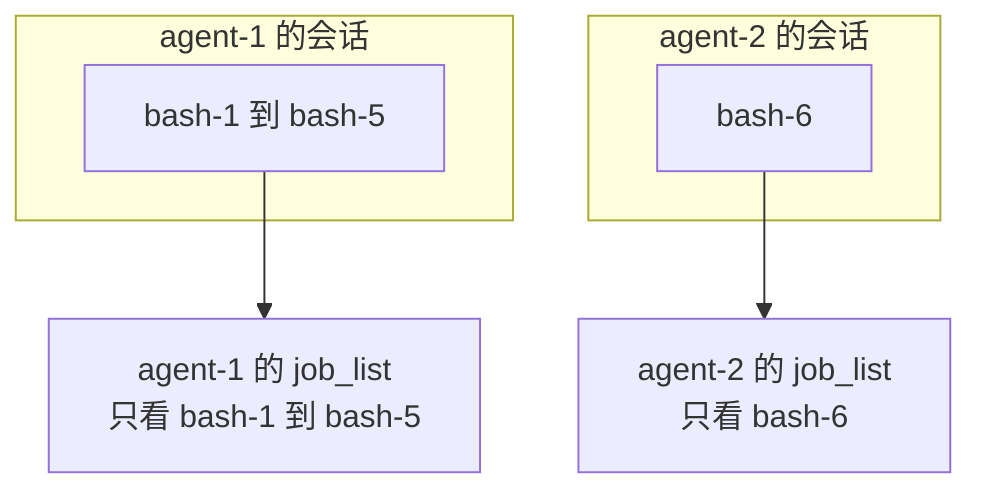

**运行输出**（完整输出 Part 5）：

```
🚀 启动 bash-5（agent-1）与 bash-6（agent-2）:
  agent-1 的 job_list → ["bash-1","bash-2","bash-3","bash-4","bash-5"]
  agent-2 的 job_list → ["bash-6"]
  （agent-2 看不到 bash-5，agent-1 看不到 bash-6——授权而非保密）
```

**为什么要 fence**？任务可能包含敏感输出（某次构建的日志），且模型会基于 `job_list` 决定要不要收结果——**看到不该看的任务会诱导模型做错决定**。dsh 的 `list` 签名是 `list(caller?: Agent)`——按调用者过滤；我们的简化版按 ownerSession 过滤。

## Part 9：模型怎么用——何时后台、三个工具、行为纪律

**解决"模型怎么用 jobs"**——三件事：什么时候该后台（决策）、三个控制工具、启动后的行为纪律。

### 何时用后台：决策

dsh 的官方引导写在 bash 工具描述里（模型每次调用都看得到）：

> "Set `run_in_background: true` for long-running commands: the call returns a job id immediately; read its output with `job_output` and stop it with `job_kill`."

**一句话：长运行命令用后台，短命令用前台。** 判断"长运行"靠模型的经验启发式：

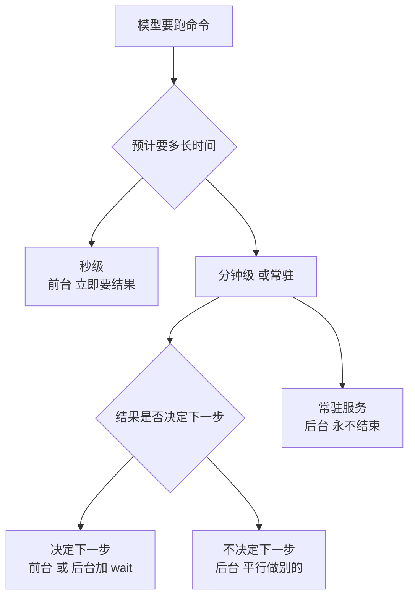

**读图**：先估计时间——秒级（ls、git status、快速查询）走前台，**立即要结果**；分钟级或常驻（构建、测试、装依赖、下载、dev server）再问一句"结果是否决定我下一步"——**决定**（读文件内容再决定改什么）就走前台、或后台加 `wait: true` 等到结果；**不决定**就走后台，**平行做别的事**。常驻服务（dev server）永远不会"结束"，只能后台跑着、随时读日志。

**为什么后台还解决了超时**（dsh 工具参数描述）："Run in the background and return a job id immediately (collect with job_output, stop with job_kill). **No timeout applies**."——**后台任务没有超时**，前台命令受工具超时限制。超长任务放后台，本身就规避了"跑到一半被超时截断"。

**后台可用性也是部署选择**（dsh 配置 `enableRunInBackground`，默认 true）：禁用后工具描述变成 "Background execution is not available; long-running commands must finish within the timeout"，`run_in_background: true` 的调用被拒绝（"run_in_background is disabled for this deployment"）；只加载 bash 没加载 jobs 会报 "background jobs unavailable: load @deepseek-ai/dsh-jobs and @deepseek-ai/dsh-tool-jobs"。

### 三个工具

| 工具 | 做什么 | 关键语义 |
| --- | --- | --- |
| **job_output** | 读任务输出 | 增量读（自上次以来）；`wait: true` 才阻塞；0 字节也是成功 |
| **job_list** | 列自己的任务 | 只返回 owner 名下的（running 和 finished） |
| **job_kill** | 请求终止 | 立即返回；stopping → 生产者确认后 killed |

**没有 job_start**：创建任务属于执行者内部行为（bash/subagent 的工具执行器调用 `ctx.jobs.start`）。模型能**控制**任务，不能**创造**任务——防止模型随意 fork 后台工作失控。

### 启动后的行为纪律

dsh 用一段系统提示词教模型怎么用后台任务（`systemPrompt.section`，name `tool:jobs`，order 106）：

> "Track every background job id you start. You are notified in-session when a job finishes — do not busy-poll or sleep on one; keep working on independent steps and do not duplicate a running job's work. Before giving a final answer, collect every still-relevant job with job_output (set wait: true only when you are genuinely blocked on it), and job_kill jobs that stopped mattering."

**拆解**：

1. **记住每个任务 id**（之后要收集/终止）；
2. **不要忙轮询或 sleep**——完成时会收到通知，轮询浪费回合；多个后台任务平行跑，各有各的完成通知，**每个都不需要盯**；
3. **不要重复运行**（job 还在跑就别再启动一个相同的）；
4. **最终回答前收集所有还相关的输出**（job_output）——把完成的输出并入最终回答；
5. **`wait: true` 只在真正被阻塞时用**（回答内容必须有它的结果）——平时不轮询，靠通知驱动；
6. **不相关的任务就 job_kill**（别留着浪费资源）。

**注意时机**：不是"每次 return 都查"，而是**最终回答前一次性收尾**——平时靠完成通知被动驱动，收尾时主动收集，避免把未完成任务的结果写进回答。

## 完整运行输出

以上所有片段都来自同一次真实运行（`pnpm dev`，省略 pnpm 启动横幅）：

```
============================================================
博客19：jobs 域 - 后台任务（JobRegistry + 三工具）
============================================================

============================================================
Part 0: 抽象 JobRegistry（fail-loud）+ 启动任务
============================================================

直接实例化抽象 JobRegistry（没有实现时 fail loud）:
  ❌ @dsh/jobs is the abstract job registry seam; load an implementation such as jobs-local

🚀 ctx.jobs.start → bash-1
   读取: status=running output=""

============================================================
Part 1: 生命周期——running 到 completed
============================================================
  +350ms 读取: status=running output="line 1"
  +400ms 读取: status=running output="line 2"
  [done listener] bash-1 结算: completed

⏳ wait(bash-1, 5000) → status=completed finishedAt=已记录

============================================================
Part 2: 增量读——模型视角的 job_output
============================================================

🚀 启动 bash-2，模型轮询输出:
  第 1 次 job_output → status=running lines="line 1"
  第 2 次 job_output → status=running lines="line 2"
  [done listener] bash-2 结算: completed
  （第 3 次轮询时任务已完成，lines 为空——增量读，0 字节也是成功）

============================================================
Part 3: job_kill——stopping 之后由任务自己收场
============================================================

🚀 启动 bash-3，模型决定终止它:
  job_kill → {"jobId":"bash-3","status":"stopping","done":false}
  +100ms 读取: status=stopping（已进入 stopping，等任务自己确认）
  [done listener] bash-3 结算: killed（cancel requested）
  wait → status=killed detail="cancel requested"

============================================================
Part 4: 失败结算——failed
============================================================

🚀 启动 bash-4（第 2 行后失败）:
  [done listener] bash-4 结算: failed（exit code 2）
  wait → status=failed detail="exit code 2"

============================================================
Part 5: owner-fenced——job_list 只看得到自己的任务
============================================================

🚀 启动 bash-5（agent-1）与 bash-6（agent-2）:
  agent-1 的 job_list → ["bash-1","bash-2","bash-3","bash-4","bash-5"]
  agent-2 的 job_list → ["bash-6"]
  （agent-2 看不到 bash-5，agent-1 看不到 bash-6——授权而非保密）
  [done listener] bash-5 结算: completed
  [done listener] bash-6 结算: completed

============================================================
Part 6: wait 超时——等不到就带着当前快照回来
============================================================

🚀 启动 bash-7，只等 200ms:
  wait(bash-7, 200) → status=running（超时返回当前快照，任务继续跑）
  [done listener] bash-7 结算: completed
  wait(bash-7, 5000) → status=completed

============================================================
Part 7: 与 dsh 的对应
============================================================

📝 与 dsh 源码对应：
  1. JobRegistry - 抽象注册表服务（packages/jobs/jobs/src/index.ts）
  2. LocalJobRegistry - 进程内实现（packages/jobs/jobs-local/src/index.ts）
  3. job_output/job_list/job_kill - 模型工具（packages/jobs/tool-jobs/src/index.ts）
  4. running/stopping/completed/killed/failed - 状态机（jobs/src/types.ts JobStatus）
  5. <kind>-N - 任务 id（jobs/src/types.ts JobId）
  6. 结算 first-wins - done 恰好结算一次，通知监听器（jobs/src/index.ts）
  7. owner-fenced - 访问按拥有者 session 隔离（jobs/src/index.ts）

✅ 博客19 完成！
```

## 常见问题 FAQ

**Q: jobs 是解决"工具平行"（并行工具调用）的吗？**

A: **一半对，要精确**。工具层本来就能并行——模型一个回合发多个工具调用，runtime 并行执行、一起收结果（parallel tool calls），这**不需要 jobs**。jobs 解决的是**回合外的平行**：`run_in_background: true` 把工作丢到回合外跑，多个后台任务同时跑、各自独立管理（独立 id、独立输出游标、独立结算、完成时各自通知）。**它是"可控的平行"**——平行从"一次回合内"升级为"回合外持续、可查询、可中断"。

**Q: 模型怎么决定用前台还是后台？**

A: dsh 的引导写在 bash 工具描述里："Set `run_in_background: true` for long-running commands"。启发式：**秒级短命令走前台**（立即要结果）；**分钟级或常驻**（构建/测试/装依赖/下载/dev server）再问一句"结果是否决定下一步"——决定就前台或后台加 `wait: true`，不决定就后台平行做别的。另外**后台没有超时**（dsh: "No timeout applies"）——超长任务放后台还规避了前台命令的超时截断。后台可用性本身是部署选择（`enableRunInBackground`）。

**Q: 模型怎么启动一个任务？没有 job_start 工具？**

A: **没有 job_start 是刻意的**。创建任务属于**执行者内部行为**——bash/subagent 的工具执行器在内部调用 `ctx.jobs.start`，模型只拿到任务 id。模型能做的只有 `job_output`（读）、`job_list`（列）、`job_kill`（终止）——**能控制，不能创造**，防止模型随意 fork 后台工作。

**Q: stopping 会卡住吗？任务拒绝终止怎么办？**

A: `cancel` 必须同步、幂等、**最终 settle done**（dsh 契约）——生产者收到请求后必须给出终态。但终态不一定是 killed：生产者可以继续把事做完（completed）。如果 `cancel` 抛错，dsh 只 force-fail 注册表记录，**不假装工作真的停了**（"force-fail only the registry record without claiming that the work stopped"）。

**Q: 任务 id 全局唯一吗？**

A: **同一注册表内唯一**（`<kind>-N` 按 kind 递增）。跨进程/跨注册表可能重名，所以工具参数要求带完整 id。dsh 用 branded string 让类型系统区分 JobId 和普通 string。

**Q: job_output 读 0 字节是失败吗？**

A: **不是**。增量读没有新输出是正常状态（dsh 渲染 `(no new output)`）。只有 `wait: true` 时才阻塞到终态或超时；**超时返回当前快照（`[status: running]`）而不是 TOOL_TIMEOUT 错误**（dsh: "A timed-out wait returns job state rather than a TOOL_TIMEOUT error"）。

**Q: 任务完成时，模型怎么知道？**

A: 注册表结算 → tool-jobs 构造一条 user 消息（source 标记 plugin notice）→ 投递到 owner 的 inbox → **下一个模型回合**组装上下文时作为 user 消息进入 LLM 上下文。通知**不含输出**（模型自己 `job_output` 读）、**不打断当前回合**；空闲 owner 默认 `wakeup` 开一轮，忙碌 owner 注入下一步（合并回合），`quiet` 策略挂起等别的事唤醒。模型已经通过 job_output/kill/wait 接触过终态（`reported`）则不再通知。

**Q: 完成通知会打扰模型吗？**

A: **忙碌时不会**——通知注入下一步（不额外开回合，多个任务一起结算只花一步）；只有空闲时默认 `wakeup` 开一轮（"an unclaimed notice is a completion the model never learns about"）。通知排队进 inbox、下一个回合才进入上下文，不打断进行中的回合，且不含输出。`maxConsecutiveWakes` 默认 3 封顶"唤醒-启动-完成-再唤醒"的自激链，`quiet` 策略则完全不主动开回合。

**Q: 进程退出后任务会丢吗？**

A: **会**。jobs-local 是**进程内注册表**（记录在内存）——进程退出任务记录即失。和 todo 一样**没有独立持久后端**——jobs 是"进程内的后台执行协议"，任务记录只活在当前进程里。

**Q: owner 销毁时任务怎么办？**

A: dsh: "Agent or service disposal cancels live work and awaits compliant producers"——owner 或服务销毁会**取消活动工作并等待配合的生产者**优雅收场；teardown 取消还会把记录标记为 reported（因为 owner 已销毁，没有读者了，避免浪费一次模型请求）。

**Q: jobs 和 todo（blog-18）什么关系？**

A: **完全不同的两件事**。todo 是**任务记忆**（模型记住"该做哪几件事、做到哪了"，整表替换 + off surface）；jobs 是**后台执行**（长运行动作脱离回合跑 + 可查询可终止）。配合场景：todo 记录计划，bash/subagent 任务后台跑，完成通知回到模型，模型更新 todo 进度。

## 小结

1. **问题**：长运行动作把模型回合钉死——无法继续、无法中断、无法增量了解、无法平行；
2. **方案**：把"执行"从"模型回合"里拆出来——任务跨回合存活、可查询、可终止、完成时通知回上下文；
3. **契约**：JobStart 声明 + JobHooks 控制 + JobSnapshot 读模型——生产者拥有执行资源，注册表拥有身份与生命周期；
4. **生命周期**：running →（stopping）→ 恰好一个终态（completed / killed / failed）——stopping 是信号，终态由生产者决定；job 没有 idle；
5. **增量读**：一个消费游标，`job_output` 每次只拿新增输出（0 字节也是成功）；
6. **结算 first-wins**：done 只结算一次——记录终态、通知监听器、释放等待者，迟到结算忽略；
7. **完成通知**：user 消息进 inbox、下一回合进上下文——不含输出、不打断当前回合、忙碌注入/空闲唤醒、reported 抑制；
8. **请求终止**：`job_kill` → stopping → cancel → 生产者优雅收场（killed）；cancel 抛错只 force-fail 记录；
9. **owner-fenced**：按 session 隔离——授权而非保密，`job_list` 只看得到自己的任务；
10. **模型纪律**：长运行才后台（后台无超时）、平时不轮询靠通知、最终回答前一次性收集、不相关的 job_kill。

下一篇预告：**具体工具域**——fs 域（文件系统：read / write / edit + glob / grep），模型直接操作文件。

---

*本文代码已验证可运行（Node.js + tsx，@cordisjs/core v4.0.0-beta.5）。完整源码见同目录 `src/`（main.ts 演示入口 + 每文件对应 dsh 一个模块），实现结构对应 dsh 的 `packages/jobs/`（jobs + jobs-local + tool-jobs）。*
