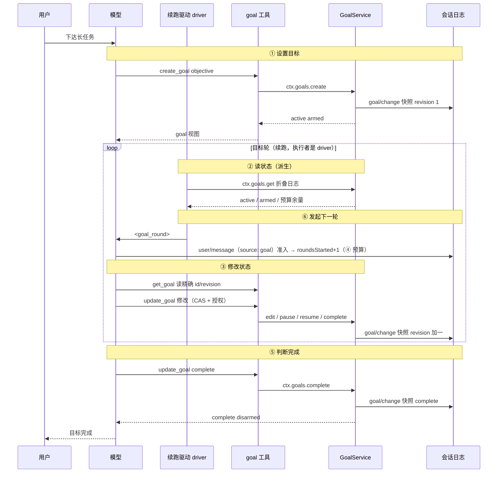
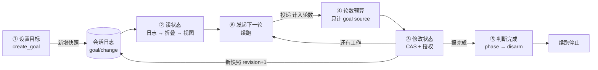
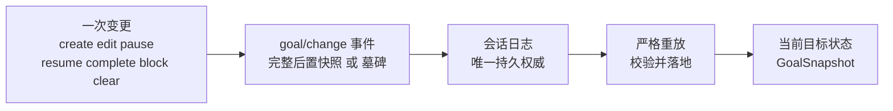
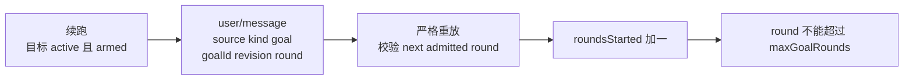
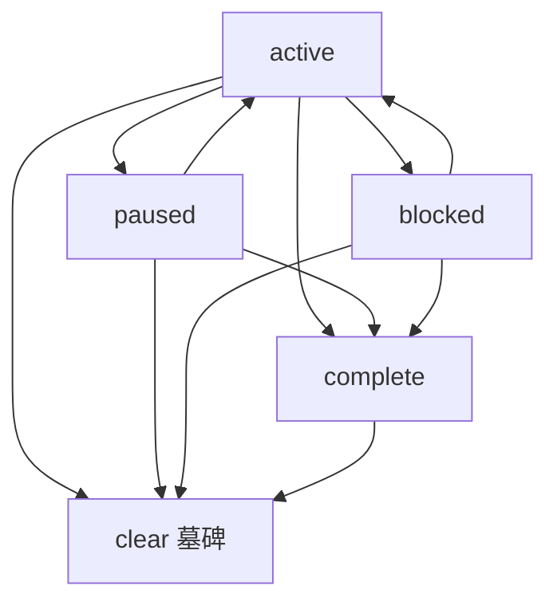

> 本系列从 0 开始，基于 Cordis 框架实现一个简略版 DeepSeek Harness。本篇讲 `packages/goal/` 的**持久化同会话目标**。
>
> **一句话**：**goal 给"长任务"一个持久的目标，goal 模式（goal 域 + driver）再让它自动推进下去**。你把"当前要完成的那件事"交给 goal（`create_goal`），它把目标存进会话日志（重启也丢不了）；**续跑**（自动发起下一轮）由独立的 **goal-round-driver** 承担，直到模型报告完成（`complete`）。
>
> **怎么读**：**只想先建立直觉**——读「速览」+ 六个节点标题 + 「小结」即可，代码、对照表、运行输出都按需回看；**想跟实现**——每个节点固定四段：谁触发 → 做了什么 → 关键代码 → 输入输出与分叉。代码在 [blog-20-goal](https://github.com/kakaCat/learn-dh/tree/main/04-%E5%AE%9E%E7%8E%B0/blog-20-goal)（`pnpm install && pnpm dev`），完整运行输出见文末**附录**。

## 速览（TL;DR）

- **goal 是什么**：给"长任务"一个**持久目标**（`create_goal` 写进会话日志，重启不丢）+ **自动续跑**（目标 active 且 armed 时一轮接一轮推进，直到模型报 `complete`）。
- **六个关键节点**：① 设置目标 → ② 读状态（日志派生）→ ③ 修改状态（CAS + 授权）→ ④ 轮数预算（只计 goal source）→ ⑤ 判断完成（phase → disarm）→ ⑥ 发起下一轮（**续跑**）。
- **续跑是 goal 模式的核心价值，但它不属于 goal 域**：**执行者是独立的 `goal-round-driver` 包**——goal 管"状态可信"，driver 管"何时再动一次"。
- **最容易误解的两点**：① 当前状态不是"存"的、是"算"的（会话日志是唯一权威，严格重放派生）；② 重启后**目标还在，但续跑权不在**（`activation` 是进程内的，从不持久化）。
- **可复现**：可运行代码 + 真实运行输出，事实与 dsh 源码逐条对照。

## goal 模式到底提供了什么：两个能力

抛开实现，**goal 模式**对使用者只承诺两件事：

| 能力 | 是什么 | 体现在哪 |
| --- | --- | --- |
| **① 把目标持久化住** | 目标是一份可信、可恢复、可审计的状态——写进会话日志，重启/分叉/压缩都不丢 | 节点 ①②③ |
| **② 让它自己一直跑下去（续跑）** | 目标激活时自动一轮接一轮地推进，不需要你反复说"继续"——**执行者是 driver，不是 goal** | 节点 ④⑤⑥ |

**没有能力 ②，goal 就只是个"记着你要干什么"的状态容器**——你写 20 篇还是得说 20 次"继续"。

但要立刻澄清一个容易走偏的定位：**续跑是 goal 模式的核心价值，执行它的人不是 goal**。dsh 把"何时开始下一轮"这个决定交给一个独立的包 **goal-round-driver**（源码里就是 `packages/goal/goal-round-driver/`）——goal domain 只保留目标、只提供改它的工具，**从不自己决定何时再动一次**（dsh 原话："the goal domain can retain an objective and the model-facing tools can mutate its lifecycle, but **neither should decide when another model turn begins**"）。

所以本文的组织方式是：

- **goal 的状态模型**（节点 ①②③④⑤）是主干，读它就懂 goal 是什么；
- **续跑**（节点 ⑥）单独成节点，讲清"谁来发起、发起时做哪三步"——它是 goal 模式的核心价值，**由 driver 承担**；内部复杂度（静默检测、竞态栅栏、结算分类）**指向 [blog-22-goal-round-driver](https://github.com/kakaCat/learn-dh/blob/main/04-%E5%AE%9E%E7%8E%B0/blog-22-goal-round-driver/blog.md)**，不在主流程里展开。

### 一个例子：写一个博客系列

假设你对模型说："帮我写一个博客系列，从 0 实现 DeepSeek Harness，每篇一个主题。先写第 1 篇。"

没有续跑时，agent 的工作是**一步一停**的：写完第 1 篇，轮次结束，agent 停下来——**你不说"继续"，它就不动**。写 20 篇，你就要说 20 次"继续"（每篇中间可能还要纠正方向）；agent 只是在每次你推它的时候干一点，**无法长时间自我运行一个任务**（业界把这个叫 human-in-the-loop：每个动作都要人驱动）。

有了 goal，事情变成这样——**你只下达一次，后面都是自动的**：

**你下达（人类轮次，不计轮数）**：

> 👤 你：帮我写一个博客系列，从 0 实现 DeepSeek Harness，每篇一个主题。先写第 1 篇。
>
> ```
> 模型调用 ①  create_goal(objective="写博客系列：从 0 实现 DeepSeek Harness，每篇一个主题", max_goal_rounds=20)
>        → { goal: { id: "goal-1", revision: 1, phase: "active", roundsStarted: 0, maxGoalRounds: 20 }, activation: "armed" }
>
> 模型调用 ②  todo_write(todos=[ 博客 1 到 20 的标题列表 ])
>        → Updated todo list: 19 pending, 1 in progress, 0 completed
> ```
>
> 🤖 模型：**轮次结束**——接下来交给续跑。

**Round 1 · 自动续跑（不需要你说"继续"）**：

> 轮次结束、模型 idle——**续跑被唤醒**：目标 active + armed，于是自动发起下一轮，给模型发一条续跑消息：
>
> ```
> <goal_round>
> Objective: "写博客系列：从 0 实现 DeepSeek Harness，每篇一个主题"
> Round: 1/20
>
> Continue working toward the objective in this same session. Treat the current workspace,
> tool results, and durable session state as authoritative; inspect them instead of assuming
> earlier narration is still current. Make concrete progress and verify the result. ...
> If work remains, leave the goal active for the next round.
> </goal_round>
> ```
>
> 🤖 模型：看到 Objective + **Round 1/20** → get_goal 确认 → 写第 1 篇 → 轮次结束 → **又自动发起 Round 2/20**……

**Round 20 · 完成**：

> 模型在某一轮：get_goal → 读当前目标 → 确认 20 篇全部完成 → `complete` → disarm → **续跑不再发起**，目标停在 complete。

**这就是主流程**。中间你随时可以说"第 5 篇先写 session"（人类轮次，不影响轮数），或者进程重启了（目标还在，但需要你说"继续"才恢复）——这些插曲在下面节点里各自讲到。

### 全景时序图（标出六个能力节点）

把上面这个过程画成时序图——六个参与者：你、模型、续跑驱动、goal 工具、GoalService、会话日志。图里用 **①～⑥** 标出六个关键节点：



**读图**：你下达 → ① 模型 `create_goal`、服务写快照（active armed）→ 循环里：② 读派生状态 → ⑥ 发起下一轮（拼 `<goal_round>` 并投递，④ 计入预算）→ ③ 模型 `get_goal` 读、`update_goal` 改（每次变更写新快照、revision +1）→ ⑤ 模型 `complete` → 写完成快照 → disarm → 结束。

**先弄清四个词**（dsh goal-round-driver 的层级，Agent Note 原文："The hierarchy is **Goal → Goal Round → Turn → Step**"）：

| 术语 | 含义 | 在本例里 |
| --- | --- | --- |
| **Goal**（目标） | 你要完成的那件事 | "写博客系列，每篇一个主题" |
| **Goal Round**（目标轮） | 续跑每次自动发起的外层迭代——**时序图 loop 里转一圈 = 一个目标轮** | Round 1/20 里的"1" |
| **Turn**（轮次） | 模型会话轮次——**一个目标轮变成一个轮次**（1:1） | 模型写第 1 篇的那个轮次 |
| **Step**（步骤） | 轮次内的模型/工具步骤 | 轮次里调 get_goal、写正文 |

所以时序图里的 **loop 不是"轮次"的循环，是"目标轮"的循环**——续跑一轮轮发起（Goal Round），每一轮进入一个轮次（Turn），轮次里是若干步骤（Step）。

## 关键节点：goal 的能力逐个看

把 goal 拆开，一共六个能力节点。每个节点都按同一套模板讲：**谁触发 → goal 做了什么 → 关键代码 → 输入输出与分叉**。



**一张图看懂六个节点**：①②③ 是"目标状态"本身（设置、读、改）；④⑤ 是约束与收尾（预算、完成）；⑥ 是把状态接回模型循环的**续跑**——它读 ②、写 ③、受 ④ 约束、终点是 ⑤。

实现结构对应 dsh 的 `packages/goal/`：

```
blog-20-goal/
├── package.json          # 项目配置：依赖、启动脚本
├── pnpm-lock.yaml        # 依赖锁定文件
└── src/
    ├── main.ts           # 演示入口：组装 + 按关键节点演示
    ├── types.ts          # 纯类型（goal/src/types.ts）
    ├── domain.ts         # 事件词汇与错误码（goal/src/domain.ts）
    ├── session.ts        # Session 事件日志（dsh-session）
    ├── fold.ts           # 严格重放（goal/src/fold.ts）
    ├── goal.ts           # GoalService（goal/src/index.ts）
    ├── driver.ts         # GoalRoundDriver 续跑（goal-round-driver/src/index.ts 简化）
    ├── agent.ts          # Agent + AgentFactory（dsh-agent）
    ├── tools.ts          # ToolRegistry（dsh-tools）
    └── tool-goal.ts      # 三个模型工具 + authority（tool-goal/src/index.ts）
```

**诚实标注**：`goal` + `tool-goal` + **`driver.ts`** 是本博客的实现核心。本文多次标注"简化"——**凡标简化的地方，差异都在这张表里**，读者可据此判断 demo 与 dsh 的语义距离：

| 环节 | dsh `goal-round-driver` | demo `driver.ts` | 省掉后的语义差距 |
| --- | --- | --- | --- |
| **触发** | 监听 `agent/status`(idle) 与 `goal/changed` 两个事件 | ❌ 手动调 `schedule()` | demo 不自动感知 idle；**判断逻辑本身一致**，只是没人替它按下按钮 |
| **串行化** | 合并同一 agent 的并发 drive 请求（coalesce） | ❌ | 并发 idle 信号可能重复发起（demo 是顺序调用，触发不到） |
| **竞态栅栏** | 预留身份 + `agent/pre-step` 双重校验 live revision | ❌ | 目标在投递途中被 edit/clear 时，demo 不走"静默丢弃预留"，而是由严格重放以"非顺序轮"**拒绝**（fail loud，不是 fail silent） |
| **准入计入轮数** | 一致 | ✅（`fold.ts`） | 无 |
| **预算耗尽** | `block(code: 'round-limit')` | ✅ | 无 |
| **轮次结算** | 取消 / 错误 / max-tokens → pause / block / disarm 分类 | ❌ | demo 里轮次异常**不会自动映射**回目标状态，需人工调 `update_goal` |
| **卸载 / 持久性不确定** | 卸载前、持久性不确定、max-tokens 时 disarm | ⚠️ 有 `disarm()` 方法，**无触发钩子** | 复现不了"卸载前收回续跑权"这个时机 |
| **续跑提示词** | `renderGoalRoundPrompt`（完整措辞） | ✅ 文案略短 | 字段一致（Objective + Round N/M），纪律句是精简版 |

另外整体略过：`command-goal`（CLI 命令）；`tool-goal` 的 `goalToolExecution` 与 `wrapup` 收尾 notice 为简化实现。

### 节点 ① 设置目标：create_goal 把目标变成持久事实

**谁触发**：你下达一个长任务，模型判断"这是要跨多轮自动推进的目标"，于是在**直接人类轮次**里调 `create_goal`。dsh 工具描述："when the current **direct human request** is a **long-running objective** that should continue across autonomous goal rounds"；模型从请求推断意图，**琐碎的单轮工作不调用**（"Do not use this for trivial single-turn work"）。

**goal 做了什么**：`GoalService.create` 校验入参 → 造一个 `GoalSnapshot`（新 id、revision 1、phase active）→ `commit` 把**完整快照**作为 `goal/change` 事件追加进会话日志 → 立刻折叠回来 → 设置 `activation = 'armed'` → 返回给模型的 `GoalView`。

```ts
/** 创建并 arm 一个目标（dsh: create）——只有无目标或目标是 complete 时才允许 */
create(agent: Agent, request: CreateGoalRequest): GoalView {
  const spec = {
    objective: resolveObjective(request.objective),
    maxGoalRounds: resolveMaxGoalRounds(request.maxGoalRounds ?? this.defaultMaxGoalRounds),
  }
  const cache = this.prepareMutation(agent)
  const current = cache.state.goal
  if (current !== undefined && current.phase !== 'complete') {
    throw new GoalError(`goal "${current.id}" already exists with phase "${current.phase}"`, 'GOAL_ALREADY_EXISTS')
  }
  const now = Date.now()
  const goal: GoalSnapshot = {
    id: GoalId(`goal-${++this.goalCounter}`),
    revision: 1,
    objective: spec.objective,
    phase: 'active',
    maxGoalRounds: spec.maxGoalRounds,
  }
  return this.commitSnapshot(agent, cache, 'create', goal, 0, now, now, 'armed')
}
```

**写日志那一步**长这样——注意 `activation` 不走日志（`pendingActivation` 只在这次 commit 期间生效，用来把"刚写的这条事件"和"要设的激活态"对上）：

```ts
/** 提交一次变更：写日志 → 增量折叠 → 通知监听器（dsh: commit） */
private commit(agent: Agent, cache: GoalCache, change: GoalChangeMeta, activation: GoalActivation): void {
  const ref = goalChangeRef(change)
  cache.pendingActivation = { seq: agent.session.seq, activation }
  try {
    agent.session.append({ type: 'goal/change', data: change })
    this.sync(agent.session, cache)
  } finally {
    cache.pendingActivation = undefined
  }
  ...
}
```

**输入 → 输出**：

```
create_goal(objective="写博客系列…", max_goal_rounds=3)
→ { goal: { id: "goal-1", revision: 1, phase: "active", roundsStarted: 0, maxGoalRounds: 3 }, activation: "armed" }
```

**返回的这个 `{ goal, activation }` 就是"目标"的全部**，十个字段其实是四组——按**"这个值由什么驱动"**分（别按"在不在日志里"分：`createdAt` 也在日志里，但它不是派生量）：

| 字段 | 组（由什么驱动） | 为什么有它 | 记录什么 | 有什么用 |
| --- | --- | --- | --- | --- |
| **id**（`goal-N`） | 快照持久事实 · 变更操作 | 工具、续跑、日志都要指认"这一个目标" | 目标身份 | 重启后 get_goal 凭它找回；update_goal 带它做 CAS |
| **revision**（每次 +1） | 快照持久事实 · 变更操作 | 防并发覆盖——多个轮次交错提交，谁过期谁被拒 | 第几次变更 | CAS 栅栏的基础（节点 ③）；变更次数审计 |
| **objective**（一句话） | 快照持久事实 · 变更操作 | 目标本身——"要完成的是什么" | 你的请求 | **续跑每轮把它喂给模型**（`<goal_round>` 里的 Objective）；重启后读回 |
| **phase** | 快照持久事实 · 变更操作 | 生命周期——目标现在处于哪个状态 | active/paused/blocked/complete | 决定续跑是否继续（active 才跑）、工具允许哪些操作（节点 ⑤） |
| **maxGoalRounds** | 快照持久事实 · 变更操作 | 防续跑失控 | 你设的预算（20） | `Round N/M` 里的 M；预算耗尽自动 block（节点 ④） |
| **blockedReason**（仅 blocked 时） | 快照持久事实 · 变更操作 | "卡住"要有原因，不只是一个状态 | code（机器路由）+ message（人看） | 恢复时知道为什么卡；审计"为什么停" |
| **createdAt** | 快照时间戳 · 变更时刻 | 顺序与审计 | create 那次变更的时刻 | 重放校验后续快照必须携带同一个 createdAt |
| **updatedAt** | 快照时间戳 · 变更时刻 | 顺序与审计 | 最近一次变更的时刻 | 严格重放校验**时间戳不回退**；写入时被"墙钟不回退"钳制（节点 ②） |
| **roundsStarted** | 目标轮消息推进（也随快照持久化） | 已烧了多少轮 | 只算 goal source 的目标轮（人类轮次不计） | 回答"写到哪了"；预算判断依据（节点 ④）；blocked 轮号门槛（节点 ③） |
| **activation** | 进程内 · 会话生命周期（**不持久化**） | 生命周期 ≠ 续跑权 | 进程内的 armed / disarmed | 重启后自动 disarmed，你说"继续"才 resume（节点 ⑤） |

**分叉与失败路径**：

- objective 为空/空白 → `GOAL_INVALID_OBJECTIVE` 拒绝
- maxGoalRounds 不是正整数 → `GOAL_INVALID_MAX_ROUNDS` 拒绝
- 已有目标且不是 complete → `GOAL_ALREADY_EXISTS`——**完成的目标让位给新目标**
- 非直接人类轮次（子代理/注入消息） → 工具层拒绝：`this goal operation requires a direct human turn on a top-level agent`

### 节点 ② 读状态：状态是"算"出来的，不是"存"的

**谁触发**：**任何要读目标的人**——模型的 `get_goal`、续跑发起前的检查、UI 渲染。goal 没有"当前状态"这个变量给你读，读状态永远是一次**派生（derive）**。

**goal 做了什么**：`ctx.goals.get(agent)` 先**把日志里还没折叠的事件折进来**（`sync`），再返回一个算出来的 `GoalView`：

```ts
/** 读当前目标（dsh: get）——返回新视图或 undefined */
get(agent: Agent): GoalView | undefined {
  this.assertLive(agent)
  const cache = this.cache(agent.session)
  this.sync(agent.session, cache)
  return this.view(cache)
}
```

`cache()` 首次会把全部事件折一遍，之后的 `sync` 只折 `observedSeq` 之后的新事件——**增量的折叠，不是每次全量重算**。

**为什么这件事重要**：它让"读状态"有了**唯一权威**。模型工具、续跑、UI、重放读到的都是同一份日志算出的同一个值，不存在"续跑以为 active、工具读到 paused"的副本漂移。数据流只有一条：



**goal/change 事件长什么样**——非 clear 的变更，负载是**完整快照**（没有 diff）：

```
{ kind: 'goal/change', version: 1, operation: 'create' | 'edit' | 'pause' | 'resume' | 'complete' | 'block',
  goal: { …完整目标… }, roundsStarted, createdAt, updatedAt }
```

clear 则是**墓碑**（没有快照，只有一个 ref）：

```
{ kind: 'goal/change', version: 1, operation: 'clear', cleared: { id, revision }, clearedAt }
```

**每次变更都是完整后置状态，没有 diff**——这正是"重放 last-wins 无歧义"的原因。

**为什么不单独存一份，而是放进会话日志？** dsh 的决策记录说得很直白：会话日志**已经**提供顺序、持久化、分叉前缀、可重建性——再加一份独立存储，只会引入"两份状态怎么保持一致"的原子性问题、以及"这份存储和会话是什么关系"的谱系问题（dsh Alternatives: "a second store introduces atomicity and lineage questions"）。所以目标记录作为**普通会话数据**放进日志——持久化、恢复、分叉**天然继承**，这正是"重启后 get_goal 还在"的原因。

**重放是严格的**——五类校验，任一不合格就 fail loud（宁可挂起，不给错状态）。这是折叠的核心：

```ts
/** 应用一个会话事件到严格折叠（dsh: applyGoalEvent） */
export function applyGoalEvent(state: GoalFoldState, event: SessionEvent): void {
  if (event.type === 'goal/change') {
    const change = decodeGoalChange(event.data)
    if (change === undefined) throw new Error(`goal change at session event ${event.seq} has an invalid kind`)
    applyGoalChange(state, change)                 // 畸形形状 / 不连续 revision / 非法转换 / 时间戳回归
    return
  }
  if (event.type === 'user/message') {
    const source = goalSource(event.data.source)
    if (source === undefined) return               // 人类消息：不计轮数
    const current = state.goal
    if (current === undefined || current.phase !== 'active' || source.goalId !== current.id
      || source.revision !== current.revision || source.round !== state.roundsStarted + 1
      || source.round > current.maxGoalRounds) {   // ⑤ 非顺序轮数拒绝
      throw new Error(`goal round at session event ${event.seq} is not the next admitted round of the active goal`)
    }
    state.roundsStarted = source.round
  }
}
```

（`user/message` 分支就是节点 ④ 的轮数计入，这里先记一笔。）

畸形、篡改、部分写入的记录被拒绝而不是被悄悄修复（dsh: "A malformed current-format record fails replay rather than being ignored or repaired"）。运行输出——一条伪造的残缺事件被重放拒之门外：

```
  ✅ 重放拒绝畸形 goal/change → goal snapshot change must have exactly createdAt,goal,kind,operation,roundsStarted,updatedAt,version fields
```

**输入 → 输出**：

```
输入：agent（其会话日志）
输出：GoalView（含 from 日志算出的 roundsStarted / createdAt / updatedAt）+ 进程内 activation
     或 undefined（没有目标 / 已被 clear）
```

**分叉与失败路径**：

- 事件畸形 / 字段不全 → **重放抛错（fail loud）**，不给近似状态
- revision 不连续 / 时间戳回归 / 非法阶段转换 → 重放抛错
- 日志里有非顺序的目标轮消息 → 重放抛错
- 目标已被 clear → 返回 `undefined`（墓碑保留在 `lastRef`）

### 节点 ③ 修改状态：get_goal 读、update_goal 改（CAS + 授权）

**谁触发**：**每个目标轮开头**（确认目标还在、看当前状态），以及**每次 update_goal 之前必读**（抄精确 id/revision——源码："Call this before updating a goal"）。

**goal 做了什么**：分两半——

- **读**：`get_goal()` 无参数、纯读取（不改任何状态），返回当前目标或 `null`。它是 goal 的**唯一读取通道**——目标状态不在模型上下文里，模型每次都要重新读。
- **写**：`update_goal(goal_id, revision, action, …)` 带**精确 id/revision（CAS）**，五种 action：

| action | 做什么 | 权威 |
| --- | --- | --- |
| **edit** | 改 objective 或预算 | 需要直接人类轮次 |
| **pause** | 暂停 | 需要直接人类轮次 |
| **resume** | 恢复 | 需要直接人类轮次 |
| **complete** | 完成 | 直接人类 **或** 当前目标的精确目标轮 |
| **blocked** | 阻塞（必带 blocked_reason） | 直接人类 **或** 当前目标的精确目标轮 |

每次成功的写，都是一次**合法阶段迁移 + 一次新 `goal/change` 快照**（revision +1）。CAS 的实现就是 `expectCurrent`——当前 revision 与提交的 ref 不一致就抛错：

```ts
/** 拒绝过期或缺失的 ref（dsh: expectCurrent） */
private expectCurrent(cache: GoalCache, ref: GoalRef): GoalSnapshot {
  const current = cache.state.goal
  if (current === undefined) throw new GoalError('no current goal', 'GOAL_NOT_FOUND')
  if (ref.id !== current.id || ref.revision !== current.revision) {
    throw new GoalError(
      `stale goal ref "${ref.id}" revision ${ref.revision}; current is "${current.id}" revision ${current.revision}`,
      'GOAL_STALE_REVISION',
    )
  }
  return current
}
```

**为什么需要 CAS**：模型可以并发/交错提交——两个轮次都读到 revision 1，一个改成 2，另一个若直接覆盖就丢更新。CAS（compare-and-set）让每个提交者带**精确 revision**，过期即拒绝，**第二个提交者必须重读**。运行输出：

```
  edit（revision 1 → 2）→ {"goal":{…,"revision":2,"objective":"补目录索引并校对",…}}
  ❌ 再用过期的 revision 1 edit → stale goal ref "goal-4" revision 1; current is "goal-4" revision 2
  用精确 revision 2 edit → {"goal":{…,"revision":3,"objective":"补目录索引并校对完成",…}}
```

**为什么授权必须在执行时校验**：提示词无法认证"谁授权了变更"（dsh: "a subagent, injected plugin message, stale model turn, or resumed session could all produce the same tool arguments"）。子代理、注入的插件消息、过期的旧轮次、恢复的会话——工具参数一模一样，所以权威必须在**执行时**看"这个轮次里有没有人类输入 / 是不是当前目标的精确轮"：

```ts
/** create/edit/pause/resume 的权威：必须是直接人类轮次 */
function requireDirectHuman(ctx: Context, agent: Agent, window: SessionEvent[]): void {
  if (hasDirectHumanInput(ctx, agent, window)) return
  throw new Error('this goal operation requires a direct human turn on a top-level agent')
}

/** complete/blocked 的权威：直接人类 或 当前目标的精确目标轮 */
function completionAuthority(ctx: Context, agent: Agent, window: SessionEvent[]): GoalToolAuthority {
  if (hasDirectHumanInput(ctx, agent, window)) return { kind: 'direct-human' }
  const goal = ctx.goals.get(agent)
  if (goal !== undefined && isMatchingGoalRound(window, goal)) return { kind: 'goal-round', goal }
  throw new Error('complete and blocked require a direct human turn or the current goal round')
}
```

翻译成人话：

| 场景 | 权威落点 |
| --- | --- |
| 你改需求 → edit | 直接人类轮次（你说了话）——通过 |
| 子代理想改目标 → update_goal | 不是直接人类、不是 root 的目标轮——**被拒** |
| 目标轮里模型报完成 → complete | 目标轮（goal source 精确匹配）——通过，但**只能报终态**，不能 edit |

配套规则：**目标轮里报 blocked 有"轮号门槛"**——判据是 `roundsStarted >= blockedAfterConsecutiveRounds`（默认 3）。**口径要说清**：`roundsStarted` 在这一轮准入时**已经把当前轮计进去了**，所以门槛的实际含义是「**第 3 轮起才允许报**」，而不是「报之前还要再等 3 轮」。运行输出里第 2 轮被拒（`current round is 2`）、第 3 轮通过，正是这个边界。blocked 的 code 固定 `model-reported`。

**输入 → 输出**（真实运行）：

```
get_goal → {"goal":{"id":"goal-1","revision":1,…,"roundsStarted":1,"maxGoalRounds":3},"activation":"armed"}

update_goal edit   → {"goal":{"id":"goal-3","revision":2,"objective":"写迁移文档并附回滚方案","phase":"active",…}}
pause              → {"goal":{…,"phase":"paused",…},"activation":"disarmed"}
resume             → {"goal":{…,"phase":"active",…},"activation":"armed"}
update_goal blocked→ {"goal":{"id":"goal-9",…,"phase":"blocked",
                       "blockedReason":{"code":"model-reported","message":"审批人在三个轮次中均未回复，无法继续"}},…}
```

**分叉与失败路径**：

- 拿旧 revision 提交 → `GOAL_STALE_REVISION`：`stale goal ref … current is rev N`——**必须重读**
- 非法阶段迁移（如 paused → block） → `GOAL_INVALID_TRANSITION`：`cannot block goal … from phase "paused"; expected active`
- 无授权（子代理 / 非目标轮） → 拒绝：`this goal operation requires a direct human turn…`
- blocked 轮号未达门槛（`roundsStarted < 3`）/ 缺 blocked_reason → 拒绝：`blocked requires at least 3 consecutive goal rounds…`
- edit 传了 blocked_reason / complete 传了 objective → 字段纪律拒绝：字段只属于特定 action

### 节点 ④ 轮数预算：只计 goal source 的目标轮

**谁触发**：每次续跑发起前（节点 ⑥ 检查预算），以及每条消息进入轮次时（计入轮数）。

**这个节点解决什么问题**：自动续跑不能无限烧轮数，也**不能把你的人类轮次算进预算**。dsh 明确否掉了"每个会话轮次都算进度"的做法——"one session can contain human clarification, inspection, and unrelated work"。你中途插话、检查、闲聊，都是普通人类轮次，**一分钱预算都不占**。

**goal 做了什么**：靠消息自带的 **source（来源标记）** 区分——你说话的消息 source 是 `{ kind: 'user' }`；续跑发起的目标轮消息 source 是 `{ kind: 'goal', goalId, revision, round }`。**只有 goal source 的消息算一轮**：



计入就发生在节点 ② 那段 `applyGoalEvent` 的 `user/message` 分支里：`goalSource()` 对 `{ kind: 'user' }` 直接返回 undefined（不计入）；只有 `{ kind: 'goal', goalId, revision, round }` 且 round 恰好是 `roundsStarted + 1` 且不超 `maxGoalRounds`，才把 `roundsStarted` 设为 `round`——**非顺序的轮数会被重放拒绝**。

**预算耗尽怎么办**：续跑发起前发现 `roundsStarted >= maxGoalRounds`，就**自动 `block(code: 'round-limit')`**，从不自动重试；连 `resume` 都会被拒（要求先提高预算）。

运行输出——轮数递增，预算耗尽后连 resume 都被拒：

```
  create_goal → {"goal":{"id":"goal-5",…,"roundsStarted":0,"maxGoalRounds":2,…}}
（目标轮 1）...
  轮 1 后 get_goal → {…,"roundsStarted":1,"maxGoalRounds":2,…}
（目标轮 2）...
  轮 2 后 get_goal → {…,"roundsStarted":2,"maxGoalRounds":2,…}
  ❌ 预算耗尽后 resume → goal "goal-5" exhausted 2 goal rounds; increase maxGoalRounds before resuming
  edit 提高预算到 5 → {…,"revision":3,…, "phase":"paused","roundsStarted":2,"maxGoalRounds":5,…}
```

**一个诚实的边界**：预算**只计轮数**（dsh: "Round-count budget only — maxGoalRounds does not meter tokens, currency, wall time, or provider quotas"）——它是续跑次数的闸门，不是费用闸门；token、费用、墙钟的限制由策略层映射成 blocked reason。

**分叉与失败路径**：

- 你的消息（source kind = user） → 直接跳过，**不计轮数**
- `source.round` 不是 `roundsStarted + 1`（跳号/重号） → 重放拒绝：`is not the next admitted round of the active goal`
- `source.round` 超 maxGoalRounds → 重放拒绝
- 预算已耗尽还想 resume → `GOAL_INVALID_TRANSITION`：`exhausted N goal rounds; increase maxGoalRounds before resuming`
- 预算耗尽后续跑发起 → 自动 `block(code: 'round-limit')`，不自动重试

### 节点 ⑤ 判断完成：complete → disarm → 续跑停

**谁触发**：模型在某一轮里判断"目标真正达成了"，调 `update_goal(complete)`。**这里有两层"判断"**——模型判断"业务上完成了"，续跑判断"状态上还该不该跑"。

**goal 做了什么**：`complete` 是一次合法阶段迁移（→ `phase = 'complete'`）**外加 disarm**。下一次续跑发起前读到 phase 不是 active，就停——**自动续跑结束**。

```ts
/** 标记完成并 disarm（dsh: complete） */
complete(agent: Agent, ref: GoalRef): GoalView {
  return this.transition(agent, ref, 'complete', ['active', 'paused', 'blocked'], 'complete', 'disarmed')
}
```

**阶段机**——每次操作都是一次合法的阶段迁移，非法转换直接被拒：



| 操作 | 允许的当前阶段 | 进入 | 附带 |
| --- | --- | --- | --- |
| create | 无目标 / complete | active revision 1 | arm |
| edit | 任意（非 clear） | 同阶段 revision+1 | 保留激活 |
| pause | active | paused | disarm |
| resume | active（未 armed）/ paused / blocked | active | arm；预算有余量 |
| complete | active / paused / blocked | complete | disarm |
| block | active | blocked + reason | disarm |
| clear | 任意 | 墓碑（revision+1，无快照） | disarm |

**为什么 blocked 单独是一个阶段而不是一个标志**：provider 限制、预算、执行错误、等人类输入——dsh 把**所有"卡住"的情况统一成一个 durable 阶段**，带 `{ code, message }`（code 机器可路由、message 人可读），**避免为每种卡法发明一个新状态**。

**激活分离**——注意表里的"arm / disarm"：complete 会 disarm，意味着"目标完成了，别跑了"。激活（armed/disarmed）是**进程内的，从不持久化**——这解决一个现实问题：重启后目标可以还在（日志重放），但"你一打开会话就静默开工"是吓人的（dsh: "silently starting work when a user opens that session is surprising"）。所以会话重启即 disarm：

```ts
constructor(ctx: Context, config: { defaultMaxGoalRounds?: number } = {}) {
  ...
  ctx.on('agent/session-start', ({ agent }) => {
    this.cache(agent.session).activation = 'disarmed'   // 会话重启 → disarm
  })
}
```

dsh 原话："Resume and fork expose the same durable phase while remaining **operationally inert** until an explicit resume mutation arms activation"——**恢复/分叉后目标、阶段、修订、轮数都在，但绝不自动开工**；你说"接着写"→ 模型 `update_goal resume` 才重新 arm。**状态"还在"和"能自动续跑"从此是两个事实**。

运行输出——pause 后续跑被拒、resume 后恢复：

```
  pause → {"goal":{…,"phase":"paused",…},"activation":"disarmed"}
  ✅ paused 后 goalRound 被拒 → no armed active goal for g5
  resume → {"goal":{…,"phase":"active",…},"activation":"armed"}
```

**完成了就是真的完成吗？**——dsh 的态度很明确：**由"记录完成的那方"说了算**（"the caller that records completion or blocking is authoritative"），**没有独立评估器**（"evaluator-backed certification is deferred to a separate policy layer"）。goal 保证的是**状态质量**（可信、一致、可控、可审计），不是**结果质量**。

**输入 → 输出**（真实运行，含收尾 notice）：

```
update_goal complete → {"goal":{"id":"goal-1","revision":2,"phase":"complete","roundsStarted":3,"maxGoalRounds":3},
                        "activation":"disarmed",
                        "wrapup":"目标已完成：写博客系列：从 0 实现 DeepSeek Harness，每篇一个主题"}
```

**分叉与失败路径**：`complete` 可从 active / paused / blocked 进入；`block` 只能从 active 进入；非法转换被拒。**收尾之外**，轮次结束后的异常由续跑处理（见节点 ⑥ 的结算分类）。

### 节点 ⑥ 发起下一轮（续跑）：goal 模式的核心价值，由 driver 执行

**这是 goal 从"状态容器"变成"自动引擎"的那一步**——上面五个节点把状态管好了，但没有这一步，状态不会自己往前走。

**谁触发**：轮次结束、agent 变 idle 那一刻（dsh 的续跑挂在 `agent/status` 与 `goal/changed` 两个触发点上）。

**谁来做——这很关键**：**不是 goal**。dsh 把"何时开始下一轮"交给独立包 **goal-round-driver**（原话："neither should decide when another model turn begins"）。可以这样记：

| | 负责什么 | 是什么 |
| --- | --- | --- |
| **goal**（节点 ①②③④⑤） | **状态可信**：目标是什么、能不能改、改了多少轮 | 数据模型 + 工具 |
| **driver**（本节点） | **何时再动一次**：发起下一轮 | 外部驱动者（独立包，可替换） |

所以 driver **不是 goal 的优化项，也不是 goal 的内部件**——它是 goal 能力的**执行者**。goal 提供全部前提（派生状态、active/armed、预算、授权），driver 只回答"现在该不该推一轮、推的话推什么"。

**goal 做了什么（经由 driver）**：一轮发起分三步——

#### 第 1 步 · 状态判断：读到什么、够不够格发起

driver 先读派生状态（节点 ②），再问四个问题——**目标在吗？是 active 吗？是 armed 吗？轮数还有余量吗？** 全 yes 才发起：

```ts
/** agent 静默后调用：检查目标并决定是否发起下一轮（dsh: drive() 的核心） */
schedule(agent: Agent): { round: number; prompt: string } | undefined {
  const goal = this.ctx.goals.get(agent)
  if (goal === undefined) return undefined
  if (goal.phase !== 'active' || goal.activation !== 'armed') return undefined
  if (goal.roundsStarted >= goal.maxGoalRounds) {
    // 预算耗尽 → 自动阻塞（dsh: block with code round-limit），从不自动重试
    this.ctx.goals.block(agent, { id: goal.id, revision: goal.revision }, {
      code: 'round-limit',
      message: `Goal reached its configured limit of ${goal.maxGoalRounds} rounds.`,
    })
    return undefined
  }
  const round = goal.roundsStarted + 1
  return { round, prompt: renderGoalRoundPrompt(goal, round) }
}
```

**为什么盯着 idle**：只有 agent **闲着、且 inbox 里没有竞争的工作**（没有你新发的消息排队）时才该发起下一轮——否则会和你的人类轮次打架（dsh: "no competing queued work"）。注意 **idle 是 agent 的状态**，不是 goal 的状态（goal 只有那四个 phase）；续跑只是消费它。

| 情况 | driver 的动作 |
| --- | --- |
| 目标不存在 | 不发起 |
| phase 不是 active（paused / blocked / complete） | 不发起 |
| activation 是 disarmed | 不发起（**状态在，但续跑权不在**） |
| `roundsStarted >= maxGoalRounds` | **自动 `block(code: 'round-limit')`**，不自动重试 |
| 你插话、检查、闲聊（人类轮次） | 不影响——目标没变、轮数不涨 |

#### 第 2 步 · 生成提示词：`<goal_round>` 里装什么

算 `round = roundsStarted + 1`，然后拼出续跑消息。它只装两样东西：**Objective**（目标原文）和 **Round N/M**（第几轮 / 上限），外加一段续跑纪律：

```ts
/** 每轮发给模型的续跑消息（dsh: renderGoalRoundPrompt 简化） */
export function renderGoalRoundPrompt(goal: GoalView, round: number): string {
  return '<goal_round>\n'
    + `Objective: ${JSON.stringify(goal.objective)}\n`
    + `Round: ${round}/${goal.maxGoalRounds}\n\n`
    + 'Continue working toward the objective in this same session. Treat the current workspace, '
    + 'tool results, and durable session state as authoritative; inspect them instead of assuming '
    + 'earlier narration is still current. Make concrete progress and verify the result. '
    + 'If work remains, leave the goal active for the next round.\n'
    + '</goal_round>'
}
```

真实运行里打印出来的消息（Round 1 那轮）：

```
<goal_round>
Objective: "写博客系列：从 0 实现 DeepSeek Harness，每篇一个主题"
Round: 1/3

Continue working toward the objective in this same session. Treat the current workspace, tool results, and durable session state as authoritative; inspect them instead of assuming earlier narration is still current. Make concrete progress and verify the result. If work remains, leave the goal active for the next round.
</goal_round>
```

**逐行解读它为什么这么写**：

| 部分 | 内容 | 作用 |
| --- | --- | --- |
| **Objective** | 用 `JSON.stringify` 包起来的目标原文 | 让模型每轮都回到"总目标"，而不是被中间步骤带偏；引号保证目标原文不会被当成结构 |
| **Round N/M** | 当前轮 / 轮数上限 | 让模型知道"还剩几轮"——既知道进度，也知道不能无限拖 |
| **续跑纪律** | "以工作区、工具结果、持久会话状态为准，别相信之前的叙述" | 提醒模型**每轮重新核实事实**，而不是复述上一轮的记忆 |
| **收尾约定** | "如果还有工作，把目标留在 active" | 明确告诉模型：**续跑的前提是它不 complete** |

**关键设计**：这条消息里**没有完整状态**——没有 id、revision、blockedReason。要拿完整状态，模型得自己调 `get_goal`（节点 ③）。这不是省事，是**刻意**的：状态只在日志里有权威，模型每次要用就去读权威，而不是凭上下文里的旧副本。

#### 第 3 步 · 投递：消息进轮次，轮数在这里计入

driver 把消息**投递出去**，它最终变成会话里的一条 `user/message`，带 goal source：

```
{ kind: 'goal', goalId: 'goal-1', revision: 1, round: 1 }
```

消息进入轮次时，**严格重放**在 `user/message` 分支上做准入校验（节点 ② 的代码、节点 ④ 的规则）：只有 `round` 恰好是 `roundsStarted + 1`、且没超预算，才让 `roundsStarted` 加一。**这一步同时干了两件事**：

1. **准入（admitted）**——消息成为目标轮进入轮次；
2. **计入轮数**——`roundsStarted = source.round`。**只有这一步消耗预算**；第 2 步里算出的 `round` 还只是个打算，被拒绝就作废。

**为什么这一步最难**：投递发生在"agent 刚闲下来"的瞬间——而这正是人类输入、取消、目标编辑可能同时发生的瞬间。两个**最小化的翻车场景**（都不需要真并发，只要次序擦肩而过）：

**场景 A · 人类输入与续跑同时到达**

- `t1` 轮次结束，agent 变 idle；driver 检查"inbox 无竞争工作"→ 通过，预留 Round 3；
- `t2` 你的消息进来——恰好落在"**检查通过之后、Round 3 落地之前**"这个窗口；
- 没有栅栏 → 两条都进了轮次：agent **一边按旧目标写第 3 篇，一边收到你的改向**；或者你的消息被压在续跑后面，等它写完一篇才被读到。

**场景 B · 投递途中目标被改**

- `t1` driver 预留 Round 3（此刻 `revision=1`）；
- `t2` 你 `update_goal(edit)` 改了 objective → `revision=2`；
- 没有栅栏 → 第 3 轮带着 **rev=1 的旧 objective** 跑进 rev=2 的世界——它在按**已经作废的目标**干活。

这就是 naive 的"目标一变就续跑"（`goal/changed → followup`）会踩的坑：dsh 指出它在七个场景出错（人类输入、取消、目标编辑、持久化失败、会话重启、插件卸载、下游策略拒绝），后果是 **admit 过时工作、和人类 prompt 并行跑、超预算**。

**dsh 的应对是竞态栅栏**（本 demo 简化掉了）：消息进轮次前由 `agent/pre-step` 钩子校验"预留仍持有精确的 live revision"，**决策后再校验一次**——防止异步监听器在进入旧提示词的同时改了目标。一句话目标：**旧的一轮永远不能带着旧认知跑进新世界**；完整实现（栅栏 + 结算分类）见 [blog-22-goal-round-driver](https://github.com/kakaCat/learn-dh/blob/main/04-%E5%AE%9E%E7%8E%B0/blog-22-goal-round-driver/blog.md)。

**投递之后**：轮次关闭，driver 按结果分类处理——异常不会自动重试，而是映射回节点 ⑤ 的状态：

| 轮次结果 | driver 的动作 |
| --- | --- |
| durable completed（正常结束） | 继续（active/armed/预算内） |
| 取消 / aborted | **pause + disarm** |
| error（RATE_LIMIT / QUOTA） | **block（code: usage-limited）** |
| 其他 error | **block（code: turn-error）** |
| max-tokens | **disarm** |
| 持久性检查失败 | **disarm**（不改 durable 阶段） |
| 未知结果 | **block 待检查** |

**本节点之外的复杂度去哪了**：静默事件监听、竞态栅栏双重校验、串行化合并、结算分类、卸载时 disarm——**全部属于"何时/如何发起轮次"这个问题**，与 goal 的状态模型无关。dsh 把它们放进独立的 `goal-round-driver` 包；本博客的 demo 只保留主线（手动 `schedule`）。想深入看 [blog-22-goal-round-driver](https://github.com/kakaCat/learn-dh/blob/main/04-%E5%AE%9E%E7%8E%B0/blog-22-goal-round-driver/blog.md)。

**输入 → 输出**（真实运行）：

```
【节点 ⑥ · 发起下一轮】续跑第 1 步 · 状态判断：active + armed + 预算有余量？
  → phase=active、activation=armed、roundsStarted 0/3 尚有余量 → 允许发起 Round 1
【节点 ⑥ · 发起下一轮】续跑第 2 步 · 生成提示词：renderGoalRoundPrompt(goal, round)
    | <goal_round>
    | Objective: "写博客系列：从 0 实现 DeepSeek Harness，每篇一个主题"
    | Round: 1/3
    | …
【节点 ⑥ · 发起下一轮】续跑第 3 步 · 投递：user/message（source: goal, round 1）→ 准入 → roundsStarted=1（节点 ④ 预算 -1）
```

### 六个节点速查表

| 节点 | 属于 goal 的什么 | goal 的动作 | 读 / 写 | 主要代码 | 失败路径 |
| --- | --- | --- | --- | --- | --- |
| **① 设置目标** | 状态 · 起点 | 造快照 → 写 `goal/change(create)` → arm | 写日志 | `goal.ts create/commit` | 已有目标 / 坏入参 / 非人类权威 |
| **② 读状态** | 状态 · 唯一读取 | 折叠日志 → 算 view（增量） | 读 | `goal.ts get/cache/sync`、`fold.ts` | 畸形/乱序/非法转换 → 重放抛错 |
| **③ 修改状态** | 状态 · 唯一变更 | CAS + 授权 → 阶段迁移 → 写新快照 | 读 + 写日志 | `tool-goal.ts`、`goal.ts expectCurrent/transition` | 过期 revision / 非法迁移 / 无授权 / 阈值不足 |
| **④ 轮数预算** | 约束 | 只计 goal source → 超限自动 block | 写日志（计轮） | `fold.ts applyGoalEvent`、`goal.ts resume` | 非顺序轮拒绝 / 预算耗尽 block(round-limit) |
| **⑤ 判断完成** | 收尾 | 阶段迁移 + disarm；重启即 disarm | 写日志 | `goal.ts complete`、`goal.ts session-start` | 非法迁移 / 无独立评估器 |
| **⑥ 发起下一轮** | goal 模式的核心价值（**driver 执行**） | driver 三步：状态判断 → 生成提示词 → 投递 | 读 ② / 触发 ④③ | `driver.ts schedule/renderGoalRoundPrompt` | 非 active/未 armed 不发；预算耗尽 block；取消/错误 → pause/block/disarm |

## 设计取舍：为什么这么分层

六个节点背后是六个刻意的设计决定，每一条都指向上面某个节点：

- **状态"算"不"存"**（节点 ②）：会话日志是唯一权威，当前状态每次读时派生——多消费者天然一致，恢复即重算。
- **并发靠 CAS**（节点 ③）：每个提交者带精确 id/revision，过期即拒——丢更新不可能发生。
- **授权执行时验证**（节点 ③）：提示词无法认证授权，必须看"这个轮次里有没有人类 / 是不是精确目标轮"。
- **预算只计目标轮**（节点 ④）：靠消息自带的 goal source 区分，人类轮次一分钱不占。
- **阶段与激活分离**（节点 ⑤）：durable phase 记录"是什么状态"，进程内 activation 决定"要不要跑"——重启即 disarm。
- **续跑与状态分离**（节点 ⑥）："何时开始下一轮"不属于 goal 域，交给独立包 `goal-round-driver`。

## 常见问题 FAQ

**Q: goal 和 todo（blog-18）什么区别？**

A: **完全不同的两件事**。todo 是**多任务列表**（该做哪几件事，整表替换、off the model surface）；goal 是**单一完成目标**（当前要完成的那一件事）。todo 没有生命周期/修订/轮数——goal 有阶段机、CAS 修订、续跑预算、激活分离。配合场景：goal 定"完成什么"（写博客系列），todo 列"分几步做"（20 篇的标题和顺序）——主流程里的 ① + ② 就是这个组合。

**Q: goal 会随压缩丢失吗？**

A: **不会——这恰恰是它和 todo 的关键区别之一**。dsh 的 Consequences 明确写：goal 历史"活过持久化、恢复、无关节点压缩、会话分叉"（"Goal history survives persistence, resume, compaction of unrelated nodes, and session fork as ordinary session data"）——作为**普通会话数据**随日志走。原因：① goal 是**单一对象 + 完整快照**（每次变更都是完整后置状态，体量小、last-wins 无歧义）；② `goal/change` 事件是会话数据的一部分，压缩处理的是"无关节点"；③ 会话日志是唯一权威，**持久化、恢复、分叉天然继承目标记录**。诚实边界：没有独立持久后端——它"持久"在同一会话的日志里，会话日志整体被清空则无从恢复。

**Q: 续跑到底是谁在跑？和 goal 什么关系？**

A: **goal 提供能力，driver 执行**（节点 ⑥）。goal domain 只保留目标、只提供改它的工具，**刻意不拥有"何时开始下一轮"的决定**——所以 dsh 把续跑放进独立的 `goal-round-driver` 包。goal 管**状态可信**，driver 管**何时再动一次**；两者是并列的两个包，不是主从关系。driver 不是"优化项"，但它也确实**不属于 goal 的状态模型**。

**Q: 为什么需要 CAS 修订（id/revision）？**

A: 见**节点 ③**：防止并发/交错提交互相覆盖。带错 revision 会被拒，第二个提交者必须重读。

**Q: 重启后目标还在吗？会自动继续吗？**

A: **状态在，续跑权不在**（节点 ⑤）。目标、阶段、修订、轮数都在会话日志里（durable）；但 activation 被 **disarm**（会话重启即 disarm）。你说"继续"后模型 `update_goal resume` 才重新 arm——**绝不自动开工**。arm 之后续跑恢复自动发起。

**Q: 模型能自己创建目标吗？**

A: **不能**。create/edit/pause/resume 都需要**直接人类轮次**（当前轮次有 user source 消息且是顶层 agent）——非人类轮次和子代理被拒绝。这正是节点 ③ 的要点：**提示词无法认证授权，必须执行时验证**。模型只能从你的请求**推断**意图后创建，但权威源头必须是你。

**Q: complete 和 blocked 为什么目标轮里也允许？**

A: 因为目标轮里**没有人类在场**——模型必须能自我报告"目标达成了"（complete）或"被同一问题卡了多轮"（blocked）。但权限**窄**：目标轮只能做这两个终态报告，**不能 edit/pause/resume/replace**（不能扩大自己的授权）。blocked 有**轮号门槛**（默认 `roundsStarted >= 3`，即**第 3 轮起才允许报**），防止模型一遇难就放弃。

**Q: goal 怎么保证目标执行的质量？**

A: **goal 不保证执行质量——它保证的是"状态质量"，不是"结果质量"**。dsh 明确没有独立评估器（"evaluator-backed certification is deferred to a separate policy layer"）——完成/阻塞由记录方说了算，模型说 complete 就是 complete。goal 保证的是：**状态可信**（事件溯源+严格重放）、**一致**（CAS）、**可控**（预算+激活）、**可审计**（goal/change 全量快照历史）。**间接支撑质量的机制**：blocked 阈值（同一条件 ≥3 轮才允许报）、轮数预算（防止无限低效续跑）、激活分离（重启后人类检查点）、CAS 纪律（update 前 get_goal）。**真正的质量验证在 goal 之外**：模型执行者本身、外部验证（人工评审/测试）、以及被推迟到独立策略层的评估器认证。

**Q: 目标轮里怎么算"已完成"？**

A: 由**记录完成的那方**说了算（dsh: "the caller that records completion or blocking is authoritative"）——没有独立的评估器。模型在目标轮里 complete 即完成；这是刻意的简化（评估器认证是另一层策略）。

**Q: goal 和 plan（blog-17）什么关系？**

A: plan 是**协作模式**（提示词引导"先设计再执行"，plan/mode 事件 log-only）；goal 是**持久目标状态 + 自动续跑**。plan 管"当前轮次怎么走"，goal 管"整个任务要完成什么、还能跑几轮、谁有权改它"。

**Q: goal 和 workflow 什么关系？**

A: **正交、可组合**。goal 是"总目标的状态机 + 自动续跑"（跨轮、持久、带预算、带授权）；workflow 是"某一轮次里的执行编排器"（模型写脚本 fan-out 子代理，一次 run，无持久状态）。配合方式：**workflow 跑在 goal 的一轮续跑里**——goal 管"任务往哪走"，workflow 管"这步怎么干"。goal 不依赖 workflow，workflow 也不依赖 goal。

## 小结

1. **goal 模式提供两个能力**：**① 把目标持久化住**（状态可信，节点 ①②③④⑤）+ **② 让它自己一直跑下去（续跑）**（节点 ⑥，执行者是 driver）；
2. **六个能力节点**：
   - **① 设置目标**：模型在人类轮次 `create_goal` → 写 `goal/change(create)` 进日志 → arm；
   - **② 读状态**：状态不"存"只"算"——日志 → 严格重放 → view；任何消费者同一份权威；
   - **③ 修改状态**：每轮开头 `get_goal` 抄精确 id/revision → `update_goal`（CAS + 执行时授权）→ 写新快照 revision+1；
   - **④ 轮数预算**：靠消息自带的 goal source 只计目标轮；超限自动 block(round-limit)；人类轮次不占预算；
   - **⑤ 判断完成**：`complete` → phase=complete + disarm；激活进程内、重启即 disarm——状态在 ≠ 自动续跑；
   - **⑥ 发起下一轮（续跑）**：driver 三步——状态判断（active + armed + 预算）→ 生成 `<goal_round>` → 投递并计入轮数；
3. **续跑的定位**：它是 goal 模式的**核心价值**，但**执行者不属于 goal 域**——dsh 把"何时开始下一轮"交给独立的 `goal-round-driver` 包（goal 管状态可信，driver 管何时再动一次）；竞态栅栏与结算分类等细节见 [blog-22](https://github.com/kakaCat/learn-dh/blob/main/04-%E5%AE%9E%E7%8E%B0/blog-22-goal-round-driver/blog.md)；
4. **诚实边界**：goal 保证状态可信，不保证执行质量（无独立评估器）；预算只计轮数；"长久" = 同一会话内长久（历史活过持久化/恢复/压缩/分叉，但无独立后端）。

延伸阅读：**goal 的 derive 引擎**（日志怎么折叠成状态与投影，见 [blog-21-goal-derive](https://github.com/kakaCat/learn-dh/blob/main/04-%E5%AE%9E%E7%8E%B0/blog-21-goal-derive/blog.md)）与 **goal-round-driver 的完整实现**（竞态栅栏与结算分类，见 [blog-22-goal-round-driver](https://github.com/kakaCat/learn-dh/blob/main/04-%E5%AE%9E%E7%8E%B0/blog-22-goal-round-driver/blog.md)）。

## 附录：完整运行输出（`pnpm dev` 原始输出）

以下是同一次真实运行的全部输出（`pnpm dev`，省略 pnpm 启动横幅）——正文各节点只引用了其中的关键片段。Part 0 按关键节点打印，后面各 Part 分别演示某个节点的边界情况：

```
============================================================
博客20：goal 主题 - 持久化的同会话目标
============================================================

============================================================
Part 0: goal 的关键节点——① 设置目标 → ② 读状态 → ③ 修改状态 → ⑥ 发起下一轮（续跑）→ ⑤ 判断完成
============================================================

👤 用户（直接人类轮次）: "帮我写一个博客系列…"
【节点 ① · 设置目标】模型判断这是长目标 → create_goal(objective, max_goal_rounds)
    create_goal → {"goal":{"id":"goal-1","revision":1,"objective":"写博客系列：从 0 实现 DeepSeek Harness，每篇一个主题","phase":"active","roundsStarted":0,"maxGoalRounds":3},"activation":"armed"}
  → 目标写进会话日志：goal/change(create, revision 1)，activation=armed

【节点 ② · 读状态】轮次结束、agent 变 idle → 读状态走同一条链：日志 → 折叠 → 视图
【节点 ⑥ · 发起下一轮】续跑第 1 步 · 状态判断：active + armed + 预算有余量？
  → phase=active、activation=armed、roundsStarted 0/3 尚有余量 → 允许发起 Round 1
【节点 ⑥ · 发起下一轮】续跑第 2 步 · 生成提示词：renderGoalRoundPrompt(goal, round)
    | <goal_round>
    | Objective: "写博客系列：从 0 实现 DeepSeek Harness，每篇一个主题"
    | Round: 1/3
    | 
    | Continue working toward the objective in this same session. Treat the current workspace, tool results, and durable session state as authoritative; inspect them instead of assuming earlier narration is still current. Make concrete progress and verify the result. If work remains, leave the goal active for the next round.
    | </goal_round>
【节点 ⑥ · 发起下一轮】续跑第 3 步 · 投递：user/message（source: goal, round 1）→ 准入 → roundsStarted=1（节点 ④ 预算 -1）
  （模型在这一轮里干活：写第 1 篇，主题 loop）
【节点 ③ · 修改状态】模型每轮先 get_goal，读精确 id/revision
    get_goal → {"goal":{"id":"goal-1","revision":1,"objective":"写博客系列：从 0 实现 DeepSeek Harness，每篇一个主题","phase":"active","roundsStarted":1,"maxGoalRounds":3},"activation":"armed"}

【节点 ② · 读状态】轮次结束、agent 变 idle → 读状态走同一条链：日志 → 折叠 → 视图
【节点 ⑥ · 发起下一轮】续跑第 1 步 · 状态判断：active + armed + 预算有余量？
  → phase=active、activation=armed、roundsStarted 1/3 尚有余量 → 允许发起 Round 2
【节点 ⑥ · 发起下一轮】续跑第 2 步 · 生成提示词：renderGoalRoundPrompt(goal, round)
    | <goal_round>
    | Objective: "写博客系列：从 0 实现 DeepSeek Harness，每篇一个主题"
    | Round: 2/3
    | 
    | Continue working toward the objective in this same session. Treat the current workspace, tool results, and durable session state as authoritative; inspect them instead of assuming earlier narration is still current. Make concrete progress and verify the result. If work remains, leave the goal active for the next round.
    | </goal_round>
【节点 ⑥ · 发起下一轮】续跑第 3 步 · 投递：user/message（source: goal, round 2）→ 准入 → roundsStarted=2（节点 ④ 预算 -1）
  （模型在这一轮里干活：写第 2 篇，主题 session）
【节点 ③ · 修改状态】模型每轮先 get_goal，读精确 id/revision
    get_goal → {"goal":{"id":"goal-1","revision":1,"objective":"写博客系列：从 0 实现 DeepSeek Harness，每篇一个主题","phase":"active","roundsStarted":2,"maxGoalRounds":3},"activation":"armed"}

【节点 ② · 读状态】轮次结束、agent 变 idle → 读状态走同一条链：日志 → 折叠 → 视图
【节点 ⑥ · 发起下一轮】续跑第 1 步 · 状态判断：active + armed + 预算有余量？
  → phase=active、activation=armed、roundsStarted 2/3 尚有余量 → 允许发起 Round 3
【节点 ⑥ · 发起下一轮】续跑第 2 步 · 生成提示词：renderGoalRoundPrompt(goal, round)
    | <goal_round>
    | Objective: "写博客系列：从 0 实现 DeepSeek Harness，每篇一个主题"
    | Round: 3/3
    | 
    | Continue working toward the objective in this same session. Treat the current workspace, tool results, and durable session state as authoritative; inspect them instead of assuming earlier narration is still current. Make concrete progress and verify the result. If work remains, leave the goal active for the next round.
    | </goal_round>
【节点 ⑥ · 发起下一轮】续跑第 3 步 · 投递：user/message（source: goal, round 3）→ 准入 → roundsStarted=3（节点 ④ 预算 -1）
  （模型在这一轮里干活：写第 3 篇，主题 tool）
【节点 ③ · 修改状态】模型每轮先 get_goal，读精确 id/revision
    get_goal → {"goal":{"id":"goal-1","revision":1,"objective":"写博客系列：从 0 实现 DeepSeek Harness，每篇一个主题","phase":"active","roundsStarted":3,"maxGoalRounds":3},"activation":"armed"}
【节点 ③ · 修改状态】模型判断目标达成 → update_goal(complete)（CAS：带精确 id/revision）
    update_goal complete → {"goal":{"id":"goal-1","revision":2,"objective":"写博客系列：从 0 实现 DeepSeek Harness，每篇一个主题","phase":"complete","roundsStarted":3,"maxGoalRounds":3},"activation":"disarmed","wrapup":"目标已完成：写博客系列：从 0 实现 DeepSeek Harness，每篇一个主题"}

【节点 ② · 读状态】轮次结束、agent 变 idle → 读状态走同一条链：日志 → 折叠 → 视图
【节点 ⑥ · 发起下一轮】续跑第 1 步 · 状态判断：active + armed + 预算有余量？
  → phase=complete、activation=disarmed → 不发起，续跑结束

【节点 ⑤ · 判断完成】目标已 complete 并 disarm → driver 判定"无事可做"，续跑停止

============================================================
Part 1: create 与 get_goal——状态与激活
============================================================
  create_goal → {"goal":{"id":"goal-2","revision":1,"objective":"重构配置系统","phase":"active","roundsStarted":0,"maxGoalRounds":256},"activation":"armed"}
  get_goal  → {"goal":{"id":"goal-2","revision":1,"objective":"重构配置系统","phase":"active","roundsStarted":0,"maxGoalRounds":256},"activation":"armed"}

============================================================
Part 2: edit——改 objective 或 max_goal_rounds（revision +1）
============================================================
  create_goal → {"goal":{"id":"goal-3","revision":1,"objective":"写迁移文档","phase":"active","roundsStarted":0,"maxGoalRounds":2},"activation":"armed"}
  update_goal edit → {"goal":{"id":"goal-3","revision":2,"objective":"写迁移文档并附回滚方案","phase":"active","roundsStarted":0,"maxGoalRounds":2},"activation":"armed"}

============================================================
Part 3: CAS 栅栏——过期 revision 拒绝，精确 revision 通过
============================================================
  create_goal → {"goal":{"id":"goal-4","revision":1,"objective":"补目录索引","phase":"active","roundsStarted":0,"maxGoalRounds":256},"activation":"armed"}
  edit（revision 1 → 2）→ {"goal":{"id":"goal-4","revision":2,"objective":"补目录索引并校对","phase":"active","roundsStarted":0,"maxGoalRounds":256},"activation":"armed"}
  ❌ 再用过期的 revision 1 edit → stale goal ref "goal-4" revision 1; current is "goal-4" revision 2
  用精确 revision 2 edit → {"goal":{"id":"goal-4","revision":3,"objective":"补目录索引并校对完成","phase":"active","roundsStarted":0,"maxGoalRounds":256},"activation":"armed"}

============================================================
Part 4: 轮数——目标轮计入 roundsStarted，预算耗尽 resume 被拒
============================================================
  create_goal → {"goal":{"id":"goal-5","revision":1,"objective":"迁移测试套件到 vitest","phase":"active","roundsStarted":0,"maxGoalRounds":2},"activation":"armed"}
（目标轮 1）模型迁移第一批测试
  轮 1 后 get_goal → {"goal":{"id":"goal-5","revision":1,"objective":"迁移测试套件到 vitest","phase":"active","roundsStarted":1,"maxGoalRounds":2},"activation":"armed"}
（目标轮 2）模型迁移第二批测试
  轮 2 后 get_goal → {"goal":{"id":"goal-5","revision":1,"objective":"迁移测试套件到 vitest","phase":"active","roundsStarted":2,"maxGoalRounds":2},"activation":"armed"}
  ❌ 预算耗尽后 resume → goal "goal-5" exhausted 2 goal rounds; increase maxGoalRounds before resuming
  edit 提高预算到 5 → {"goal":{"id":"goal-5","revision":3,"objective":"迁移测试套件到 vitest","phase":"paused","roundsStarted":2,"maxGoalRounds":5},"activation":"disarmed"}

============================================================
Part 5: pause 与 resume——暂停与恢复（激活变化）
============================================================
  create_goal → {"goal":{"id":"goal-6","revision":1,"objective":"整理仓库 README","phase":"active","roundsStarted":0,"maxGoalRounds":256},"activation":"armed"}
  pause → {"goal":{"id":"goal-6","revision":2,"objective":"整理仓库 README","phase":"paused","roundsStarted":0,"maxGoalRounds":256},"activation":"disarmed"}
  ✅ paused 后 goalRound 被拒 → no armed active goal for g5
  resume → {"goal":{"id":"goal-6","revision":3,"objective":"整理仓库 README","phase":"active","roundsStarted":0,"maxGoalRounds":256},"activation":"armed"}

============================================================
Part 6: complete 后可替换——完成的目标让位给新目标
============================================================
  create_goal → {"goal":{"id":"goal-7","revision":1,"objective":"升级 CI 到 GitHub Actions","phase":"active","roundsStarted":0,"maxGoalRounds":256},"activation":"armed"}
  complete → {"goal":{"id":"goal-7","revision":2,"objective":"升级 CI 到 GitHub Actions","phase":"complete","roundsStarted":0,"maxGoalRounds":256},"activation":"disarmed"}
  complete 后 create 新目标 → {"goal":{"id":"goal-8","revision":1,"objective":"写 CI 迁移文档","phase":"active","roundsStarted":0,"maxGoalRounds":256},"activation":"armed"}

============================================================
Part 7: blocked——阈值边界（第 2 轮被拒、第 3 轮允许）+ 恢复
============================================================
  create_goal → {"goal":{"id":"goal-9","revision":1,"objective":"上线反馈分类器","phase":"active","roundsStarted":0,"maxGoalRounds":6},"activation":"armed"}
（目标轮 1）模型工作：准备上线，但缺少审批人回复
（目标轮 2）模型尝试报 blocked
  ❌ 第 2 轮报 blocked 被拒 → blocked requires at least 3 consecutive goal rounds; current round is 2
（目标轮 3）模型再报 blocked → 门槛达标，允许
  update_goal blocked → {"goal":{"id":"goal-9","revision":2,"objective":"上线反馈分类器","phase":"blocked","roundsStarted":3,"maxGoalRounds":6,"blockedReason":{"code":"model-reported","message":"审批人在三个轮次中均未回复，无法继续"}},"activation":"disarmed","wrapup":"目标已阻塞：上线反馈分类器 —— 审批人在三个轮次中均未回复，无法继续"}
  审批通过后 resume → {"goal":{"id":"goal-9","revision":3,"objective":"上线反馈分类器","phase":"active","roundsStarted":3,"maxGoalRounds":6},"activation":"armed"}

============================================================
Part 8: clear 墓碑 + 重放——历史仍在，当前目标置空
============================================================
  create_goal → {"goal":{"id":"goal-10","revision":1,"objective":"清理旧的 npm 脚本","phase":"active","roundsStarted":0,"maxGoalRounds":256},"activation":"armed"}
  clear → {"id":"goal-10","revision":3}
  clear 后 get_goal → {"goal":null}

📜 重放会话日志（goal/change 事件）:
    #2 goal/change create revision 1
    #3 goal/change edit revision 2
    #4 goal/change clear
  foldGoal 重放结果 → {"goal":null,"roundsStarted":0,"lastRef":{"id":"goal-10","revision":3}}

============================================================
Part 9: 重放严格性——畸形与非法事件 fail loud
============================================================
  create_goal → {"goal":{"id":"goal-11","revision":1,"objective":"零配置开发服务器","phase":"active","roundsStarted":0,"maxGoalRounds":256},"activation":"armed"}
  ❌ paused 状态 blocked → cannot block goal "goal-11" from phase "paused"; expected active
  ✅ 重放拒绝畸形 goal/change → goal snapshot change must have exactly createdAt,goal,kind,operation,roundsStarted,updatedAt,version fields

============================================================
Part 10: 与 dsh 的对应
============================================================

📝 与 dsh 源码对应：
  1. GoalService - 事件溯源目标服务（packages/goal/goal/src/index.ts）
  2. GoalPhase - active/paused/blocked/complete（goal/src/types.ts）
  3. goal/change 事件 - 完整快照或墓碑（goal/src/domain.ts）
  4. 严格重放 - 拒绝畸形/不连续/非法转换（goal/src/fold.ts）
  5. CAS 修订栅栏 - GoalRef id/revision（goal/src/types.ts）
  6. get_goal/create_goal/update_goal - 模型工具（tool-goal/src/index.ts）
  7. activation - 进程内 armed/disarmed，从不持久化（goal/src/index.ts）
  8. roundsStarted - 只由 goal source 的 user/message 计入（goal/src/fold.ts）

✅ 博客20 完成！
```

---

*本文代码已验证可运行（Node.js + tsx，@cordisjs/core v4.0.0-beta.5）。完整源码见同目录 `src/`（main.ts 演示入口 + 每文件对应 dsh 一个模块），实现结构对应 dsh 的 `packages/goal/`（goal + tool-goal + goal-round-driver）。*
