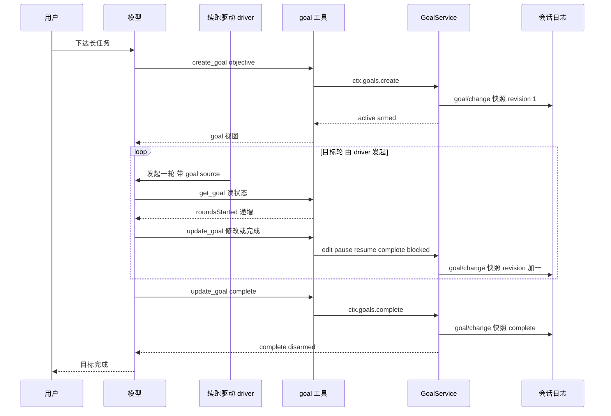
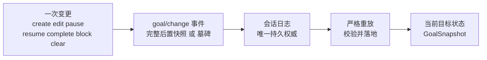
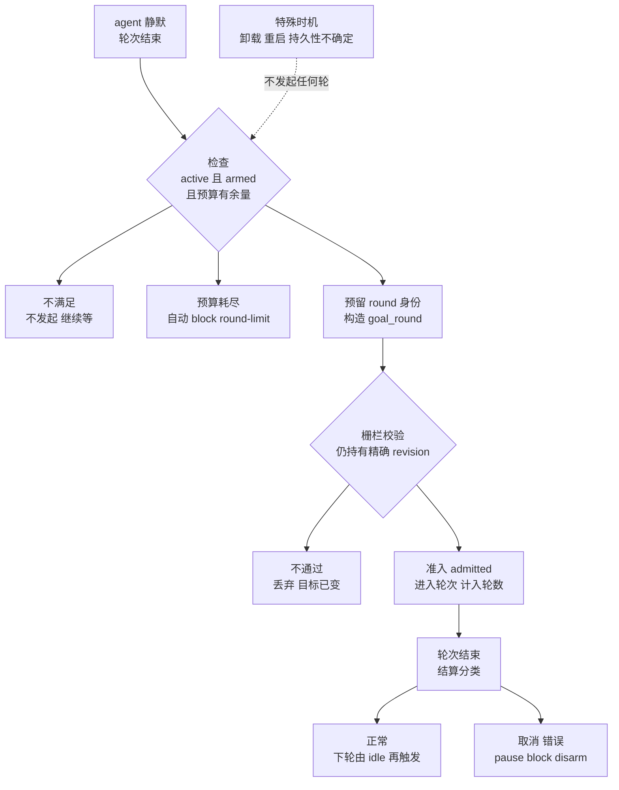
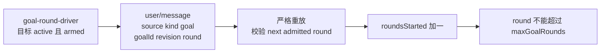
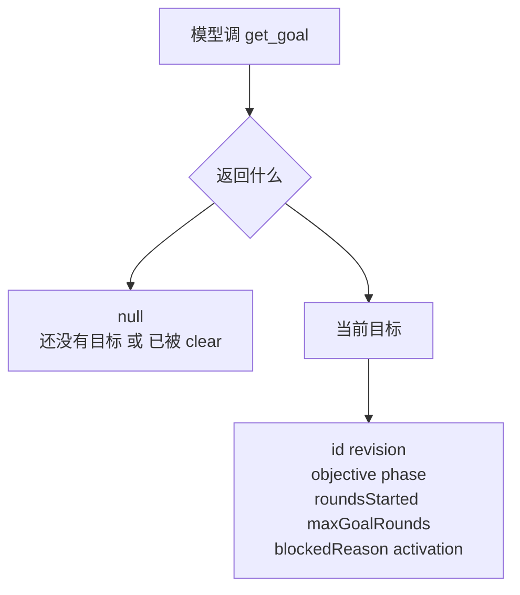
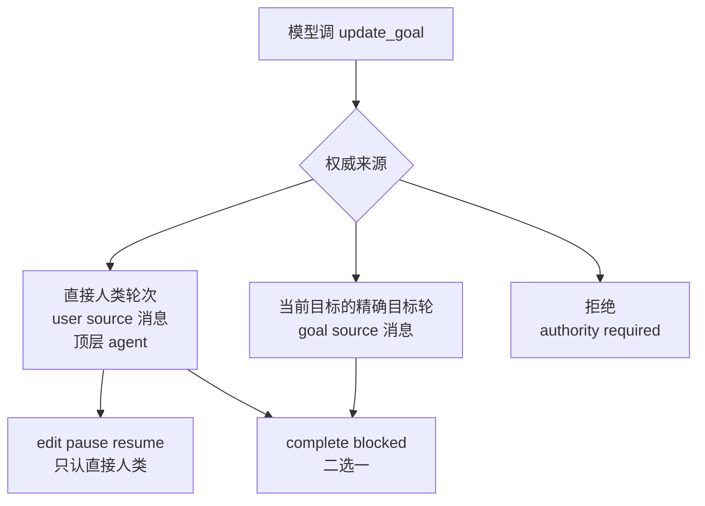
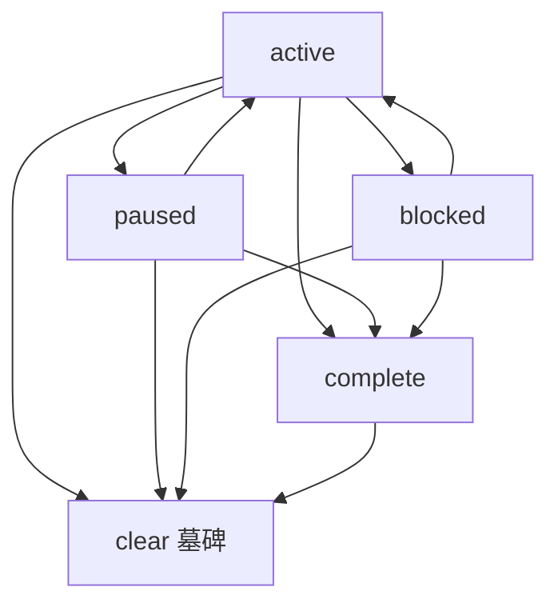

# DeepSeek Harness 从 0 开始：goal 持久目标

> 本系列从 0 开始，基于 Cordis 框架一步步实现一个简略版本的 DeepSeek Harness。这一篇讲 **goal 主题**——dsh `packages/goal/` 下的**持久化的同会话目标**。
>
> **一句话**：**goal 给"长任务"一个持久的目标，并自动推进它**。你把"当前要完成的那件事"交给 goal（`create_goal`），它把目标存进会话日志（重启也丢不了），然后一个叫 **goal-round-driver** 的驱动器在目标激活时**自动一轮接一轮地让模型继续干活**，直到模型报告完成（`complete`）。模型用 `create_goal` / `get_goal` / `update_goal` 三个工具和它打交道。
>
> **阅读路线**：先看**主流程**（一个例子 + 一张时序图，goal 到底怎么工作）→ 然后**跟着时序图一步步看实现**（每个环节背后是什么代码；重启、改需求、预算耗尽这些插曲在 Part 里各自讲到）。
>
> 配套代码：[blog-20-goal](./)，运行 `pnpm install && pnpm dev` 即可复现本文全部输出。

## 主流程：goal 是什么，怎么工作

### 一个例子：写一个博客系列

假设你对模型说："帮我写一个博客系列，从 0 实现 DeepSeek Harness，每篇一个主题。先写第 1 篇。"

没有 goal（也就是没有自动续跑）时，agent 的工作是**一步一停**的：写完第 1 篇，轮次结束，agent 停下来——**你不说"继续"，它就不动**。写 20 篇，你就要说 20 次"继续"（每篇中间可能还要纠正方向）；agent 只是在每次你推它的时候干一点，**无法长时间自我运行一个任务**（业界把这个叫 human-in-the-loop：每个动作都要人驱动）。

goal 要解决的就是这个：**让 agent 能自动持续工作**——你只下达一次，driver 在目标激活时自动发起下一轮，agent 自己接着干，不需要你一次次推它。

有了 goal，事情变成这样——**你只下达一次，后面都是自动的**：

**你下达（人类轮次，不计轮数）**：

> 👤 你：帮我写一个博客系列，从 0 实现 DeepSeek Harness，每篇一个主题。先写第 1 篇。
>
> ```
> 模型调用 ①  create_goal(objective="写博客系列：从 0 实现 DeepSeek Harness，每篇一个主题", max_goal_rounds=20)
>        → { goal: { id: "goal-1", revision: 1, phase: "active", roundsStarted: 0, maxGoalRounds: 20 }, activation: "armed" }
>
> 模型调用 ②  todo_write(todos=[ 博客 1 到 20 的标题列表 ])
>        → Updated todo list: 19 pending, 1 in progress, 0 completed
> ```
>
> 🤖 模型：**轮次结束**——接下来交给 driver。

**Round 1 · driver 自动续跑（不需要你说"继续"）**：

> 轮次结束、模型 idle——**goal-round-driver 检测到目标 active + armed，自动发起下一轮**，给模型发一条续跑消息：
>
> ```
> <goal_round>
> Objective: "写博客系列：从 0 实现 DeepSeek Harness，每篇一个主题"
> Round: 1/20
>
> Continue working toward the objective in this same session. Treat the current workspace,
> tool results, and durable session state as authoritative; inspect them instead of assuming
> earlier narration is still current. Make concrete progress and verify the result. ...
> If work remains, leave the goal active for the next round.
> </goal_round>
> ```
>
> 🤖 模型：看到 Objective + **Round 1/20** → get_goal 确认 → 写第 1 篇 → 轮次结束 → **driver 又自动发起 Round 2/20**……

**Round 20 · 完成**：

> 模型在某一轮：get_goal → 读当前目标 → 确认 20 篇全部完成 → `complete` → disarm → **driver 不再发起**，目标停在 complete。

**这就是主流程**。中间你随时可以说"第 5 篇先写 session"（人类轮次，不影响轮数），或者进程重启了（目标还在，但需要你说"继续"才恢复）——这些插曲在下面 Part 里各自讲到。

### 全景时序图

把上面这个过程画成时序图——六个参与者：你、模型、driver、goal 工具、GoalService、会话日志：



**读图**：你下达 → 模型 `create_goal` → 服务写快照（active armed）→ **driver 在 loop 里反复发起目标轮**（模型 `get_goal` 读、`update_goal` 改，每次变更写新快照、revision +1）→ 模型 `complete` → 写完成快照 → disarm → 结束。

**先弄清四个词**（dsh goal-round-driver 的层级，Agent Note 原文："The hierarchy is **Goal → Goal Round → Turn → Step**"）：

| 术语 | 含义 | 在本例里 |
| --- | --- | --- |
| **Goal**（目标） | 你要完成的那件事 | "写博客系列，每篇一个主题" |
| **Goal Round**（目标轮） | driver 每次自动发起的外层续跑迭代——**时序图 loop 里转一圈 = 一个目标轮** | Round 1/20 里的"1" |
| **Turn**（轮次） | 模型会话轮次——**一个目标轮变成一个轮次**（1:1） | 模型写第 1 篇的那个轮次 |
| **Step**（步骤） | 轮次内的模型/工具步骤 | 轮次里调 get_goal、写正文 |

所以时序图里的 **loop 不是"轮次"的循环，是"目标轮"的循环**——driver 一轮轮发起（Goal Round），每一轮进入一个轮次（Turn），轮次里是若干步骤（Step）。

**下面"技术实现"就跟着这张时序图走**——图里每一条消息，背后都有一段代码。

## 技术实现：跟着时序图走一遍

实现结构对应 dsh 的 `packages/goal/`：

```
blog-20-goal/
├── package.json          # 项目配置：依赖、启动脚本
├── pnpm-lock.yaml        # 依赖锁定文件
└── src/
    ├── main.ts           # 演示入口：组装 + 演示
    ├── types.ts          # 纯类型（goal/src/types.ts）
    ├── domain.ts         # 事件词汇与错误码（goal/src/domain.ts）
    ├── session.ts        # Session 事件日志（dsh-session）
    ├── fold.ts           # 严格重放（goal/src/fold.ts）
    ├── goal.ts           # GoalService（goal/src/index.ts）
    ├── driver.ts         # GoalRoundDriver 自动续跑（goal-round-driver/src/index.ts 简化）
    ├── agent.ts          # Agent + AgentFactory（dsh-agent）
    ├── tools.ts          # ToolRegistry（dsh-tools）
    └── tool-goal.ts      # 三个模型工具 + authority（tool-goal/src/index.ts）
```

**诚实标注**：`goal` + `tool-goal` + **`driver.ts`** 是本博客的实现核心；driver 实现了核心（触发检查、`<goal_round>` 消息、goal source 计入轮数、预算耗尽自动 block），**未实现** dsh 完整机制的 agent 静默事件监听、竞态栅栏双重校验、串行化合并、结算分类、卸载时 disarm；`command-goal` 是 CLI 命令略过。

### Part 1：create_goal 创建目标对象

**什么时候调用 create_goal**：你下达长任务、且这任务要续跑多轮时（直接人类轮次）——dsh 工具描述："when the current **direct human request** is a **long-running objective** that should continue across autonomous goal rounds"；模型从请求推断意图，**琐碎的单轮工作不调用**（"Do not use this for trivial single-turn work"）。

它返回的那个 `{ goal: {…}, activation }` 到底是什么？——这就是"目标"的全部，由 `types.ts` 定义：

```ts
/** 目标 id（dsh: GoalId）——`goal-N` */
export type GoalId = string & { readonly __brand: 'GoalId' }

/** Compare-and-set 身份：一次精确修订（dsh: GoalRef） */
export interface GoalRef {
  readonly id: GoalId
  readonly revision: number   // 正修订号；每次持久变更 +1
}

/** 持久生命周期阶段（dsh: GoalPhase）——激活是进程内的，与阶段分离 */
export type GoalPhase = 'active' | 'paused' | 'blocked' | 'complete'

/** 完整持久状态（dsh: GoalSnapshot）——每次非 clear 变更写入 */
export interface GoalSnapshot extends GoalRef {
  readonly objective: string
  readonly phase: GoalPhase
  readonly blockedReason?: GoalBlockReason   // 恰好当 phase 为 blocked 时存在
  readonly maxGoalRounds: number             // 目标轮数总上限
}

/** 当前目标读模型（dsh: GoalView）——含从会话日志算出的计数 */
export interface GoalView extends GoalSnapshot {
  readonly roundsStarted: number   // 本目标已计入的最高目标轮数
  readonly createdAt: number
  readonly updatedAt: number
  readonly activation: GoalActivation   // 进程内 armed/disarmed
}
```

**这个对象其实是三层**——九个字段不是平铺的，按"谁写进日志、谁从日志算出、谁只在进程内"分三组：

**第一层 · 写进日志的持久事实**（每次变更整体写入 `goal/change` 事件）：

| 字段 | 为什么有它 | 记录什么 | 有什么用 |
| --- | --- | --- | --- |
| **id**（`goal-N`） | 工具、driver、日志都要指认"这一个目标" | 目标身份 | 重启后 get_goal 凭它找回；update_goal 带它做 CAS |
| **revision**（每次 +1） | 防并发覆盖——多个轮次交错提交，谁过期谁被拒 | 第几次变更 | CAS 栅栏的基础（见 FAQ）；变更次数审计 |
| **objective**（一句话） | 目标本身——"要完成的是什么" | 你的请求 | **driver 每轮把它喂给模型**（<goal_round> 里的 Objective）；重启后读回 |
| **phase** | 生命周期——目标现在处于哪个状态 | active/paused/blocked/complete | 决定 driver 是否续跑（active 才跑）、工具允许哪些操作（Part 7） |
| **maxGoalRounds** | 防续跑失控 | 你设的预算（20） | driver 的 Round 1/20 里的 20；预算耗尽自动 block（Part 4） |
| **blockedReason**（仅 blocked 时） | "卡住"要有原因，不只是一个状态 | code（机器路由）+ message（人看） | 恢复时知道为什么卡；审计"为什么停" |

**第二层 · 从日志算出来的计数**（重放算出来，不是单独存的）：

| 字段 | 为什么有它 | 记录什么 | 有什么用 |
| --- | --- | --- | --- |
| **roundsStarted** | 已烧了多少轮 | 只算 goal source 的目标轮 | 回答"写到哪了"；预算判断依据（Part 4） |
| **createdAt / updatedAt** | 顺序与审计 | 创建/最后变更时间 | 严格重放校验时间戳不回退（Part 2） |

**第三层 · 进程内、不持久化**：

| 字段 | 为什么有它 | 记录什么 | 有什么用 |
| --- | --- | --- | --- |
| **activation** | 生命周期 ≠ 续跑权 | 什么都不记录——进程内的 armed/disarmed（已启用续行 / 停用续行） | 重启后自动 disarmed，你说"继续"才 resume（Part 7） |

**为什么这样分层**——两个原因：

1. **持久事实进日志、计数从日志算、激活只在进程内**——每层各有消费者：持久事实给重放与审计、计数给预算与进度、激活给"能否自动续跑"；
2. **每个字段都不是摆设**——第一层给重放与工具、第二层给预算、第三层给续跑判断，没有冗余字段。

（"每次变更写整个对象、不是 diff"这个特性属于**写入机制**——Part 2 讲 `goal/change` 事件时展开。）

#### phase 的四个值——目标的状态机

第一层里的 `phase` 是目标的状态机：

| 阶段 | 含义 | 谁进入 |
| --- | --- | --- |
| **active** | 目标在进行中 | create / resume |
| **paused** | 暂停，等人类或条件 | pause |
| **blocked** | 被问题卡住（带原因） | block——**唯一的"被问题停住"的持久阶段** |
| **complete** | 完成 | complete |

为什么 blocked 单独是一个阶段而不是一个标志？dsh 的理由是：provider 限制、预算、执行错误、等人类输入——**所有"卡住"的情况统一成一个 durable 阶段**，带 `{ code, message }`（code 机器可路由、message 人可读），**避免为每种卡法发明一个新状态**。这四个值**怎么互相转换**（哪些阶段能进哪些、转换时附带什么），Part 7 讲。

### Part 2：create_goal 之后，目标写进了日志

**什么时候发生**：每次目标变更（create / edit / pause / resume / complete / block / clear）时，自动写一条 `goal/change` 事件进会话日志。时序图的下一步 `S->>L: goal/change 快照 revision 1` 就是 create 那一次——**这是"目标不丢"的全部秘密**：



**goal/change 事件长什么样**——它就是一条**会话事件**（dsh 在 `SessionEventMap` 里注册的 `'goal/change'`）。非 clear 的变更，负载是**完整快照**：

```
{ kind: 'goal/change', version: 1, operation: 'create' | 'edit' | 'pause' | 'resume' | 'complete' | 'block',
  goal: { …完整目标… }, roundsStarted, createdAt, updatedAt }
```

clear 则是**墓碑**（没有快照，只有一个 ref）：

```
{ kind: 'goal/change', version: 1, operation: 'clear', cleared: { id, revision }, clearedAt }
```

**每次变更都是完整后置状态，没有 diff**——这正是"重放 last-wins 无歧义"的原因。

**为什么不单独存一份，而是放进会话日志？** 这个项目里目标状态只有两个去处：**会话日志**，或**另开一份存储**（不管叫数据库还是内存表）。dsh 的决策记录说得很直白：会话日志**已经**提供顺序、持久化、分叉前缀、可重建性——再加一份独立存储，只会引入"两份状态怎么保持一致"的原子性问题、以及"这份存储和会话是什么关系"的谱系问题（dsh Alternatives: "a second store introduces atomicity and lineage questions"）。所以目标记录作为**普通会话数据**放进日志——持久化、恢复、分叉**天然继承**，这正是"重启后 get_goal 还在"的原因。

重放不是"照着读"那么简单，它是**严格**的——五类校验，任一不合格就 fail loud（宁可挂起，不给错状态）：

```ts
/** 应用一个会话事件到严格重放（dsh: applyGoalEvent） */
export function applyGoalEvent(state: GoalFoldState, event: SessionEvent): void {
  if (event.type === 'goal/change') {
    const change = decodeGoalChange(event.data)   // ① 畸形形状拒绝
    if (change === undefined) throw new Error(`goal change at session event ${event.seq} has an invalid kind`)
    applyGoalChange(state, change)                 // ②③④ 校验 + 落地
    return
  }
  if (event.type === 'user/message') {
    const source = goalSource(event.data.source)
    if (source === undefined) return
    const current = state.goal
    if (current === undefined || current.phase !== 'active' || source.goalId !== current.id
      || source.revision !== current.revision || source.round !== state.roundsStarted + 1
      || source.round > current.maxGoalRounds) {   // ⑤ 非顺序轮数拒绝
      throw new Error(`goal round at session event ${event.seq} is not the next admitted round of the active goal`)
    }
    state.roundsStarted = source.round
  }
}
```

注意到 `user/message` 分支了吗——**轮数在这里计入**（后面 Part 4 会用到）。状态只从日志算出来：不依赖内存缓存、不依赖 inbox、不依赖 UI——任何消费者都从同一份日志读到同一个权威值。畸形、篡改、部分写入的记录被拒绝而不是被悄悄修复（dsh: "A malformed current-format record fails replay rather than being ignored or repaired"）。

运行输出（完整输出 Part 9）——一条伪造的残缺事件被重放拒之门外：

```
  ✅ 重放拒绝畸形 goal/change → goal snapshot change must have exactly createdAt,goal,kind,operation,roundsStarted,updatedAt,version fields
```

### Part 3：driver 自动发起目标轮

**什么时候触发**：轮次结束、agent idle 且目标 active + armed 时——时序图从这里进入 `loop`，driver 自动发起下一轮。**谁发起的？** 答案是 goal-round-driver。

**driver 是什么**：没有 driver，goal 只是个**状态容器**——目标记下了，但"谁让模型继续"没有答案，你每篇都得说"继续"（dsh 原话："the goal domain can retain an objective and the model-facing tools can mutate its lifecycle, but **neither should decide when another model turn begins**"）。driver 把目标状态接回模型循环——**goal 从"记录工具"变成"自动引擎"**。

#### 触发时刻：轮次结束、agent 变 idle

先弄清两个词：

- **idle 是 agent（执行者）的状态**，不是 goal 的状态——goal 只有 active / paused / blocked / complete（Part 1）；agent 的状态是 running / **idle**（和 blog-15 schedule 的 set-idle 同一概念，定义在 dsh-agent 包，driver 只是消费它）。一个轮次结束（模型给出最终回复、没有待处理步骤）→ agent 变 idle；有新输入（你的消息，或 driver 发起的下一轮）→ 又变 running；
- **driver 挂在两个触发节点上**（源码 `ctx.on(...)`）：① `agent/status`——**轮次结束那一刻 agent 变 idle，driver 被唤醒**（`if (status === 'idle') { … requestDrive(state) }`）；② `goal/changed`——目标被改/暂停/完成，重新检查要不要续跑。

**为什么 driver 盯着 idle**：只有 agent **闲着、且 inbox 里没有竞争的工作**（没有你新发的消息排队）时才该发起下一轮——否则会和你的人类轮次打架（dsh: "no competing queued work"）。主流程里"轮次结束、模型 idle——driver 检测到目标 active + armed"说的就是这个时刻。

#### 一轮目标轮的生命：六个环节

触发之后，一轮目标轮有六个环节（都有 dsh 源码对应）——一条必经链 + 四个分叉 + 一个特殊时机：



**必经链（1-5）**：

1. **触发（drive）**——检查三件事：目标 `active`、`armed`、轮数有余量——任一不满足就不发起（分叉：等待）；
2. **预留（reservation）**——`round = roundsStarted + 1`，构造 `<goal_round>` 消息（Objective + Round），排进 inbox。**注意：这还不是轮数**——轮数只在"被接受"时计入；
3. **栅栏（validReservation）**——消息进轮次前，`agent/pre-step` 钩子校验：**预留仍持有精确的 live revision**（目标被 edit/替换/清除后旧预留作废——"Fail closed unless the queued prompt still owns the exact live revision"）；**决策后还会再校验一次**（"prevents an async listener from editing or pausing the goal while still entering the old prompt"）——不通过就丢弃（分叉：目标已变）；
4. **准入（admitted，计入轮数）**——消息成为带 goal source 的 `user/message` 进入轮次，严格重放校验"next admitted round"后 `roundsStarted` + 1——**只有这一步消耗预算**；
5. **结算（settlement）**——轮次关闭后按结果分类（下表）。

**两个分叉与特殊时机（6）**：

- **预算耗尽**（环节 1 的分叉）——自动 `block(code: 'round-limit')`，从不自动重试；
- **结算异常**（环节 5 的分叉）——取消/错误 → pause / block / disarm（下表）；
- **特殊时机 disarm**（虚线）——driver 加载时对已有 agents 全部 disarm、卸载前、持久性不确定时、max-tokens、取消——**移除续跑权，保留 durable 阶段**；它不在每轮里，而是"让以后所有轮都不再发起"。

轮次关闭后 driver 怎么处理结果（结算分类）：

| 轮次结果 | driver 的动作 |
| --- | --- |
| durable completed（正常结束） | 继续（active/armed/预算内） |
| 取消 / aborted | **pause + disarm** |
| error（RATE_LIMIT / QUOTA） | **block（code: usage-limited）** |
| 其他 error | **block（code: turn-error）** |
| max-tokens | **disarm** |
| 持久性检查失败 | **disarm**（不改 durable 阶段） |
| 未知结果 | **block 待检查** |

#### 为什么需要竞态栅栏

naive 的实现是"目标一变就续跑"（`goal/changed → followup`）——dsh 明确指出它在七个场景出错：人类输入、取消、目标编辑、持久化失败、会话重启、插件卸载、下游策略拒绝，都可能竞态一个待处理的续跑；后果是 **admit 过时工作、和人类 prompt 并行跑、超预算、无新权威地从重放重启**。环节 3 的"预留 + 双重校验"就是为了：**旧的一轮永远不能带着旧认知跑进新世界**。

#### 本博客的实现

`driver.ts`——核心三步：检查 → 预算自动 block → 返回 `<goal_round>` 消息：

```ts
/** 每轮发给模型的续跑消息（dsh: renderGoalRoundPrompt 简化） */
export function renderGoalRoundPrompt(goal: GoalView, round: number): string {
  return '<goal_round>\n'
    + `Objective: ${JSON.stringify(goal.objective)}\n`
    + `Round: ${round}/${goal.maxGoalRounds}\n\n`
    + 'Continue working toward the objective in this same session. Treat the current workspace, '
    + 'tool results, and durable session state as authoritative; inspect them instead of assuming '
    + 'earlier narration is still current. Make concrete progress and verify the result. '
    + 'If work remains, leave the goal active for the next round.\n'
    + '</goal_round>'
}

export class GoalRoundDriver {
  private ctx: Context
  constructor(ctx: Context) { this.ctx = ctx }

  /** agent 静默后调用：检查目标并决定是否发起下一轮（dsh: drive() 的核心） */
  schedule(agent: Agent): { round: number; prompt: string } | undefined {
    const goal = this.ctx.goals.get(agent)
    if (goal === undefined) return undefined
    if (goal.phase !== 'active' || goal.activation !== 'armed') return undefined
    if (goal.roundsStarted >= goal.maxGoalRounds) {
      // 预算耗尽 → 自动阻塞（dsh: block with code round-limit），从不自动重试
      this.ctx.goals.block(agent, { id: goal.id, revision: goal.revision }, {
        code: 'round-limit',
        message: `Goal reached its configured limit of ${goal.maxGoalRounds} rounds.`,
      })
      return undefined
    }
    const round = goal.roundsStarted + 1
    return { round, prompt: renderGoalRoundPrompt(goal, round) }
  }
}
```

**demo 里对应**：`driver.schedule(main)` 在**每个轮次结束之后、下一个轮次开始之前**被调用——模拟的就是 dsh 的"`agent/status` 变 idle → requestDrive"这一触发节点（demo 没有事件监听，是手动调 schedule）。完整案例（运行输出 Part 0）由它自动驱动：create 之后每一轮都是 schedule 发起，模型写完一篇轮次结束，driver 再 schedule 下一轮，直到 complete 后 schedule 返回 undefined 停止：

```
（driver 自动发起 Round 1）模型工作：写第 1 篇（主题：loop）
（driver 自动发起 Round 2）模型工作：写第 2 篇（主题：session）
（driver 自动发起 Round 3）模型工作：写第 3 篇（主题：tool）
  （写完全部 3 篇，模型认为目标已达成）
  update_goal complete → {... "phase":"complete", ..., "activation":"disarmed", ...}
目标已 complete → driver 不再发起（schedule 返回 undefined）
```

### Part 4：maxGoalRounds 限定目标轮数

**什么时候起作用**：driver 每次发起目标轮之前——检查 `roundsStarted >= maxGoalRounds`，超了就自动 block（round-limit）。目标轮里模型看到的 `<goal_round>` **Round 1/20** 里的 20 就是 `maxGoalRounds`。它管的是：**自动续跑不能无限烧轮数**。

但这里有个容易忽略的细节：**只有带 goal source 的目标轮才计入 `roundsStarted`**。dsh 明确否掉了"每个会话轮次都算进度"的做法——"one session can contain human clarification, inspection, and unrelated work"。你中途插话、检查、闲聊，都是普通人类轮次，**一分钱预算都不占**：



**goal source 到底是什么**——先把这个概念说清楚：会话里的每条 `user/message` 都带一个 **source（来源标记）**。你说话的消息，source 是 `{ kind: 'user' }`；driver 发起的目标轮消息，source 是 `{ kind: 'goal', goalId, revision, round }`——**goalId 指这是哪个目标的轮、revision 是哪个修订下的轮、round 是第几轮**。重放靠 source 区分"这条消息是谁说的"：**只有 goal source 的消息算一轮**，你的消息永远不算。所以"人类轮次不计轮数"不是靠猜的——**source 是消息自带的身份**，也是 Part 6 权威校验的依据。

实现就在 Part 2 那段 `applyGoalEvent` 里：`user/message` 的 source 是 `{ kind: 'user' }` 时，`goalSource()` 直接返回 undefined、不计入；只有 `{ kind: 'goal', goalId, revision, round }` 且 round 恰好是 `roundsStarted + 1` 才计入——**非顺序的轮数会被重放拒绝**。

运行输出（完整输出 Part 4）——轮数递增，预算耗尽后连 resume 都被拒：

```
  create_goal → {"goal":{"id":"goal-5",...,"roundsStarted":0,"maxGoalRounds":2,...}}
（目标轮 1）...
  轮 1 后 get_goal → {...,"roundsStarted":1,"maxGoalRounds":2,...}
（目标轮 2）...
  轮 2 后 get_goal → {...,"roundsStarted":2,"maxGoalRounds":2,...}
  ❌ 预算耗尽后 resume → goal "goal-5" exhausted 2 goal rounds; increase maxGoalRounds before resuming
  edit 提高预算到 5 → {...,"revision":3,...,"roundsStarted":2,"maxGoalRounds":5,...}
```

一个诚实的边界：预算**只计轮数**（dsh: "Round-count budget only — maxGoalRounds does not meter tokens, currency, wall time, or provider quotas"）——它是续跑次数的闸门，不是费用闸门；token、费用、墙钟的限制由策略层映射成 blocked reason。

### Part 5：get_goal 读取目标

**什么时候调用 get_goal**：每个目标轮开头（确认目标还在、看当前状态），以及**每次 update_goal 之前必读**（抄精确 id/revision——源码："Call this before updating a goal"）。**这个环节解决什么问题**：目标状态**不在模型上下文里**（Part 1 讲过：模型靠 `get_goal` 读，行为才可重建）——那模型怎么知道"当前目标是什么、写到哪了"？答案是 `get_goal`：goal 的**唯一读取通道**。

时序图的 loop 里，每一轮模型的第一件事就是 `get_goal`——确认目标还在、看当前状态：



**get_goal 是什么**：`get_goal()`——无参数、纯读取（不改变任何状态）。返回当前目标或 `null`：

```
{ id, revision, objective, phase, roundsStarted, maxGoalRounds, blockedReason?, activation }
```

**什么时候读**（源码："Call this before updating a goal"）：

1. **每个目标轮开头**——确认目标还在、看当前状态（driver 发的 `<goal_round>` 消息里只有 objective 和轮数，完整状态要 get_goal 拿）；
2. **每次 update_goal 之前必读**——抄下**精确的 id 和 revision**（为什么必须精确，见 FAQ 的 CAS 条目：带错 revision 会被拒）。

运行输出（完整输出 Part 0）——driver 每轮发起后，模型先 get_goal：

```
（driver 自动发起 Round 1）模型工作：写第 1 篇（主题：loop）
  get_goal → {"goal":{"id":"goal-1","revision":1,...,"roundsStarted":1,"maxGoalRounds":3,...}}
```

### Part 6：update_goal 变更目标

**什么时候调用 update_goal**：要改需求（edit）、要暂停（pause）、要恢复（resume）、模型判断完成（complete）、被卡住（blocked）时——它是**变更的唯一入口**。**这个环节解决什么问题**：目标不是一成不变的，但更关键的问题是：**谁有权改**——提示词无法认证"谁授权了变更"（dsh: "a subagent, injected plugin message, stale model turn, or resumed session could all produce the same tool arguments"）。子代理、注入的插件消息、过期的旧轮次、恢复的会话——工具参数一模一样，所以权威必须在**执行时**验证。

**update_goal 是什么**：`update_goal(goal_id, revision, action, objective?, max_goal_rounds?, blocked_reason?)`——带精确 id/revision（CAS），五种 action：

| action | 做什么 | 权威 |
| --- | --- | --- |
| **edit** | 改 objective 或预算 | 需要直接人类轮次 |
| **pause** | 暂停 | 需要直接人类轮次 |
| **resume** | 恢复 | 需要直接人类轮次 |
| **complete** | 完成 | 直接人类 **或** 当前目标的精确目标轮 |
| **blocked** | 阻塞（必带 blocked_reason） | 直接人类 **或** 当前目标的精确目标轮 |

字段纪律：objective / max_goal_rounds 只属于 edit；blocked_reason 只属于 blocked（且必填）——传错直接拒绝。

**权威怎么实现**（执行时校验，不是提示词承诺）：



```ts
/** edit/pause/resume 的权威：必须是直接人类轮次 */
function requireDirectHuman(ctx: Context, agent: Agent, window: SessionEvent[]): void {
  if (hasDirectHumanInput(ctx, agent, window)) return
  throw new Error('this goal operation requires a direct human turn on a top-level agent')
}

/** complete/blocked 的权威：直接人类 或 当前目标的精确目标轮 */
function completionAuthority(ctx: Context, agent: Agent, window: SessionEvent[]): GoalToolAuthority {
  if (hasDirectHumanInput(ctx, agent, window)) return { kind: 'direct-human' }
  const goal = ctx.goals.get(agent)
  if (goal !== undefined && isMatchingGoalRound(window, goal)) return { kind: 'goal-round', goal }
  throw new Error('complete and blocked require a direct human turn or the current goal round')
}
```

翻译成人话：

| 场景 | 权威落点 |
| --- | --- |
| 你改需求 → edit | 直接人类轮次（你说了话）——通过 |
| 子代理想改目标 → update_goal | 不是直接人类、不是 root 的目标轮——**被拒** |
| 目标轮里模型报完成 → complete | 目标轮（goal source 精确匹配）——通过，但**只能报终态**，不能 edit |

配套规则：**目标轮里报 blocked 至少要累计 3 轮**（`blockedAfterConsecutiveRounds`，默认 3）——防止模型第一轮遇难就放弃；blocked 的 code 固定 `model-reported`。

运行输出（完整输出 Part 2/5/7）——edit revision+1、pause/resume、blocked 阈值：

```
  update_goal edit → {"goal":{"id":"goal-3","revision":2,"objective":"写迁移文档并附回滚方案","phase":"active",...}}
  ...
  pause → {"goal":{...,"phase":"paused",...},"activation":"disarmed"}
  resume → {"goal":{...,"phase":"active",...},"activation":"armed"}
  ...
  update_goal blocked → {"goal":{"id":"goal-9",...,"phase":"blocked",
    "blockedReason":{"code":"model-reported","message":"审批人在三个轮次中均未回复，无法继续"}},...}
```

### Part 7：complete 结束目标

**什么时候调用 complete**：模型判断目标真正达成时——写完成快照并 disarm（driver 停）。**这个环节解决什么问题**：目标怎么收尾。收尾背后是两个机制：

**阶段机**（Part 1 提过）——每次操作都是一次合法的阶段迁移，非法转换直接被拒：



| 操作 | 允许的当前阶段 | 进入 | 附带 |
| --- | --- | --- | --- |
| create | 无目标 / complete | active revision 1 | arm |
| edit | 任意（非 clear） | 同阶段 revision+1 | 保留激活 |
| pause | active | paused | disarm |
| resume | active（未 armed）/ paused / blocked | active | arm；预算有余量 |
| complete | active / paused / blocked | complete | disarm |
| block | active | blocked + reason | disarm |
| clear | 任意 | 墓碑（revision+1，无快照） | disarm |

**激活分离**——注意表里的"arm / disarm"：complete 会 disarm，意味着"目标完成了，driver 别再跑"。激活（armed/disarmed）是**进程内的，从不持久化**——这解决一个现实问题：重启后目标可以还在（日志重放），但"你一打开会话就静默开工"是吓人的（dsh: "silently starting work when a user opens that session is surprising"）。所以会话重启即 disarm：

```ts
constructor(ctx: Context, config: { defaultMaxGoalRounds?: number } = {}) {
  ...
  ctx.on('agent/session-start', ({ agent }) => {
    this.cache(agent.session).activation = 'disarmed'   // 会话重启 → disarm
  })
}
```

dsh 原话："Resume and fork expose the same durable phase while remaining **operationally inert** until an explicit resume mutation arms activation"——**恢复/分叉后目标、阶段、修订、轮数都在，但绝不自动开工**；你说"接着写"→ 模型 `update_goal resume` 才重新 arm。**状态"还在"和"能自动续跑"从此是两个事实**。

运行输出（完整输出 Part 5）——pause 后续跑被拒、resume 后恢复：

```
  pause → {"goal":{...,"phase":"paused",...},"activation":"disarmed"}
  ✅ paused 后 goalRound 被拒 → no armed active goal for g5
  resume → {"goal":{...,"phase":"active",...},"activation":"armed"}
```

## 完整运行输出

以上所有片段都来自同一次真实运行（`pnpm dev`，省略 pnpm 启动横幅）：

```
============================================================
博客20：goal 主题 - 持久化的同会话目标
============================================================

============================================================
Part 0: 完整案例——用户请求 → driver 自动续跑 → complete
============================================================

👤 用户（直接人类轮次）: "帮我写一个博客系列…"
🤖 模型: 这是长目标，创建 goal
  create_goal → {"goal":{"id":"goal-1","revision":1,"objective":"写博客系列：从 0 实现 DeepSeek Harness，每篇一个主题","phase":"active","roundsStarted":0,"maxGoalRounds":3},"activation":"armed"}

（driver 自动发起 Round 1）模型工作：写第 1 篇（主题：loop）
  get_goal → {"goal":{"id":"goal-1","revision":1,"objective":"写博客系列：从 0 实现 DeepSeek Harness，每篇一个主题","phase":"active","roundsStarted":1,"maxGoalRounds":3},"activation":"armed"}

（driver 自动发起 Round 2）模型工作：写第 2 篇（主题：session）
  get_goal → {"goal":{"id":"goal-1","revision":1,"objective":"写博客系列：从 0 实现 DeepSeek Harness，每篇一个主题","phase":"active","roundsStarted":2,"maxGoalRounds":3},"activation":"armed"}

（driver 自动发起 Round 3）模型工作：写第 3 篇（主题：tool）
  get_goal → {"goal":{"id":"goal-1","revision":1,"objective":"写博客系列：从 0 实现 DeepSeek Harness，每篇一个主题","phase":"active","roundsStarted":3,"maxGoalRounds":3},"activation":"armed"}
  （写完全部 3 篇，模型认为目标已达成）
  update_goal complete → {"goal":{"id":"goal-1","revision":2,"objective":"写博客系列：从 0 实现 DeepSeek Harness，每篇一个主题","phase":"complete","roundsStarted":3,"maxGoalRounds":3},"activation":"disarmed","wrapup":"目标已完成：写博客系列：从 0 实现 DeepSeek Harness，每篇一个主题"}

目标已 complete → driver 不再发起（schedule 返回 undefined）

============================================================
Part 1: create 与 get_goal——状态与激活
============================================================
  create_goal → {"goal":{"id":"goal-2","revision":1,"objective":"重构配置系统","phase":"active","roundsStarted":0,"maxGoalRounds":256},"activation":"armed"}
  get_goal  → {"goal":{"id":"goal-2","revision":1,"objective":"重构配置系统","phase":"active","roundsStarted":0,"maxGoalRounds":256},"activation":"armed"}

============================================================
Part 2: edit——改 objective 或 max_goal_rounds（revision +1）
============================================================
  create_goal → {"goal":{"id":"goal-3","revision":1,"objective":"写迁移文档","phase":"active","roundsStarted":0,"maxGoalRounds":2},"activation":"armed"}
  update_goal edit → {"goal":{"id":"goal-3","revision":2,"objective":"写迁移文档并附回滚方案","phase":"active","roundsStarted":0,"maxGoalRounds":2},"activation":"armed"}

============================================================
Part 3: CAS 栅栏——过期 revision 拒绝，精确 revision 通过
============================================================
  create_goal → {"goal":{"id":"goal-4","revision":1,"objective":"补目录索引","phase":"active","roundsStarted":0,"maxGoalRounds":256},"activation":"armed"}
  edit（revision 1 → 2）→ {"goal":{"id":"goal-4","revision":2,"objective":"补目录索引并校对","phase":"active","roundsStarted":0,"maxGoalRounds":256},"activation":"armed"}
  ❌ 再用过期的 revision 1 edit → stale goal ref "goal-4" revision 1; current is "goal-4" revision 2
  用精确 revision 2 edit → {"goal":{"id":"goal-4","revision":3,"objective":"补目录索引并校对完成","phase":"active","roundsStarted":0,"maxGoalRounds":256},"activation":"armed"}

============================================================
Part 4: 轮数——目标轮计入 roundsStarted，预算耗尽 resume 被拒
============================================================
  create_goal → {"goal":{"id":"goal-5","revision":1,"objective":"迁移测试套件到 vitest","phase":"active","roundsStarted":0,"maxGoalRounds":2},"activation":"armed"}
（目标轮 1）模型迁移第一批测试
  轮 1 后 get_goal → {"goal":{"id":"goal-5","revision":1,"objective":"迁移测试套件到 vitest","phase":"active","roundsStarted":1,"maxGoalRounds":2},"activation":"armed"}
（目标轮 2）模型迁移第二批测试
  轮 2 后 get_goal → {"goal":{"id":"goal-5","revision":1,"objective":"迁移测试套件到 vitest","phase":"active","roundsStarted":2,"maxGoalRounds":2},"activation":"armed"}
  ❌ 预算耗尽后 resume → goal "goal-5" exhausted 2 goal rounds; increase maxGoalRounds before resuming
  edit 提高预算到 5 → {"goal":{"id":"goal-5","revision":3,"objective":"迁移测试套件到 vitest","phase":"paused","roundsStarted":2,"maxGoalRounds":5},"activation":"disarmed"}

============================================================
Part 5: pause 与 resume——暂停与恢复（激活变化）
============================================================
  create_goal → {"goal":{"id":"goal-6","revision":1,"objective":"整理仓库 README","phase":"active","roundsStarted":0,"maxGoalRounds":256},"activation":"armed"}
  pause → {"goal":{"id":"goal-6","revision":2,"objective":"整理仓库 README","phase":"paused","roundsStarted":0,"maxGoalRounds":256},"activation":"disarmed"}
  ✅ paused 后 goalRound 被拒 → no armed active goal for g5
  resume → {"goal":{"id":"goal-6","revision":3,"objective":"整理仓库 README","phase":"active","roundsStarted":0,"maxGoalRounds":256},"activation":"armed"}

============================================================
Part 6: complete 后可替换——完成的目标让位给新目标
============================================================
  create_goal → {"goal":{"id":"goal-7","revision":1,"objective":"升级 CI 到 GitHub Actions","phase":"active","roundsStarted":0,"maxGoalRounds":256},"activation":"armed"}
  complete → {"goal":{"id":"goal-7","revision":2,"objective":"升级 CI 到 GitHub Actions","phase":"complete","roundsStarted":0,"maxGoalRounds":256},"activation":"disarmed"}
  complete 后 create 新目标 → {"goal":{"id":"goal-8","revision":1,"objective":"写 CI 迁移文档","phase":"active","roundsStarted":0,"maxGoalRounds":256},"activation":"armed"}

============================================================
Part 7: blocked——带 blocked_reason 的阻塞（阈值 + 恢复）
============================================================
  create_goal → {"goal":{"id":"goal-9","revision":1,"objective":"上线反馈分类器","phase":"active","roundsStarted":0,"maxGoalRounds":6},"activation":"armed"}
（目标轮 1）模型工作：准备上线，但缺少审批人回复
（目标轮 2）模型工作：准备上线，但缺少审批人回复
（目标轮 3）模型工作：准备上线，但缺少审批人回复
（目标轮 4）模型尝试报 blocked
  update_goal blocked → {"goal":{"id":"goal-9","revision":2,"objective":"上线反馈分类器","phase":"blocked","roundsStarted":4,"maxGoalRounds":6,"blockedReason":{"code":"model-reported","message":"审批人在三个轮次中均未回复，无法继续"}},"activation":"disarmed","wrapup":"目标已阻塞：上线反馈分类器 —— 审批人在三个轮次中均未回复，无法继续"}
  审批通过后 resume → {"goal":{"id":"goal-9","revision":3,"objective":"上线反馈分类器","phase":"active","roundsStarted":4,"maxGoalRounds":6},"activation":"armed"}

============================================================
Part 8: clear 墓碑 + 重放——历史仍在，当前目标置空
============================================================
  create_goal → {"goal":{"id":"goal-10","revision":1,"objective":"清理旧的 npm 脚本","phase":"active","roundsStarted":0,"maxGoalRounds":256},"activation":"armed"}
  clear → {"id":"goal-10","revision":3}
  clear 后 get_goal → {"goal":null}

📜 重放会话日志（goal/change 事件）:
    #2 goal/change create revision 1
    #3 goal/change edit revision 2
    #4 goal/change clear
  foldGoal 重放结果 → {"goal":null,"roundsStarted":0,"lastRef":{"id":"goal-10","revision":3}}

============================================================
Part 9: 重放严格性——畸形与非法事件 fail loud
============================================================
  create_goal → {"goal":{"id":"goal-11","revision":1,"objective":"零配置开发服务器","phase":"active","roundsStarted":0,"maxGoalRounds":256},"activation":"armed"}
  ❌ paused 状态 blocked → cannot block goal "goal-11" from phase "paused"; expected active
  ✅ 重放拒绝畸形 goal/change → goal snapshot change must have exactly createdAt,goal,kind,operation,roundsStarted,updatedAt,version fields

============================================================
Part 10: 与 dsh 的对应
============================================================

📝 与 dsh 源码对应：
  1. GoalService - 事件溯源目标服务（packages/goal/goal/src/index.ts）
  2. GoalPhase - active/paused/blocked/complete（goal/src/types.ts）
  3. goal/change 事件 - 完整快照或墓碑（goal/src/domain.ts）
  4. 严格重放 - 拒绝畸形/不连续/非法转换（goal/src/fold.ts）
  5. CAS 修订栅栏 - GoalRef id/revision（goal/src/types.ts）
  6. get_goal/create_goal/update_goal - 模型工具（tool-goal/src/index.ts）
  7. activation - 进程内 armed/disarmed，从不持久化（goal/src/index.ts）
  8. roundsStarted - 只由 goal source 的 user/message 计入（goal/src/fold.ts）

✅ 博客20 完成！
```

## 常见问题 FAQ

**Q: goal 和 todo（blog-18）什么区别？**

A: **完全不同的两件事**。todo 是**多任务列表**（该做哪几件事，整表替换、off the model surface）；goal 是**单一完成目标**（当前要完成的那一件事）。todo 没有生命周期/修订/轮数——goal 有阶段机、CAS 修订、续跑预算、激活分离。配合场景：goal 定"完成什么"（写博客系列），todo 列"分几步做"（20 篇的标题和顺序）——主流程里的 ① + ② 就是这个组合。

**Q: goal 会随压缩丢失吗？**

A: **不会——这恰恰是它和 todo 的关键区别之一**。dsh 的 Consequences 明确写：goal 历史"活过持久化、恢复、无关节点压缩、会话分叉"（"Goal history survives persistence, resume, compaction of unrelated nodes, and session fork as ordinary session data"）——作为**普通会话数据**随日志走。原因：① goal 是**单一对象 + 完整快照**（每次变更都是完整后置状态，体量小、last-wins 无歧义）；② `goal/change` 事件是会话数据的一部分，压缩处理的是"无关节点"；③ 会话日志是唯一权威，**持久化、恢复、分叉天然继承目标记录**。诚实边界：没有独立持久后端——它"持久"在同一会话的日志里，会话日志整体被清空则无从恢复。

**Q: 为什么需要 CAS 修订（id/revision）？**

A: 模型可以并发/交错提交——两个轮次都读到 revision 1，一个改成 2，另一个若直接覆盖就丢更新。CAS（compare-and-set）让每个提交者带**精确 revision**，过期即拒绝（`GOAL_STALE_REVISION`："stale goal ref"），**第二个提交者必须重读**。实现就是 `expectCurrent`：当前 revision 与提交的 ref 不一致就抛错。运行输出（完整输出 Part 3）：

```
  edit（revision 1 → 2）→ {"goal":{...,"revision":2,"objective":"补目录索引并校对",...}}
  ❌ 再用过期的 revision 1 edit → stale goal ref "goal-4" revision 1; current is "goal-4" revision 2
  用精确 revision 2 edit → {"goal":{...,"revision":3,"objective":"补目录索引并校对完成",...}}
```

工具纪律配合：**update_goal 前必须 get_goal 抄精确 id/revision**——模型的每个动作都基于最新状态，而不是凭记忆。

**Q: 重启后目标还在吗？会自动继续吗？**

A: **状态在，续跑权不在**。目标、阶段、修订、轮数都在会话日志里（durable）；但 activation 被 **disarm**（会话重启即 disarm）。你说"继续"后模型 `update_goal resume` 才重新 arm——**绝不自动开工**。arm 之后 driver 恢复自动续跑。

**Q: 模型能自己创建目标吗？**

A: **不能**。create/edit/pause/resume 都需要**直接人类轮次**（当前轮次有 user source 消息且是顶层 agent）——非人类轮次和子代理被拒绝。这正是 Part 6 里 subagent 被拒的原因：**提示词无法认证授权，必须执行时验证**。模型只能从你的请求**推断**意图后创建，但权威源头必须是你。

**Q: complete 和 blocked 为什么目标轮里也允许？**

A: 因为目标轮里**没有人类在场**——模型必须能自我报告"目标达成了"（complete）或"被同一问题卡了多轮"（blocked）。但权限**窄**：目标轮只能做这两个终态报告，**不能 edit/pause/resume/replace**（不能扩大自己的授权）。blocked 有**阈值**（默认累计 3 轮），防止第一轮遇难就放弃。

**Q: goal 怎么保证目标执行的质量？**

A: **goal 不保证执行质量——它保证的是"状态质量"，不是"结果质量"**。dsh 明确没有独立评估器（"evaluator-backed certification is deferred to a separate policy layer"）——完成/阻塞由记录方说了算，模型说 complete 就是 complete。goal 保证的是：**状态可信**（事件溯源+严格重放）、**一致**（CAS）、**可控**（预算+激活）、**可审计**（goal/change 全量快照历史）。**间接支撑质量的机制**：blocked 阈值（同一条件 ≥3 轮才允许报）、轮数预算（防止无限低效续跑）、激活分离（重启后人类检查点）、CAS 纪律（update 前 get_goal）。**真正的质量验证在 goal 之外**：模型执行者本身、外部验证（人工评审/测试）、以及被推迟到独立策略层的评估器认证。

**Q: 目标轮里怎么算"已完成"？**

A: 由**记录完成的那方**说了算（dsh: "the caller that records completion or blocking is authoritative"）——没有独立的评估器。模型在目标轮里 complete 即完成；这是刻意的简化（评估器认证是另一层策略）。

**Q: goal 和 plan（blog-17）什么关系？**

A: plan 是**协作模式**（提示词引导"先设计再执行"，plan/mode 事件 log-only）；goal 是**持久目标状态 + 自动续跑**。plan 管"当前轮次怎么走"，goal 管"整个任务要完成什么、还能跑几轮、谁有权改它"。

**Q: goal 和 workflow 什么关系？**

A: **正交、可组合**。goal 是"总目标的状态机 + 自动续跑"（跨轮、持久、带预算、带授权）；workflow 是"某一轮次里的执行编排器"（模型写脚本 fan-out 子代理，一次 run，无持久状态）。配合方式：**workflow 跑在 goal 的一轮续跑里**——goal 管"任务往哪走"，workflow 管"这步怎么干"。goal 不依赖 workflow，workflow 也不依赖 goal。

## 小结

1. **goal 是什么**：给"长任务"一个持久的目标 + 自动续跑（goal-round-driver）——目标 active + armed 时，driver 自动一轮接一轮让模型干活，直到完成；
2. **主流程**：你下达（create_goal + todo_write）→ driver 自动续跑（每轮发 `<goal_round>`：Objective + Round）→ 模型 get_goal / update_goal → 完成 complete → disarm；
3. **跟着时序图走一遍**：
   - create_goal 创建（Part 1）：对象三层——写进日志的持久事实 + 从日志算出的计数 + 进程内激活；
   - 事件溯源（Part 2）：goal/change 全量快照入会话日志，严格重放五类校验 fail loud——重启后目标还在；
   - driver（Part 3）：轮次结束自动发起下一轮 + 竞态栅栏（预留必须仍持有精确 live revision）+ 结算分类（异常 → blocked，从不自动重试）；
   - 轮数预算（Part 4）：只由 goal source 计入，预算耗尽自动 block（round-limit）；
   - get_goal 读取（Part 5）：唯一读取通道——目标不在模型上下文，update 前必读抄精确 id/revision；
   - update_goal 变更（Part 6）：唯一变更入口——edit/pause/resume 只认直接人类；complete/blocked 目标轮也允许——子代理改不了目标；
   - complete 收尾（Part 7）：阶段机转换校验 + armed/disarmed 进程内，重启即 disarmed——不静默开工；
4. **诚实边界**：goal 保证状态可信，不保证执行质量（无独立评估器）；预算只计轮数；"长久" = 同一会话内长久（历史活过持久化/恢复/压缩/分叉，但无独立后端）。

下一篇预告：**goal-round-driver 的完整实现**（竞态栅栏与结算分类），或换一个主题（memory / compaction / fs），看系列安排。

---

*本文代码已验证可运行（Node.js + tsx，@cordisjs/core v4.0.0-beta.5）。完整源码见同目录 `src/`（main.ts 演示入口 + 每文件对应 dsh 一个模块），实现结构对应 dsh 的 `packages/goal/`（goal + tool-goal + goal-round-driver）。*
