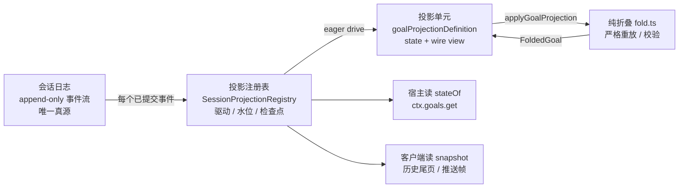
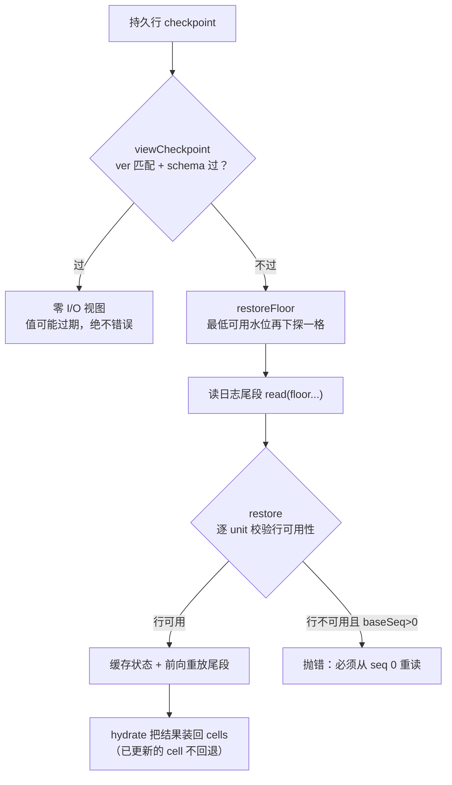
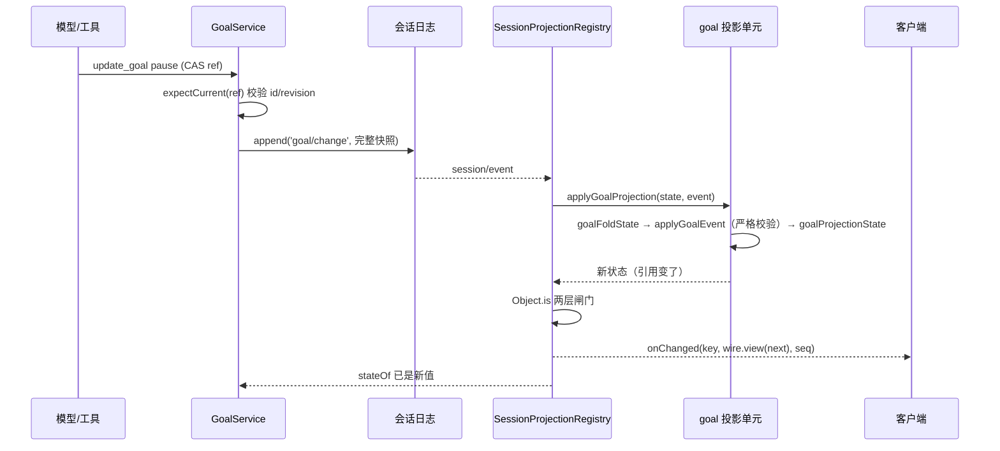
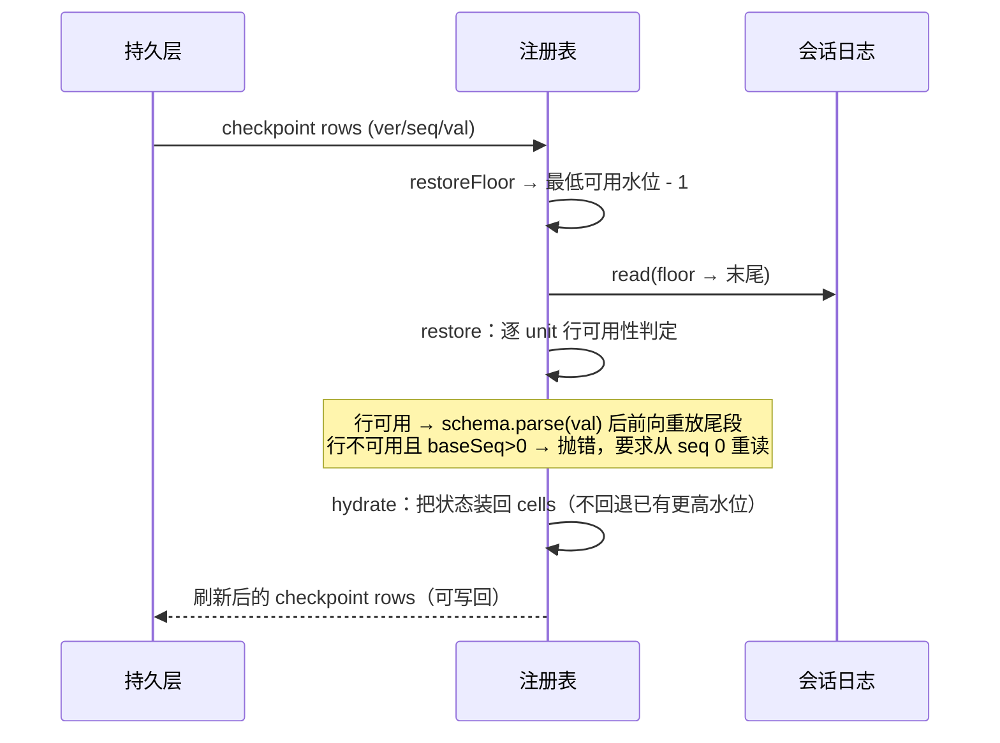

# DeepSeek Harness 从 0 开始：goal 的 derive 引擎

> 本篇是 [blog-20-goal](../blog-20-goal/blog.md) 的**深挖篇**。主篇讲 goal 是什么、driver 怎么自动续跑；这一篇只讲一件事：**goal 的当前状态是怎么被「派生」（derive）出来的**。
>
> **一句话**：goal 从不维护一份可写的「当前状态」对象——**会话日志是唯一真源，当前目标是每次读的时候从日志算出来的**。算它的那套机器我在这里叫 **derive 引擎**：**纯折叠**（`fold.ts`，把事件折算成目标状态）+ **投影单元**（`goalProjectionDefinition`，把折叠状态包成可 checkpoint、可给客户端看的形状）+ **投影注册表**（`SessionProjectionRegistry`，负责驱动、水位、通知与检查点）。
>
> **阅读路线**：先看 derive 引擎是什么、为什么需要（第 0、1 节）→ 顺着数据流走三层实现（第 2～5 节）→ 看 live / cold 两条循环的时序（第 6 节）→ 再对照本仓库的简化实现（第 7 节）→ 最后一页 FAQ 与速查（第 8、9 节）。
>
> **配套代码**：本篇沿用 blog-20-goal 的可运行代码（`cd 04-实现/blog-20-goal && pnpm dev`），并逐段对照 dsh 真实源码（`packages/goal/`、`packages/session/session-projection/`），文末给出出处。

## 0. 先定义：什么是 goal 的 derive 引擎

`goal` 的数据流只有一条主线：



**derive 引擎 = 把「日志里发生过什么」折算成「现在是什么」的那套机器。** 它由三块组成，各管一段：

| 层 | 文件（dsh 真实路径） | 输入 → 输出 | 出错时 |
| --- | --- | --- | --- |
| **纯折叠** | `packages/goal/goal/src/fold.ts` | 事件 → `FoldedGoal`（当前快照 + 轮数 + 时间戳 + 最后 ref） | **fail loud**：直接抛错 |
| **投影单元** | `packages/goal/goal/src/index.ts`（`goalProjectionDefinition`） | 折叠状态 → `GoalProjectionState`（可 checkpoint 的纯 JSON）+ wire 视图 | **fail soft**：把抛错收进 `failure` 字段 |
| **投影注册表** | `packages/session/session-projection/src/index.ts` | 每个已提交事件 → 每个注册单元的新状态 | 不解释语义，只负责驱动与持久化 |

注意这三层是**能力 seam**：注册表是框架，领域（goal）只提供「纯函数 + schema」。注册表不认识 goal，goal 也不认识注册表——它只是在自己的插件启动时 `ctx.sessionProjections.register(goalProjectionDefinition)` 注册一个单元（`goal/src/index.ts:258`）。

配套代码里对应哪几个文件：

```
04-实现/blog-20-goal/src/
├── fold.ts    # 第一层：纯折叠（blog-20 的 289 行版，与 dsh fold.ts 同构）
└── goal.ts    # 第二层简化版：GoalService 自己带 WeakMap 缓存做增量折叠
```

**诚实标注**：blog-20 的简化版**没有做第三层**——它把 derive 内联进了 `GoalService`（每 session 一个 `GoalCache`，`observedSeq` 水位 + `sync()` 增量折叠，见 `src/goal.ts:213`、`:224`）。dsh 真实版把它抽成了通用注册表，让 todo、goal、对话统计等多个领域共用同一套驱动与持久化。第 7 节会逐条对照这两版。

## 1. 为什么 goal 需要一个 derive 引擎

如果按最直觉的做法——**在内存里放一个 `currentGoal` 变量，改的时候顺手写文件**——会遇到四个问题：

1. **重启后状态从哪来？** 内存没了，文件可能只写了一半。
2. **fork / 回放怎么办？** 会话可以 fork 成两条线、可以重放到任意 seq，两份「当前状态」会各说各话。
3. **审计怎么办？** 「这个目标是 paused 还是 blocked」只有结果、没有过程，出了问题查不出来。
4. **一致性怎么办？** 客户端读到的目标、宿主用来做 CAS 判断的目标、模型看到的目标，可能是三个时刻的值。

derive 引擎的答案是把问题拆成**一个写路径 + 一个读路径**：

- **写路径只做一件事**：把「发生了什么」append 成一条不可变事件（`goal/change` 快照或 `clear` 墓碑）。不维护派生值。
- **读路径才是 derive**：从事件序列算出当前值；算法是**纯函数**，所以同一段日志在内存、在 fork、在重启后、在别的进程里，算出来的是同一个值。

这带来三个性质，后面所有设计都是为了守住它们：

| 性质 | 含义 | 靠什么守 |
| --- | --- | --- |
| **权威** | 日志是唯一真源，任何缓存都只是加速 | 折叠只从日志派生；cache 丢了能重算 |
| **一致** | 同一时刻读到的所有派生值反映同一个日志切面 | 同步折叠 + `asOfSeq` 一致切面 |
| **可信** | 算不出合法状态时，**宁可不给状态，也不给错状态** | 严格校验（fail loud） |

## 2. 真源：日志里到底存了什么

goal 只往会话日志写**两种**与自己有关的事实（`goal/src/domain.ts`）：

```ts
/** 全量快照变更（dsh: GoalSnapshotChangeMeta）——每次非 clear 变更携带完整后置状态 */
export interface GoalSnapshotChangeMeta {
  readonly kind: 'goal/change'
  readonly version: 1
  readonly operation: Exclude<GoalOperation, 'clear'>   // create | edit | pause | resume | complete | block
  readonly goal: GoalSnapshot                            // 完整后置状态：id/revision/objective/phase/maxGoalRounds
  readonly roundsStarted: number                         // 当前已准入轮数（不允许被变更推进）
  readonly createdAt: number
  readonly updatedAt: number
}

/** 墓碑（dsh: GoalClearChangeMeta）——clear 后当前目标置空，但身份与历史保留 */
export interface GoalClearChangeMeta {
  readonly kind: 'goal/change'
  readonly version: 1
  readonly operation: 'clear'
  readonly cleared: GoalRef          // { id, revision: 当前+1 }——墓碑也是一个修订
  readonly clearedAt: number
}
```

第二个真源是**被准入的目标轮消息**：driver 发起的续跑消息是一条 `user/message`，带一个 `goal` 来源标记：

```ts
export interface GoalMessageSource {
  readonly kind: 'goal'
  readonly goalId: GoalId
  readonly revision: number   // 这是哪个修订下的轮
  readonly round: number      // 第几轮（正数）
}
```

两条事实、两种角色，这是理解整个 derive 引擎的钥匙：

| 日志事实 | 派生什么 | 谁写 |
| --- | --- | --- |
| `goal/change`（快照 / 墓碑） | **生命周期**：当前目标、phase、revision、时间戳 | `GoalService` 的变更动词（create/edit/pause/…） |
| `user/message` with `source.kind === 'goal'` | **轮数**：`roundsStarted` | driver 发起的一轮（准入后） |

**关键设计：每次变更写的是完整后置状态，不是 diff。** 快照里带着 `id + revision + objective + phase + maxGoalRounds` 全套——重放因此是「last-write-wins」，不需要按顺序 replay 一堆增量操作，也不存在「补一条丢了的 diff」这种问题。代价是日志更大、写入时要读一次当前值（CAS 语义本来就要求读），换来的是重放无歧义。

## 3. 第一级 derive：纯折叠（`fold.ts`）

第一层的职责：**一条事件进来，校验它合法，然后把状态往前推一格**。它的可变累加器是 `GoalFoldState`（`fold.ts:27`）：

```ts
/** 可变累加器（纯重放内部使用） */
export interface GoalFoldState {
  goal: GoalSnapshot | undefined   // 当前目标；clear 后为 undefined
  roundsStarted: number            // 已准入轮数
  createdAt: number | undefined
  updatedAt: number | undefined
  lastRef: GoalRef | undefined     // 最后一次变更身份（含墓碑）
  seenGoalIds: Set<string>         // 本 session 出现过的所有 goal id
}
```

入口只有两个，读路径是 `foldGoal`，增量路径是 `applyGoalEvent`：

```ts
/** 从连续会话事件流折叠出当前目标状态（dsh: foldGoal） */
export function foldGoal(events: readonly SessionEvent[]): FoldedGoal {
  const state = emptyGoalFoldState()
  for (const event of events) applyGoalEvent(state, event)
  return { /* 快照出 goal / roundsStarted / createdAt / updatedAt / lastRef */ }
}
```

`applyGoalEvent`（`fold.ts:313`）只认两类事件，其余一律无视——注意这一点很重要：注册表会把**每一个**已提交事件送进来，折叠必须对无关事件是零成本的：

```ts
export function applyGoalEvent(state: GoalFoldState, event: SessionEvent): void {
  if (event.type === 'goal/change') {
    const change = decodeGoalChange(event.data)       // 畸形则抛
    if (change === undefined) throw new Error(/* 声明了自己是 goal change，却不是合法形状 */)
    applyGoalChange(state, change)
    return
  }
  if (event.type === 'user/message') {
    const source = goalSource(event.data.source)      // 非 goal 来源 → undefined
    if (source === undefined) return                  // 人类消息不计轮
    if (/* 不是当前 active 目标的「下一轮」，或超出上限 */) throw new Error(/* not the next admitted round */)
    state.roundsStarted = source.round
  }
}
```

### 5 类严格校验——「fail loud」的具体内容

`applyGoalChange` + `validateSnapshotTransition`（`fold.ts:271`、`:200`）把「随便写一条快照也能被接受」的漏洞全部堵上：

| # | 校验 | 规则 |
| --- | --- | --- |
| 1 | **形状** | 快照字段集合必须**恰好**匹配 phase（`blocked` 时多 `blockedReason`）；`blockedReason.code` 必须 lower-kebab-case，message 非空且已 trim |
| 2 | **版本** | `version` 必须是 `GOAL_CHANGE_VERSION`（1）；`updatedAt >= createdAt` |
| 3 | **修订连续** | 非 create 变更必须**恰好**是当前 goal 的 `id` 且 `revision + 1`（`requireNextRevision`） |
| 4 | **相位合法** | `pause` 只能 `active→paused`；`resume` 只能 `active|paused|blocked→active` 且预算有余；`complete` 不能从 `complete` 再来；`block` 只能 `active→blocked`；`edit` 不得改 phase / blockedReason |
| 5 | **计数与时间不回退** | 变更必须保留当前 `createdAt`/`roundsStarted`，且 `updatedAt` 不倒退；`clear` 的 `clearedAt` 不得早于当前 `updatedAt`；`create` 必须是全新的 revision-1 / active / 0 轮目标，且 id 从未出现过 |

外加一条**准入校验**：`user/message` 的 goal source 必须 `goalId === 当前 id`、`revision === 当前 revision`、`round === roundsStarted + 1` 且 `round <= maxGoalRounds`——**轮数只能一格格加，不能跳号，也不能补写**。

**为什么这么严？** 因为下游把这个值当作权威：CAS 用 `revision` 拒绝陈旧视图，driver 用 `roundsStarted` 算预算，`complete` 决定还要不要自动续跑。**一个静默错误的派生值，比一个明确的报错危险得多。** 所以折叠对畸形输入的态度是 fail loud——本仓库的可运行演示里那条伪造的残缺事件就被拒了：

```
Part 9: 重放严格性——畸形与非法事件 fail loud
  ❌ paused 状态 blocked → cannot block goal "goal-11" from phase "paused"; expected active
  ✅ 重放拒绝畸形 goal/change → goal snapshot change must have exactly createdAt,goal,kind,operation,roundsStarted,updatedAt,version fields
```

（输出取自 blog-20 的可运行 demo；简化版对应 `src/fold.ts:113`、`:212`、`:258`、`:279`。）

## 4. 第二级 derive：投影单元（`goalProjectionDefinition`）

`fold.ts` 算出来的是**内部的、可变的、带 Set 的**累加器；而注册表要求单元状态**可序列化、可校验、可跨进程序列化**（它要写持久检查点）。所以中间有一层「换形状」的适配：`GoalProjectionState`（`goal/src/types.ts:118`）：

```ts
/** Strict checkpoint state used to derive the current goal client value. */
export interface GoalProjectionState {
  readonly current: GoalProjection | null   // 当前目标 + roundsStarted/createdAt/updatedAt；clear 后为 null
  readonly seenGoalIds: GoalId[]             // 纯 JSON 数组（不是 Set）
  readonly failure: string | null            // 第一次严格重放失败；流合法时恒为 null
}
```

`fold.ts` ↔ 投影状态之间有**两个方向**的转换（`goal/src/index.ts:104`、`:116`），把 `Set` 折成数组、把可空时间戳补全或抛错：

```ts
/** Build strict fold state from one checkpoint-safe projection state. */
function goalFoldState(state: GoalProjectionState): GoalFoldState {
  return {
    goal: state.current?.goal,
    roundsStarted: state.current?.roundsStarted ?? 0,
    createdAt: state.current?.createdAt,
    updatedAt: state.current?.updatedAt,
    lastRef: undefined,                        // lastRef 不进 checkpoint：它只服务本次折叠
    seenGoalIds: new Set(state.seenGoalIds),
  }
}
```

**为什么用两套表示？** 各取所需，谁也不用迁就谁：

- 折叠要**快**：`Set.has` O(1)、字段可变、`lastRef` 随手更新。
- checkpoint 要**纯**：plain JSON（`structuredClone` 能整体拷贝、zod 能整体校验、持久层能直接落行）；`Set` 不在 JSON 里。

### `applyGoalProjection`：把 throw 变成 failure

这是 derive 引擎里最关键的一次角色转换（`goal/src/index.ts:146`）：

```ts
export function applyGoalProjection(state: GoalProjectionState, event: SessionEvent): GoalProjectionState {
  if (state.failure !== null) return state                                  // 已经坏了：粘住，不再前进
  if (event.type !== 'goal/change'
    && (event.type !== 'user/message' || event.data.source.kind !== 'goal')) return state  // 无关事件：同引用返回
  const folded = goalFoldState(state)
  try {
    applyGoalEvent(folded, event)
    return goalProjectionState(folded)                                      // 校验通过：新状态
  } catch (error: unknown) {
    const message = error instanceof Error ? error.message : String(error)
    return { ...state, failure: `goal replay failed at session event ${event.seq}: ${message}` }
  }
}
```

三个细节都值得停一下：

1. **同引用早退**：无关事件返回**同一个对象**。注册表用 `Object.is(next, previous)` 判断「这个单元变了吗」——返回同引用就是「没变」，后面的 view 计算和通知整段跳过。这不是优化小技巧，是驱动契约的一部分。
2. **fail loud 变 fail soft**：注册表的 `drive` 会把**每个**事件送给**每个**单元。如果 goal 在一条畸形事件上直接抛，抛错会打断整个事件流上所有其他域（todo、统计……）的投影。所以单元自己不抛，把错误**收进 `failure` 字段**——错误被保留、被粘住（后续事件不再被折叠），但引擎继续转。
3. **失败一旦发生就不再前进**：`if (state.failure !== null) return state`。不是「跳过这条继续算」——因为跳过之后每一条后续事件的合法性判断都建立在错的前缀上，算出来的只能是错的。**停住**才是诚实的。

fail soft 不等于「错误被吞掉」：**宿主侧读取会明确拒绝**（`goal/src/index.ts:476`）：

```ts
/** Read the current durable projection maintained by the registry. */
private state(session: Session): GoalProjection | null {
  const state = this.ctx.sessionProjections.stateOf(session, 'goal')
  if (state === undefined) throw new Error('goal projection is not registered')
  if (state.failure !== null) throw new Error(state.failure)   // 折叠坏过 → 宿主访问直接报错
  return state.current
}
```

于是形成一条有意思的分工：**宿主（`ctx.goals.get`）拒绝服务、客户端视图停在最后一个合法值**。dsh 的投影测试正是在测这个（`goal/tests/projection.spec.ts`）：注入一条失败后 `ctx.goals.get(agent)` 抛出，而 `snapshot().values.goal` 仍返回那个合法目标——UI 不会白屏，工具调用会得到明确错误。

### 状态 schema：把「自洽」也变成可校验的

`goalProjectionStateSchema`（`goal/src/index.ts:83`）不只校验字段形状，还 `superRefine` 三条**跨字段不变式**：

| 不变式 | 为什么 |
| --- | --- |
| `current === null` 时 `seenGoalIds` 可任意；否则 `current.goal.id` 必须在 `seenGoalIds` 里 | 当前目标 id 必然是「见过」的——一条被打断/篡改的 checkpoint 不能凭空复活一个从没 create 过的 id |
| `current.updatedAt >= current.createdAt` | 时间不可能倒着来 |
| `current.roundsStarted <= current.goal.maxGoalRounds` | 轮数不可能超过上限——否则预算判断全失真 |

**checkpoint 是外部输入**（磁盘上的行、别人写的行），过 schema 才算「可用」，否则整行弃用、从头重折。这是把「信任边界」画在 `stateSchema.parse` 上。

### wire：给客户端看的那一半

单元定义最后一块是 `wire`，把宿主状态**裁剪**成客户端该看的形状（`goal/src/index.ts:162`）：

```ts
export const goalProjectionDefinition = {
  key: 'goal',
  stateSchema: goalProjectionStateSchema,
  init: (): GoalProjectionState => ({ current: null, seenGoalIds: [], failure: null }),
  apply: applyGoalProjection,
  wire: { viewSchema: goalProjectionSchema, view: state => state.current },  // 只给 current，不给 seenGoalIds/failure
  stateVersion: 6,
} satisfies ProjectionDefinition<'goal', GoalProjectionState>
```

三件事：

- **裁剪**：`seenGoalIds`（内部去重记账）和 `failure`（内部诊断）**不进客户端视图**。宿主状态 ≠ 客户端值——`stateOf()` 拿全量，`snapshot()` 只拿 `wire.view`。
- **`activation` 故意不在视图里**：`GoalProjection` 是持久阶段（active/paused/blocked/complete），而 armed/disarmed 是进程内的（重启就该 disarm，「一打开会话就静默开工」是吓人的）。它走另一条通道 `goal/activation-changed`，由 `GoalService` 在进程内维护。**派生引擎只派生持久事实**——这是它边界清晰的关键。
- **`stateVersion: 6`**：状态形状或折叠语义的版本号。它同时被写进 checkpoint 行（`ver`）：**版本变了，旧行一律不可用、必须重折**；同一个 key 被两个不同 `stateVersion` 注册也会被拒（`session-projection/src/index.ts:279`）。这是「派生规则升级」时的迁移安全阀。

## 5. 第三级 derive：会话投影注册表

前两层是 goal 自己的事，第三层是框架能力（`ctx.sessionProjections`，`session-projection/src/index.ts:199`）。它的定位一句话：**框架负责驱动，领域负责计算。**

### cell：状态 + 水位 + 双槽视图

每个 (单元 × session) 一个内存 cell（`index.ts:150`）：

```ts
/** Per-session per-unit watermark and fixed live-drive view buffer. */
interface UnitCell {
  state: unknown            // 该单元在该 session 的当前折叠状态
  observedSeq: SessionSeqCursor   // 水位：已经折叠到哪个 seq
  readonly views: [unknown, unknown]  // 前一个 / 当前 原始 view（两层 Object.is 闸门用）
}
```

**水位（`observedSeq`）是增量派生的全部秘密**：它记录「已经算到哪」。读的时候只看 `seq > 水位` 的尾巴；驱动的时候只处理「我还没见过的事件」。整个引擎没有「全量重算」的常规路径——全量只发生在冷启动/懒建。

### 注册：是 effect，不是全局表

`register` 用 `ctx.effect` 把单元挂到调用方的 fiber 上，返回一个精确的 disposer（`index.ts:253`）。同一个 key 可以被多个插件注册（N 个 preset 各注册一次），注册表只保留一份并**计数**，最后一个卸载时才删 key（`:284`）。

这带来一个务实的行为：**卸载域插件，key 就从快照里消失**——客户端把它读成「这个能力不存在」，HMR 也不会留下幽灵状态（投影测试里专门有一条 `drops the key when the goal fiber unloads (HMR safety)`）。

### 驱动：一次订阅，两层闸门

注册表在构造函数里**只订阅一次** `session/event`，然后每个已提交事件走 `drive`（`index.ts:657`）：

```ts
private drive(session: Session, event: SessionEvent): void {
  for (const registration of this.registrations.values()) {
    let cell = registration.cells.get(session)
    if (cell !== undefined && cell.observedSeq >= event.seq) continue      // 已经见过 → 跳过
    if (cell === undefined) {                                             // 晚注册 / 老 session → 先补折前缀
      cell = this.buildCell(registration.def, session.header, session.inheritedEventCount,
        session.snapshotEvents(SessionLogOffset(0), SessionLogOffset(event.seq)))
      registration.cells.set(session, cell)
    } else {
      this.advanceCell(registration.def, cell, session, event.seq === 0 ? -1 : SessionSeq(event.seq - 1))
    }
    const previousState = cell.state
    const next = registration.def.apply(previousState, event)
    const changed = !Object.is(next, previousState)                        // 第一层闸门：状态引用变了吗
    cell.state = next
    cell.observedSeq = event.seq
    if (changed && registration.def.wire !== undefined) {                   // 状态没变 → 整段 view 工作跳过
      const views = cell.views
      views[0] = views[1]
      if (this.listeners.size > 0) {
        views[1] = registration.def.wire.view(next)
        if (!Object.is(views[0], views[1])) {                               // 第二层闸门：视图真的变了吗
          const value = registration.def.wire.viewSchema.parse(views[1])
          for (const listener of this.listeners) listener(session, registration.def.key, value, event.seq)
        }
      } else {
        views[1] = undefined
      }
    }
  }
}
```

- **第一层 `Object.is`**：`apply` 返回同引用即「与我无关」。goal 的 `applyGoalProjection` 对无关事件正是同引用返回——所以一个 `turn/start` 事件不会让 goal 单元产生任何 view 工作。这是把「无关事件零成本」写进单元契约。
- **第二层 `Object.is`**：状态变了，但**裁出来的视图**可能没变（例如 `edit` 改了 objective 之外的内部字段），此时不通知客户端。
- **双槽 `views`**：live 驱动只需要「上一个原始视图」来比较；`snapshot()` 仍独立做**全量** view 计算与 schema 校验，两者互不将就。

### 懒建：**任何**路径第一次触达都能补上历史

cell 不是在注册时创建的，而是在**需要时**创建，规则有三条：

1. `session/created` 且 `session.seq === 0` → 用 `init` 建空 cell（`index.ts:209`）。
2. session 比注册来得早（或 seq ≠ 0 的 fork/prefilled session）→ 第一次 `cellFor` 时**从 `init` 折叠 `snapshotEvents()` 全量日志**（`index.ts:615`、`:603`）。
3. 注册比事件流来得晚 → `drive` 里先补折 `[0, event.seq)` 前缀，再走正常闸门。

三条通路最后都收敛到同一个状态：**「已经算到 seq N」**。这就是 derive 引擎「随时可重建」的性质——没有必须按顺序启动的初始化仪式。

`advanceCell` 还顺手做了缺失检测：折叠时逐 seq 取事件，`eventAt(seq)` 为空或 seq 对不上就直接抛（`index.ts:643`）——**日志出现空洞，宁可报错也不跳着算**。

### 读：一致切面 + 零 I/O 提示

注册表对外有三档读（对应「我要多新鲜、愿意付多少代价」）：

| API | 语义 | 代价 |
| --- | --- | --- |
| `stateOf(session, key)` | 宿主读单元状态；缺 cell 先物化 | 折叠缺失前缀 |
| `snapshot(session, keys?)` | 所有 client-visible 单元的一致切面，附 `asOfSeq = cursorBefore(session.seq)` | 全量 view + schema 校验 |
| `cachedSnapshot(session, keys?)` | 只读**已经物化**的 cell，取最低公共水位；可能落后 | 零折叠 |

`cachedSnapshot` 的注释说得很直白：**「值是过期的，但永远不会是错的」**（hints, not a complete baseline）——过期可以标注（`asOfSeq`），错误没法标注。

### 检查点：冷读的三档读阶梯

内存 cell 重启即失。持久层（`session-projection-cache`）会把 `checkpoint(session)` 的行 `(key → {ver, seq, val})` 落盘——注意 `val` 是 `structuredClone` 出来的**脱离引用**的拷贝（`index.ts:403`），不能把活着的 cell 引用交出去，否则调用方能改坏注册表的权威状态。

恢复时不是「信缓存直接返回」，而是一条三档阶梯：



三个设计点：

1. **`restoreFloor` 的「下探一格」是承重结构**（`index.ts:425`）：它返回**最低可用水位再减一**。尾段读到这个锚点，就能证明「存储日志还延伸到了哪里」；如果日志被 crash-repair **截短**到水位之下，尾段为空 → `endSeq` 低于所有 watermark → `restore` 判定行不可用而拒绝，**而不是把陈旧的行当作 current 端出去**。
   ```ts
   const need = row !== undefined && row.ver === registration.def.stateVersion
     ? Math.max(row.seq + 1, 0)       // 可用行：从它的下一个事件开始读
     : 0                              // 缺失/版本不匹配：从 seq 0 重折
   return floor === undefined ? undefined : SessionLogOffset(Math.max(floor - 1, 0))  // 锚点再下探一格
   ```
2. **逐 unit 判定「行可用」**（`index.ts:510`）：`ver` 匹配 **且** 行不早于 `baseSeq - 1` **且** 行没声称越过日志末尾。不满足才重折；而**在 `baseSeq > 0` 时丢弃行会直接抛错**——因为从 `init` 重折**只在全量日志上成立**，缺前缀时重折出来的状态是错的。
3. **`hydrate` 不回退**（`index.ts:583`）：装 cells 时若已有 cell 的水位高过恢复结果，就保留更活的那个——恢复与 live drive 谁也不能覆盖更权威的一方。

## 6. 两条循环：一次 derive 的完整生命

把上面的零件装起来，derive 引擎在两条循环里工作。

### live 循环：写一条变更，客户端看到新值



注意顺序：**先 append（写路径），再由事件驱动派生（读路径）**。`GoalService.commit`（`goal/src/index.ts:609`）在 append 之后才去读投影取新视图，所以「写完立刻读」看到的一定是新值——不需要手动 invalidate 缓存。

### cold 循环：重启后第一次读，怎么不多算



**派生成本永远只与「日志尾段」成正比**，与「会话有多长」无关——这是 derive 引擎在长会话里可用的前提。

## 7. 对照：本仓库的简化版做到了哪一步

blog-20 的可运行实现把三层压成了两层半，对照表如下（想读代码从这两处入手）：

| 能力 | dsh 真实版 | blog-20 简化版 | 差在哪 |
| --- | --- | --- | --- |
| 纯折叠 + 5 类严格校验 | `goal/src/fold.ts` | `src/fold.ts`（同构，289 行） | 基本等价 |
| 单元形状（可 checkpoint 的 state / wire view 裁剪） | `goalProjectionDefinition` | **无**：`GoalService.view()` 直接拼 `GoalView` | 没有「host 状态 vs 客户端值」的分层 |
| 驱动与水位 | `SessionProjectionRegistry.drive` | `GoalService.sync()`：`WeakMap<Session, GoalCache>` + `observedSeq`（`src/goal.ts:213`、`:224`） | 只有增量折叠，没有注册表、没有 `Object.is` 闸门、没有变更通知协议 |
| 懒建 / 晚注册 / fork | `cellFor` / `buildCell` / `hydrate` 三条通路 | `cache()` 首次读到就全量折叠一次 | 覆盖了最常用的一条，没有检查点恢复 |
| fail loud → fail soft | `failure` 字段 + 宿主读拒绝 | **无**：`applyGoalEvent` 直接抛 | 简化版里一条畸形事件会让读路径直接抛 |
| 持久检查点 | `checkpoint` / `restoreFloor` / `restore` / `hydrate` | **无**：cache 只活在内存，重启靠重折 | 这是第三层最大的价值所在 |
| activation 分离 | wire 视图不含 activation，走 `goal/activation-changed` | 同思路：`GoalCache.activation` 进程内、`view()` 才合进去 | 一致 |

如果你只记得一句话：**简化版把「derive」写成了一个私有方法；真实版把它抽成了一门公共能力**——于是 todo（blog-18）、goal、对话统计可以共用同一套驱动、同一套 checkpoint 协议、同一套客户端推送。

## 8. 常见问题 FAQ

**Q1：为什么折叠内部用 `Set`，checkpoint 却存数组？**
A：两个表示服务两个约束。折叠要 O(1) 判重、随手可变；checkpoint 要 plain JSON（`structuredClone` 整体拷贝、zod 整体校验、持久层直接落行），`Set` 不在 JSON 里。所以 `goalFoldState` / `goalProjectionState` 各做一次转换（`goal/src/index.ts:104`、`:116`）。**换形状的地方，就是信任边界所在**——数组转回 `Set` 之前，schema 已经把「id 唯一」「current.id ∈ seenGoalIds」校验过了。

**Q2：为什么折叠 fail loud，投影却 fail soft？**
A：位置不同。折叠是**规则的执行者**——它只有在能保证结果正确的前提下才能给出状态，所以宁可抛。投影是**驱动链上的一环**——`drive` 会把每个事件送进每个域，一个域抛错会打断所有域的投影，所以单元必须自己吸收错误（`failure` 字段），但**错误没有被吞**：宿主读（`ctx.goals.get`）照样明确抛，客户端停在最后一个合法值。

**Q3：`roundsStarted` 明明在 `goal/change` 快照里，为什么说它由 `user/message` 推进？**
A：快照**携带**它，但校验要求 `change.roundsStarted === state.roundsStarted`（`fold.ts:209`）——变更**不能**推进轮数，只能把当前值一起写进「完整后置状态」。真正推进它的只有准入的 goal-source 消息：round 必须是 `roundsStarted + 1`、必须对应当前 active 修订、不能超过 `maxGoalRounds`。这防止「改一次 objective 顺手把轮数加一」这类污染。

**Q4：为什么 `activation` 不进投影？**
A：投影反映**持久事实**，activation 是**进程内意图**。重启后目标还在（日志重放），但「自动续跑」必须默认关闭——「一打开会话就静默开工」是吓人的。所以它单独走 `goal/activation-changed`，并从 wire 视图里被裁掉。反过来也说明：**能进投影的，必须是「重放同一段日志必然得到同一个值」的东西。**

**Q5：投影是缓存吗？**
A：内存 cell 是**派生状态**（丢了能重算，权威永远是日志）；持久 checkpoint 是**加速缓存**（可能被丢弃、必须过 schema、版本不匹配就重折）。两者的共同点是：**没有任何一份可以是权威。**

**Q6：一条畸形事件之后会怎样？**
A：`applyGoalProjection` 把错误信息连同 seq 收进 `failure` 并**粘住**——后续事件不再折叠（跳过一条会让后续校验建立在错的前缀上）。表现形式：宿主 `ctx.goals.get` 抛 `goal replay failed at session event N: …`；客户端快照仍是最后一个合法目标；有 `failure` 的 checkpoint 不满足 schema（`failure` 是 `string | null`，schema 仍接受，但状态本身已经不可推进）——测试覆盖见 `goal/tests/projection.spec.ts` 的 `retains strict replay failures…` 与 `fails host goal access…`。

**Q7：每个事件都过每个单元，会不会太慢？**
A：单次成本被三层闸门压到很低——（1）`observedSeq >= event.seq` 直接跳过；（2）单元对无关事件**同引用返回**，`Object.is` 一判即走；（3）状态变了但原始 view 没变时，不产出视图、不通知。真正的结构性风险是「注册的单元变多」，那时可以按单元做事件类型预过滤——dsh 的已知限制里明确列了这条。

**Q8：为什么 `wire.view` 必须同步返回？**
A：`view` 的结果要走 `viewSchema.parse`——返回 Promise 会被 schema 拒绝。更根本的是语义：`snapshot()` 要在切页面的同一 tick 里给出**一致切面**（所有值对应同一个 `asOfSeq`），异步 view 会让「一致」无法定义。

**Q9：它和 `deriveMessages`（blog-08）是什么关系？**
A：同一个哲学的两个投射面。`deriveMessages` 从日志派生**给模型看的消息面**（带增量缓存 + 代数失效）；goal 投影从日志派生**给宿主与客户端看的值面**（带水位 + 检查点）。两者都把「日志是唯一真源、读路径算派生值」当作第一原则；差别只在消费者是谁、以及值要不要跨进程序列化。

**Q10：日志被截短（crash-repair）了怎么办？**
A：这正是 `restoreFloor` 那个「下探一格」锚点的用途。恢复读是从**最低可用水位 - 1** 开始的；如果日志短到连锚点都覆盖不了，尾段为空 → 恢复端点的 `endSeq` 落在所有 watermark 之下 → `restore` 判定行不可用；此时若 `baseSeq > 0` 就直接抛错（「re-read from seq 0」），**绝不会把陈旧的行当 current 端出去**——宁可多算，不给错值。

## 9. 小结

**一页速查：**

| 问题 | 答案 |
| --- | --- |
| goal 的状态存在哪？ | 不存在任何一处；**会话日志是唯一真源**，状态是派生的 |
| 怎么写？ | 只 append `goal/change`（完整后置状态 / clear 墓碑）；轮数靠准入的 goal-source `user/message` |
| 怎么算？ | 纯折叠 `foldGoal` / `applyGoalEvent`，5 类严格校验，fail loud |
| 怎么给出去？ | 投影单元 `goalProjectionDefinition`：checkpoint-safe state + `wire` 裁剪（不含 activation） |
| 谁负责驱动？ | `SessionProjectionRegistry`：一次订阅 `session/event`、水位增量、两层 `Object.is` 闸门 |
| 错误怎么处理？ | 折叠抛（fail loud）→ 单元收进 `failure`（fail soft）→ 宿主读拒绝、客户端停在最后合法值 |
| 重启后怎么快？ | 三档读阶梯：`viewCheckpoint`（零 I/O）→ `restoreFloor` + `restore`（缓存 + 尾段重放）→ 全量重折 |

**三条设计原则**（比实现细节更值得带走）：

1. **写路径只记事实，读路径才做推导。** 一旦允许「顺手把派生值写下来」，你就有两份真相，迟早不一致。
2. **派生值必须可重建，规则必须可验证。** 严格校验不是为了保守，是因为下游（CAS、预算、续跑）真的把它当权威。
3. **错误要分层处理：在能负责的地方 fail loud，在必须继续的地方 fail soft，但永远不静默。**

## 出处

**dsh 真实源码（本机 `~/Documents/ai/dsh/deepseek-harness/`）**

| 内容 | 位置 |
| --- | --- |
| 纯折叠 / 严格解码 / 五类校验 | `packages/goal/goal/src/fold.ts`：`decodeGoalChange` L134、`validateSnapshotTransition` L200、`applyGoalChange` L271、`applyGoalEvent` L313、`foldGoal` L339 |
| 投影单元 / fail soft / wire / stateVersion | `packages/goal/goal/src/index.ts`：`applyGoalProjection` L146、`goalProjectionDefinition` L162（`stateVersion: 6` L168）、`state()` 宿主读拒绝 L476、`commit` L609、注册调用 L258 |
| 投影状态与 wire 类型 | `packages/goal/goal/src/types.ts`（`GoalProjection` L~89、`GoalProjectionState` L118、`SessionProjectionMap` merge） |
| 变更与来源词汇 | `packages/goal/goal/src/domain.ts`（`GoalSnapshotChangeMeta`、`GoalClearChangeMeta`、`GoalMessageSource`） |
| 注册表：驱动 / 水位 / 闸门 / 懒建 | `packages/session/session-projection/src/index.ts`：`cursorBefore` L177、class L199、`stateOf` L319、`snapshot` L338、`cachedSnapshot` L362、`checkpoint` L396、`restoreFloor` L425、`viewCheckpoint` L448、`restore` L495、`hydrate` L552、`buildCell` L603、`cellFor` L615、`advanceCell` L633、`drive` L657 |
| 驱动与检查点语义（文档） | `packages/session/session-projection/README.zh.md` 的「设计理念 / 驱动与检查点流程」 |
| goal 的投影约定（文档） | `packages/goal/goal/README.zh.md` 的「会话投影」 |
| 行为测试 | `packages/goal/goal/tests/projection.spec.ts`（null 语义、last-wins、clear 后不复活、failure 保留、宿主读拒绝、卸载丢 key） |

**本仓库**

- [blog-20-goal](../blog-20-goal/blog.md)：goal 主题主篇（工具、driver、CAS、轮数预算、完整运行输出）。
- `04-实现/blog-20-goal/src/fold.ts`：第一层纯折叠的可运行简化版（`decodeGoalChange` L113、`applyGoalChange` L212、`applyGoalEvent` L258、`foldGoal` L279）。
- `04-实现/blog-20-goal/src/goal.ts`：第二层的简化版（`cache` L213、`sync` L224、`view` L325）。
- [blog-08-compaction](../blog-08-compaction/blog.md)：`deriveMessages` 的增量投影与代数失效——同一个哲学的消息面。
