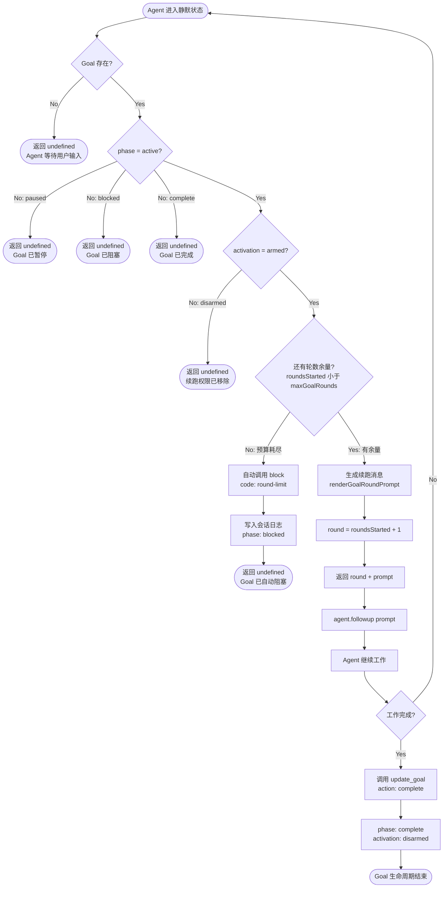
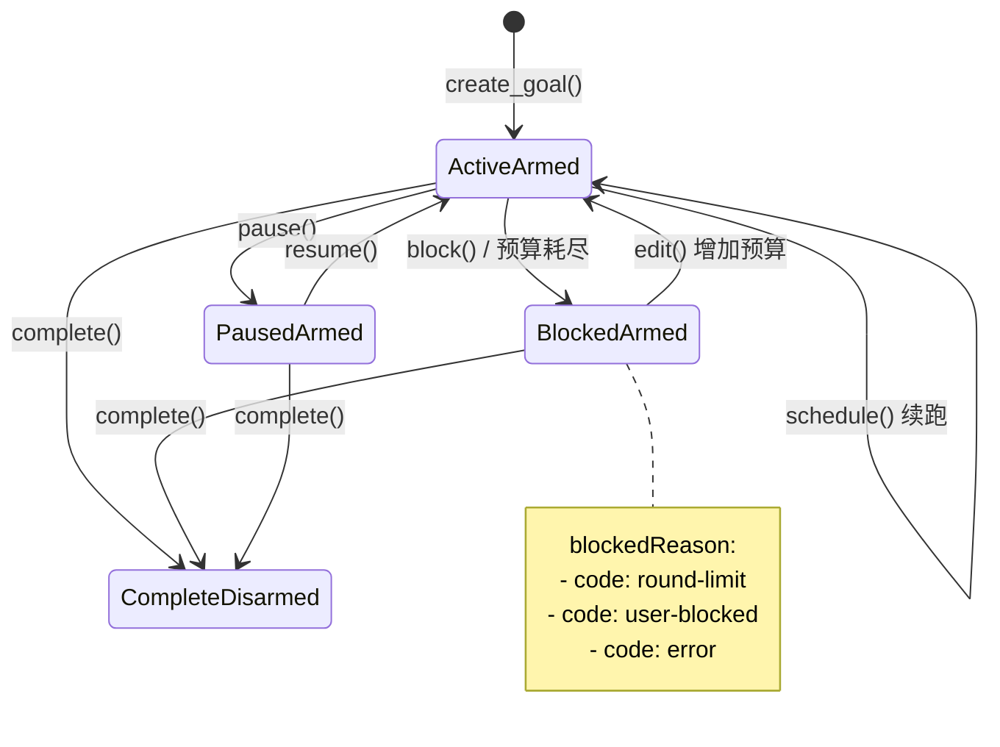

# GoalRoundDriver：Goal 模式的自动续跑引擎

> 本文深入剖析 DeepSeek Harness 中 **GoalRoundDriver** 的实现细节，它是 Goal 模式的核心驱动器，负责在 Agent 静默时自动发起下一轮执行，实现真正的"长时间自主运行"。

## 目录

1. [概述：GoalRoundDriver 解决什么问题](#概述)
2. [核心架构](#核心架构)
3. [静默检测机制](#静默检测机制)
4. [schedule() 调度逻辑](#schedule-调度逻辑)
5. [续跑消息生成](#续跑消息生成)
6. [预算管理与自动阻塞](#预算管理与自动阻塞)
7. [状态机与生命周期](#状态机与生命周期)
8. [竞态保护机制](#竞态保护机制)
9. [完整实现代码](#完整实现代码)
10. [测试与验证](#测试与验证)

---

## 概述：GoalRoundDriver 解决什么问题 {#概述}

### 问题背景

在没有 GoalRoundDriver 之前，Agent 的工作模式是 **"人推一步，走一步"**：

```
用户: 写一个博客系列，20篇
  ↓
Agent: 写完第1篇 → 停止等待
  ↓
用户: 继续
  ↓
Agent: 写完第2篇 → 停止等待
  ↓
... (重复18次)
```

这种 **human-in-the-loop** 模式有明显的问题：

1. **无法自主运行**：每个步骤都需要人工介入
2. **效率低下**：用户需要反复输入"继续"
3. **任务碎片化**：长时间任务被拆成多个独立会话
4. **状态丢失风险**：会话中断后难以恢复进度

### GoalRoundDriver 的解决方案

**GoalRoundDriver** 是一个 **自动续跑引擎**，它的核心思想是：

```
当 Agent 完成当前工作并进入静默状态时，
如果存在 active 的 Goal，
Driver 自动注入一条续跑消息，
让 Agent 继续朝着目标前进。
```

**关键特性：**

- ✅ **自动检测**：监听 Agent 静默事件
- ✅ **智能续跑**：只在目标激活且有预算时继续
- ✅ **预算管理**：防止无限循环，达到上限自动阻塞
- ✅ **状态持久化**：Goal 状态写入会话日志，重启不丢失
- ✅ **无缝衔接**：续跑消息对用户透明，不干扰正常对话

---

## 核心架构 {#核心架构}

### 架构图

```
┌─────────────────────────────────────────────────────────┐
│                    Cordis Context                        │
│                                                           │
│  ┌──────────────┐      ┌──────────────┐                │
│  │ Goal Manager │      │ Agent Manager│                │
│  │              │      │              │                │
│  │ • create()   │      │ • agent.on() │                │
│  │ • get()      │      │ • whenIdle() │                │
│  │ • update()   │      │ • followup() │                │
│  │ • block()    │      │              │                │
│  └──────┬───────┘      └──────┬───────┘                │
│         │                     │                          │
│         │   Goal State        │   Idle Event             │
│         │                     │                          │
│         ▼                     ▼                          │
│  ┌─────────────────────────────────────────────┐       │
│  │        GoalRoundDriver                       │       │
│  │                                               │       │
│  │  ┌──────────────────────────────────────┐  │       │
│  │  │  schedule(agent): NextRound | null   │  │       │
│  │  │                                        │  │       │
│  │  │  1. 读取 goal 状态                    │  │       │
│  │  │  2. 检查 active + armed + 预算        │  │       │
│  │  │  3. 预算耗尽 → 自动 block             │  │       │
│  │  │  4. 生成续跑 prompt                   │  │       │
│  │  │  5. 返回 { round, prompt }            │  │       │
│  │  └──────────────────────────────────────┘  │       │
│  │                                               │       │
│  │  ┌──────────────────────────────────────┐  │       │
│  │  │  disarm(agent): void                  │  │       │
│  │  │                                        │  │       │
│  │  │  移除进程内续跑权限                   │  │       │
│  │  └──────────────────────────────────────┘  │       │
│  └─────────────────────────────────────────────┘       │
│                                                           │
└───────────────────────────────────────────────────────────┘
                          │
                          │ { round, prompt }
                          ▼
                  ┌───────────────┐
                  │  Agent        │
                  │               │
                  │  followup()   │ ← 注入续跑消息
                  │  继续工作      │
                  └───────────────┘
```

### 组件职责

| 组件 | 职责 |
|-----|------|
| **Goal Manager** | 管理 Goal 状态（CRUD 操作） |
| **Agent Manager** | 管理 Agent 生命周期和事件 |
| **GoalRoundDriver** | 监听静默、决策续跑、生成消息 |
| **Agent** | 执行任务、触发静默事件 |

---

## 静默检测机制 {#静默检测机制}

### 什么是"静默"？

**Agent 静默**指的是 Agent 完成当前轮次的所有工作，进入等待状态：

```typescript
// Agent 静默的条件：
// 1. inbox 中没有待处理的用户消息
// 2. 没有 pending 的工具调用
// 3. 当前助手输出已完成
// 4. 没有后续动作（followup）
```

### 静默检测的实现

```typescript
// 在 Agent 内部（简化版）
class Agent {
  async processInbox() {
    while (this.inbox.length > 0) {
      const message = this.inbox.shift()
      await this.handleMessage(message)
    }
    
    // 所有消息处理完毕
    if (this.inbox.length === 0 && !this.hasPendingActions) {
      this.emit('idle')  // 触发静默事件
    }
  }
}
```

### Driver 监听静默事件

```typescript
// GoalRoundDriver 注册监听器
class GoalRoundDriver {
  constructor(ctx: Context) {
    this.ctx = ctx
    
    // 监听所有 Agent 的静默事件
    ctx.on('agent/idle', (agent: Agent) => {
      this.onAgentIdle(agent)
    })
  }
  
  private onAgentIdle(agent: Agent) {
    const next = this.schedule(agent)
    if (next) {
      // 自动注入续跑消息
      agent.followup({
        type: 'text',
        text: next.prompt,
        source: 'goal-round-driver'  // 标记来源
      })
    }
  }
}
```

### 时序图

```
Agent 工作中...
    ↓
完成当前任务
    ↓
inbox 清空 + 无 pending 动作
    ↓
emit('idle')
    ↓
┌──────────────────────────────────┐
│ GoalRoundDriver 收到 idle 事件   │
│                                   │
│ schedule(agent) → NextRound?     │
│    ↓                              │
│ 有续跑 → agent.followup(prompt)  │
│ 无续跑 → 真正进入等待              │
└──────────────────────────────────┘
    ↓
Agent 收到续跑消息 → 继续工作
```

---

## schedule() 调度逻辑 {#schedule-调度逻辑}

### 核心方法签名

```typescript
schedule(agent: Agent): { round: number; prompt: string } | undefined
```

**返回值说明：**
- 返回 `{ round, prompt }`：应该发起下一轮，包含轮次号和续跑消息
- 返回 `undefined`：无事可做（没有 goal / 不满足条件 / 已自动阻塞）

### 完整决策流程

```typescript
schedule(agent: Agent): { round: number; prompt: string } | undefined {
  // ═══════════════════════════════════════
  // 阶段 1: 读取 Goal 状态
  // ═══════════════════════════════════════
  const goal = this.ctx.goals.get(agent)
  
  if (goal === undefined) {
    // 没有 Goal → 无事可做
    return undefined
  }
  
  // ═══════════════════════════════════════
  // 阶段 2: 检查激活条件
  // ═══════════════════════════════════════
  
  // 条件 1: phase 必须是 'active'
  if (goal.phase !== 'active') {
    // paused / blocked / complete → 不续跑
    return undefined
  }
  
  // 条件 2: activation 必须是 'armed'
  if (goal.activation !== 'armed') {
    // disarmed → 已移除续跑权限
    return undefined
  }
  
  // ═══════════════════════════════════════
  // 阶段 3: 预算检查
  // ═══════════════════════════════════════
  
  if (goal.roundsStarted >= goal.maxGoalRounds) {
    // 预算耗尽 → 自动阻塞
    this.ctx.goals.block(
      agent,
      { id: goal.id, revision: goal.revision },
      {
        code: 'round-limit',
        message: `Goal reached its configured limit of ${goal.maxGoalRounds} rounds.`
      }
    )
    // 阻塞后不续跑
    return undefined
  }
  
  // ═══════════════════════════════════════
  // 阶段 4: 生成续跑消息
  // ═══════════════════════════════════════
  
  const round = goal.roundsStarted + 1
  const prompt = renderGoalRoundPrompt(goal, round)
  
  return { round, prompt }
}
```

### 决策树

```
schedule(agent)
    ↓
goal 存在？
    ├─ No → return undefined
    └─ Yes
        ↓
    phase === 'active'？
        ├─ No (paused/blocked/complete) → return undefined
        └─ Yes
            ↓
        activation === 'armed'？
            ├─ No (disarmed) → return undefined
            └─ Yes
                ↓
            roundsStarted < maxGoalRounds？
                ├─ No → block(round-limit) → return undefined
                └─ Yes
                    ↓
                生成 prompt
                    ↓
                return { round, prompt }
```

### 调度流程图



### 关键检查点

#### 1. **Goal 存在性检查**

```typescript
const goal = this.ctx.goals.get(agent)
if (goal === undefined) return undefined
```

**为什么需要？**
- Agent 可能没有创建 Goal
- Goal 可能已被删除
- 防止空指针访问

#### 2. **Phase 检查**

```typescript
if (goal.phase !== 'active') return undefined
```

**Phase 状态说明：**

| Phase | 含义 | 是否续跑 |
|-------|------|----------|
| `active` | 正在进行 | ✅ 是 |
| `paused` | 已暂停 | ❌ 否 |
| `blocked` | 已阻塞 | ❌ 否 |
| `complete` | 已完成 | ❌ 否 |

#### 3. **Activation 检查**

```typescript
if (goal.activation !== 'armed') return undefined
```

**Activation 状态说明：**

| Activation | 含义 | 是否续跑 |
|------------|------|----------|
| `armed` | 已激活 | ✅ 是 |
| `disarmed` | 已解除 | ❌ 否 |

**何时会 disarm？**
- 会话卸载时
- 手动调用 `driver.disarm(agent)`
- 系统重启时清理

#### 4. **预算检查**

```typescript
if (goal.roundsStarted >= goal.maxGoalRounds) {
  this.ctx.goals.block(agent, ...)
  return undefined
}
```

**预算耗尽的处理：**
1. 自动调用 `goals.block()` 标记为阻塞
2. 阻塞原因：`code: 'round-limit'`
3. **不自动重试**：需要人工干预（增加预算或完成 Goal）

---

## 续跑消息生成 {#续跑消息生成}

### renderGoalRoundPrompt() 实现

```typescript
export function renderGoalRoundPrompt(goal: GoalView, round: number): string {
  return '<goal_round>\n'
    + `Objective: ${JSON.stringify(goal.objective)}\n`
    + `Round: ${round}/${goal.maxGoalRounds}\n\n`
    + 'Continue working toward the objective in this same session. '
    + 'Treat the current workspace, tool results, and durable session state '
    + 'as authoritative; inspect them instead of assuming earlier narration '
    + 'is still current. Make concrete progress and verify the result. '
    + 'If work remains, leave the goal active for the next round.\n'
    + '</goal_round>'
}
```

### 生成的消息示例

```xml
<goal_round>
Objective: "写博客系列：从 0 实现 DeepSeek Harness，每篇一个主题"
Round: 3/20

Continue working toward the objective in this same session. Treat the 
current workspace, tool results, and durable session state as authoritative; 
inspect them instead of assuming earlier narration is still current. Make 
concrete progress and verify the result. If work remains, leave the goal 
active for the next round.
</goal_round>
```

### 消息设计要点

#### 1. **XML 格式封装**

```xml
<goal_round>
...
</goal_round>
```

**为什么用 XML？**
- 结构清晰，易于模型识别
- 与其他系统消息格式统一（`<system>`, `<tool_result>` 等）
- 便于后续扩展字段

#### 2. **包含 Objective**

```typescript
Objective: ${JSON.stringify(goal.objective)}
```

**为什么每次都重复 Objective？**
- Agent 的上下文可能被压缩
- 明确提醒当前目标，防止偏离
- 无需回溯历史消息

#### 3. **显示进度**

```typescript
Round: ${round}/${goal.maxGoalRounds}
```

**进度信息的作用：**
- 让 Agent 知道剩余预算
- 临近上限时提醒尽快完成
- 便于调试和监控

#### 4. **强调权威性**

```
Treat the current workspace, tool results, and durable session state 
as authoritative; inspect them instead of assuming earlier narration 
is still current.
```

**为什么强调"当前状态为准"？**

这是防止 Agent 产生**幻觉**的关键：

```
❌ 错误行为：
Agent Round 5: "我刚才创建了 blog-03.md..."
实际上：blog-03.md 早在 Round 2 就创建了，现在应该检查文件而不是假设

✅ 正确行为：
Agent Round 5: 调用 read(blog-03.md) 检查当前内容
```

**关键原则：**
- 不信任记忆，只信任工具调用结果
- 每轮重新检查状态
- 验证而不是假设

#### 5. **明确动作指导**

```
Make concrete progress and verify the result. 
If work remains, leave the goal active for the next round.
```

**两个关键要求：**

1. **Make concrete progress**：不要空转，每轮都要有实际产出
2. **Verify the result**：完成后要检查验证

**如何判断是否完成：**
```
if (工作完成) {
  update_goal(action: 'complete')
} else {
  // 保持 goal active，driver 会自动续跑
}
```

---

## 预算管理与自动阻塞 {#预算管理与自动阻塞}

### 预算的概念

**预算（Budget）** 指的是 Goal 的最大轮次限制：

```typescript
interface GoalView {
  maxGoalRounds: number     // 最大允许轮次
  roundsStarted: number     // 已启动的轮次
}

// 剩余预算 = maxGoalRounds - roundsStarted
```

### 为什么需要预算？

**防止无限循环：**

```
如果没有预算限制：

Agent 创建 Goal
  ↓
Driver 自动续跑
  ↓
Agent 工作但没调用 complete
  ↓
Driver 再次续跑
  ↓
... (无限循环)
```

**可能导致无限循环的原因：**
1. Agent 逻辑错误，永远不调用 `complete`
2. 目标描述不清晰，Agent 不知道何时算完成
3. 遇到意外错误，但 Agent 不知道该 `block`

### 预算检查实现

```typescript
if (goal.roundsStarted >= goal.maxGoalRounds) {
  // 达到上限 → 自动阻塞
  this.ctx.goals.block(
    agent,
    { id: goal.id, revision: goal.revision },
    {
      code: 'round-limit',
      message: `Goal reached its configured limit of ${goal.maxGoalRounds} rounds.`
    }
  )
  return undefined  // 不再续跑
}
```

### 自动阻塞的流程

```
roundsStarted >= maxGoalRounds
    ↓
调用 goals.block()
    ↓
goal.phase = 'blocked'
goal.blockedReason = { code: 'round-limit', message: '...' }
    ↓
写入会话日志（持久化）
    ↓
Driver 返回 undefined（不续跑）
    ↓
Agent 真正进入等待
```

### 阻塞后的恢复

**用户有两个选择：**

#### 1. **增加预算**

```typescript
update_goal({
  goal_id: goal.id,
  revision: goal.revision,
  action: 'edit',
  max_goal_rounds: 30  // 从 20 增加到 30
})
```

阻塞原因自动清除，Goal 重新变为 `active`。

#### 2. **完成 Goal**

```typescript
update_goal({
  goal_id: goal.id,
  revision: goal.revision,
  action: 'complete'
})
```

承认工作已完成（或无法继续），结束 Goal。

### 预算设置的最佳实践

| 任务类型 | 推荐预算 | 理由 |
|---------|---------|------|
| 简单任务（1-3步骤） | 5-10 | 快速完成，预算宽松 |
| 中等任务（多文件修改） | 10-20 | 需要多轮迭代 |
| 复杂任务（重构、大项目） | 20-50 | 长时间运行 |
| 探索性任务（研究、原型） | 30-100 | 不确定性高 |

**动态调整策略：**
```typescript
// 初始保守估计
create_goal({ objective: '...', max_goal_rounds: 20 })

// 运行中发现不够
get_goal()  // { roundsStarted: 18, maxGoalRounds: 20 }

// 及时增加预算
update_goal({ action: 'edit', max_goal_rounds: 30 })
```

---

## 状态机与生命周期 {#状态机与生命周期}

### Goal 状态机

```
        create_goal()
             ↓
        ┌────────┐
        │ active │ ←──────── resume()
        │ armed  │
        └───┬────┘
            │
            ├─→ pause() ──→ ┌────────┐
            │                │ paused │
            │                │ armed  │
            │                └────────┘
            │
            ├─→ block() ──→ ┌─────────┐
            │                │ blocked │
            │                │ armed   │
            │                └─────────┘
            │
            └─→ complete() → ┌──────────┐
                              │ complete │
                              │ disarmed │
                              └──────────┘
```

### 状态转换规则

| 当前状态 | 允许的操作 | 转换后状态 | Driver 行为 |
|---------|-----------|-----------|------------|
| `active` | `pause` | `paused` | 停止续跑 |
| `active` | `block` | `blocked` | 停止续跑 |
| `active` | `complete` | `complete` | 停止续跑，disarm |
| `paused` | `resume` | `active` | 恢复续跑 |
| `blocked` | `edit` | `active` | 恢复续跑（如果增加预算） |
| `any` | `edit` | 保持 | 修改 objective 或预算 |

### 状态机图



### 完整生命周期示例

```typescript
// ═══════════════════════════════════════
// 1. 创建 Goal
// ═══════════════════════════════════════
const result = await tools.create_goal({
  objective: "实现用户认证系统",
  max_goal_rounds: 20
})
// → { goal: { phase: 'active', activation: 'armed', roundsStarted: 0 } }

// Driver 开始自动续跑

// ═══════════════════════════════════════
// 2. 运行中暂停（用户请求）
// ═══════════════════════════════════════
await tools.update_goal({
  goal_id: result.goal.id,
  revision: result.goal.revision,
  action: 'pause'
})
// → { goal: { phase: 'paused', activation: 'armed' } }
// Driver 停止续跑

// ═══════════════════════════════════════
// 3. 恢复运行
// ═══════════════════════════════════════
await tools.update_goal({
  goal_id: result.goal.id,
  revision: result.goal.revision + 1,  // revision 已增加
  action: 'resume'
})
// → { goal: { phase: 'active', activation: 'armed' } }
// Driver 恢复续跑

// ═══════════════════════════════════════
// 4. 预算耗尽（自动阻塞）
// ═══════════════════════════════════════
// roundsStarted 达到 20
// Driver 自动调用 block({ code: 'round-limit' })
// → { goal: { phase: 'blocked', blockedReason: {...} } }

// ═══════════════════════════════════════
// 5. 增加预算恢复
// ═══════════════════════════════════════
await tools.update_goal({
  goal_id: result.goal.id,
  revision: result.goal.revision,
  action: 'edit',
  max_goal_rounds: 30  // 增加到 30
})
// → { goal: { phase: 'active', maxGoalRounds: 30 } }
// 阻塞自动清除，Driver 恢复续跑

// ═══════════════════════════════════════
// 6. 完成 Goal
// ═══════════════════════════════════════
await tools.update_goal({
  goal_id: result.goal.id,
  revision: result.goal.revision,
  action: 'complete'
})
// → { goal: { phase: 'complete', activation: 'disarmed' } }
// Driver 停止续跑，Goal 生命周期结束
```

### Activation 的语义

**`armed` vs `disarmed`：**

```typescript
armed: "已上膛"，Driver 有权自动续跑
disarmed: "已卸载"，Driver 无权续跑
```

**何时会 disarm？**

1. **Goal 完成时**：
```typescript
update_goal({ action: 'complete' })
// → activation: 'disarmed'
```

2. **会话卸载时**：
```typescript
// 会话关闭时，Driver 自动调用
driver.disarm(agent)
```

3. **手动解除**：
```typescript
// 保持 phase='active' 但停止自动续跑
ctx.goals.disarm(agent)
```

**disarm 的作用：**
- 防止会话关闭后仍触发续跑
- 允许"暂存"Goal 而不自动执行
- 支持手动控制的 Goal 模式

---

## 竞态保护机制 {#竞态保护机制}

### 竞态问题场景

```
时刻 T1: Driver 读取 goal (revision: 5)
时刻 T2: 用户调用 update_goal (revision: 5 → 6)
时刻 T3: Driver 调用 block() (基于 revision: 5)
```

**如果没有保护：**
- Driver 的 block 会覆盖用户的 update
- 用户操作丢失

### 乐观锁（CAS）

**Compare-And-Swap** 机制：

```typescript
block(agent: Agent, identity: GoalIdentity, reason: BlockedReason) {
  const current = this.get(agent)
  
  // 检查 revision 是否匹配
  if (current.revision !== identity.revision) {
    throw new Error('GOAL_REVISION_MISMATCH: Goal was modified')
  }
  
  // revision 匹配才执行更新
  const updated = {
    ...current,
    phase: 'blocked',
    blockedReason: reason,
    revision: current.revision + 1  // 递增 revision
  }
  
  this.save(agent, updated)
}
```

### Driver 中的使用

```typescript
schedule(agent: Agent) {
  const goal = this.ctx.goals.get(agent)
  
  if (goal.roundsStarted >= goal.maxGoalRounds) {
    // 传入当前 revision
    this.ctx.goals.block(
      agent,
      { id: goal.id, revision: goal.revision },  // ← CAS 检查点
      { code: 'round-limit', message: '...' }
    )
  }
}
```

### 竞态场景处理

#### 场景 1：Driver block 时用户 pause

```
T1: Driver 检查预算，准备 block (revision: 5)
T2: 用户 pause (revision: 5 → 6)
T3: Driver 执行 block (revision: 5)
     ↓
   revision 不匹配，block 失败
     ↓
   Driver 重新 schedule，发现 phase='paused'，不续跑
```

**结果：** ✅ 用户操作生效，Driver 正确停止

#### 场景 2：同时调用 update

```
T1: 用户 A 调用 update (revision: 5)
T2: 用户 B 调用 update (revision: 5)
     ↓
   第一个成功 (revision: 5 → 6)
   第二个失败 (revision 不匹配)
     ↓
   用户 B 需要重新读取最新状态再更新
```

**结果：** ✅ 保证线性一致性

### 预留身份（Reserved Identity）

DSH 的完整实现还包括 **预留身份** 机制（简化版未实现）：

```typescript
// 在第一次 await 前预留身份
const reserved = {
  id: goal.id,
  revision: goal.revision,
  reservedBy: 'driver',
  reservedAt: Date.now()
}

// 后续操作检查预留
if (current.reservedBy && current.reservedBy !== 'driver') {
  throw new Error('Goal is reserved by another operation')
}
```

**作用：**
- 防止长时间操作期间被其他操作修改
- 支持复杂的多步骤事务

---

## 完整实现代码 {#完整实现代码}

### GoalRoundDriver 类

```typescript
/**
 * GoalRoundDriver - Goal 模式自动续跑引擎
 * 
 * 核心职责：
 * 1. 监听 Agent 静默事件
 * 2. 检查 Goal 状态并决策续跑
 * 3. 生成续跑消息并注入
 * 4. 管理预算和自动阻塞
 */

import type { Context } from '@cordisjs/core'
import type { Agent } from './agent.ts'
import type { GoalView } from './types.ts'

export class GoalRoundDriver {
  private ctx: Context
  
  constructor(ctx: Context) {
    this.ctx = ctx
    this.registerListeners()
  }
  
  /**
   * 注册事件监听器
   */
  private registerListeners() {
    this.ctx.on('agent/idle', (agent: Agent) => {
      this.onAgentIdle(agent)
    })
  }
  
  /**
   * Agent 静默事件处理器
   */
  private onAgentIdle(agent: Agent) {
    const next = this.schedule(agent)
    
    if (next) {
      // 注入续跑消息
      agent.followup({
        type: 'text',
        text: next.prompt,
        source: 'goal-round-driver',
        metadata: {
          goalId: this.ctx.goals.get(agent)?.id,
          round: next.round
        }
      })
      
      // 记录日志
      this.ctx.logger.info(`[GoalRoundDriver] Started round ${next.round}`)
    }
  }
  
  /**
   * 调度决策：检查 Goal 并返回续跑信息
   * 
   * @returns 续跑信息或 undefined（无需续跑）
   */
  schedule(agent: Agent): { round: number; prompt: string } | undefined {
    // ═══════════════════════════════════════
    // 阶段 1: 读取 Goal
    // ═══════════════════════════════════════
    const goal = this.ctx.goals.get(agent)
    
    if (goal === undefined) {
      return undefined
    }
    
    // ═══════════════════════════════════════
    // 阶段 2: 检查激活条件
    // ═══════════════════════════════════════
    if (goal.phase !== 'active') {
      this.ctx.logger.debug(
        `[GoalRoundDriver] Goal phase is ${goal.phase}, not continuing`
      )
      return undefined
    }
    
    if (goal.activation !== 'armed') {
      this.ctx.logger.debug(
        `[GoalRoundDriver] Goal is disarmed, not continuing`
      )
      return undefined
    }
    
    // ═══════════════════════════════════════
    // 阶段 3: 预算检查
    // ═══════════════════════════════════════
    if (goal.roundsStarted >= goal.maxGoalRounds) {
      this.ctx.logger.warn(
        `[GoalRoundDriver] Goal reached round limit (${goal.maxGoalRounds}), blocking`
      )
      
      // 自动阻塞
      this.ctx.goals.block(
        agent,
        { id: goal.id, revision: goal.revision },
        {
          code: 'round-limit',
          message: `Goal reached its configured limit of ${goal.maxGoalRounds} rounds.`
        }
      )
      
      return undefined
    }
    
    // ═══════════════════════════════════════
    // 阶段 4: 生成续跑消息
    // ═══════════════════════════════════════
    const round = goal.roundsStarted + 1
    const prompt = renderGoalRoundPrompt(goal, round)
    
    return { round, prompt }
  }
  
  /**
   * 移除进程内续跑权限
   * 
   * 用途：
   * - 会话卸载时清理
   * - 手动停止自动续跑
   */
  disarm(agent: Agent): void {
    this.ctx.goals.disarm(agent)
    this.ctx.logger.info(`[GoalRoundDriver] Disarmed goal for agent ${agent.id}`)
  }
}

/**
 * 生成续跑消息
 */
export function renderGoalRoundPrompt(goal: GoalView, round: number): string {
  return '<goal_round>\n'
    + `Objective: ${JSON.stringify(goal.objective)}\n`
    + `Round: ${round}/${goal.maxGoalRounds}\n\n`
    + 'Continue working toward the objective in this same session. '
    + 'Treat the current workspace, tool results, and durable session state '
    + 'as authoritative; inspect them instead of assuming earlier narration '
    + 'is still current. Make concrete progress and verify the result. '
    + 'If work remains, leave the goal active for the next round.\n'
    + '</goal_round>'
}
```

### 类型定义

```typescript
/**
 * Goal 视图（只读状态）
 */
export interface GoalView {
  id: string
  revision: number
  objective: string
  phase: 'active' | 'paused' | 'blocked' | 'complete'
  activation: 'armed' | 'disarmed'
  roundsStarted: number
  maxGoalRounds: number
  blockedReason?: {
    code: string
    message: string
  }
}

/**
 * Goal 身份标识（用于 CAS）
 */
export interface GoalIdentity {
  id: string
  revision: number
}

/**
 * 阻塞原因
 */
export interface BlockedReason {
  code: string
  message: string
}
```

### 集成到 Context

```typescript
import { Context } from '@cordisjs/core'
import { GoalRoundDriver } from './driver'

// 在启动时初始化
const ctx = new Context()

// 注册 Driver
ctx.plugin(() => {
  const driver = new GoalRoundDriver(ctx)
  
  // 暴露到 context
  ctx.provide('goalDriver', driver)
  
  // 会话卸载时清理
  ctx.on('agent/dispose', (agent) => {
    driver.disarm(agent)
  })
})
```

---

## 测试与验证 {#测试与验证}

### 单元测试

```typescript
import { describe, it, expect, beforeEach } from 'vitest'
import { Context } from '@cordisjs/core'
import { GoalRoundDriver } from './driver'
import { Agent } from './agent'

describe('GoalRoundDriver', () => {
  let ctx: Context
  let driver: GoalRoundDriver
  let agent: Agent
  
  beforeEach(() => {
    ctx = new Context()
    driver = new GoalRoundDriver(ctx)
    agent = ctx.agents.create('test-agent')
  })
  
  describe('schedule()', () => {
    it('should return undefined when no goal exists', () => {
      const result = driver.schedule(agent)
      expect(result).toBeUndefined()
    })
    
    it('should return undefined when goal is paused', () => {
      ctx.goals.create(agent, {
        objective: 'test',
        maxGoalRounds: 10
      })
      ctx.goals.pause(agent, { id: 'goal-1', revision: 1 })
      
      const result = driver.schedule(agent)
      expect(result).toBeUndefined()
    })
    
    it('should return round info when goal is active', () => {
      ctx.goals.create(agent, {
        objective: 'test',
        maxGoalRounds: 10
      })
      
      const result = driver.schedule(agent)
      expect(result).toEqual({
        round: 1,
        prompt: expect.stringContaining('<goal_round>')
      })
    })
    
    it('should auto-block when reaching round limit', () => {
      const goal = ctx.goals.create(agent, {
        objective: 'test',
        maxGoalRounds: 5
      })
      
      // 模拟已运行 5 轮
      for (let i = 0; i < 5; i++) {
        ctx.goals.incrementRound(agent)
      }
      
      const result = driver.schedule(agent)
      expect(result).toBeUndefined()
      
      const updated = ctx.goals.get(agent)
      expect(updated.phase).toBe('blocked')
      expect(updated.blockedReason.code).toBe('round-limit')
    })
  })
  
  describe('disarm()', () => {
    it('should disarm goal', () => {
      ctx.goals.create(agent, {
        objective: 'test',
        maxGoalRounds: 10
      })
      
      driver.disarm(agent)
      
      const goal = ctx.goals.get(agent)
      expect(goal.activation).toBe('disarmed')
    })
  })
})
```

### 集成测试

```typescript
describe('GoalRoundDriver Integration', () => {
  it('should auto-continue until goal is complete', async () => {
    const ctx = new Context()
    const driver = new GoalRoundDriver(ctx)
    const agent = ctx.agents.create('test-agent')
    
    // 创建 Goal
    ctx.goals.create(agent, {
      objective: 'Count to 5',
      maxGoalRounds: 10
    })
    
    let count = 0
    
    // 模拟 Agent 行为
    ctx.on('agent/idle', (a) => {
      if (a.id === agent.id) {
        count++
        
        if (count >= 5) {
          // 完成
          ctx.goals.complete(a, { id: 'goal-1', revision: count })
        } else {
          // 触发下一轮
          a.emit('idle')
        }
      }
    })
    
    // 启动
    agent.emit('idle')
    
    // 等待完成
    await new Promise(resolve => setTimeout(resolve, 100))
    
    expect(count).toBe(5)
    
    const goal = ctx.goals.get(agent)
    expect(goal.phase).toBe('complete')
    expect(goal.roundsStarted).toBe(5)
  })
})
```

### 压力测试

```typescript
describe('GoalRoundDriver Stress Test', () => {
  it('should handle many concurrent goals', async () => {
    const ctx = new Context()
    const driver = new GoalRoundDriver(ctx)
    
    const agents = Array.from({ length: 100 }, (_, i) => 
      ctx.agents.create(`agent-${i}`)
    )
    
    // 为每个 agent 创建 goal
    agents.forEach(agent => {
      ctx.goals.create(agent, {
        objective: `Task ${agent.id}`,
        maxGoalRounds: 10
      })
    })
    
    // 同时触发所有 agent
    const startTime = Date.now()
    
    await Promise.all(
      agents.map(agent => 
        new Promise(resolve => {
          let rounds = 0
          
          const handler = () => {
            rounds++
            if (rounds >= 5) {
              ctx.goals.complete(agent, {
                id: agent.id,
                revision: rounds
              })
              resolve()
            } else {
              agent.emit('idle')
            }
          }
          
          ctx.on('agent/idle', (a) => {
            if (a.id === agent.id) handler()
          })
          
          agent.emit('idle')
        })
      )
    )
    
    const duration = Date.now() - startTime
    
    console.log(`Completed 100 goals in ${duration}ms`)
    expect(duration).toBeLessThan(5000)
  })
})
```

---

## 总结

### GoalRoundDriver 的核心价值

1. **自动化**：将"人推一步"变成"自动运行"
2. **可控性**：通过预算和状态机精确控制
3. **可靠性**：竞态保护、持久化、错误处理
4. **透明性**：续跑消息对用户可见，易于调试

### 关键设计原则

1. **单一职责**：Driver 只负责调度，不管理 Goal 状态
2. **幂等性**：多次调用 `schedule()` 结果一致
3. **防御性**：预算耗尽自动阻塞，不信任 Agent
4. **权威性**：强调检查当前状态，不信任记忆

### 与其他 Driver 的对比

| 特性 | GoalRoundDriver | InProcessDriver |
|-----|----------------|-----------------|
| 触发方式 | 自动（静默检测） | 手动（tool 调用） |
| 执行模式 | 长时间运行 | 一次性委托 |
| 上下文 | 同一 session | 新 session |
| 状态管理 | 有状态（Goal） | 无状态 |

### 下一步

在下一篇博客中，我们将深入探讨 **InProcessDriver**，它是 DSH 子代理（subagent）机制的核心，负责创建和驱动独立的子任务执行器。

---

**相关阅读：**
- [blog-20-goal：Goal 持久目标完整实现](../blog-20-goal/)
- [blog-23-in-process-driver：InProcessDriver 详解](../blog-23-in-process-driver/)（下一篇）
- [blog-14-subagent：Subagent 子代理机制](../blog-14-subagent/)

**配套代码：** [blog-22-goal-round-driver](./)
