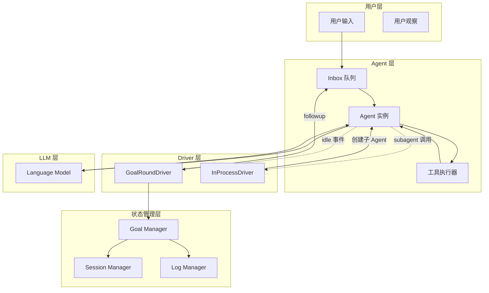
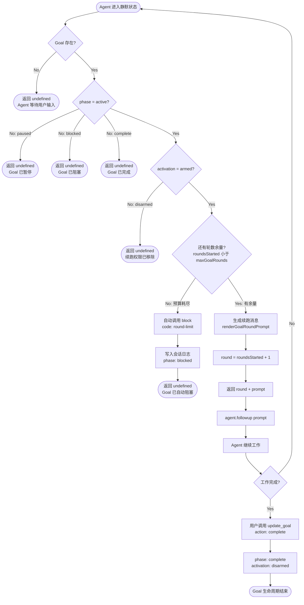
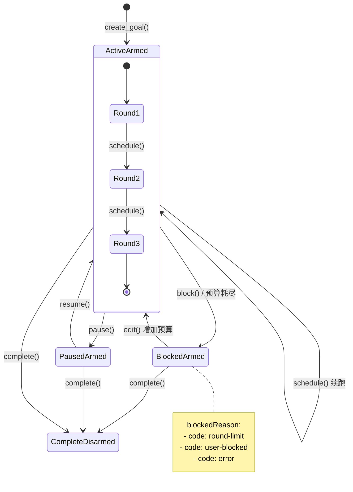
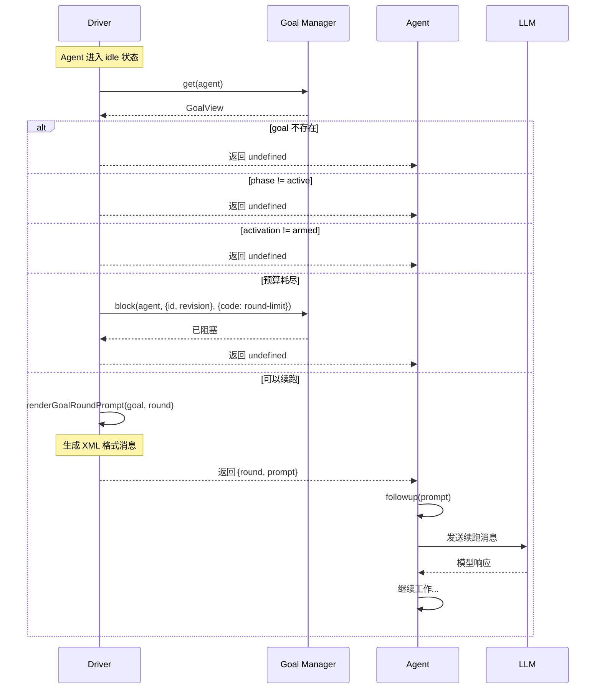
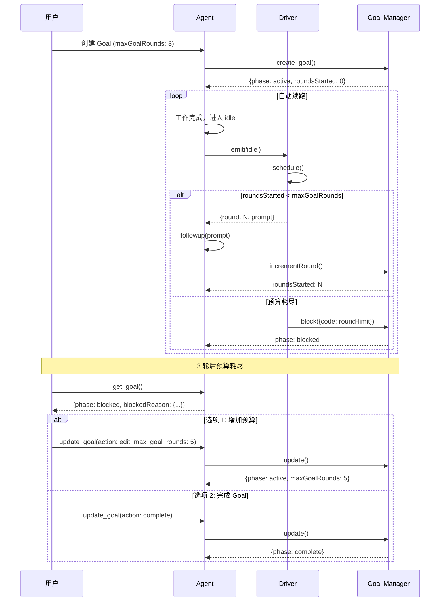
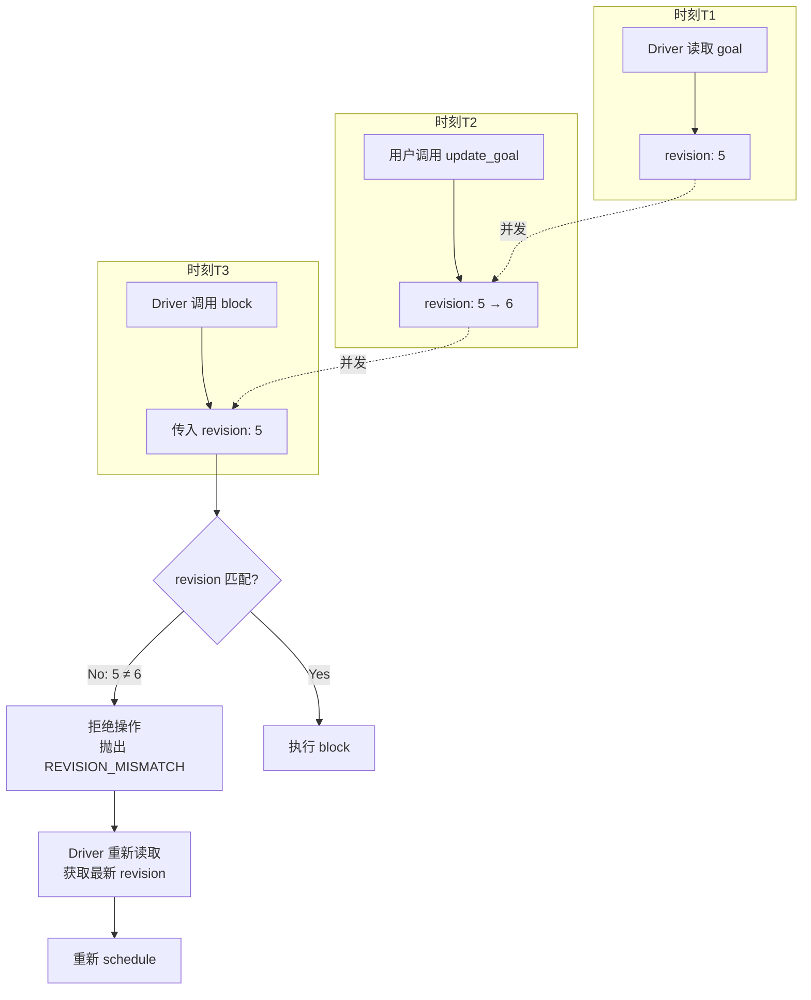
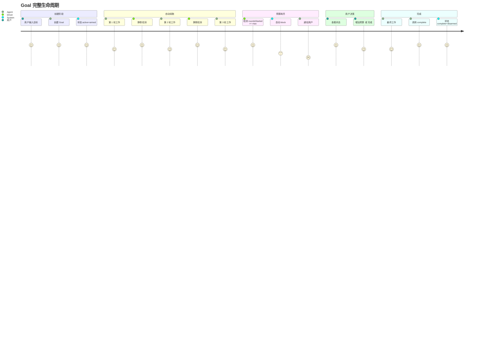
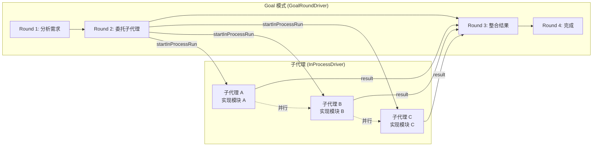
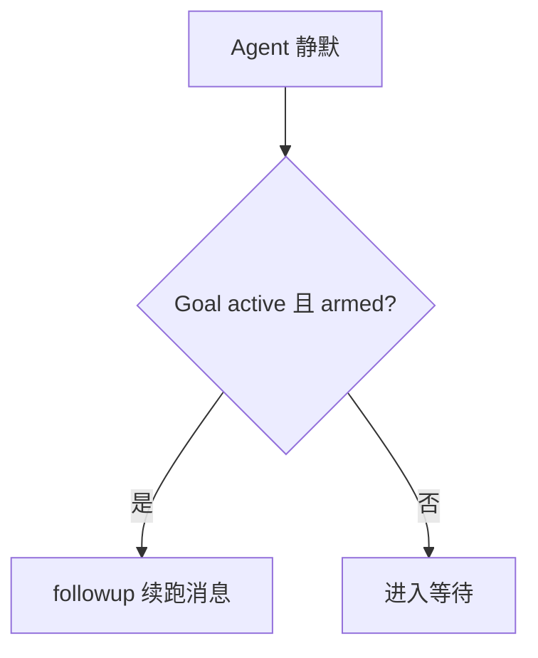

# GoalRoundDriver 详细流程图

## 1. 总体架构图

## 2. GoalRoundDriver 核心调度流程

## 3. Goal 状态机转换图

## 4. 续跑消息生成流程

## 5. 预算管理时序图

## 6. 竞态保护（CAS）流程

## 7. 完整生命周期流程

## 8. 与 InProcessDriver 协作流程

---

## 渲染说明

以上流程图使用 **Mermaid** 语法，可以在以下平台渲染：

- **GitHub**: 直接支持 Mermaid 渲染
- **VS Code**: 安装 "Markdown Preview Mermaid Support" 插件
- **在线工具**: https://mermaid.live/
- **Notion**: 支持 Mermaid 代码块

### 嵌入博客

把要用的那张图整段复制到博客对应章节即可（下例是一张可直接渲染的最小图）：

