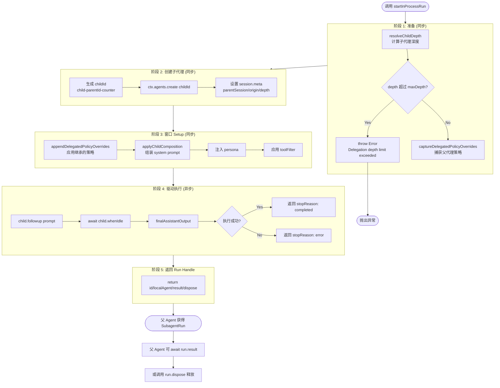
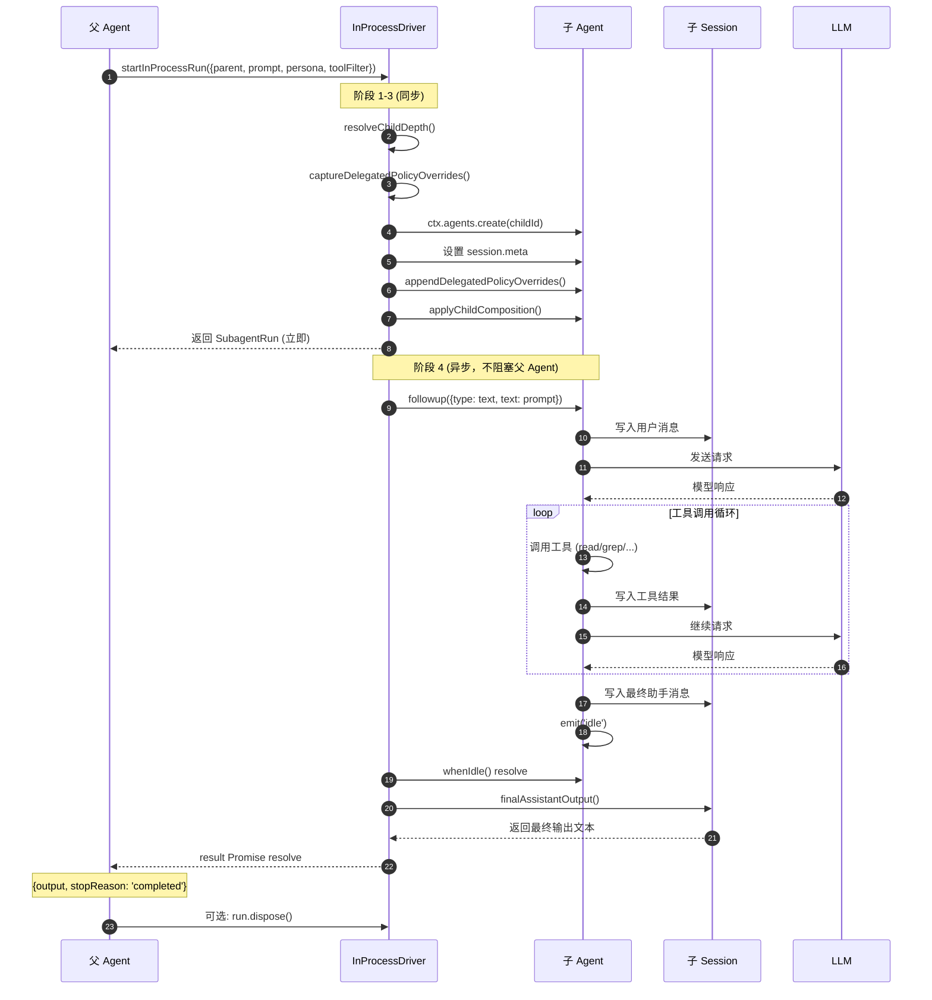
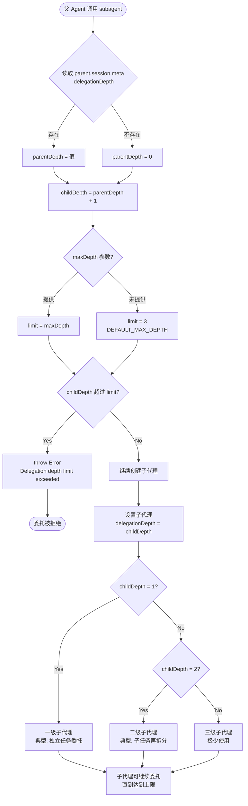

# InProcessDriver：子代理驱动引擎详解

> 本文深入剖析 DeepSeek Harness 中 **InProcessDriver** 的实现细节，它是子代理（subagent）机制的核心驱动器，负责创建独立的子任务执行器、管理父子通信、处理策略委托与深度控制。

## 目录

1. [概述：InProcessDriver 解决什么问题](#概述)
2. [核心架构](#核心架构)
3. [startInProcessRun() 完整流程](#startinprocessrun-完整流程)
4. [子代理创建：agents.create()](#子代理创建)
5. [策略委托：Policy Delegation](#策略委托)
6. [子代理组合：Child Composition](#子代理组合)
7. [父子通信机制](#父子通信机制)
8. [深度控制：Depth Limiting](#深度控制)
9. [结果结算与资源释放](#结果结算与资源释放)
10. [与 GoalRoundDriver 的对比](#与-goalrounddriver-的对比)
11. [完整实现代码](#完整实现代码)
12. [测试与验证](#测试与验证)

---

## 概述：InProcessDriver 解决什么问题 {#概述}

### 问题背景

在单一 Agent 模式下，所有工作都在同一个会话中串行执行：

```
用户: 帮我分析这个项目的所有模块依赖
  ↓
Agent: 读模块 A → 分析 → 读模块 B → 分析 → 读模块 C → 分析 → ...
  ↓
（串行执行，慢且占用主会话上下文）
```

这种模式有明显的问题：

1. **上下文污染**：大量中间结果堆积在主会话中
2. **无法并行**：多个独立任务只能串行执行
3. **上下文窗口耗尽**：长任务容易撑爆 context window
4. **职责混杂**：主 Agent 既要协调又要执行细节

### InProcessDriver 的解决方案

**InProcessDriver** 是一个 **子代理驱动引擎**，它的核心思想是：

```
父 Agent 遇到独立子任务时，
创建一个全新的子 Agent（独立 session、独立上下文），
把任务委托给它执行，
等待结果返回后继续主流程。
```

**关键特性：**

- ✅ **独立上下文**：子代理有自己的 session，不污染父会话
- ✅ **并行执行**：多个子代理可以同时运行
- ✅ **策略继承**：子代理自动继承父代理的运行策略
- ✅ **深度控制**：防止子代理无限嵌套
- ✅ **结果回传**：子代理完成后结果以 Promise 形式返回

### 典型使用场景

| 场景 | 说明 |
|-----|------|
| **代码审查** | 委托子代理审查特定文件，返回审查报告 |
| **并行搜索** | 同时搜索多个关键词，汇总结果 |
| **独立分析** | 让子代理分析日志、数据，返回结论 |
| **原型开发** | 委托子代理实现某个独立功能模块 |
| **批量处理** | 并行处理多个文件、多个任务 |

---

## 核心架构 {#核心架构}

### 架构图

```
┌─────────────────────────────────────────────────────────┐
│                    Cordis Context                        │
│                                                           │
│  ┌──────────────────────────────────────────────────┐  │
│  │              InProcessDriver                      │  │
│  │                                                    │  │
│  │  startInProcessRun(request) → SubagentRun         │  │
│  │                                                    │  │
│  │  ┌────────────────────────────────────────────┐  │  │
│  │  │ 阶段 1: 准备                                │  │  │
│  │  │  • resolveChildDepth()    计算深度          │  │  │
│  │  │  • captureDelegatedPolicy() 捕获策略        │  │  │
│  │  └────────────────────────────────────────────┘  │  │
│  │  ┌────────────────────────────────────────────┐  │  │
│  │  │ 阶段 2: 创建子代理                          │  │  │
│  │  │  • ctx.agents.create(childId)               │  │  │
│  │  │  • 设置 session.meta                        │  │  │
│  │  └────────────────────────────────────────────┘  │  │
│  │  ┌────────────────────────────────────────────┐  │  │
│  │  │ 阶段 3: 窗口 Setup                          │  │  │
│  │  │  • appendDelegatedPolicyOverrides()         │  │  │
│  │  │  • applyChildComposition()                  │  │  │
│  │  └────────────────────────────────────────────┘  │  │
│  │  ┌────────────────────────────────────────────┐  │  │
│  │  │ 阶段 4: 驱动执行（异步）                    │  │  │
│  │  │  • child.followup(prompt)                   │  │  │
│  │  │  • child.whenIdle()                         │  │  │
│  │  │  • finalAssistantOutput()                   │  │  │
│  │  └────────────────────────────────────────────┘  │  │
│  │  ┌────────────────────────────────────────────┐  │  │
│  │  │ 阶段 5: 返回 Run Handle                     │  │  │
│  │  │  • { id, localAgent, result, dispose }      │  │  │
│  │  └────────────────────────────────────────────┘  │  │
│  └──────────────────────────────────────────────────┘  │
│                          │                                │
│           ┌──────────────┴──────────────┐                │
│           ▼                             ▼                │
│  ┌─────────────────┐          ┌─────────────────┐      │
│  │   Parent Agent  │          │   Child Agent   │      │
│  │                 │          │                 │      │
│  │ • 主会话         │  委托    │ • 独立 session  │      │
│  │ • 协调任务       │ ───────► │ • 独立上下文    │      │
│  │ • 等待结果       │ ◄─────── │ • 执行任务      │      │
│  │ • 汇总输出       │  结果    │ • 返回 output   │      │
│  └─────────────────┘          └─────────────────┘      │
│                                                           │
└───────────────────────────────────────────────────────────┘
```

### 组件职责

| 组件 | 职责 |
|-----|------|
| **Parent Agent** | 发起委托、等待结果、汇总输出 |
| **InProcessDriver** | 创建子代理、配置环境、驱动执行 |
| **Child Agent** | 独立执行任务、产生输出 |
| **Context (Cordis)** | 共享的依赖注入容器 |

### 与 GoalRoundDriver 的架构差异

```
GoalRoundDriver:                    InProcessDriver:
┌──────────────┐                    ┌──────────────┐
│ 同一 Agent    │                    │ 父 Agent      │
│ 自动续跑      │                    │ 手动委托      │
│ 长时间运行    │                    │ 一次性执行    │
│ 有状态 Goal   │                    │ 无状态 Run    │
└──────────────┘                    └──────────────┘
     单 Agent                          多 Agent 协作
```

---

## startInProcessRun() 完整流程 {#startinprocessrun-完整流程}

### 方法签名

```typescript
async function startInProcessRun(
  request: ResolvedSubagentStartRequest
): Promise<SubagentRun>
```

**入参结构：**

```typescript
interface ResolvedSubagentStartRequest {
  parent: Agent                          // 父代理
  prompt: ContentBlock[]                 // 任务描述
  persona?: string                       // 人格/角色设定
  toolFilter?: ToolFilter                // 工具过滤规则
  maxDepth?: number                      // 最大嵌套深度
  // ... 其他配置
}
```

**返回结构：**

```typescript
interface SubagentRun {
  id: string                             // 子代理 ID
  localAgent: Agent                      // 子代理实例
  result: Promise<SubagentResult>        // 异步结果
  dispose: () => Promise<void>           // 资源释放
}

interface SubagentResult {
  output: string                         // 最终输出
  stopReason: 'completed' | 'error' | 'aborted'
}
```

### 五阶段执行流程

```
┌─────────────────────────────────────────────────────────┐
│ 阶段 1: 准备（同步，立即执行）                            │
├─────────────────────────────────────────────────────────┤
│ 1. resolveChildDepth(parent, maxDepth)                   │
│    → 计算子代理的嵌套深度                                │
│                                                          │
│ 2. captureDelegatedPolicyOverrides(parent)               │
│    → 在第一次 await 前捕获父代理的策略                   │
│    → 防止父代理后续修改影响子代理                        │
└─────────────────────────────────────────────────────────┘
                          ↓
┌─────────────────────────────────────────────────────────┐
│ 阶段 2: 创建子代理（同步）                                │
├─────────────────────────────────────────────────────────┤
│ 3. childId = `child-${parentId}-${counter}`              │
│                                                          │
│ 4. child = ctx.agents.create(childId)                    │
│    → 在同一个 Cordis Context 上创建新 Agent              │
│    → 拥有独立的 session、system prompt                   │
│                                                          │
│ 5. child.session.meta = {                                │
│      parentSession: parent.session.id,                   │
│      origin: 'subagent',                                 │
│      delegationDepth: childDepth                         │
│    }                                                     │
└─────────────────────────────────────────────────────────┘
                          ↓
┌─────────────────────────────────────────────────────────┐
│ 阶段 3: 窗口 Setup（同步）                                │
├─────────────────────────────────────────────────────────┤
│ 6. appendDelegatedPolicyOverrides(child.session,         │
│      inherited)                                          │
│    → 把捕获的策略应用到子代理                            │
│                                                          │
│ 7. applyChildComposition(child, parent, {                │
│      persona, toolFilter                                 │
│    })                                                    │
│    → 组装 system prompt                                  │
│    → 应用人格设定                                        │
│    → 配置工具过滤                                        │
└─────────────────────────────────────────────────────────┘
                          ↓
┌─────────────────────────────────────────────────────────┐
│ 阶段 4: 驱动执行（异步，立即返回 Promise）                │
├─────────────────────────────────────────────────────────┤
│ 8. result = (async () => {                               │
│      child.followup(prompt)     // 投递任务              │
│      await child.whenIdle()     // 等待完成              │
│      return finalAssistantOutput(child.session)          │
│    })()                                                  │
│    → 立即返回 Promise，不阻塞调用方                      │
└─────────────────────────────────────────────────────────┘
                          ↓
┌─────────────────────────────────────────────────────────┐
│ 阶段 5: 返回 Run Handle                                   │
├─────────────────────────────────────────────────────────┤
│ 9. return {                                              │
│      id: childId,                                        │
│      localAgent: child,                                  │
│      result,          // Promise<SubagentResult>         │
│      dispose: async () => {}                             │
│    }                                                     │
└─────────────────────────────────────────────────────────┘
```

### 五阶段流程图



### 关键设计：为什么阶段 1-3 是同步的？

```typescript
// ✅ 正确：策略在 await 前捕获
const inherited = captureDelegatedPolicyOverrides(parent)
// ↑ 同步执行，此时父代理的状态是确定的

const child = ctx.agents.create(childId)
// ↑ 同步执行，创建是原子的

// 之后才进入异步
const result = (async () => { ... })()
```

**如果放在 await 之后：**

```typescript
// ❌ 错误：可能捕获到变化后的策略
await someAsyncOperation()
const inherited = captureDelegatedPolicyOverrides(parent)
// ↑ 此时父代理的策略可能已经改变！
```

**原则：委托策略固定于委托时刻**——父代理后续的策略切换属于父代理的未来，不影响已发出的委托。

---

## 子代理创建 {#子代理创建}

### ctx.agents.create() 详解

```typescript
// 在 Cordis Context 上创建新 Agent
const child = parent.ctx.agents.create(childId)
```

**创建过程：**

```
ctx.agents.create(childId)
    ↓
┌──────────────────────────────────┐
│ 1. 创建新 Session                │
│    • 独立的消息历史              │
│    • 独立的上下文窗口            │
│    • 独立的 meta 信息            │
├──────────────────────────────────┤
│ 2. 创建新 Agent 实例             │
│    • 绑定到同一 Cordis Context   │
│    • 共享 Context 中的服务       │
│    • 独立的 inbox 队列           │
├──────────────────────────────────┤
│ 3. 初始化默认配置                │
│    • 默认 system prompt          │
│    • 默认工具集                  │
│    • 默认运行时策略              │
└──────────────────────────────────┘
    ↓
返回 Agent 实例（尚未配置完成）
```

### Session Meta 设置

```typescript
child.session.meta = {
  parentSession: parent.session.id,   // 父会话 ID（溯源用）
  origin: 'subagent',                  // 来源标记
  delegationDepth: childDepth          // 嵌套深度
}
```

**meta 字段的作用：**

| 字段 | 用途 |
|-----|------|
| `parentSession` | 溯源：知道子代理是谁创建的 |
| `origin` | 区分：subagent / main / fork |
| `delegationDepth` | 深度控制：防止无限嵌套 |

### 子代理 ID 生成

```typescript
// 简化版：计数器
let childCounter = 0
const childId = `child-${parent.session.id}-${++childCounter}`
// → "child-session-69173262-1"

// 真实 DSH：随机 UUID
const childId = `child-${randomUUID()}`
// → "child-550e8400-e29b-41d4-a716-446655440000"
```

**为什么需要唯一 ID？**
- 同一父代理可能创建多个子代理
- Context 中所有 Agent 需要可寻址
- 日志、调试、监控需要追踪

---

## 策略委托 {#策略委托}

### 什么是策略委托？

**策略（Policy）** 是 Agent 的运行时配置：

```typescript
interface PolicyOverrides {
  sandbox_permissions?: 'workspace-write' | 'danger-full-access'
  timeout?: number
  allowedTools?: string[]
  blockedTools?: string[]
  // ...
}
```

**策略委托**指的是：父代理把自己的策略配置传递给子代理，让子代理在相同约束下运行。

### 为什么需要捕获？

```typescript
// 场景：父代理在委托后修改了策略

// T1: 开始委托
const inherited = captureDelegatedPolicyOverrides(parent)
// → { sandbox_permissions: 'workspace-write' }

// T2: 创建子代理（使用捕获的策略）
// 子代理的 sandbox = 'workspace-write' ✅

// T3: 父代理修改自己的策略
parent.setPolicy({ sandbox_permissions: 'danger-full-access' })
// 父代理策略变了，但不影响已创建的子代理 ✅
```

**如果没有捕获：**

```typescript
// ❌ 错误：子代理读到变化后的策略
const child = createChild()
child.policy = parent.policy  // 引用而非拷贝
// ...
parent.setPolicy({ sandbox: 'danger-full-access' })
// 子代理的 sandbox 也变了！❌
```

### captureDelegatedPolicyOverrides() 实现

```typescript
function captureDelegatedPolicyOverrides(parent: Agent): PolicyOverrides {
  return {
    // 浅拷贝当前策略
    sandbox_permissions: parent.policy.sandbox_permissions,
    timeout: parent.policy.timeout,
    allowedTools: [...parent.policy.allowedTools],
    blockedTools: [...parent.policy.blockedTools],
    // ...
  }
}
```

**注意是浅拷贝：**
- 基本类型直接复制
- 数组/对象需要手动展开（`[...arr]`）
- 防止引用共享导致意外修改

### appendDelegatedPolicyOverrides() 实现

```typescript
function appendDelegatedPolicyOverrides(
  session: Session,
  inherited: PolicyOverrides
): void {
  // 合并到子代理的 session 配置中
  session.policyOverrides = {
    ...session.policyOverrides,  // 保留已有配置
    ...inherited                  // 覆盖为继承的策略
  }
}
```

**合并策略：**
- 子代理可能已有自己的默认配置
- 继承的策略**覆盖**默认值
- 但保留未被覆盖的其他配置

---

## 子代理组合 {#子代理组合}

### applyChildComposition() 详解

```typescript
function applyChildComposition(
  child: Agent,
  parent: Agent,
  options: {
    persona?: string
    toolFilter?: ToolFilter
  }
): void
```

**职责：** 组装子代理的 system prompt 和运行配置

### System Prompt 组装

```typescript
function composeSystemPrompt(
  parent: Agent,
  options: { persona?: string }
): string {
  const parts: string[] = []
  
  // 1. 基础系统提示（继承父代理）
  parts.push(parent.systemPrompt.base)
  
  // 2. 人格设定（如果提供）
  if (options.persona) {
    parts.push(`\n\n## Persona\n${options.persona}`)
  }
  
  // 3. 子代理特定指令
  parts.push(`
## Subagent Instructions

You are a subagent delegated by a parent agent.
- Complete the assigned task independently
- Return a clear, concise result
- Do not attempt to communicate with the user directly
- Your output will be consumed by the parent agent
`)
  
  // 4. 工具使用约束
  parts.push(`
## Tool Constraints

${options.toolFilter ? generateToolConstraints(options.toolFilter) : ''}
`)
  
  return parts.join('\n')
}
```

### 人格设定（Persona）

```typescript
// 父代理可以这样委托：
await tools.subagent({
  description: "代码审查",
  prompt: "审查 src/auth.ts 的安全性",
  persona: `你是一位资深安全工程师，专注于：
- 认证与授权漏洞
- 注入攻击防护
- 敏感数据处理
请从安全角度审查代码，列出所有潜在风险。`
})
```

**Persona 的作用：**
- 让子代理以特定角色思考
- 聚焦特定视角（安全/性能/可读性）
- 提高输出质量

### 工具过滤（Tool Filter）

```typescript
interface ToolFilter {
  allow?: string[]    // 白名单：只允许这些工具
  block?: string[]    // 黑名单：禁止这些工具
}

// 示例：只读审查子代理
const toolFilter = {
  allow: ['read', 'grep', 'glob']  // 只允许读取类工具
}

// 示例：禁止危险操作
const toolFilter = {
  block: ['write', 'edit', 'bash']  // 禁止写入和执行
}
```

**应用场景：**

| 场景 | 工具过滤 |
|-----|---------|
| 代码审查 | 只允许 `read`, `grep`, `glob` |
| 数据分析 | 允许 `read`, `bash`(只读命令) |
| 文件生成 | 允许 `write`, `edit`，禁止 `bash` |
| 完整开发 | 允许所有工具 |

---

## 父子通信机制 {#父子通信机制}

### 通信模型

```
┌─────────────────┐                    ┌─────────────────┐
│   Parent Agent  │                    │   Child Agent   │
│                 │                    │                 │
│  1. 组装 prompt │ ─────────────────► │  inbox: [任务]  │
│                 │   followup()       │                 │
│                 │                    │  2. 处理任务    │
│                 │                    │     • 读文件    │
│                 │                    │     • 调工具    │
│                 │                    │     • 推理      │
│                 │                    │                 │
│  4. 接收结果    │ ◄───────────────── │  3. 产生输出    │
│                 │   result Promise   │                 │
│  5. 继续主流程  │                    │  进入 idle      │
└─────────────────┘                    └─────────────────┘
```

### followup()：投递任务

```typescript
child.followup({
  type: 'text',
  text: request.prompt.map(b => b.text).join('')
})
```

**followup 的作用：**
- 向子代理的 inbox 注入一条消息
- 触发子代理开始处理
- 相当于"用户输入"，但来源是父代理

### whenIdle()：等待完成

```typescript
await child.whenIdle()
```

**whenIdle 的语义：**
- 等待子代理处理完所有 inbox 消息
- 等待所有工具调用完成
- 等待子代理进入静默状态

**实现原理：**

```typescript
class Agent {
  whenIdle(): Promise<void> {
    return new Promise(resolve => {
      if (this.isIdle) {
        // 已经空闲，立即 resolve
        resolve()
      } else {
        // 等待 idle 事件
        this.once('idle', resolve)
      }
    })
  }
}
```

### finalAssistantOutput()：提取结果

```typescript
function finalAssistantOutput(session: Session): string {
  // 从 session 历史中找到最后一条助手消息
  const messages = session.messages
  
  for (let i = messages.length - 1; i >= 0; i--) {
    const msg = messages[i]
    if (msg.role === 'assistant') {
      // 提取文本内容
      return msg.content
        .filter(block => block.type === 'text')
        .map(block => block.text)
        .join('\n')
    }
  }
  
  return ''  // 没有找到助手消息
}
```

**为什么从后往前找？**
- 子代理可能产生多条助手消息（多轮工具调用）
- 最后一条是最完整的总结
- 前面的可能是中间思考过程

### 完整通信时序

```
时间轴 ──────────────────────────────────────────────►

Parent:  [组装 prompt]
              │
              │ followup(prompt)
              ▼
Child:   [inbox 接收] → [开始处理]
              │              │
              │              │ 调用工具...
              │              │ 推理...
              │              │
              │              ▼
              │         [产生输出]
              │              │
              │         emit('idle')
              │              │
              │ ◄────────────┘
              │
Parent:  [whenIdle() resolve]
              │
              │ finalAssistantOutput()
              ▼
         [获取结果文本]
              │
              ▼
         [继续主流程]
```

### 父子通信时序图



---

## 深度控制 {#深度控制}

### 问题：无限嵌套

如果没有深度控制：

```
父 Agent
  └─ 子 Agent A
       └─ 子 Agent A1
            └─ 子 Agent A1a
                 └─ ... 无限嵌套
```

**风险：**
- 资源耗尽（每个 Agent 都占用内存）
- 死循环（A 委托 B，B 又委托 A）
- 调试困难（调用链太深）

### resolveChildDepth() 实现

```typescript
function resolveChildDepth(parent: Agent, maxDepth?: number): number {
  // 读取父代理的深度
  const parentDepth = parent.session.meta?.delegationDepth ?? 0
  
  // 子代理深度 = 父深度 + 1
  const childDepth = parentDepth + 1
  
  // 检查是否超过限制
  const limit = maxDepth ?? DEFAULT_MAX_DEPTH  // 默认 3
  if (childDepth > limit) {
    throw new Error(
      `Delegation depth limit exceeded: ${childDepth} > ${limit}`
    )
  }
  
  return childDepth
}
```

### 深度限制策略

| 深度 | 含义 | 典型场景 |
|-----|------|---------|
| 0 | 主 Agent | 用户直接交互 |
| 1 | 一级子代理 | 委托独立任务 |
| 2 | 二级子代理 | 子任务再拆分 |
| 3 | 三级子代理 | 极少使用 |
| >3 | 拒绝 | 防止无限嵌套 |

### 默认深度限制

```typescript
const DEFAULT_MAX_DEPTH = 3

// 可以全局配置
ctx.config.subagent = {
  maxDepth: 5  // 放宽到 5 层
}

// 或单次委托时指定
await tools.subagent({
  description: "深度任务",
  prompt: "...",
  maxDepth: 2  // 这次只允许 2 层
})
```

### 深度检查时机

```
父 Agent 调用 subagent()
    ↓
InProcessDriver.startInProcessRun()
    ↓
resolveChildDepth(parent, maxDepth)
    ↓
parentDepth = parent.session.meta.delegationDepth ?? 0
childDepth = parentDepth + 1
    ↓
childDepth > maxDepth?
    ├─ Yes → throw Error('深度超限')
    └─ No → 继续创建
```

**注意：** 深度检查在创建**之前**，避免创建后再销毁浪费资源。

### 深度控制流程图



---

## 结果结算与资源释放 {#结果结算与资源释放}

### SubagentRun 结构

```typescript
interface SubagentRun {
  id: string                              // 子代理 ID
  localAgent: Agent                       // 子代理实例
  result: Promise<SubagentResult>         // 异步结果
  dispose: () => Promise<void>            // 资源释放函数
}
```

### 结果结算流程

```typescript
const result: Promise<SubagentResult> = (async () => {
  try {
    // 1. 投递任务
    child.followup({ type: 'text', text: prompt })
    
    // 2. 等待完成
    await child.whenIdle()
    
    // 3. 提取输出
    const output = finalAssistantOutput(child.session)
    
    // 4. 返回成功结果
    return {
      output,
      stopReason: 'completed'
    }
  } catch (error) {
    // 异常处理
    return {
      output: `Error: ${error.message}`,
      stopReason: 'error'
    }
  }
})()
```

### dispose() 资源释放

```typescript
// 简化版
dispose: async () => {
  // 真实 DSH 中会做：
  // 1. 取消 pending 的工具调用
  // 2. 清理 event listeners
  // 3. 释放 session 内存
  // 4. 从 ctx.agents 中注销
}
```

**为什么需要 dispose？**

```
场景：父代理创建了 10 个子代理
  ├─ 3 个已完成，结果已读取
  ├─ 2 个仍在运行
  └─ 5 个已放弃（父代理不再等待）

如果不 dispose：
  • 已完成的子代理仍占用内存
  • event listeners 持续累积
  • session 历史永不清理
```

### 异常处理

```typescript
// 场景 1：子代理执行出错
child.followup(prompt)
await child.whenIdle()
// 子代理内部已处理错误，正常返回

// 场景 2：子代理超时
const timeoutPromise = new Promise((_, reject) =>
  setTimeout(() => reject(new Error('Timeout')), 30000)
)
await Promise.race([child.whenIdle(), timeoutPromise])

// 场景 3：父代理取消
const run = await startInProcessRun(request)
// 用户取消
await run.dispose()  // 中断子代理
```

---

## 与 GoalRoundDriver 的对比 {#与-goalrounddriver-的对比}

### 核心差异表

| 维度 | GoalRoundDriver | InProcessDriver |
|-----|----------------|-----------------|
| **执行模式** | 自动续跑、长时间运行 | 手动委托、一次性执行 |
| **触发方式** | Agent 静默时自动触发 | 调用 `subagent()` 工具 |
| **Agent 关系** | 同一 Agent 多轮执行 | 父 Agent 创建子 Agent |
| **上下文** | 同一 session，状态累积 | 独立 session，完全隔离 |
| **状态管理** | 有状态（Goal 状态机） | 无状态（完成即结束） |
| **通信方式** | 内部续跑消息 | 父子消息传递 |
| **结果返回** | 无显式返回（持续工作） | `Promise<SubagentResult>` |
| **资源占用** | 单 Agent 持续占用 | 多 Agent 临时占用 |
| **典型场景** | 写博客系列、长任务 | 代码审查、并行分析 |

### 架构对比图

```
GoalRoundDriver:                    InProcessDriver:

┌──────────────────┐               ┌──────────────────┐
│   Agent (同一)    │               │  Parent Agent    │
│                  │               │                  │
│  Round 1 ────────┤               │     │            │
│  Round 2 ────────┤               │     ▼ 委托       │
│  Round 3 ────────┤               │  Child Agent 1   │
│  ...             │               │  Child Agent 2   │
│  (自动续跑)       │               │  Child Agent 3   │
│                  │               │     │            │
└──────────────────┘               │     ▼ 等待       │
   单 Agent 长时间运行              │  汇总结果         │
                                   └──────────────────┘
                                      多 Agent 协作
```

### 何时使用哪个？

**使用 GoalRoundDriver：**
- 任务需要多轮迭代（如：写 20 篇博客）
- 需要保持上下文连贯性
- 任务边界模糊，需要逐步探索

**使用 InProcessDriver：**
- 任务可以独立拆分（如：审查 5 个文件）
- 需要并行执行多个任务
- 子任务可能污染主上下文（如：大量临时数据）
- 需要隔离失败（子代理崩溃不影响主流程）

**组合使用：**

```
Goal (GoalRoundDriver)
  └─ Round 1: 分析需求
  └─ Round 2: 委托子代理并行实现模块 A、B、C (InProcessDriver)
  └─ Round 3: 整合子代理结果
  └─ Round 4: 委托子代理进行测试
  └─ ...
```

---

## 完整实现代码 {#完整实现代码}

### 核心驱动函数

```typescript
/**
 * InProcessDriver - 子代理驱动引擎
 * 
 * 核心职责：
 * 1. 创建独立的子 Agent
 * 2. 配置子 Agent 的运行环境
 * 3. 驱动子 Agent 执行任务
 * 4. 返回结果给父 Agent
 */

import type { Agent } from './agent.ts'
import {
  appendDelegatedPolicyOverrides,
  applyChildComposition,
  captureDelegatedPolicyOverrides,
  resolveChildDepth,
} from './child-agent.ts'
import { finalAssistantOutput } from './subagent.ts'
import type {
  ContentBlock,
  ResolvedSubagentStartRequest,
  SubagentResult,
  SubagentRun,
} from './types.ts'

/** 子代理 id 计数器（简化：真实 dsh 用随机 UUID） */
let childCounter = 0

/**
 * 建立并驱动一个进程内 one-shot 子代理
 * 
 * @param request - 已解析的委托请求
 * @returns Run Handle：result 结算 + dispose 释放
 */
export async function startInProcessRun(
  request: ResolvedSubagentStartRequest,
): Promise<SubagentRun> {
  const parent = request.parent
  
  // ═══════════════════════════════════════════════════
  // 阶段 1: 准备（同步）
  // ═══════════════════════════════════════════════════
  
  // 1.1 计算子代理深度（防止无限嵌套）
  const childDepth = resolveChildDepth(parent, request.maxDepth)
  
  // 1.2 捕获委托策略（在第一次 await 前固定）
  const inherited = captureDelegatedPolicyOverrides(parent)
  
  // ═══════════════════════════════════════════════════
  // 阶段 2: 创建子代理（同步）
  // ═══════════════════════════════════════════════════
  
  // 2.1 生成唯一 ID
  const childId = `child-${parent.session.id}-${++childCounter}`
  
  // 2.2 在同一 Cordis Context 上创建新 Agent
  //     拥有独立 session + 独立 system prompt
  const child = parent.ctx.agents.create(childId)
  
  // 2.3 设置 session meta（溯源 + 深度追踪）
  child.session.meta = {
    parentSession: parent.session.id,
    origin: 'subagent',
    delegationDepth: childDepth,
  }
  
  // ═══════════════════════════════════════════════════
  // 阶段 3: 窗口 Setup（同步）
  // ═══════════════════════════════════════════════════
  
  // 3.1 应用继承的策略
  appendDelegatedPolicyOverrides(child.session, inherited)
  
  // 3.2 组装子代理配置（system prompt + persona + tool filter）
  applyChildComposition(child, parent, {
    persona: request.persona,
    toolFilter: request.toolFilter,
  })
  
  // ═══════════════════════════════════════════════════
  // 阶段 4: 驱动执行（异步，立即返回 Promise）
  // ═══════════════════════════════════════════════════
  
  const result: Promise<SubagentResult> = (async () => {
    try {
      // 4.1 投递任务（相当于用户输入）
      const promptText = request.prompt
        .map(b => b.text)
        .join('')
      
      child.followup({
        type: 'text',
        text: promptText,
      })
      
      // 4.2 等待子代理完成
      await child.whenIdle()
      
      // 4.3 提取最终输出
      const output = finalAssistantOutput(child.session)
      
      // 4.4 返回成功结果
      return {
        output,
        stopReason: 'completed' as const,
      }
    } catch (error) {
      // 异常处理：返回错误信息
      return {
        output: `Subagent error: ${error instanceof Error ? error.message : String(error)}`,
        stopReason: 'error' as const,
      }
    }
  })()
  
  // ═══════════════════════════════════════════════════
  // 阶段 5: 返回 Run Handle
  // ═══════════════════════════════════════════════════
  
  return {
    id: childId,
    localAgent: child,
    result,
    dispose: async () => {
      // 资源释放（简化版为空实现）
      // 真实 DSH 会：
      // - 取消 pending 操作
      // - 清理 listeners
      // - 释放 session
    },
  }
}
```

### 辅助函数实现

#### resolveChildDepth()

```typescript
const DEFAULT_MAX_DEPTH = 3

function resolveChildDepth(parent: Agent, maxDepth?: number): number {
  const parentDepth = parent.session.meta?.delegationDepth ?? 0
  const childDepth = parentDepth + 1
  const limit = maxDepth ?? DEFAULT_MAX_DEPTH
  
  if (childDepth > limit) {
    throw new Error(
      `Delegation depth limit exceeded: ` +
      `child depth ${childDepth} > max ${limit}`
    )
  }
  
  return childDepth
}
```

#### captureDelegatedPolicyOverrides()

```typescript
interface PolicyOverrides {
  sandbox_permissions?: string
  timeout?: number
  allowedTools?: string[]
  blockedTools?: string[]
}

function captureDelegatedPolicyOverrides(parent: Agent): PolicyOverrides {
  const policy = parent.session.policyOverrides ?? {}
  
  return {
    sandbox_permissions: policy.sandbox_permissions,
    timeout: policy.timeout,
    allowedTools: policy.allowedTools ? [...policy.allowedTools] : undefined,
    blockedTools: policy.blockedTools ? [...policy.blockedTools] : undefined,
  }
}
```

#### appendDelegatedPolicyOverrides()

```typescript
function appendDelegatedPolicyOverrides(
  session: Session,
  inherited: PolicyOverrides,
): void {
  session.policyOverrides = {
    ...session.policyOverrides,
    ...inherited,
  }
}
```

#### applyChildComposition()

```typescript
function applyChildComposition(
  child: Agent,
  parent: Agent,
  options: {
    persona?: string
    toolFilter?: ToolFilter
  },
): void {
  // 组装 system prompt
  const parts: string[] = []
  
  // 1. 基础提示（继承父代理）
  parts.push(parent.systemPrompt.base)
  
  // 2. 人格设定
  if (options.persona) {
    parts.push(`\n\n## Persona\n${options.persona}`)
  }
  
  // 3. 子代理指令
  parts.push(`
## Subagent Instructions

You are a subagent delegated by a parent agent.
- Complete the assigned task independently and thoroughly
- Return a clear, structured result
- Do not attempt to communicate with the user directly
- Your output will be consumed by the parent agent
`)
  
  // 4. 工具约束
  if (options.toolFilter) {
    const constraints: string[] = []
    
    if (options.toolFilter.allow) {
      constraints.push(
        `Allowed tools: ${options.toolFilter.allow.join(', ')}`
      )
    }
    
    if (options.toolFilter.block) {
      constraints.push(
        `Blocked tools: ${options.toolFilter.block.join(', ')}`
      )
    }
    
    parts.push(`\n## Tool Constraints\n${constraints.join('\n')}`)
  }
  
  // 应用到子代理
  child.systemPrompt.base = parts.join('\n')
  
  // 配置工具过滤
  if (options.toolFilter) {
    child.toolFilter = options.toolFilter
  }
}
```

#### finalAssistantOutput()

```typescript
function finalAssistantOutput(session: Session): string {
  const messages = session.messages
  
  // 从后往前找最后一条助手消息
  for (let i = messages.length - 1; i >= 0; i--) {
    const msg = messages[i]
    
    if (msg.role === 'assistant') {
      return msg.content
        .filter((block): block is TextBlock => block.type === 'text')
        .map(block => block.text)
        .join('\n')
    }
  }
  
  return ''
}
```

### 类型定义

```typescript
/** 内容块 */
export type ContentBlock =
  | { type: 'text'; text: string }
  | { type: 'image'; url: string }
  | { type: 'tool_use'; id: string; name: string; input: unknown }
  | { type: 'tool_result'; toolUseId: string; content: unknown }

/** 工具过滤规则 */
export interface ToolFilter {
  allow?: string[]
  block?: string[]
}

/** 已解析的委托请求 */
export interface ResolvedSubagentStartRequest {
  parent: Agent
  prompt: ContentBlock[]
  persona?: string
  toolFilter?: ToolFilter
  maxDepth?: number
}

/** 子代理运行句柄 */
export interface SubagentRun {
  id: string
  localAgent: Agent
  result: Promise<SubagentResult>
  dispose: () => Promise<void>
}

/** 子代理执行结果 */
export interface SubagentResult {
  output: string
  stopReason: 'completed' | 'error' | 'aborted'
}
```

---

## 测试与验证 {#测试与验证}

### 单元测试

```typescript
import { describe, it, expect, beforeEach } from 'vitest'
import { Context } from '@cordisjs/core'
import { startInProcessRun } from './driver'
import { Agent } from './agent'

describe('InProcessDriver', () => {
  let ctx: Context
  let parent: Agent
  
  beforeEach(() => {
    ctx = new Context()
    parent = ctx.agents.create('parent-1')
  })
  
  describe('startInProcessRun()', () => {
    it('should create a child agent with correct meta', async () => {
      const run = await startInProcessRun({
        parent,
        prompt: [{ type: 'text', text: 'Hello' }],
      })
      
      expect(run.id).toMatch(/^child-parent-1-\d+$/)
      expect(run.localAgent.session.meta).toEqual({
        parentSession: 'parent-1',
        origin: 'subagent',
        delegationDepth: 1,
      })
    })
    
    it('should enforce depth limit', async () => {
      // 创建一个深度为 3 的代理
      const deepAgent = ctx.agents.create('deep-1')
      deepAgent.session.meta = { delegationDepth: 3 }
      
      await expect(
        startInProcessRun({
          parent: deepAgent,
          prompt: [{ type: 'text', text: 'test' }],
          maxDepth: 3,
        })
      ).rejects.toThrow('Delegation depth limit exceeded')
    })
    
    it('should inherit parent policy', async () => {
      parent.session.policyOverrides = {
        sandbox_permissions: 'workspace-write',
        timeout: 5000,
      }
      
      const run = await startInProcessRun({
        parent,
        prompt: [{ type: 'text', text: 'test' }],
      })
      
      expect(run.localAgent.session.policyOverrides).toMatchObject({
        sandbox_permissions: 'workspace-write',
        timeout: 5000,
      })
    })
    
    it('should apply persona to system prompt', async () => {
      const run = await startInProcessRun({
        parent,
        prompt: [{ type: 'text', text: 'test' }],
        persona: 'You are a security expert.',
      })
      
      expect(run.localAgent.systemPrompt.base).toContain(
        'You are a security expert.'
      )
    })
  })
})
```

### 集成测试：并行子代理

```typescript
describe('InProcessDriver Integration', () => {
  it('should run multiple subagents in parallel', async () => {
    const ctx = new Context()
    const parent = ctx.agents.create('parent-1')
    
    // 创建 3 个并行子代理
    const runs = await Promise.all([
      startInProcessRun({
        parent,
        prompt: [{ type: 'text', text: 'Task 1' }],
      }),
      startInProcessRun({
        parent,
        prompt: [{ type: 'text', text: 'Task 2' }],
      }),
      startInProcessRun({
        parent,
        prompt: [{ type: 'text', text: 'Task 3' }],
      }),
    ])
    
    // 等待所有结果
    const results = await Promise.all(runs.map(r => r.result))
    
    expect(results).toHaveLength(3)
    expect(results[0].stopReason).toBe('completed')
    
    // 验证子代理 ID 唯一
    const ids = runs.map(r => r.id)
    expect(new Set(ids).size).toBe(3)
  })
  
  it('should isolate child contexts', async () => {
    const ctx = new Context()
    const parent = ctx.agents.create('parent-1')
    
    // 子代理 1 修改自己的 session
    const run1 = await startInProcessRun({
      parent,
      prompt: [{ type: 'text', text: 'Set flag' }],
    })
    
    run1.localAgent.session.customData = { flag: 'child-1' }
    
    // 子代理 2 不受影响
    const run2 = await startInProcessRun({
      parent,
      prompt: [{ type: 'text', text: 'Check flag' }],
    })
    
    expect(run2.localAgent.session.customData).toBeUndefined()
    expect(run1.localAgent.session.customData.flag).toBe('child-1')
  })
})
```

### 压力测试

```typescript
describe('InProcessDriver Stress Test', () => {
  it('should handle 50 concurrent subagents', async () => {
    const ctx = new Context()
    const parent = ctx.agents.create('parent-1')
    
    const startTime = Date.now()
    
    // 创建 50 个并行子代理
    const runs = await Promise.all(
      Array.from({ length: 50 }, (_, i) =>
        startInProcessRun({
          parent,
          prompt: [{ type: 'text', text: `Task ${i}` }],
        })
      )
    )
    
    // 等待全部完成
    const results = await Promise.all(runs.map(r => r.result))
    
    const duration = Date.now() - startTime
    
    expect(results).toHaveLength(50)
    expect(results.every(r => r.stopReason === 'completed')).toBe(true)
    
    console.log(`50 subagents completed in ${duration}ms`)
    expect(duration).toBeLessThan(10000)
  })
})
```

---

## 总结

### InProcessDriver 的核心价值

1. **隔离性**：子代理有独立上下文，不污染主会话
2. **并行性**：多个子代理可同时执行，提高效率
3. **安全性**：策略继承 + 深度控制 + 工具过滤
4. **灵活性**：支持人格设定、自定义工具集

### 关键设计原则

1. **委托时刻固定策略**：捕获而非引用，防止后续变化
2. **同一 Context 创建**：共享服务，但隔离 session
3. **异步立即返回**：`startInProcessRun` 不阻塞调用方
4. **深度限制**：防止无限嵌套，保护系统稳定

### 与 GoalRoundDriver 的配合

```
┌─────────────────────────────────────────┐
│           复杂任务的处理模式              │
│                                          │
│  Goal (GoalRoundDriver)                  │
│    ├─ Round 1: 分析需求                  │
│    ├─ Round 2: 并行委托 3 个子代理        │
│    │         (InProcessDriver)           │
│    │           ├─ 子代理 A: 实现模块 A   │
│    │           ├─ 子代理 B: 实现模块 B   │
│    │           └─ 子代理 C: 实现模块 C   │
│    ├─ Round 3: 整合结果                  │
│    ├─ Round 4: 委托子代理进行测试        │
│    └─ Round 5: 完成                      │
│                                          │
│  Goal 提供"长时间运行"的骨架              │
│  InProcess 提供"并行拆分"的能力          │
└─────────────────────────────────────────┘
```

### 下一步

- 阅读 [blog-22-goal-round-driver](../blog-22-goal-round-driver/) 了解 Goal 自动续跑机制
- 阅读 [blog-14-subagent](../blog-14-subagent/) 了解 Subagent 工具的完整使用
- 阅读 [blog-20-goal](../blog-20-goal/) 了解 Goal 模式的完整实现

---

**配套代码：** [blog-23-in-process-driver](./)
