# InProcessDriver 详细流程图

## 1. 总体架构图

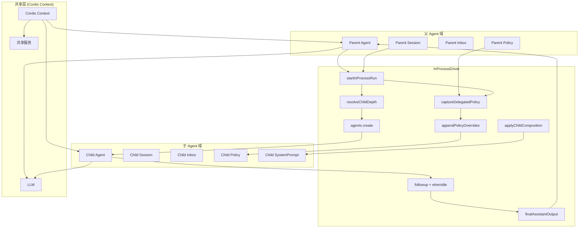

## 2. startInProcessRun 五阶段流程

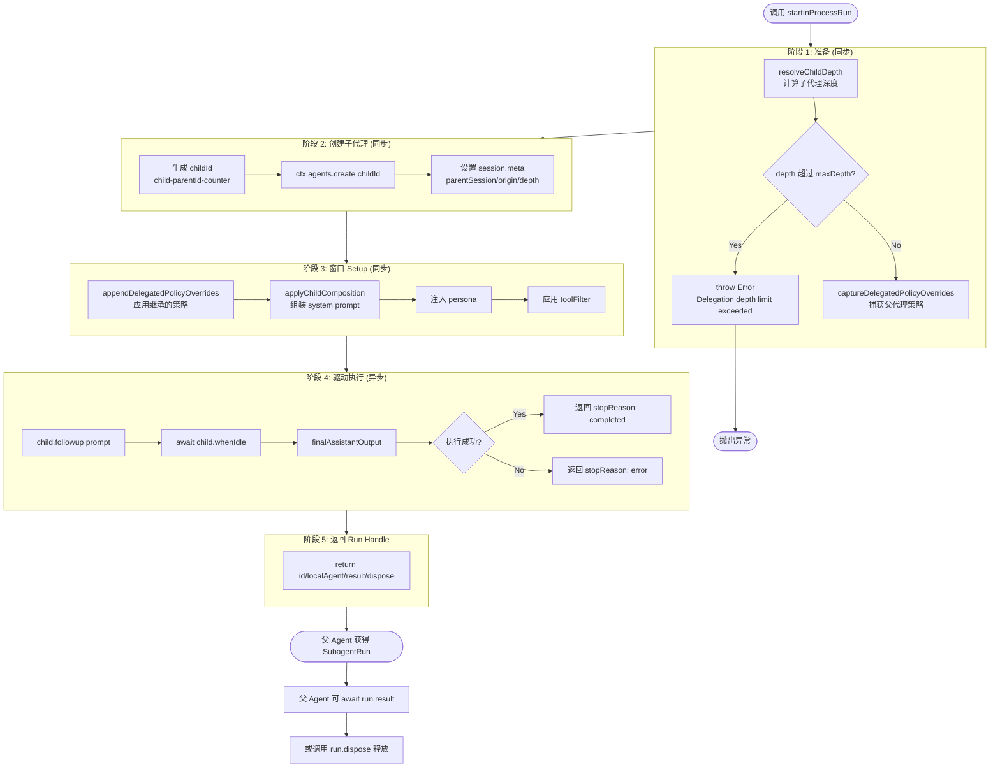

## 3. 父子通信时序图

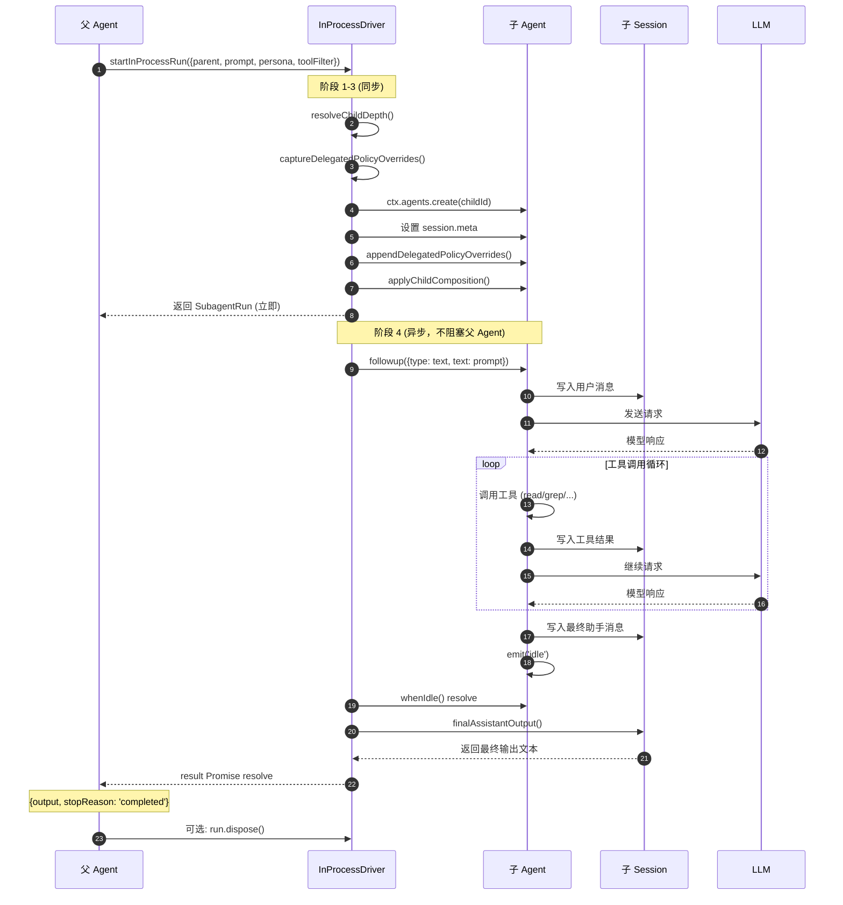

## 4. 策略委托流程

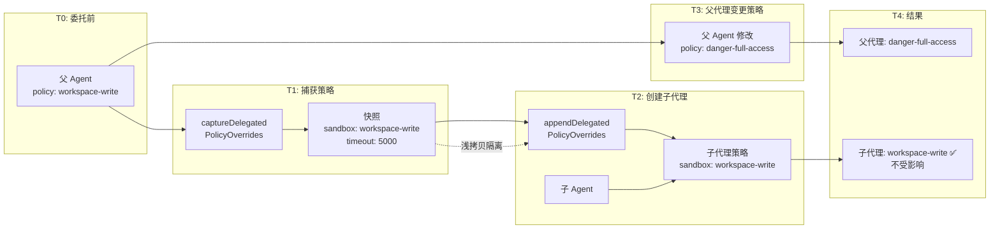

## 5. 深度控制流程

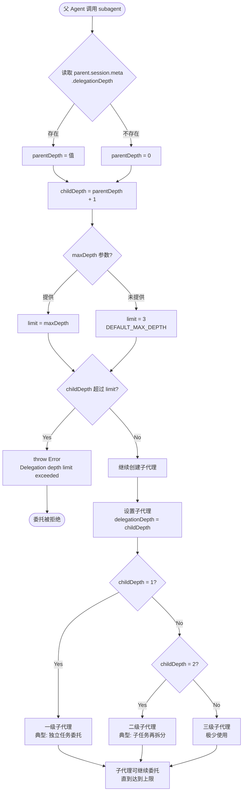

## 6. 并发子代理执行流程

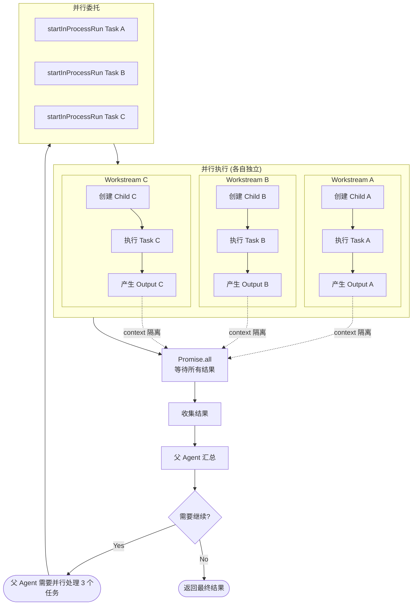

## 7. 子代理 System Prompt 组装流程

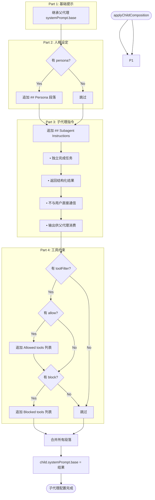

## 8. SubagentRun 生命周期

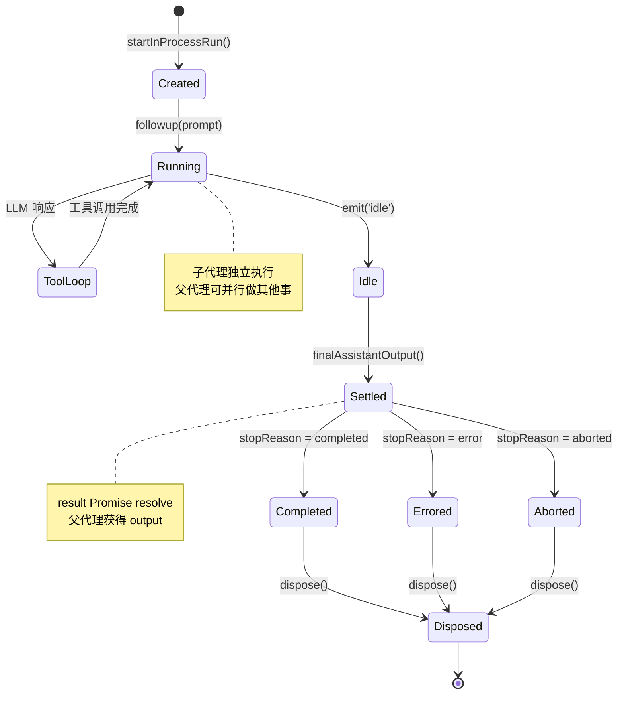

## 9. 错误处理流程

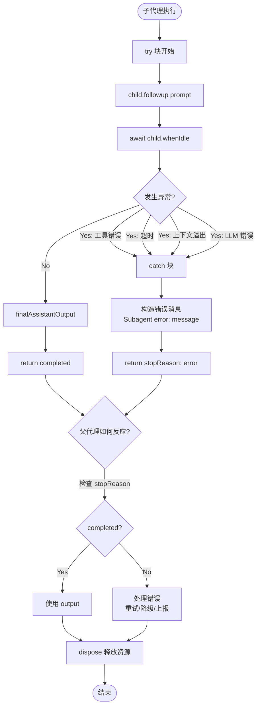

## 10. 与 GoalRoundDriver 协作全景图

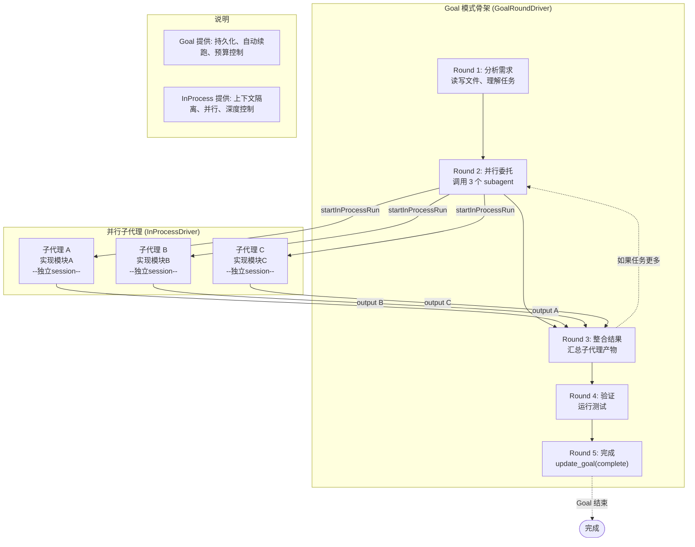

## 11. 决策流程：何时用哪个 Driver

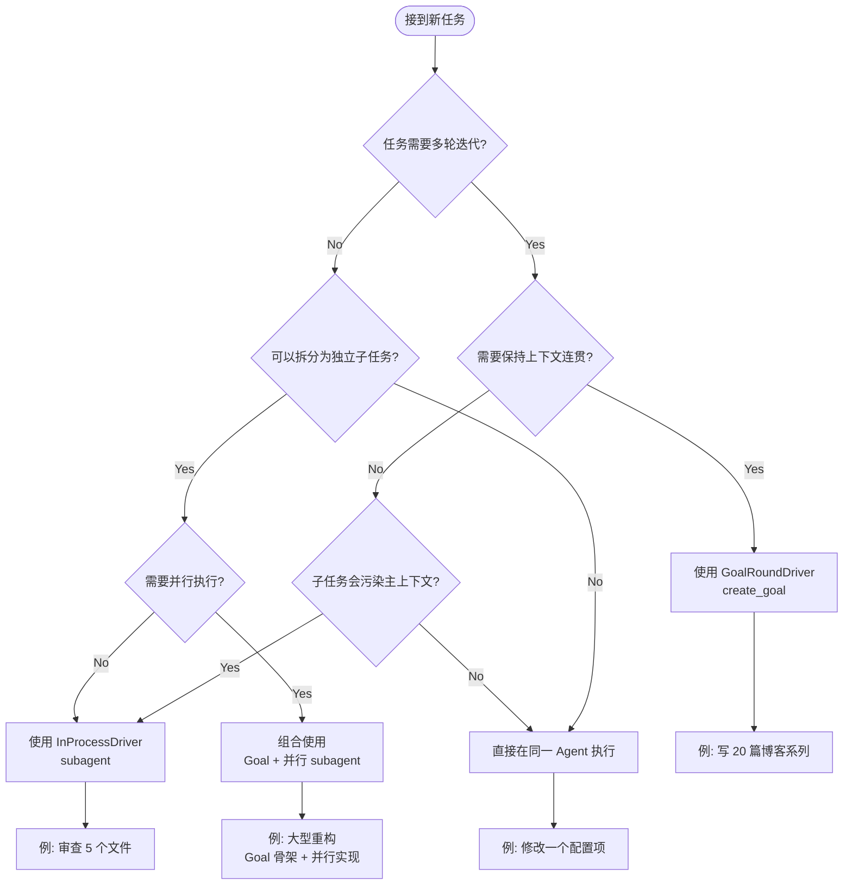

---

## 渲染说明

以上流程图使用 **Mermaid** 语法：

| 图表类型 | 用途 | 语法关键字 |
|---------|------|-----------|
| `flowchart` | 流程图、架构图 | `flowchart TB/TD/LR` |
| `sequenceDiagram` | 时序图、交互流程 | `sequenceDiagram` |
| `stateDiagram-v2` | 状态机 | `stateDiagram-v2` |
| `journey` | 用户旅程 | `journey` |
| `subgraph` | 分组 | `subgraph Name ... end` |

### 渲染平台

- **GitHub / GitLab**: 原生支持
- **VS Code**: 安装 Mermaid 插件
- **在线预览**: https://mermaid.live/
- **Typora**: 原生支持
