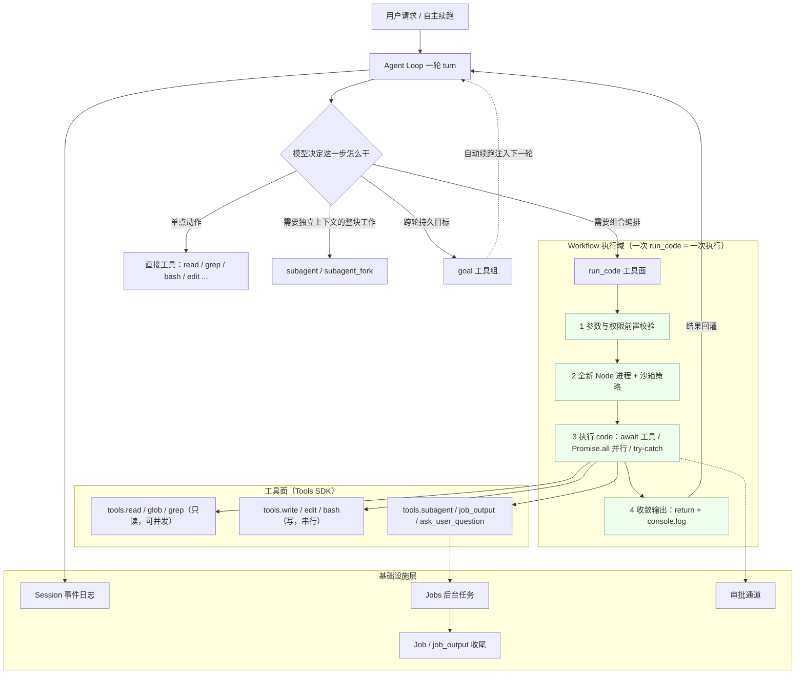
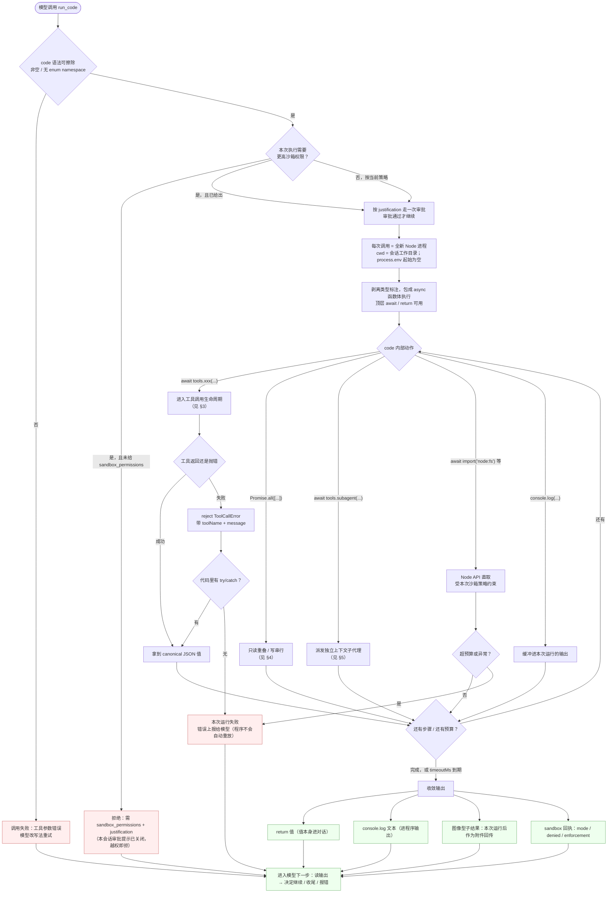
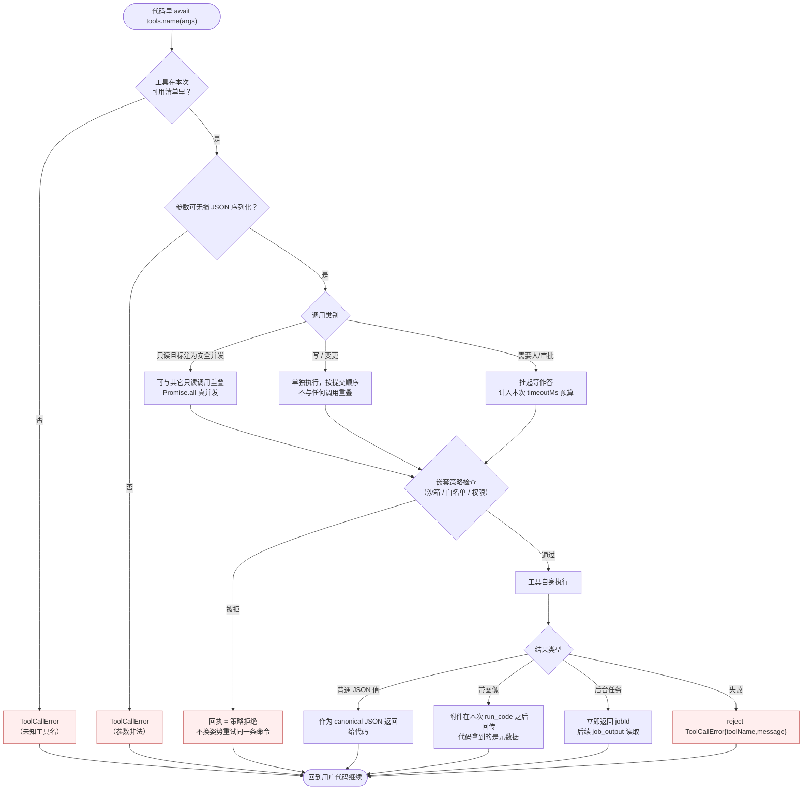
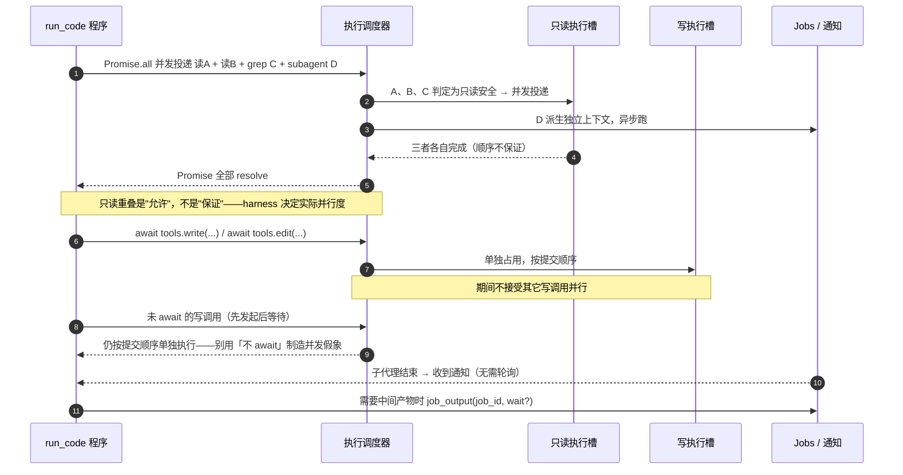
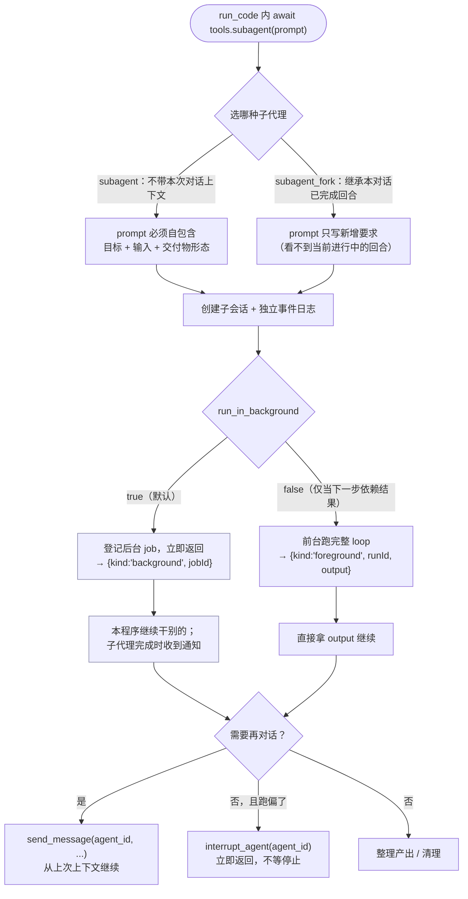
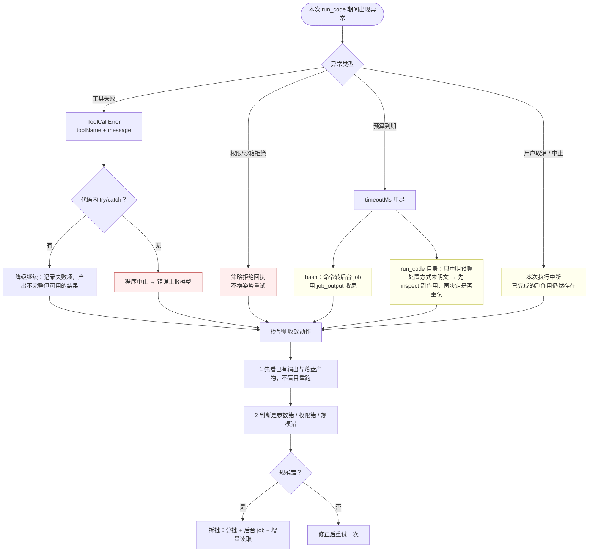
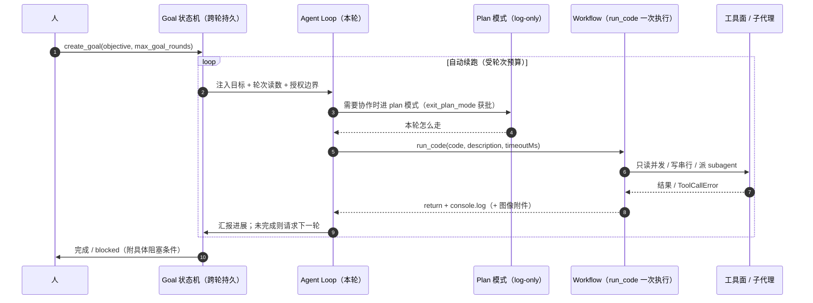
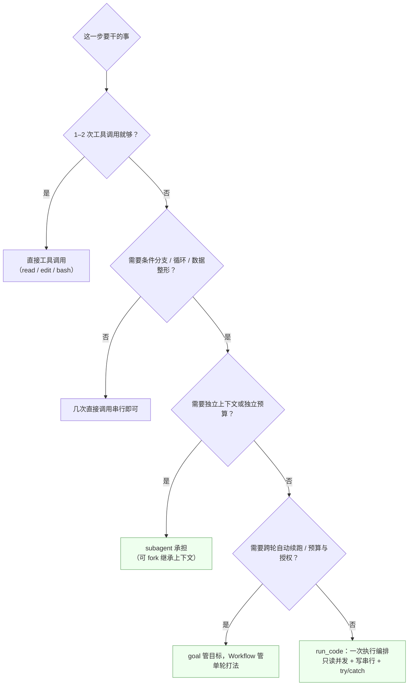

# DSH Workflow 模块流程图（run_code 执行编排）

> 口径：**Workflow 不是一个独立包**，它是「模型在某一轮里手写 TS 程序、编排工具与子代理」的执行模式；唯一的实现入口是 `run_code` 工具。
> 本文 8 张图覆盖：总览 → `run_code` 单次执行 → `tools.*` 单次调用 → 并行调度 → subagent 派发 → 错误/超时收敛 → 与 Goal/Plan 的时序 → 选型决策。
> 图用 Mermaid 书写，GitHub / VS Code(Markdown Preview Mermaid) / Typora 可直接渲染；本机未装 `mmdc`，未导出 PNG。

---

## 0. 口径说明（哪些是运行时事实、哪些是概念表述）

| 结论 | 来源 | 可信度 |
|------|------|--------|
| `run_code({ code, description, timeoutMs?, sandbox_permissions?, justification? })`，默认 `timeoutMs=120000`、上限 `600000` | 本会话 SDK 声明 | 权威（运行时契约） |
| `timeoutMs` 覆盖「嵌套工具调用 + 审批等待」的总耗时 | 同上 | 权威 |
| `code` 是可擦除语法的 async 函数体，类型标注被剥离（type-stripped） | 同上 | 权威 |
| 每次调用跑在**全新 Node 进程**；`process.env` 起始为空；相对路径基于工作目录 | 同上 | 权威 |
| 独立**只读**调用可在 `Promise.all` 下重叠；**写**调用单独执行、按提交顺序 | 同上 | 权威 |
| 工具失败以 `ToolCallError`（带 `toolName` / `message`）reject，可 try/catch 续跑 | 同上 | 权威 |
| 只有 `return` 与 `console.log` 进入对话；图像型结果在本次运行后作为附件回传 | 同上 | 权威 |
| 嵌套工具调用各自保留自己的策略与审批；**程序不会被自动重放** | 同上 | 权威 |
| 「Workflow = 单轮生命周期 / 无持久状态 / 与 Goal、Plan 配合」 | `dsh-workflow-deep-dive.md` §1.1–1.2 | 概念表述 |
| 文中 TypeScript 伪码（`TypeScriptRuntime` / `ToolExecutor` 等） | `dsh-workflow-implementation-guide.md` | **示意实现**，非源码逐字 |
| 超时后如何处理 | `bash` 明确「转后台 job」；`run_code` 仅声明预算，**处置方式未明文** | 见 §5 图注 |

---

## 0.5 Workflow 到底实现了什么

一句话：**它把「这一步怎么干」从模型的多轮 tool-call 往返，压缩成模型自己写一段程序、在单次执行里编排完。**

| 层 | 实现的东西 | 运行时证据 |
|---|---|---|
| 执行载体 | `run_code` 工具 = 把 `code`（可擦除语法的 async 函数体）在**全新 Node 进程**里跑起来，顶层 `await`/`return` 可用 | 每次调用新进程；相对路径基于工作目录；`process.env` 起始为空 |
| 工具面 | Tools SDK：可用工具投影成 `tools.<name>(args)`，返回 canonical JSON；失败边给 `ToolCallError{toolName,message}`，可 `try/catch` 续跑 | 同上 |
| 调度 | 只读调用可并发重叠；写调用单独执行、按提交顺序；长任务可后台 job 化 | `Promise.all` 下只读重叠；`job_output` 收尾 |
| 上下文派生 | 需要独立上下文时用 `subagent` / `subagent_fork` 派出去；workflow 本体**不新建 agent** | `subagent` 默认后台，返回 `subagentId` 可续聊 |
| 隔离与授权 | 沙箱模式按**本次执行**生效（`sandbox_permissions` + `justification`）；审批与嵌套等待都计入 `timeoutMs`（默认 120s / 上限 600s） | 授权不粘到后续调用；预算含等待 |
| 输出 | `return` 值 + `console.log` 进对话；图像型结果事后作为附件回传；附 sandbox 回执 | 只有 print/return 被看见 |
| **不实现** | 无持久状态、不跨轮续跑（那是 goal 的）、不做协作模式编排（那是 plan 的）、**不是独立包或模块** | deep-dive §1.2 对比表 |

对应主图见 §2；两个最容易踩的边界是「超时预算含审批等待」与「程序永不自动重放」。

---

## 1. 总览：Workflow 在架构中的位置

**三条边界的读法**

- Workflow 与 Goal：Goal 管「任务往哪走」（跨轮、持久、带预算）；Workflow 管「这一步怎么干」（单次执行、无状态）。Workflow 跑在 Goal 的某一轮续跑里。
- Workflow 与 Plan：Plan 管「当前轮怎么走」（log-only 提示词引导）；Workflow 是 Plan 落地时的执行手段。
- Workflow 与 subagent：`run_code` **不产生新上下文**，它在本进程里编排；要独立上下文必须显式 `tools.subagent(...)`。

---

## 2. `run_code` 单次执行全流程（主图）

**关键时序点**

1. **前置校验先于执行**：语法、权限、审批都在分配进程之前，避免「跑了一半才发现越权」。
2. **一次审批 = 一次执行**：`sandbox_permissions` 的授权只覆盖本程序这一次运行，不粘到后续调用。
3. **超时预算含等待**：`timeoutMs` 计的是墙上时间，把审批弹框、嵌套工具、子代理前台等待全算进去——长任务应显式调大或改走后台（`run_in_background` / jobs）。
4. **失败不重放**：早段副作用可能已经落盘；重试前先 inspect。

---

## 3. 单次 `tools.*` 调用的生命周期

**嵌套调用保留自己的策略**：`run_code` 不是「一次性提权通道」——里面每个工具仍各自过自己的沙箱与审批面；被拒就是被拒，不要换写法绕。

---

## 4. 并行调度：只读重叠、写串行

**写法要点**

| 想做的事 | 正确写法 | 常见错误 |
|---------|---------|---------|
| 批量读文件 | `await Promise.all(paths.map(p => tools.read({file_path:p})))` | 串行 for 循环逐个 await（慢 N 倍） |
| 批量派子代理 | `run_in_background: true` 默认，拿到 id 后继续干别的 | 前台等待（占满本次 `timeoutMs`） |
| 写文件 | 顺序 await，逐条校验 | 并发 `Promise.all` 写同一片区域（顺序不定） |
| 长任务 | 后台 job + `job_output` 收尾 | 死等前台，撞 600000ms 上限 |

---

## 5. 派发子代理：`subagent` 与 `subagent_fork`

**与 Workflow 的分工（一句话）**：能用纯编排解决的别开子代理（省一次上下文装载）；需要「独立上下文 + 独立预算 + 可继续对话」的整块工作才派 `subagent`。

---

## 6. 错误、超时与收敛

**硬规则**：程序**不会被自动重放**。任何重试都是模型显式的新调用，且必须建立在「已确认上次副作用范围」之上。

---

## 7. 与 Goal / Plan 的协作时序

---

## 8. 选型决策：什么时候才该用 Workflow

---

## 9. 一页速查

| 维度 | Workflow（run_code） |
|------|---------------------|
| 生命周期 | 单次执行，无持久状态 |
| 状态存放 | Session 事件日志 / 台账文件（不在 workflow 内） |
| 上下文 | 与当前会话同一进程，不新建 agent |
| 并发规则 | 只读可重叠；写单独、按提交顺序 |
| 错误通道 | `ToolCallError{toolName,message}`，可 catch |
| 预算 | `timeoutMs` 默认 120000、上限 600000，含审批与嵌套等待 |
| 隔离 | 每次调用全新 Node 进程；`process.env` 起始为空 |
| 提权 | `sandbox_permissions` + `justification`，仅本次执行有效 |
| 重放 | 永不自动重放；重试前先 inspect |
| 输出通道 | `return` + `console.log`；图像结果事后作为附件回传 |

**关联文档**：`docs/dsh-workflow-deep-dive.md`（概念与模式）、`docs/dsh-workflow-implementation-guide.md`（示意实现与案例）、`03-执行流程/01-turn-flow.md`（一轮 turn 的完整流程）。
